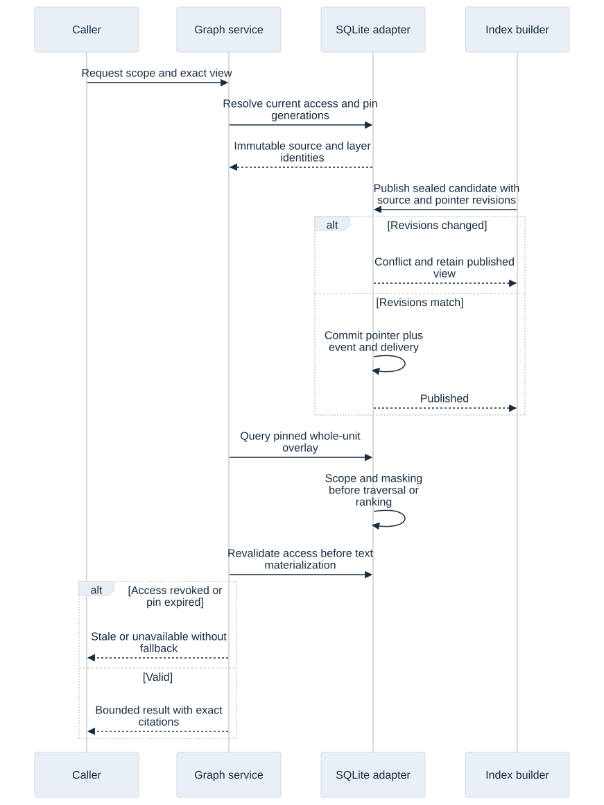
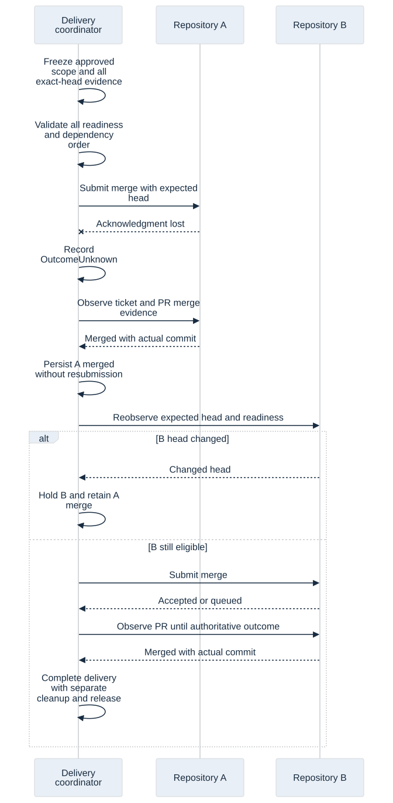

# Graph, retrieval, artifact and delivery contracts

Current baseline 1.1 adds [incoming MCP server contracts](mcp-server-contracts.html) and four typed internal administration operations. The current register has 352 operations in 48 families; historical counts below describe their original checkpoints. New MCP transport/authentication/client behavior remains DW-063/064 implementation acceptance.

Current coverage update, 2 November 2026: the [domain schema pass](domain-operation-contracts.html) now provides all 347 input/result candidates in 44 schemas, with zero unbound inputs. Counts and next-step statements below describe this reader's earlier checkpoint. Actual service/authority/SDK/provider/platform acceptance remains unqualified.

Adopted architecture candidate `1.0-draft.1`, 1 November 2026 · AD 57–61. Confidence: high in these contracts; medium in implementation readiness. Native experiments cover one macOS arm64 host. They do not qualify the production services, GitHub integration, security guarantees or other platforms.

This pass gives graph reads, retrieval, immutable artifacts and delivery concrete message shapes and failure rules. It extends the [shared operation contracts](shared-operation-contracts.html) and [provider/session/package contracts](provider-session-package-contracts.html). Host-created authority, immutable receipts, current root controls and effect-aware recovery remain mandatory. A valid request body grants no access.

## Boundaries and ownership

| Boundary | Candidate messages | Owner and consistency rule |
| --- | --- | --- |
| Graph service | `GraphReadRequest`, `ResolvedViewSet`, `GraphPage` | Host resolves permitted sources and exact immutable generations; query adapters cannot choose a more convenient snapshot. |
| Retrieval service | `RetrievalRequest`, `RetrievalPage`, typed citations | Filter authorized, visible, compatible sources before ranking; revalidate visibility before publishing passages. |
| Index coordinator | `IndexCommandRequest`, internal `PublicationRequest` | Builders stage immutable data; only the coordinator publishes after source revision, manifest and pointer checks. |
| Artifact service | `ArtifactCommandRequest`, reply, query and deletion requests | Owns versions, references, logical availability and managed files. Source handles are host-resolved, never caller-supplied filesystem authority. |
| Delivery coordinator | Internal `DeliveryBarrier`, `DeliverySnapshot`; public `GitCommandRequest` | Owns fixed commit/evidence identities, dependency order, remote observations and partial delivery. |
| Release service | `ReleaseCommandRequest` | Prepare, publish and deploy remain separate operations under their existing approval policies. |

The data/delivery checkpoint records 39 generated schemas and 58 of 345 catalog operation inputs across 47 families, with 287 pending. The later SystemOne correction adds two pending router operations: that checkpoint recorded 347 operations, 58 inputs and 289 pending. The current [family register](contracts/family-coverage.json) binds all 347 inputs/results. These are input candidates, not complete result/error schemas or implemented capabilities. Internal views, publications and delivery barriers do not inflate that public count. Operation selection must agree with its discriminator before dispatch, including query kinds and release actions.

## Exact graph views and checked publication

**AD 57.** Resolve a requested published, exact or pinned view into a `ResolvedViewSet`. Each repository member names repository identity, Git object format and base/head IDs, source revision, baseline generation and optional branch/captured-worktree layers. Layer manifest digests and parent generation IDs bind the chain. A captured worktree also names its immutable capture digest and worktree identity. A changed head cannot silently use only the baseline. Cross-repository queries retain every participating repository's identity rather than presenting one fictitious global commit.

Database graph members name connection, schema snapshot, generation, digest and access revision. They describe metadata/topology; this interface does not authorize sampling database records. Schema-only views are valid. A repository or connection appears once per resolved set. Partial/unavailable extraction coverage lists bounded gap reasons and an overflow marker; it cannot be labeled complete.

Overlay semantics replace the highest visible **whole source unit**, including deletion tombstones. Lower-layer nodes, chunks and edges produced by that replaced unit are masked. Returned edges also require visible endpoints. Traversal and ranking use this effective view, not a mixture selected independently by each query. Stable unit/node identities distinguish continuity from unchanged content; exact captures and content digests establish the latter.

Publication seals the manifest and staged files before a short write transaction compares the current source revision and publication pointer revision, then commits the pointer, receipt/history and outbox together. A stale builder loses the comparison and cannot publish. A failed stage leaves the old published view usable. Builders do not hold a database transaction across parsing, embedding or filesystem I/O.

A pin is bounded, renewed under current eligibility and access, and identifies an immutable view. Publication can advance while an older valid pin remains coherent. Expiry, deletion, restore epoch or lost access produces a typed unavailable/stale response; do not substitute current main or another source. Cursors additionally bind query/filter/order, view identity, visibility revision and expiry. Garbage collection checks published pointers, active pins, in-progress readers/builds, backup holds and all other live references before reclaiming generations or source captures. The narrow probe's view-reclaimability check does not prove that complete collector.

Graph query variants cover search/overview/schema, node/source, traversal/path, node/file impact, file membership, repository dependencies, consumers/publishers, data lineage and scope status. Results identify completion, coverage and work bounds. Returned graph node/source citations must belong to the resolved source snapshot set; graph edges cannot refer to absent nodes. Node-ID resolution, edge-kind semantics and source inventory parity remain service acceptance work.

## Scoped retrieval and version-bound citations

**AD 58.** Workspace/project selectors request scope; the host derives actual visibility from current membership, role and policy. Apply visibility, source/version selection, overlay masking and embedding compatibility before top-k selection and before traversing cross-source edges. Do not rank everything and filter the returned snippets afterward. Unauthorized content must not consume the result budget, enter a model request or leak through diagnostics/counts. Revalidate before materializing/publishing text; revoke stale candidates when scope changes. Already delivered content cannot be recalled by a later revocation.

Embedding identity includes model digest, dimensions and metric. Vector input references exact float32 little-endian bytes of the declared size; adapters also reject nonfinite values and enforce metric-specific normalization. Never reinterpret a vector in another space. Lexical fallback requires the request's explicit permission and reports its actual effective mode. Native exact ranking is the correctness baseline; accelerated indexes must preserve eligible-view semantics and demonstrate their recall/performance separately. Scores are ranking evidence, not invented confidence probabilities.

Every passage carries chunk/block identity, content digest and a discriminated citation source. Managed content names an exact artifact version and extraction revision; code names repository/base/head/capture plus unit and source digest; Knowledge names entry/revision; conventions name their immutable version; database schema names connection/snapshot/digest. Text uses line ranges, PDF uses a source page, `.docx` uses part/paragraph and optional table-cell identity, and code repeats its exact source snapshot/unit with line range. A DOCX extractor cannot invent stable page numbers from flow layout.

Normal document retrieval selects active indexed versions. Explicit historical-version queries may read retained, authorized versions. Replacement never retargets old citations. Expired/reclaimed code captures are reported unavailable; the all-versions retention policy for imported managed documents does not silently turn every derived code capture into a permanent retained document.

## Artifact mutation and deletion

**AD 59.** Save/import and replacement first resolve an upload ticket, attachment handle or authorized work-output file handle. Verify bytes/digest and publish a new immutable version only after the managed-file journal is recoverable. Host-generated paths and ordinary file-read authority apply to the original source; a raw path, actor label or digest supplied by a caller is not sufficient. Content deduplication does not grant access or reveal an unauthorized artifact's existence.

Use expected artifact/reference revisions for changes. Reference/share/move operations check both source and destination scope, advance visibility revision and invalidate affected cursors/cached candidates. Removing an index only removes derived retrieval data; disabling retrieval preserves the source. Export returns an authorized byte stream. Writing that stream to a filesystem destination requires the normal host file-write operation and destination authority.

All imported versions remain until explicitly deleted. Deleting the current version clears its active retrieval selection; it does **not** reactivate an older version. Whole-artifact deletion binds the exact version-set digest so an unseen concurrent replacement cannot be silently swept into an earlier decision. Detaching a project's reference preserves other projects' live references and their files. Historical citations retain tombstone provenance but do not prohibit an explicitly authorized deletion forever.

Detach and global version/artifact deletion are different intents. Global deletion requires authority for its full affected reference set. If live references outside that authorized deletion scope remain, return `SharedReferencesRemain` with only permitted metadata and leave the global artifact unchanged; do not silently reinterpret it as a detach. A separately requested detach changes only its named project reference. Content-addressed bytes can also remain because a different surviving version/artifact needs them, without making the deleted version readable again.

Commit logical unavailability and its event before deferred physical unlink. New reads fail as soon as that transaction commits; already admitted readers and manual backup holds can delay physical removal. A command reply distinguishes logical deletion with physical cleanup pending from preserved shared references and revision conflict. Crash recovery completes journaled work rather than resurrecting a deleted version. This creates no automatic backup or age-based retention deletion.

## Delivery barriers and uncertain remote outcomes

**AD 60.** Freeze a delivery barrier from the approved root scope, exact repository PR heads, observed main bases, review/check evidence, policy revisions, merge methods and acyclic repository dependency order. Validate every required repository before the first irreversible submission. Revalidate current heads, readiness, authority and root controls before each subsequent submission. Evidence for a different head is stale. Scope or head changes invalidate affected remaining work; they do not erase merges or already admitted remote requests.

`observedBase` records an observation, not an atomic base compare-and-swap promise. GitHub's expected `sha` protects the PR **head**. Honor server rules and required merge queues; do not silently change repository settings or bypass rules to manufacture the desired ordering. There is no cross-repository atomic merge transaction. Dependencies must therefore describe safe intermediate states; an unsafe dependency cycle blocks delivery for redesign.

Prefer GitHub's async merge endpoint when qualified, using the saved head, chosen merge method, normal `default` action and no rule bypass. An accepted request, an existing pending request and an enqueued PR are distinct durable observations. Acceptance does not mean repository rules passed or that the merge completed. The async result's queued state is final for that job: follow the PR for eventual completion. Job records expire 24 hours after their last update; an expired/missing job record is not evidence that replay is safe. Persist ticket, PR/head, method and evidence before further decisions. These are API facts from [GitHub's pull-request REST documentation](https://docs.github.com/en/rest/pulls/pulls); actual authentication, queue behavior and compatibility remain qualification work.

Transport loss after submission becomes `OutcomeUnknown`. Observe the ticket and authoritative PR/head/merge metadata before deciding whether a retry is safe. A merged outcome records the actual merge commit. Squash/rebase reconciliation needs provider metadata for the saved PR/head/method; simple ancestry cannot prove those merges. Ordinary merge ancestry is useful only for the appropriate method, as specified by [Git's merge-base documentation](https://git-scm.com/docs/git-merge-base).

If repository A merged and B changed or failed, retain A's actual merge and hold/replan B. Never automatically revert A, fabricate all-or-nothing rollback or mark the feature complete. An already admitted queue item may finish after a local pause; record that external fact while fencing new submissions. Pause/Continue rules still apply to new execution. Feature/issue delivery completes only after every required barrier member has authoritative merged evidence for the expected head. Release, deployment and cleanup have separate pending/outcome fields and do not redefine that completion.

## Safe cleanup and release authority

**AD 61.** Commit/push/PR/integrate/cleanup requests name registered repository/worktree/remote identities and expected revisions rather than arbitrary shell commands or filesystem paths. Force-with-lease requires an expected remote head and is forbidden for main. Normal push also obeys protected-target policy. Integration names the saved barrier revision and expected PR head; the caller cannot mark its own checks approved.

Cleanup requires known ownership, no active writer or unresolved resource effect, a clean worktree and appropriate integration evidence. Remove only the registered owned worktree. Delete a branch with an expected-object comparison so a new commit arriving after the worktree removal survives. A partially completed cleanup records which step occurred. External/unowned or dirty trees remain intact with an actionable reason. Actual filesystem target races and process fencing still require native enforcement qualification.

Release preparation, publication and deployment bind exact repository revision, version, destination, artifact digest and expected policy revision. These request fields do not mint the existing explicit approvals or alter Ask-me defaults. A complete feature does not silently publish or deploy it.

## Evidence, acceptance and remaining work

[Evidence and reproduction](validation/data-delivery-contracts/README.md) separate schema/native DTO checks, a real SQLite adapter behind a small driver-free trait boundary, real temporary Git effects with scripted PR metadata, and unexecuted production acceptance. No inference, GitHub writes or user repository mutations were used.

The native store experiment demonstrates transaction-scoped repository lifetimes, drop rollback, atomic domain/receipt/history/outbox changes, receipt replay before stale-revision rejection, whole-unit masking, endpoint filtering, source binding, scoped FTS/vector selection, checked publication, coherent old pins and revocation before snippet materialization. Its compile-fail doctest prevents a repository borrow escaping its transaction. SQL and driver handles remain adapter-local. This is a small feasibility subset of AD 15, not a frozen complete repository API or asynchronous writer implementation.

The Git experiment demonstrates readiness/dependency barriers, changed-head blocking, real regular merges with lost acknowledgment, observation without repeat effects, partial delivery and owned-worktree/expected-ref cleanup. GitHub check/review/queue state is scripted. The experiment does not prove real GitHub eventual consistency, squash/rebase reconciliation, transport cancellation, auth or path-race safety.

Production acceptance must exercise full rename/delete/uncommitted/cross-repository overlays; incompatible embeddings and fallback; all citation/source kinds; document replacement/share/delete races and recovery; generation GC; every merge method/queue/review policy; stale-head/base and approval changes; partial multi-repository delivery; safe cleanup; and release/deployment approval recovery. Remaining gates include full repository/claim/migration/restore conformance, native PDF/UI/browser and confined execution feasibility, provider/auth transports, complete SDK behavior and target qualification. The later domain pass closes wire coverage; these earlier experiments do not prove production behavior. The [handoff checklist](architecture-handoff.md) keeps the distinction explicit in the complete local implementation breakdown.
