# DevWorks architectural design

2 November 2026 · Architecture baseline 1.1 · Adopted design; implementation acceptance pending

DevWorks will be one native Rust desktop application with an egui interface, an in-process agent harness and router, local embedded storage, and managed executable extensions. Plain SQLite and sqlite-vec are selected; graph storage uses application-owned tables, lexical search uses FTS, and domain-focused Rust traits isolate all persistence. The application opens into workspace coordinator chat. Projects, repositories, work, code intelligence and administration are alternate views over the same durable operations and history. The Home coordinator remains accessible beside every screen through the shared-session sidebar.

The adopted structure is a modular application with six Cargo packages, explicit application operations, a single execution-policy boundary, and durable journals for every externally effective operation. Component separation supports testing and replacement of infrastructure; it does not introduce separately administered services. On 1 November 2026 the user delegated routine architectural choices, prioritizing uninterrupted automation and a clean, extensible architecture. Sections explicitly marked **Adopted technical design** record those choices and their rationale; other new choices remain proposals. Technical adoption does not promote Proposed requirements to Confirmed, change existing authority, or demonstrate implementation. Confirmed requirements remain authoritative.

This plan covers the captured 353 requirements, including the latest global coordinator sidebar. Every requirement has a design owner, architecture section and validation assignment in the [traceability register](devworks-requirements-traceability.json). A mapping is design coverage, not proof of implementation or acceptance. The native application and production services have not been implemented. Disposable contract/dependency probes below exercise a limited subset of the proposed interfaces. The existing [UI study](../planning/harness-workbench.html) remains a browser-based design reference.

## Architecture baseline

The fixed product constraints are Rust, native egui, no mandatory application server or VM, no mandatory preinstalled .NET/Node/Python, local embedded storage, first-class internal tools, and one router for **all** inference. Plain SQLite plus sqlite-vec is the confirmed store choice. HelixDB and GraphQLite are not app dependencies. Optional language packs, external MCP servers, project toolchains and container engines declare their dependencies separately. Neither the old .NET applications nor an external Codex/Claude coding CLI forms the new runtime.

The adopted qualification matrix comprises six OS/CPU build targets, with named OS versions and separate Linux X11/Wayland capabilities in [Supported platforms and execution adapters](#supported-platforms-and-execution-adapters). macOS 26.2 and Windows 10 remain minimum product targets; specific distribution, packaging and capability support requires actual evidence. A backend cannot make an optional runtime an accidental startup dependency.

Architecture success means that a user can plan and edit work without inference, run approved work concurrently, inspect and redirect it, follow its complete history, and recover after interruption without duplicating effects. Read-only reviewer policy, task-scoped escalation, all-repository delivery gates and explicit approvals must survive every entry path, including packages, schedules and MCP. The design must be testable without a model. Real-inference end-to-end testing remains a separate later suite.

## Component and dependency structure


The composition root constructs concrete adapters, application services, the asynchronous engine and UI subscriptions. The egui event loop renders immutable or revisioned view models and submits commands. It does not execute SQL, perform provider requests, traverse large graphs or wait for compilers on its rendering thread. View updates are incremental and bounded; loss of an ephemeral update is repaired by querying durable state.

| Proposed package | Responsibility | Permitted internal dependencies |
| --- | --- | --- |
| `devworks` | Native binary, egui shell, navigation, reusable conversation/board/source/settings components, OS startup composition | core, engine, adapters, extension protocol |
| `devworks-core` | Domain records and pure policies; validated command/query use cases; operation, persistence and external-system port contracts | none; public protocol conversion stays at the boundary |
| `devworks-engine` | Agent activation loop, routing orchestration, context assembly, scheduling, supervision and package host | core, extension protocol |
| `devworks-adapters` | SQLite/sqlite-vec persistence implementation, artifacts, provider transports/authentication, Git/GitHub, native OS and optional tool adapters | core, extension protocol |
| `devworks-extension-protocol` | Small versioned public wire DTOs, capability declarations and compatibility rules | no private host packages, egui, database or provider SDK |
| `devworks-extension-sdk` | Rust package-side client, typed host requests, cancellation/progress and contribution builders | extension protocol; runtime/client dependencies isolated here |

Keep work management, policies, history, knowledge, reviews, sources and diagnostics as modules inside these packages initially. Do not create a crate for every service, repository interface, entity or screen. Split later only when an independent dependency, release contract or measured build/ownership boundary warrants it. The extension protocol is separated now because independently installed executables need a stable public contract.

Dependency arrows point inward. Core domain policy has no egui, database-driver or HTTP dependency. Pure transition functions are separate from use cases that call ports. Dynamic provider/package ports use object-safe asynchronous boundaries; ordinary domain logic need not pay for a plugin abstraction. Avoid a generic plugin framework around every internal function or a trait for every struct.

The engine owns a bounded async runtime. Use separately admitted blocking work for parsers, native libraries and filesystem-heavy operations. Do not assume cancelling a future stops a started blocking computation: Tokio documents that started blocking tasks cannot be aborted through their join handle. Killable or potentially unbounded helpers need a process boundary and process-tree ownership. Use an app-managed worker mode of the same shipped Rust binary for parsing/extraction that cannot cooperatively cancel within a bounded interval; workers return staged results and never own authoritative database writes. This permits immediate archival interruption without waiting for a safe point inside an unabortable library call. Admission controls for parsing, provider capacity and physical resources are independent of the **absence of a global subagent cap**. [Tokio blocking-task documentation](https://docs.rs/tokio/latest/tokio/task/fn.spawn_blocking.html)

### Runtime responsibilities and handoff

Continue architecture planning by assigning execution ownership before choosing detailed APIs. The proposed runtime keeps the native UI and core harness in one application process. Managed language packs, plugins, project commands and browser/desktop helpers run as owned child processes where their contracts require it. An agent session is a supervised logical task; it does not require a VM, separate user or one OS process per agent.

| Runtime owner | Owns | Handoff and lifetime |
| --- | --- | --- |
| egui main thread | input, pane state and rendering of bounded view models | submits commands/queries; consumes bounded updates, never waits for SQL or a provider stream |
| application services | command validation, effective policy, revision checks and work transitions | calls core ports and records durable intent before dispatching effects |
| `AgentSupervisor` | coordinator/worker lifetimes, cancellation generations and active assignments | reconstructs from persisted execution state; enforces independent per-feature/issue limits |
| router and transport tasks | model pins, eligibility, cooldowns and provider streams | emits attributed deltas/usage; tool dispatch returns through the common policy boundary |
| storage owner and read workers | short commits, read snapshots and schema lifecycle | implements persistence ports; never calls agents, UI or inference from inside a transaction |
| indexing/analysis workers | source capture, parsing, bounded graph analysis and generation preparation | publishes through `IndexStore`; yields batches and reports actual freshness/progress |
| process/package host | child identity, protocol requests, output, resource leases and cancellation | monitors actual process outcomes and records uncertain effects before recovery |

For Start feature, the UI and chat tool invoke the same application command. One transaction checks the approved plan/current ownership and records the execution, assignment, history and launch intent. After commit, the supervisor claims that intent and starts the coordinator; no provider request occurs before the durable activation exists. Streaming text is sent to the UI promptly and persisted in ordered bounded chunks, with append sequence and last-durable position visible to recovery. A UI event is a wake-up signal, not the only durable record. If a view misses events or a buffer overflows, it re-queries from the last durable cursor rather than losing history or blocking an agent indefinitely.

Redirect and pause enter that same application boundary, advance the relevant control revision and invalidate incompatible pending dispatch. The supervisor delivers the instruction/control at the required safe step, preserving the immediate-stop exception for confirmed project archival. Completion and late tool results revalidate assignment, policy and control revisions before becoming current work state. External effects that may already have happened are reconciled, not discarded as if cancellation undid them.

The Start/Continue handoff, parallel tool turns, wakeups, redirect and shutdown/reopen contracts below now have adopted technical defaults. Physical schema, serialized DTO versions, provider-wire compatibility and platform cancellation still require their assigned validation gates. This remains architecture work; no native implementation is started by these decisions.

## Domain objects and identity


Use explicit stable newtypes for project, repository, work, task, agent, conversation, session, execution, operation, artifact, snapshot and package version identities. A repository is independent of a project membership; internal compiler/code projects are a separate `CodeUnit` concept. A feature may touch several repositories, and each repository retains its own commits, branches, worktrees and pull requests.

`WorkItem` contains features and project tasks. Every task belongs to a project; its feature relationship is optional. A standalone task is shown as an issue and is the same durable work record through task and issue entry points, never a copied issue/task pair. Only genuinely standalone work enters the project queue as an independent candidate. Feature-linked tasks remain allocated within their feature. A grouped task PR has a many-to-many link to its tasks. A worktree association records repository, path, branch, owner, creation operation and current/removed state rather than storing an unstructured path in chat.

`AgentId` identifies a logical coordinator or worker. `ConversationId` owns a durable transcript; `SessionId` identifies a concrete work conversation/assignment activation lineage. `ContextEpoch` describes the request-visible context after instruction changes or compaction. `ProviderContinuation` describes endpoint-specific wire state. Provider failover, transport reconnection and compaction must not silently create a different logical agent or lose conversation history.

Every new assignment starts a fresh session with an explicit brief. Continue resumes the existing work and agent lineage. An interrupted scheduled run resumes the same `JobRunId`; a later scheduled occurrence gets a new run. This distinguishes fresh work from recovery without relying on human-readable conversation titles.

**Confirmed 2 November 2026 — AR-01 / WORK-11:** task creation requires a project and accepts an optional feature relationship (`parentId` in the current wire candidate). The host validates any feature/project membership. An absent feature never prevents task inspection, Start, Continue or delegation: standalone tasks use the existing issue execution, usage-only accounting and direct-to-main delivery rules. `Issue` and `Task` wire tags describe the shared project-task surface; they are not independent stores or authorization. Task operations can return either representation with the same stable identity. Assignment parentage is a separate supervisor relationship: `agents.delegate` may bind the root issue and scoped brief with an empty task-reference list. Optional task references must pass project/root scope validation; a feature is never fabricated. Editable membership follows the confirmed issue-delivery transitions below.

Project workflow status, execution state, delivery state, cleanup state, release state and deployment state are separate dimensions. Renaming “In progress” cannot change dispatch semantics. Each custom status has a stable ID and a separately configured semantic meaning. Manual completion is recorded as a human transition and never fabricated as test or review evidence.

Authored records carry a revision. Evidence identifies the exact plan, source snapshot, check or review head it supports. Origin links are immutable provenance; current associations and explicit shares may change. A deleted or retired reference resolves to a tombstone where necessary for retained history, not a different record with the same display name.

### Feature plans and pending revisions

**Confirmed 2 November 2026 — AR-02 / AGENT-13:** a plan belongs to its feature. Keep one active approved plan and, when needed, one pending revision. Editing or submitting the pending revision leaves the original plan open and approved; eligible work continues against that original plan. The feature is not paused or closed just because a revision is pending. Initial planning has only a pending plan and cannot authorize implementation before first approval.

The existing plan fields and approval describe the active plan; `pendingPlan` holds the draft separately. Saving another edit replaces that pending draft and makes any earlier approval request for it stale. Requesting approval and rejecting it leave the active plan, effective requirements/repositories/acceptance and execution controls unchanged. Pending content can be discussed and prepared but cannot authorize implementation. Routine task breakdown within the active plan remains autonomous; scope changes cannot bypass this rule through task sync, generic feature edits, atomic project plans or imports.

An authenticated approval replaces the active plan with the exact reviewed pending revision in one short transaction, updates its effective scope/acceptance and history, clears the pending slot and publishes an adoption event. Recheck the pending content and approval binding before commit. A concurrent edit makes approval stale rather than approving unseen content. Active assignments adopt the approved change at their next safe boundary; affected obsolete work is fenced/reconciled and still-valid work continues. Required pauses, budgets, permissions and uncertain effects remain effective. Approval does not implicitly Continue a paused feature. Explicit user stop/redirect controls still work while a draft is pending.

There is no independent plan work item, version browser, branching or user-managed version sequence. Existing internal revision checks and content digests only prevent stale edits/approvals; ordinary feature history records what changed. The application does not maintain a catalog of editable plan versions. DW-009/012/014/015 acceptance covers draft, rejection, replacement and approval/edit races without inference.

### Issue membership and feature delivery

**Confirmed 2 November 2026 — AR-04:** humans and agents may add/remove a project task or issue from a feature. Membership makes resolution part of delivery; linking itself authorizes this addition without approving another plan. Keep one stable work identity and one authoritative optional feature reference (`WorkRecord.parentId` / `work_items.parent_feature_id`); issue/task tags are views, not independent stores. The shared revision-checked `tasks.set_feature` operation explicitly sets or clears membership; generic links cannot change it. Validate project/feature access and current feature lifecycle before committing.

An active agent sends a durable notification to the feature coordinator and continues in its current branch/workspace. The coordinator tracks delivery and owns integration. With no active agent, it launches unstarted work or resumes existing work when eligible. Reconcile queue membership, current supervisor/admission binding and notifications atomically; preserve original assignment/session/effect history and fence stale future dispatch. Never launch a second agent for an already owned task. Existing pauses, dependencies, permissions, capacity and budget holds survive linking.

Clearing membership installs a durable issue pause and fences further dispatch; use existing interruption/reconciliation for in-flight effects. The pause survives relinking and requires explicit manual resume authority. A direct feature-to-feature transfer changes coordinator/budget without creating a pause; keep all existing holds. Transfers use this same small operation, not a separate transfer-management workflow.

New usage reservations/calls after membership changes use the current feature budget; existing usage and later settlement of already admitted calls retain their original attribution snapshot. Do not retroactively move costs. Keep branches/worktrees and completed evidence; the coordinator serializes integration into feature delivery and reconciles any existing PR target before reuse. Unlinking does not delete code, close PRs or move already merged changes. Feature completion requires acceptance and integration of its currently linked work, including an issue added after plan approval.

## Shared operations and interfaces

UI controls, built-in agent tools, schedules, package host calls and MCP-initiated requests enter the same application operation boundary. No caller supplies its own trusted actor, work ownership, approval identity or policy revision. The host binds these from the invocation context.

An untrusted request carries its contract revision, retry key, typed target/body and expected record revisions. The host supplies actor/session, scope, authority and current execution context; it assigns a `CommandId` to the durable decision and an `OperationId` only where asynchronous/effectful work exists. The use case commits its decision receipt, domain changes, history and durable intent atomically. Slow I/O stays outside that transaction. A query returns bounded scoped results with revision, freshness and provenance, rechecking current scope/policy before publication.

### Concrete shared contract candidates

The [shared operation contracts](shared-operation-contracts.html) define host-only authority, normalized command fingerprints, exact receipt/retry behavior, root controls, bounded queries and event replay. The [schema manifest](contracts/manifest.json) links the JSON Schema documents generated from compiled Rust candidate DTOs, with positive/negative fixtures. `runs.start`, `runs.pause`, `runs.continue` and their supporting reads now have concrete input/output candidates. Schema shape, typed consistency and application authority are separate validation stages; a valid JSON message is never proof of permission.

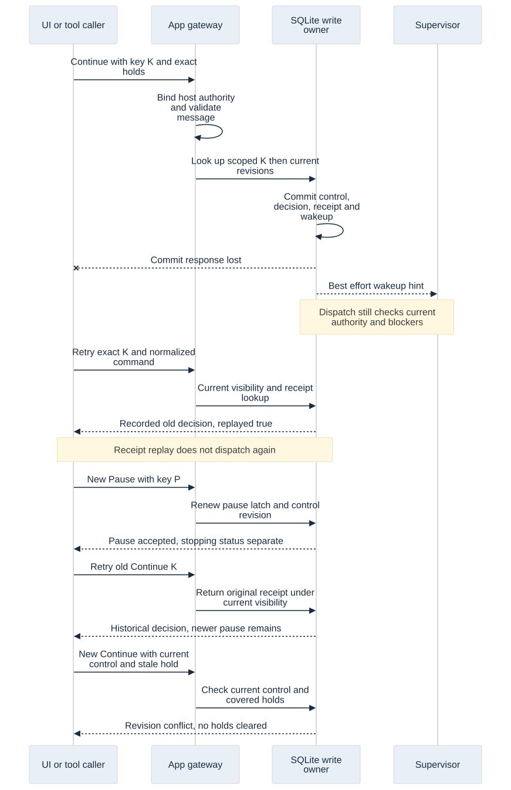

A lost commit acknowledgment returns `CommandStatusUnknown`, resolved with the same retry identity. Replaying a receipt returns the old decision without launching work or clearing a newer pause. Every distinct Pause renews its revision-bound latch; Continue clears only exact authorized covered holds. A control command can be durably accepted while independent blockers keep work stopped. Work and control revision conflicts name their revision dimension explicitly.

The [family register](contracts/family-coverage.json) now binds every catalog operation to concrete input/result candidates and explicit mode/authority/recovery rules. Native DTO/schema checks and SQLite contract-model races are [recorded separately](validation/operation-contracts/README.md); they do not implement the production gateway, authority adapters, native JCS hashing or full event/SDK surface.

| Port or service contract | Important input and result | Contract that must hold |
| --- | --- | --- |
| `ApplicationGateway` | typed command/query and host-bound `InvocationContext` | same validation for UI and agents; structured conflict/denial/wait outcomes |
| `ApplicationStore` / `WriteTransaction` | expected revisions, transaction-scoped repository operations, history and durable intent | one atomic commit or rollback; SQLite implementation owns its short transaction, with no network waits inside |
| `OperationJournal` | effect intent, attempt, remote identity, observations | durable before dispatch; outcome can be unknown; reconciliation precedes unsafe replay |
| `GraphStore` | `GraphScope`, generation, bounded graph/vector request | never silently substitute main for a missing overlay; return coverage and freshness |
| `ArtifactStore` | staged bytes, digest, revision and scoped references | atomic publish; immutable referenced content; explicit deletion and shared-reference checks |
| `InferenceRouter` | request purpose, session pin, capabilities, work attribution | sole inference entry point; admission and reasoned routing result |
| `ProviderTransport` | provider-native request envelope / stream | preserve ordering, IDs, opaque continuation, errors and usage classification |
| `ToolBroker` | registered capability, policy epoch and invocation | authoritative preflight, resource and approval checks before dispatch and result publication |
| `AgentSupervisor` | activation request, parent ownership and control revision | one active owner per assignment; bounded child activations and acknowledged control |
| `ContextAssembler` | session, model limit, instruction versions and source references | inspectable authority ordering; scoped retrieval; immutable transcript source |
| `GitService` / `GitHubPort` | repository/ref/head plus guarded operation | actual destination checks, observed results and attributable Git/PR/check history |
| `PackageHost` | approved manifest/version digest and contribution request | negotiated protocol; no direct storage/provider/egui object access |
| `SchemaAdapter` | connection, project access and metadata request | metadata-only indexing; separate constrained data-operation channel |
| `AutomationBackend` / `ProcessHost` | target, resource lease, consent and operation | owned process/input session; visible capability limits and cancellation outcome |
| `Clock`, `IdSource`, `SecretStore` | clock/IDs and secret handles | deterministic tests; secrets resolved only at the adapter boundary |

Use explicit results such as `RevisionConflict`, `PermissionDenied`, `ApprovalRequired`, `WaitUntil`, `ViewUnavailable`, `OutcomeUnknown` and `CompletedWithEvidence`. A timeout is not automatically failure without effects. An agent-visible error includes what is known, whether retry is safe, and a correlation link, with secrets removed.

The proposed [capability catalog](devworks-capability-catalog.json) lists operation families, shared owners and access characteristics. It is a starting contract inventory, not an implemented or final tool schema. Use the concrete shared candidate set above; freeze remaining domain argument/result schemas and retained-operation behavior before their affected implementation interfaces are committed.

## Storage ownership and consistency


Plain SQLite and sqlite-vec are the confirmed app-store choice. GraphQLite is not included. Historical OverGraph, Grafeo, HelixDB and GraphQLite comparisons remain evidence, not alternate production backends to implement. The initial adapter uses application-owned indexed node/edge tables, FTS5 lexical projections and sqlite-vec vector indexes. The user removed the external HelixDB schema reader on 2 November 2026. HelixDB has no current application or source-adapter role.

| Data | Authority | Derived representations |
| --- | --- | --- |
| Projects, memberships, approved plans, tasks, holds and assignments | SQLite domain records | paged UI and relationship projections |
| Agents, sessions, ordered transcript metadata, effect journal, approvals, jobs, usage and Git observations | SQLite domain records | bounded views, provenance and history queries |
| Authored Knowledge entries, claims, relations and conventions | SQLite records; versioned files where file-backed | lexical, graph and vector projections |
| Imported documents, screenshots, attachments and retained raw payloads | managed immutable artifacts plus SQLite metadata | extraction/chunk files and retrieval indexes |
| Source code and external database schemas | repositories and target databases | SQLite graph generations and source manifests |
| Derived graph, vector and lexical indexes | published SQLite generation and manifest | bounded Rust analyses and version-keyed caches |
| Credentials | OS secret facility | opaque references only in the app store |

Authored work and Knowledge remain durable independently of rebuildable indexes. Reindexing never deletes conversations, approved plans, authored claims, decisions or retained artifacts. No independently editable duplicate of the business record is maintained in a graph projection.

### Repository traits and dependency direction

Rust uses traits for shared interface contracts. Define the persistence traits in `devworks-core::ports::storage` and their implementation in `devworks-adapters::storage::sqlite`. The composition root constructs the concrete adapter and injects the required traits into application services. UI, agents, router, jobs and package tools call application operations; they never obtain a database connection. This is dependency inversion with a concrete SQLite implementation, not a universal ORM. [Rust traits](https://doc.rust-lang.org/book/ch10-02-traits.html)


The following are adopted semantic contracts; a small driver-free Rust subset now compiles and runs against real SQLite in the [native store-port probe](validation/data-delivery-contracts/README.md). Complete production signatures and repositories remain pending. Repository here means a persistence abstraction; it is distinct from the Git `Repository` domain entity. Group by aggregate and invariant, not one interface per table. Query-focused contracts can return purpose-built projections without loading whole aggregates.

| Contract | Responsibility | Essential behavior |
| --- | --- | --- |
| `ApplicationStore` | create bounded read snapshots and write units of work | cancellation/deadline, typed results, no driver handles |
| `WriteTransaction` | provide transaction-scoped repositories and own commit/rollback | no independent nested commits; drop without commit rolls back |
| `WorkRepository` | projects, repo memberships, features/issues/tasks, plans and ownership | expected revisions, dependency-aware atomic claims, deterministic priority tie-breaks |
| `ExecutionRepository` | sessions, executions, ordered transcript/history, journals, jobs and approvals | append ordering, durable intent, idempotency, leases and fencing |
| `KnowledgeRepository` | authored entries/claims/relations, conventions and artifact references | scope, provenance, revisions and retained identity |
| `ConfigurationRepository` | persisted policy/provider/package settings and usage records | versioned configuration and atomic policy changes; no secret values |
| `IndexStore` / `GraphReadView` | staged generations, overlay-aware graph operations and publication | immutable view identity, scope filtering during expansion, bounded traversal |
| `RetrievalIndex` | vector and lexical candidates over an eligible published view | embedding-space identity/dimensions, score semantics, deterministic limits and citations |
| `StorageMaintenance` | version checks, migrations, integrity checks, manual backup/export/import | adapter-owned operations invoked through dedicated application services |

Expose domain IDs, records, commands, revisions, continuation tokens, `ViewId`, embedding-space descriptors and storage errors. Do not expose `rusqlite` types, SQL fragments, SQLite row IDs, FTS syntax, vec0 tables, statement lifetimes or a generic `execute_sql`. Continuation tokens are opaque, versioned and bound to query/view/scope; they need not survive a store migration. Migration SQL and prepared statements stay inside the adapter. External database inspection/manipulation uses its separately permissioned target adapters and never becomes an escape hatch into DevWorks persistence.

Use a shared typed error vocabulary such as `RevisionConflict`, `NotFound`, `ScopeDenied`, `Busy`, `Cancelled`, `ViewUnavailable`, `IncompatibleSchema` and `StorageUnavailable`, with redacted adapter diagnostics attached to an operation ID. Services decide retry or user escalation from known outcome and idempotency, not from SQLite numeric errors. Domain use cases own policy and business transitions; repositories enforce persistence invariants without becoming a second copy of domain orchestration.

### Transaction ownership and runtime handoff

An application mutation obtains one `WriteTransaction`; all participating repositories borrow that unit of work. For example, claiming a task commits its assignment, execution/lease, history entry and queued intent together or leaves all unchanged. Task updates and their events cannot commit in separate repositories. The same transaction checks expected revisions and idempotency. Repository handles cannot outlive their transaction, and read views cannot silently span unrelated snapshots.

Adopted runtime realization: an async application facade submits typed, bounded requests to a dedicated blocking storage worker that owns the SQLite write connection. Transaction work executes wholly on that owner; the caller never holds a transaction across an arbitrary async await. Owned query inputs and results cross the worker boundary. Cancellation before admission prevents dispatch; once admitted, the worker rolls back before commit or reports/reconciles the committed operation rather than inferring rollback from a caller timeout. Package/UI callbacks, inference, network waits, file parsing and graph computation stay outside short write transactions.

Independent read connections serve bounded queries on blocking workers. The UI thread never runs SQL or waits synchronously for an index scan. Admission fairness gives authoritative work/lease/history writes precedence over bulk indexing without starving index progress; index batches yield between short commits. Backpressure limits pending storage operations and memory, not the configured number of subagents per feature/issue. Define read-only versus mutation effects at the application command boundary before storage dispatch.

For the first implementation, use one `workspace.sqlite` containing authoritative records and versioned graph/search tables. This keeps related database mutations atomic and avoids speculative multi-file coordination. Bulk extraction and embedding computation stage outside write transactions, followed by bounded insert batches. G12 must measure writer contention, WAL growth, transcript latency and index size on representative concurrent workloads to validate the adopted initial physical layout. Per-project index files remain a possible adapter-internal design adjustment if evidence requires it; no distributed commit is assumed or hidden behind the trait.

Use foreign keys, WAL, explicit durability/checkpoint policy, bounded busy handling and one writer owner per data root. WAL allows read/write coexistence but still has one writer at a time. Bound read snapshots so they do not pin the WAL indefinitely. Databases stay on supported local filesystems. [SQLite WAL](https://www.sqlite.org/wal.html)

### Graph queries and publication

Persist stable node/edge identities, scope, repository/source provenance and generation membership in indexed application-owned tables. Bounded adjacency and reachability use prepared SQL/recursive CTEs where suitable; graph analyses may use bounded Rust algorithms over `GraphReadView`. The adapter/query contract must bound depth, result size and work, detect cycles, honor cancellation and apply project/view/overlay masking before expansion. A caller never supplies raw SQL or Cypher. [SQLite recursive graph queries](https://www.sqlite.org/lang_with.html)

Vector storage uses sqlite-vec behind `RetrievalIndex`, recording embedding-space/model identity, dimensions, metric and index generation. Vectors from incompatible spaces are never compared. Keep filtering semantics, eligible-ID preparation, lexical ranking and graph expansion explicit. Exact vector search is the measured baseline, not a promise of ANN-scale performance. Shared Rust fusion and analysis operate on port-level candidates, reusing the same scoped retrieval behavior for documents, conventions and Knowledge.

An authoritative mutation commits the business record, ordered event and any derived-work intent atomically. Synchronous same-database projection updates may join that transaction when bounded. Expensive reindexing is asynchronous: stage complete graph/vector/FTS generation data and its manifest, verify counts and references, then atomically update the published generation pointer and completion watermark. Readers pin that pointer and source/overlay snapshot for a coherent query. Report saved state and index freshness separately while work is pending. An unpublished staging generation is never query-visible.

A crash before publication leaves the prior published generation available and an idempotently resumable or reclaimable derived staging job. A missing/corrupt published generation returns `ViewUnavailable`; never substitute another branch or a different embedding space. Generation cleanup observes active read pins. No network, inference or expensive extraction occurs in the publication transaction.

Cache keys include scope, view/generation, overlay identity, query parameters and relevant policy/source revisions. Authoritative query caches additionally track committed record revisions or are invalidated after commit. Rollback cannot publish a cache value. Test same-connection and other-connection writes, deletions, old read snapshots, rollback followed by new commit and restart. GraphQLite's stale snapshot observations explain this requirement; there is no GraphQLite global CSR cache in the selected design.

### Files and lifecycle

Artifacts stage on the managed volume, hash and flush, rename atomically where supported, then publish metadata/reference state through a journaled operation. Files and SQLite cannot form one ACID transaction; use explicit staging and reconciliation. Large files do not become giant transcript rows, and compaction never replaces the original transcript. Only explicitly disposable derived caches may be automatically reclaimed; retained artifacts remain until deleted.

Adopted data-root layout is the platform application-data directory with `workspace.sqlite`, `staging/`, `artifacts/`, `skills/`, `packages/`, `help/` and diagnostics. The data root has no `helix/` engine directory. Repositories use user-selected base directories with project overrides; managed worktrees have a separate tracked root. Changing defaults does not relocate existing data. Manual backup/export/import must coordinate database snapshots and retained artifact references through `StorageMaintenance`.

### Persistence contracts and consistency rules

**Adopted technical design, 1 November 2026 · AD 21 · confidence high.** Keep one `workspace.sqlite`, one write owner and a bounded read-worker pool. This is the initial physical design; change partitioning only if G12 demonstrates a concrete contention or size problem. The adapter bundles its SQLite/FTS/sqlite-vec dependencies; it never loads a user-supplied extension into the internal store. Require a SQLite release containing the WAL-reset fix (baseline 3.51.3 or later) and verify the actual linked version, compile options and extension identity at startup/release qualification. Historical evaluation pins are evidence, not a production dependency lock. [SQLite WAL and fix history](https://www.sqlite.org/wal.html)

Use WAL, `foreign_keys=ON` on every connection and `synchronous=FULL` on the writer. Verify effective settings rather than assuming a PRAGMA was honored. On macOS request full-fsync behavior where supported; target filesystem/hardware acceptance remains G01. Readers open query-only connections and explicit bounded snapshots. Only the write owner initiates checkpoints; background PASSIVE checkpoint requests share that owner's scheduling, and RESTART/TRUNCATE is reserved for quiescent maintenance. A full disk or inability to meet durability stops new dependent effects; never silently switch to weaker synchronization. [SQLite PRAGMA semantics](https://www.sqlite.org/pragma.html)

The async facade admits an owned typed application request. Its application-owned transactional handler runs synchronously on the write worker with borrowed repository handles and pure policy logic. Preparation/target observation happens before or after that handler. No async await, network, package callback, arbitrary user callback, inference or unbounded traversal occurs inside it. The transaction checks current authoritative records and expected revisions, then commits or rolls back once. This preserves use-case ownership of business policy without moving that policy into SQL mappings or passing live connection objects between tasks.

| Contract operation | Inputs and returned facts | Consistency requirement |
| --- | --- | --- |
| `read_snapshot` / scoped repository query | Host-bound scope, optional immutable view, bounded query, deadline and page cursor; returns records, revision/freshness and continuation | One page uses one database snapshot; current access is checked again before publication. No live snapshot survives a user think-time or provider call. |
| `run_write` / `WriteTransaction` | Application handler with owned inputs and expected revisions; returns committed command receipt and changed aggregate revisions | `BEGIN IMMEDIATE` on the sole writer; all repositories borrow the same transaction; any error rolls back the entire mutation. No repository independently commits. |
| `claim_activation` / `claim_ready` | Current boot/owner/control revisions, queue partition, bounded limit and lease request | Conditional ownership update, generation increment, attempt/history and resulting intent commit together; zero affected rows means lost race or ineligibility. |
| `append_session_batch` | Session and expected next sequence, attributed transcript/native blocks, result/artifact references | All chunks and their checkpoint/call response references commit together; duplicate batch identity returns its receipt. UI preview is not a durable checkpoint. |
| `record_observation` / `resolve_operation` | Stable operation/attempt identity, observed target facts and owner generation | Observations remain attributable even from an old owner; only a current authorized transition can change current acceptance or schedule another effect. |
| `publish_view` | Sealed generation manifest, expected prior pointer/revision, source/embedding identities and completed watermark | Verify then atomically replace pointer and completion event; no partly staged generation is visible. |
| `StorageMaintenance` | Typed migration, integrity, manual backup/restore or export request | Exclusive lifecycle controls where required; no generic SQL escape hatch. Progress and incomplete operations remain recoverable. |

Use opaque app-generated IDs, UTC millisecond timestamps and positive aggregate revisions. Order events/transcripts by committed sequence, not timestamps or UUID order. Optimistic updates include `WHERE revision = expected`; a conflict returns current identity/revision and leaves the whole command unchanged. Public continuation tokens bind query/filter digest, stable keyset position, scope revision and view identity. Mutable lists provide per-page consistency and return `CursorExpired` when their bound revision changes; immutable graph views remain pageable while their lease/pin is valid. Never imply one long database snapshot across arbitrarily separated pages.

Most write work is small. Use bounded batches and cancellation/deadline checks between batches for import/indexing. The writer gives controls, lease renewal, receipts and authoritative history precedence, with a reserved progress share for bulk jobs so continuous activity cannot starve indexing. A long-running parse is not a write batch. Busy/locked admission retries are bounded and visible, with command receipts checked after ambiguous commit acknowledgments. A caller timeout cannot establish rollback. [SQLite transaction behavior](https://www.sqlite.org/lang_transaction.html)

### Initial relational schema and indexes

**Adopted logical schema · AD 22 · confidence high; physical performance and Rust mapping remain gated.** The [initial SQL schema](persistence-schema.sql) is an executable architecture fixture, not a shipped migration. Typed columns hold identities, scope, ownership, scheduling, revisions and relationships. Validated versioned JSON holds bounded subsystem payloads such as briefs, native envelopes, adapter observations and configuration bodies; it is not a replacement for indexed relationships or a public arbitrary-object store. Large/raw bytes use immutable managed blobs. SQL declarations and subsequent migration files belong to the SQLite adapter when implemented.

| Records | Keys, important indexes and invariant owner |
| --- | --- |
| `store_meta`, `schema_migrations`, `app_boots`, `actors` | Stable store identity, read/write compatibility versions, migration checksums and boot epochs. Maintenance owns compatibility and data-root exclusivity. |
| `projects`, `repositories`, `project_repositories`, `workflow_statuses` | Unique canonical repository identity, explicit many-to-many membership and stable status meaning. Composite references prevent cross-project status/parent links. |
| `work_items`, `work_repositories`, `work_dependencies`, `feature_plans` | Project-priority/manual-order/creation/ID queue index; feature-task index; reverse prerequisite index; one feature-owned active plan and pending draft with exact approval binding; changes retain ordinary history. The work use case validates feature parent kinds, DAG acyclicity, issue association and approved readiness. |
| `root_controls`, `executions`, `assignments` | One dispatch-capable root activation via a partial unique index; one live assignment per work item; root/state/slot and parent indexes. The transactional supervisor checks inherited controls, generation and active-slot capacity. |
| `operations`, `operation_attempts`, `blockers`, `approvals`, `resume_grants` | Unique operation-attempt number, unresolved-attempt index, active blocker origin and proposal-revision uniqueness. Application policy validates exact approval/grant binding and relevant revisions. |
| `command_receipts`, `events`, `queue_entries`, `consumer_progress` | Actor/scope/idempotency key uniqueness; committed event sequence; work/aggregate history indexes; consumer/event dedupe; ready-priority and expired-claim indexes. No assumption of exactly-once external effects. |
| `conversations`, `sessions`, `inference_requests`, `provider_attempts`, `transcript_chunks`, `tool_calls`, `session_events` | Unique session sequence, request-attempt identity, native call ID and call ordinal. Session event dedupe and consumed context epoch. Native envelopes remain bounded/referenced; display prose cannot replace them. |
| `schedules`, `job_runs`, `resources`, `resource_grants` | Next-occurrence index; schedule/occurrence uniqueness; canonical physical resource identity and active occupancy lookup. Schedule overlap and capacity totals are enforced in the same claim transaction. |
| `configuration_revisions`, `effective_configuration`, `usage_entries`, `attempt_costs`, `budget_reservations` | Immutable scoped/namespace revisions with current pointer; unique usage observation per provider attempt; one reservation per attempt. Monetary values use fixed integer units plus currency, never floating-point balances. Unknown cost remains null/classified. |
| `provider_connections`, `provider_models`, `routing_cursors`, `router_availability`, `price_snapshots`, `published_prices`, `price_overrides` | Stable connection/model identities, credential references/revisions, route-pool cursor and scoped availability; immutable price-source snapshots with atomic current pointer and explicit overrides. Router requests retain attribution without requiring a conversation. |
| `artifacts`, `blobs`, `artifact_versions`, `artifact_tags`, `artifact_shares`, `artifact_links`, `documents`, `extractions` | Distinct identity, immutable content/version and current association; unique artifact/version and digest/path; explicit project shares and retained evidence references. Document-current-version ownership and blob lifecycle are validated transactionally. |
| `knowledge_entries`, `knowledge_revisions`, `knowledge_links`, `knowledge_tags`, `knowledge_shares` | One authoritative entry and revision history; typed scoped links with provenance, explicit sharing. Scope changes invalidate current retrieval eligibility immediately. |
| `index_generations`, `source_units`, `index_batches`, `graph_nodes`, `graph_edges`, `index_views`, `published_views`, `index_pins` | Generation/unit/node and generation/unit/edge identities; forward/reverse adjacency indexes; immutable view digest; source-matching published pointer; leased read pins. Current membership remains separate from index visibility. |
| `embedding_spaces`, `search_chunks`, `chunk_vectors`, `search_fts` | Model/revision/type/dimension/metric identity; generation/unit chunk index; unique space/chunk vector with dimension and byte-length checks; derived FTS rows keyed to chunks. |
| `integration_records`, `integration_links`, `external_cursors`, `import_mappings`, `maintenance_operations` | Typed versioned Git/worktree/PR/review/check, DB source, installed-package and diagnostic records; unique namespaced external identity, work lookup, independent source/consumer cursor and import/source mapping. Subsystem validators own payload schemas and semantic transitions. |

Every referenced mutable payload has an owning typed decoder and schema version. Use restrictive foreign keys by default; a project deletion is a reviewed application operation, not a cascading SQL delete. Relationship polymorphism in event/evidence links is validated against a typed subject registry in application code, with retained tombstone identity for deleted sources. Required invariants spanning rows—dependency cycles, assignment-root consistency, root subagent totals, resource capacities, pointer eligibility and scope authorization—remain transaction-level policies with conformance tests. The DDL alone does not enforce or prove those policies.

History records corrections/reversals append-only. Explicit permanent deletion can purge owned content under its reviewed manifest; surviving cross-project references keep only necessary shared content or a minimal unavailable/deleted identity, not an accidental copy of private project text. Deleting indexes never cascades into domain history. Do not add a second editable graph copy of a project/work/Knowledge record.


### Transaction boundaries and queue claims

**Adopted technical design · AD 21–22 · confidence high.** Each command follows these short transaction boundaries; file, Git, provider and external database work stays outside them.

| Unit of work | Atomically committed records and checks |
| --- | --- |
| Start/Continue/redirect/Pause | Current root/plan/authority check, covered controls/grants, activation/assignment reservation or instruction revision, history event, command receipt and wakeup/launch intent. |
| `next_work` selection | Highest-priority eligible candidate, current plan/readiness/holds, ownership reservation, receipt/history. Automatic selection never activates unapproved feature planning. Activation remains a separate idempotent operation. |
| Queue claim/renew/release | Conditional old state/generation/owner and current boot/eligibility, bounded claimed entries, updated lease/generation and attempt/progress event. Root slot/resource reservation joins the same admission transaction when needed. |
| Effect admission | Current root/owner/policy/approval/resource checks, immutable operation-attempt identity, approval consumption, budget/resource reservation where applicable and dispatch intent. |
| Result and checkpoint | Attributed response/observation, ordered transcript/native references, current eligible state transition, released reservations, completion event and dependent wakeups. |
| Authoritative edit or document move | New aggregate revision, provenance/history, current scope/membership revision and indexing intent; previous scope is denied immediately even if derived rows remain stale. |
| Index batch/publication | Idempotent staging rows and batch checkpoint; later, in a separate short transaction, sealed-manifest validation and published pointer/watermark/event. |
| External poll/import progress | Applied source records, source version/dedupe mappings, events for independent consumers and corresponding durable cursor. Never advance the cursor before its changes commit. |

For a queue claim, the writer begins an immediate transaction, chooses a bounded ready batch in priority/ready-time/stable-ID order, and conditionally updates each row from its expected state/generation. Increment the generation, set owner/lease, append the claim observation and commit. Renewal/completion uses the same owner plus generation; zero-row updates mean ownership was lost. Separate consumers have independent receipts/checkpoints; one consumer failure cannot make another skip an event. Only advance a sequence watermark through a contiguous applied prefix; out-of-order completions need individual dedupe until gaps close.

A lease is a liveness signal, not a safe-retry certificate. Expired work goes to recovery classification: undispatched safe intents may be reconsidered under current controls; possibly dispatched mutations require observation; live owned processes/resources must be stopped or isolated before transfer. Retry backoff, cause and next ready time are durable. Sleep/wake reconciles lease timing before reassignment; wall-clock jumps alone must not transfer a physical resource. Pollers and timers wake eligible rows without model inference.

### Overlay views and index publication

**Adopted technical design · AD 23 · confidence high for correctness; scale remains G12.** An immutable `IndexView` names one repository/source, baseline generation, optional branch generation and optional captured-worktree generation, with exact base/head/capture digests, analyzer/schema versions and coverage. No query reads the live worktree while pretending it is the captured view. A cross-repository request pins an explicit map of repository-to-view identities; it does not claim all repositories were captured at the same wall-clock instant.

Use whole-source-unit replacement, not an unbounded stack of symbol deltas. A generation records every changed unit as `Replace` or `Delete`, plus nodes, edges and search chunks contributed by its replacement units. To resolve a view, choose the highest layer that mentions each normalized source-unit key: captured worktree, then branch, then baseline. A deletion suppresses all lower contributions. Unchanged units remain inherited. Directory/package/schema contributions use explicit synthetic unit keys and dependency manifests. Branch overlays identify their exact baseline; a baseline change invalidates/rebuilds the overlay rather than silently rebasing its facts.

Resolve visible contributions before traversal/ranking. An edge participates only if its producing unit is visible and both endpoints resolve in that same authorized view. Missing or invalidated semantic dependencies produce a coverage gap or a rebuilt contribution; do not resurrect an edge from a masked unit. Detect cycles, bound traversal work, and return a partial/limit outcome honestly. Query entry, each expansion and final publication enforce current project/source membership. An index view or cached graph is never an access grant.


Build graph, lexical and vector rows in bounded idempotent batches keyed by immutable generation, unit and batch digest. A retried batch with different content under the same identity is a conflict. Seal only after expected unit counts/digests, endpoint/reference checks, embedding identity and declared coverage pass. A partially extracted document can publish an explicitly partial generation with page-level gaps; it cannot claim complete extraction. Publication compares the expected current source revision and previous pointer, atomically publishes the entire view and its completion watermark, and emits an event. An obsolete slower builder may finish staging but cannot overwrite a newer pointer.

A read captures the published view and obtains a leased pin in one short serialized operation before generation reclamation can select it. Renew while a long bounded query uses it. Expired pins cancel the old query/view lease; workers must not keep accessing reclaimed payload. Release actual database read snapshots between pages. Pin counts are not the only references: current published views, other view layers, active builds, backup operations and retained metadata references must also be considered. Reclaim only unreferenced derived payloads in bounded batches; retain view/source identity needed for history and report `ViewUnavailable` if a historical payload was reclaimed.

The first vector path stores one float32 BLOB per chunk/embedding space in an ordinary indexed SQLite table and uses sqlite-vec scalar distance functions over the already-authorized visible chunk set. This avoids assuming global top-k followed by filtering is equivalent to scoped nearest neighbors. No inference is involved in that comparison. Validate length/type/metric on insert/query; never mix model revisions or dimensions. Exact search is linear in the eligible candidates, with cancellation/work limits. A vec0 optimization is permitted only after equivalent prefilter/overlay semantics and workload benefit are demonstrated; keep one canonical vector payload and do not add an independently mutable duplicate. [sqlite-vec distance API](https://alexgarcia.xyz/sqlite-vec/api-reference.html)

FTS is a derived chunk-text table maintained in the same staging-batch transactions. Join matches to the eligible view before returning passages. Scope/deletion revocation is immediate through authoritative eligibility even before old FTS/vector rows are reclaimed. Fusion uses stable score and ID tie-breaks. Cache keys include view, source/scope/policy revision, embedding space and query/options; rollback never publishes cache entries. Recheck access before materializing snippets and again before delivering them to a session.

### Immutable files and document versions

**Confirmed product policy · RAG-13:** retain every imported document version until explicitly deleted. A replacement appends a new immutable `artifact_versions` row and changes the document's current version; historical citations retain their exact version/digest and locator. Retrieval defaults to the current active version, while historical citations can open retained older versions under their access rules. Do not index all old versions into ordinary current search merely because their bytes remain stored.

**Adopted technical design · AD 24 · confidence high.** Content-address managed immutable bytes by digest beneath `artifacts/`, with stable artifact/version IDs separate from the digest. Deduplication does not share scope or reveal cross-project existence. Never trust a caller-supplied relative path: the adapter constructs and validates contained managed paths. Harness-managed authored skill/role files and retained native payloads use the same journaled version/blob publication; mutable working copies are reconciled materializations. External repositories, shared skills and source originals remain external provenance, not implicitly backed-up managed files.

Publish bytes in this order: record a staged file operation; stream/hash into app-owned staging on the managed volume; flush and verify length/digest; atomically publish into the digest location with directory durability where supported; then commit blob/version metadata, links, current pointer and history. A file crash before metadata commit leaves a recoverable staging/orphan operation. Metadata never advertises a missing staged file as a completed artifact. An existing digest destination must verify before reuse; corruption blocks publication. A failed final commit leaves prior current versions unchanged and recoverable file intent.

Deletion first records the explicit authorized intent, affected references and unavailable/tombstoned state in SQLite, so new reads cannot acquire it. Physical unlink follows only when surviving shares/references, active reads and backup pins allow it; record deletion observation afterward. A failed unlink is visible and retryable, not a reason to resurrect retrieval access. Blob sharing preserves bytes while another surviving version needs them. Lost staging files and disposable derived payloads are different from retained artifacts; disk pressure cannot silently delete retained versions. Explicit deletion cannot erase an already delivered model context or an existing external backup.

### Migrations and compatibility

**Adopted technical design · AD 25 · confidence high.** Before application writes, acquire exclusive data-root ownership, check store identity, schema/minimum-reader/minimum-writer versions, SQLite/extension capabilities and the migration ledger. Unknown/newer incompatible stores enter diagnostics/export mode without ordinary writes. A checksum mismatch is an incompatibility error, not permission to rerun edited SQL. `user_version` is an adapter aid; the ledger is the authoritative migration record.

Each schema migration owns one transaction and updates schema/compatibility versions and its checksum ledger only with the successful schema/data change. Use reviewed create-copy-validate-swap table rebuilds when required; do not depend on SQL features newer than the pinned runtime or modify SQLite catalog text directly. Reenable/verify foreign keys outside the required transaction boundaries and run foreign-key checks plus integrity checks on the result. Expensive derived reindexing is an independently resumable job and never makes an incomplete authored-data migration look complete. [SQLite schema-change procedure](https://www.sqlite.org/lang_altertable.html)

Prefer additive compatible changes. Automatically apply only migrations classified as transactional, validated and non-destructive to authored data. A destructive/irreversible change requires an explicit reviewed migration action and a verified user-initiated compatible backup, with space/time and rollback limits shown. Do not create that backup automatically; STORE-07 remains authoritative. Without the required backup, leave data unchanged and explain the blocker. Do not promise that installing an old app binary can read a newer schema; refuse incompatible downgrade and offer the manually selected compatible backup path.

An interrupted transactional migration rolls back or is found committed through its ledger. Large transformations use bounded staging and a durable progress record, retaining the old authoritative representation until a validated atomic switch; their cleanup cannot drop recoverable authored data. Test full disk, process kill and reopen before/after the switch. The migration/recovery path must remain available when the normal UI schema cannot load.

### Manual backup restore and export

**Confirmed product policy · STORE-07 and STORE-13:** backups are manual only. After restoring a backup, restored schedules and keep-working remain stopped until explicit reactivation. Feature/issue work requires explicit selective Continue. This restore-specific rule takes precedence over normal scheduled-run resumption after app reopen.

**Adopted technical design · AD 26 · confidence high.** Initial backup scope is a complete application workspace recovery image: consistent SQLite snapshot, all referenced retained managed blobs/authored file versions, schema/app/dependency identities and a digest/size manifest. Include the database's derived indexes initially to avoid a misleading “complete” image that silently needs paid embedding regeneration. A later optional compact backup must explicitly describe excluded rebuildable payloads. Source repositories/worktrees, external databases, external shared skill directories, replaceable package binaries/Help and OS-secret values are excluded and visibly listed. Restored connection references require credential reconnection; a backup is sensitive plaintext application content unless the user protects its destination. Do not imply encryption or complete machine disaster recovery.

A backup is initiated through `StorageMaintenance`, reserves a durable artifact-deletion barrier, and uses SQLite's backup API on a dedicated connection into a staging destination. Ordinary writes can continue; no application transaction spans the copy. After the snapshot completes, read its exact retained-file reference set from the copied database, copy those immutable files while deletion is pinned, verify every digest/length and check the copied database. If a required file is absent/corrupt, fail visibly and leave the destination incomplete. Write/flush the manifest and completion marker last, then atomically publish the backup directory where supported and release the barrier. Cancellation/failure leaves a labeled incomplete attempt, never a valid-looking partial backup. Bounded backup progress/WAL/resource pressure may stop the backup without stopping unrelated work. [SQLite backup API](https://www.sqlite.org/backup.html)


Restore is an explicit reviewed workspace replacement, not an overlay import into the live store. Show source/checkpoint, included/excluded data, credentials, target paths and that post-backup app state will be replaced. Quiesce work, close live database connections, validate the manifest, path containment, digests, schema/extension compatibility, foreign keys and integrity in an isolated staged data root. Reject archive traversal, symlink/reparse escapes and unsupported format versions. Do not trust executable package/extension bytes from the backup as authority to run code.

Use a durable restore journal outside the root being exchanged. It names the verified staged root, old root, target and switch/finalization phase. Swap by same-volume rename using target-specific recovery logic. A crash resumes or rolls back the journaled switch; it must never combine one database with another root's artifact files. Keep the old root only as visible rollback staging for this user-initiated restore until finalization, then remove it under the restore manifest. This is a rename-based replacement protocol, not an automatic background backup or a hidden pre-migration copy. Insufficient space or an unsupported filesystem swap is a visible restore failure, with the original root preserved.

Before allowing execution in the restored root, advance the restore/boot epoch, invalidate old claims/resource grants/resume capabilities as executable authority, classify all old possibly dispatched operations for read-only reconciliation, and apply the confirmed automation-stop controls. Restored approval records remain historical evidence; a pending approval must be rebound/reviewed before a restored mutating operation can dispatch. Old event IDs and target identities assist observation; the backup cannot prove what external actions happened after its checkpoint. Restore never resets GitHub, source databases or repositories to their earlier state. Before the first resumed mutation, revalidate each restored work scope against current destination state, including actions that may have occurred after the checkpoint and are absent from the backup. Opaque effects that cannot be reconciled remain an affected-operation/user-decision blocker; manual Continue is not proof of their safety. Only explicitly reactivated eligible schedules/work may later resume effects.

Project export/import is a separate logical transfer through core records and shared artifact links: a manifest lists selected projects and necessary shared dependencies, preserving IDs/provenance without granting unintended shares. Export from a consistent database snapshot with a retained-file barrier; import stages and validates, maps source IDs, detects conflicts, and commits bounded idempotent batches with progress. No imported work or schedule starts automatically. Do not call a project export a full recovery image. CodeGraph import retains its selected work/history-only scope and excludes the legacy code index and Knowledge/memory stores.

### Persistence acceptance and remaining evidence

The original Python architecture fixture is exercised against real local SQLite without inference. It can demonstrate SQL constraints, snapshots and backup mechanics; it does not implement Rust ports, broker policy, real process/resource fencing or sqlite-vec adapter compatibility. A separate [native trait/SQLite subset](validation/data-delivery-contracts/README.md) now demonstrates limited repository, overlay and selected driver/extension behavior. G01/G06/G10/G12 still own integrated production proofs.

| Acceptance case | Required observable result |
| --- | --- |
| Revision conflict or injected error after domain update | No partial history, receipt, queue or domain change; exact retry returns the committed receipt. |
| Competing activation/queue claims and stale generation | One current activation/claim, checked slot/resource totals; stale owner cannot complete or renew current work. |
| Lost event notification, consumer gap or cursor crash | Durable processing resumes without duplicate effects; no watermark jumps over unapplied work. |
| Graph replacement/deletion and stale concurrent builder | Highest-layer unit masking before traversal/search; old builder cannot publish over newer source; prior view remains coherent. |
| Vector scope/dimension mismatch and scope revocation | No unauthorized candidates/snippets; no incompatible distance comparison; former scope loses current access before reindex cleanup. |
| Read snapshot/pin, rollback and payload reclamation | Stable bounded page/view, no rolled-back cache publication, no generation reclaimed while legitimately pinned. |
| Artifact publication/deletion crash and full disk | No successful missing-file reference, retained prior versions, visible unresolved operation and preserved shared bytes. |
| Backup while domain writes and file deletion proceed | Copied database/reference set and file digests agree; deletion barrier preserves referenced bytes; missing file prevents success. |
| Migration process kill/checksum change/newer schema | Atomic rollback or matching committed ledger; incompatible store refused without destructive writes; no automatic backup. |
| Restore interrupted during swap or old external effects | One coherent root, recoverable journal, new execution epoch, automation stopped and reconciliation before any later mutation. |
| Project export/import with cross-project references | Bounded idempotent transfer, explicit sharing/conflicts and preserved provenance; no imported execution. |
| Representative contention and recovery workload | Measure control/transcript latency, writer queue delay, WAL/read-pin growth, batch time, index/query footprint and backup progress; set numeric targets from evidence. |

No persistence product question remains open from this pass: document-version retention and post-restore automation are confirmed. Production dependency pins, full adapter conformance, target filesystem/process behavior and representative performance remain validation work, not implied by the design or its SQL fixture.

### Replacing the implementation

A future store implements these domain/query/transaction contracts and is selected by composition at startup. Consumer code and tool schemas stay unchanged when the contracts remain adequate. Replacement also requires versioned data export/import or migration, stable ID/history/artifact-link preservation, equivalent atomicity, leases/fencing, scope and ranking semantics, and the shared real-adapter conformance suite. Different engines may need different internal algorithms. If an engine cannot satisfy a required invariant, it is incompatible until the design is explicitly changed; do not silently weaken the contract. This is not runtime hot-swapping, a backend picker or a promise that data migration is free. Build only the chosen SQLite implementation now.

Unit tests use lightweight deterministic substitutes at the port boundary. Integration and adapter conformance tests exercise real SQLite/sqlite-vec without real inference, covering atomic rollback, stale revisions, duplicate commands, competing claims, snapshot isolation, graph cycles, scope/overlay masks, dimension mismatches, deletion, cache freshness, migration, disk failure and crash reconciliation. Add dependency checks that reject database-driver dependencies outside the adapter and shared contract tests every candidate must pass. Existing evaluation helpers are evidence and test-fixture inputs, not production storage code or a substitute for these tests.

### Historical storage evidence

The user selected plain SQLite plus sqlite-vec after the [four-engine comparison](devworks-storage-evaluation.html) and [GraphQLite follow-up](devworks-graphqlite-evaluation.html). Both GraphQLite/SQLite adapter matrices passed their common correctness cases; native GraphQLite cached BFS was stale in several write/rollback scenarios. Indexed Cypher improved our original predicate but remained slower than prepared baseline SQL in this fixture. Historical Helix source-resolution and runtime probes remain in [their evidence record](helix-embedding-validation.json), and Kuzu remains excluded. No candidate comparison constitutes full G01, production scale, power-loss safety or Windows/Linux/minimum-macOS acceptance.

## Durable dispatch and recovery


Every effectful operation advances through `IntentRecorded`, `Preflighted`, `Dispatching`, and an observed terminal or uncertain state. `ObservedComplete` means evidence was read from the target; it is distinct from the local process returning zero. `OutcomeUnknown` prevents automatic replay of a potentially non-idempotent effect until its reconciler can establish completion, safe retry or a user decision. A `RetryPending` attempt returns to preflight under current policy before another dispatch. Resolving `NeedsInput` returns the operation to reconciliation; neither state authorizes an unchecked replay.

| Interruption point | Recovery action |
| --- | --- |
| Before effect dispatch | revalidate ownership/policy and recovery-class eligibility before considering the recorded intent; feature/issue app-restart holds still require explicit Continue |
| After dispatch with observable remote result | query branch/PR/job/target state using the saved operation identity and record the actual outcome |
| Partial streamed inference | retain partial content and usage uncertainty; do not reexecute already dispatched tools or concatenate duplicate partial responses |
| Arbitrary database mutation or opaque MCP/package effect without a safe observation contract | mark unknown, hold affected work and dependents, escalate with evidence |
| Lost worker/resource lease | fence new writes, stop or reconcile the prior owner, then consider transfer |
| Outbox delivery gap | replay by event ID and independent consumer checkpoint; reconcile effectful consumers |
| Disk exhaustion during transcript/artifact write | stop new dependent effects, preserve previous durable state, expose storage failure; do not invent a successful checkpoint |

The durable queue records priority, ready time, attempts, owner, lease, fencing generation, cancellation epoch and cause-specific retry policy. Claims use a short transaction and conditional revision update. Queue delivery is at least once; durable deduplication and operation-specific reconciliation provide safe application behavior. Do not claim exactly-once external execution.

A lease renewal proves ownership is still recognized, not that an old external process has stopped. Each dispatch and result acceptance validates fencing and plan/policy revisions. A stale result remains historical evidence but cannot overwrite the current plan or complete superseding work. Physical resource transfer additionally verifies the old input/process owner is stopped; an expired timestamp alone is insufficient.

Ephemeral channels carry UI deltas and wakeups. Durable events and queue rows carry recovery state. Avoid writing every token as its own committed SQLite transaction: stream to bounded buffers, persist ordered chunks with acknowledgment boundaries, and define the maximum uncommitted tail during implementation. Never allow an effectful tool dispatch that depends on an unrecorded provider tool call.

### Asynchronous event delivery and channel reuse

Adopt established Tokio primitives: bounded `mpsc` for the storage mailbox/admitted worker dispatch, `oneshot` for one response, `watch` for latest-state wakeups and bounded `broadcast` for optional UI fan-out. Required handler delivery is represented in the same SQLite transaction as the state/history change. Channels move work while the app runs; the database owns recovery. No custom channel implementation, AMQP protocol or general-purpose embedded broker is introduced.

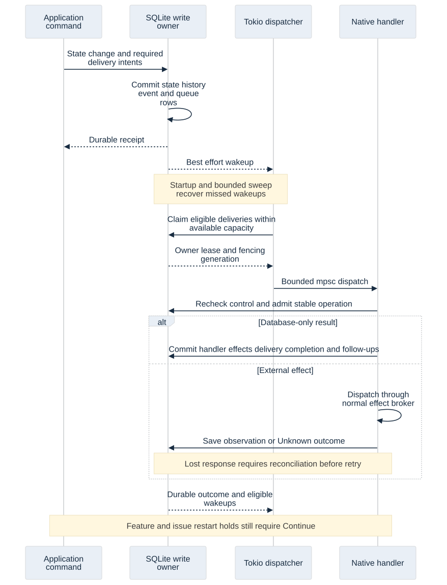

A supervised dispatcher claims eligible consumer/event deliveries only within available worker capacity. Post-commit wakeups are best effort; startup and a bounded sweep repair lost notifications. Handler database effects, completion and follow-up intents commit together. External effects use the shared operation journal and reconciliation. Durable retry/failed delivery state, consumer cursors and per-partition ordering preserve independent work and visible failures. Broadcast lag repairs from a durable cursor and never substitutes for a required handler. Close/reopen and restore continue to obey the existing feature/issue and automation recovery classes.

The [queue dependency review](async-queue-options.md) compares Tokio, Crossbeam, Flume, `msg-broker-rust`, RobustMQ and Apalis/SQLite using primary documentation and selected source files. Tokio is selected for live channels. A durable-job library is acceptable only if it preserves atomic outbox admission, write ownership, durability and DevWorks control/reconciliation semantics; none is adopted unchanged by this source review. No native queue implementation or runtime comparison benchmark has run.

## Coordinator execution and concurrency

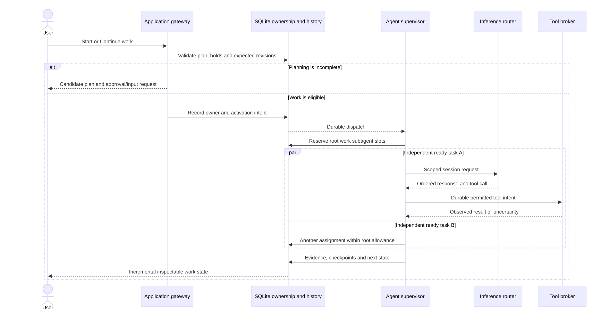

The workspace coordinator handles global conversation and user intent. A feature or standalone issue has a durable execution owner. The owner reviews current authoritative state before delegation, creates explicit task assignments and supervises workers. Asking about running work attaches to that owner instead of silently creating another coordinator.

Start and Continue share a readiness use case. Feature Start checks the plan and its execution-readiness assessment: an incomplete plan is developed from available evidence for approval or remaining input; implementation requires both approved scope and applicable readiness clearance. An approved ready plan can proceed. Within an approved plan, the coordinator chooses useful task breakdown, ordering and PR grouping. Clear actionable standalone issues may start immediately. Neither custom workflow names nor a schedule grants authority to bypass a readiness gate.

### Feature execution-readiness assessment

**Confirmed 2 November 2026 — AGENT-12, AGENT-18–20; AD 79 · confidence high in the contract; native implementation pending.** The feature coordinator is accountable for a mandatory assessment before first implementation, including for a human-approved plan. Assess the intended outcome and boundaries, observable acceptance, coverage of every required capability, dependencies/access/resources, verification and delivery path, and material uncertainties across the whole delivery path. Approval grants scope authority; it does not prove readiness. Every detail need not be planned in advance, but material uncertainties need a credible resolution path. A vague instruction such as “implement a Word clone, make no mistakes” needs concrete proposed product boundaries and verifiable acceptance; the coordinator cannot silently replace it with a smaller application.

Before escalating, the coordinator reads current requirements, relevant code, project knowledge and repository conventions, resolves ordinary choices with evidence and engineering judgment, and performs bounded investigation within current permissions and budgets. Record the decision, rationale, supporting evidence and confidence. Do not ask the user to choose a library, naming convention or reversible implementation detail when a reasonable in-scope decision is available. Do not infer materially different product intent, discard required capabilities or alter acceptance to manufacture readiness. If an investigation cannot be performed within existing authority/resources, identify that specific constraint rather than asking a generic planning question.

The blocking test is conjunctive: a gap must materially threaten delivery or verification of a specific approved requirement **and** lack a reasonable autonomous resolution before the affected implementation proceeds. A reviewer must establish both conditions; more detail, an alternative preference or hypothetical perfection is insufficient. Review has no minimum finding count. The coordinator may conclude ready with no blockers. Existing optional independent-review policy is preserved; this assessment does not universally require another reviewer.

| Finding disposition | Required outcome | Execution consequence |
| --- | --- | --- |
| Resolved decision | Record the in-scope decision, evidence, rationale and confidence | Proceed under existing authority; no human prompt |
| Bounded investigation | Record the question/objective, permitted scope/resources, expected closure evidence and affected dependencies | Execute authorized investigation; gate only implementation relying on its unresolved result |
| Needs user decision | Record the remaining material choice or missing authority/resource, a specific question and recommended answer | Hold only affected work and dependents; continue unrelated eligible work |

For each blocking finding retain its requirement/evidence reference, missing or contradictory information, concrete consequence, affected work, checks/attempts already made, reason autonomous resolution is insufficient, and exact answer or evidence needed for closure. Present remaining findings together after reasonable resolution work. Checking closure is not an invitation to reopen settled preferences: new blockers require newly discovered material evidence or changed scope/assumptions. Local gaps stay local; an undefined feature-wide outcome can block the whole feature.

Persist assessments and finding dispositions as feature-owned work records/artifacts with ordinary revision checks and history, exposed through the same WorkService to native work detail and agent tools. Bind evidence to the reviewed active or pending plan content, effective requirement/acceptance/repository scope and relevant dependency/instruction/evidence revisions. Include resolved decisions, investigation limits and gates, unresolved questions, closure evidence, and explicit human risk decisions. Keep assessment freshness separate from plan approval and workflow status; a caller-supplied ready flag or plan-approval receipt cannot establish it. Concrete native record/message/storage contracts are implementation obligations of DW-012/015, not schemas proven by this document.

An initial assessment may be prepared against the pending draft; approval can retain that evidence only when the adopted content and relevant assumptions match. A pending replacement and its findings do not revoke unaffected authority/readiness of the active approved plan. On adoption, material changes invalidate only affected assessment evidence; reconcile obsolete assignments and reassess before their next implementation dispatch. Continue reuses a current assessment and checks unresolved finding gates; it does not restart full planning. A changed prerequisite or newly discovered material evidence can invalidate affected readiness during execution without waiting for another Start.

The shared eligibility/dispatch boundary requires a current assessment covering affected feature implementation with no unresolved applicable blocking finding, plus existing plan approval, ownership, permissions, pauses, budgets and capacity. Recheck assessment/scope/finding revisions in `BeginDispatch`; a stale read cannot authorize work. Planning and bounded investigation use their existing purpose-specific admission and cannot become a back door to unapproved implementation. Automatic selection still skips incomplete or unapproved plans and wholly blocked features without eligible independent work. For an otherwise eligible approved plan, missing or stale assessment evidence permits activating its coordinator solely to perform or refresh the assessment; it never permits implementation dispatch. This avoids requiring a manual Start merely to refresh a review. A locally blocked feature may still run its assessed, eligible independent tasks through existing scheduling; any later change is fenced at activation/dispatch. Clear standalone issues keep their existing no-separate-feature-plan policy.

Generic plan approval and notification acknowledgment never close findings. Resolution or explicit finding-specific human acceptance of an identified risk is recorded separately, with rationale and remaining controls visible. Such acceptance cannot supply a missing credential/dependency, reconcile impossible acceptance criteria, waive enforced authority or required verification, or make unfinished work complete. The coordinator rechecks actual eligibility after the decision. DW-009/012/013/014/015 acceptance must prove vague approved plans are held, routine choices are resolved before escalation, bounded investigations gate dependents, prompts carry concrete closure conditions, valid reviews are reused, changes invalidate only affected scope, and approvals/risk decisions cannot bypass prerequisites. Use deterministic scripted coordinator/port inputs without model compute for normal checks; these cases establish enforcement and workflow behavior, not universal model judgment quality.

**Confirmed 1 November 2026 — CONTROL-12:** paused work requires an explicit, authorized Continue. Start through the UI, an agent or a schedule leaves the pause effective and returns a result explaining that Continue is required. The adopted semantic result is `ContinueRequired`, carrying the affected root and hold references; public serialization remains versioned protocol work. Agents and schedules may Continue human-paused work only with explicit user authorization. An agent may carry out an explicit user resume instruction, but cannot autonomously clear a human pause. Tool availability, broad coordinator authority and permission to start eligible new work are insufficient resume authorization. Existing manual-resume rules and other blockers remain effective. The authorization contract is specified under execution eligibility below.

**Confirmed 1 November 2026 — CONTROL-13, clarified by the user:** Continue on a feature or standalone issue resumes its coordinator and all eligible descendant assignments, including nested assignments. Child assignments have no manual pause control. Child-specific blockers, including approval waits, unresolved dependencies and uncertain operation outcomes, remain effective. Each descendant must pass its own eligibility checks before execution. The previous discussion of separately imposed manual child pauses is superseded by this clarification.

**Confirmed control scope:** manual Pause/Continue operates at feature/issue scope, covering the coordinator and its descendants. There is no independent manual child-Continue workflow. Internal activation or retry of a child checks applicable ancestor controls and its own blockers, and cannot implicitly resume its parent. When a child's blocker clears, the engine rechecks eligibility and continues it if the parent permits execution and other conditions allow. A paused parent keeps its children stopped. Concrete eligibility and authorization semantics are specified below; physical records and public DTOs remain validation work.

### Activation ownership and race contracts

**Accepted ownership direction, 1 November 2026:** Start/Continue checks current eligibility and authorization; one transaction records the execution attempt, ownership and durable activation intent; the supervisor claims the committed intent before execution; duplicate activation requests return the existing activation; each dispatch checks the current ownership generation. **Adopted technical design:** the following state and race contracts realize that direction under the delegated architectural discretion. They remain unimplemented.

Keep the durable coordinator relationship distinct from the runtime owner. The logical coordinator and its conversation/session lineage survive interruption. Use the existing `ExecutionId` for a concrete activation attempt, with a renewable lease and monotonically advancing ownership generation for the supervisor currently authorized to act. A committed activation is not proof that a task or child process has launched. Continue preserves lineage while recording a new attempt when actual reactivation is needed. Adopted activation phases are `Pending`, `Claimed`, `Running`, `Stopping` and `Stopped`, with normal or failed terminal outcomes. These phases do not replace work workflow, delivery state or independent eligibility conditions; ending an activation is not evidence of feature completion.

The short activation transaction checks a previous command receipt before attempting a new mutation, resolves the feature/issue scope, validates current control and authorization revisions, and enforces one dispatch-capable activation per root. It commits the coordinator/assignment link, execution attempt and ownership reservation, history, command receipt and launch intent together. The supervisor's later conditional claim establishes the live execution lease; the application transaction does not pretend a process already owns it. Different Start commands racing for the same root also converge on one existing activation. A repeated command returns its recorded activation reference; the caller can query current state rather than mistaking the original receipt for proof the work is still running.

Bind an idempotency key to the host-bound actor/scope and command kind/payload. Reusing the key with different arguments is a conflict. Returning an old receipt does not issue a new activation or renew authority to execute it.

Network requests, process launch, source inspection and outstanding-effect reconciliation happen outside the transaction. Before implementation, validate the current approved scope/acceptance revision, effective policy, root control revision and execution generation again. Explicit Start of an incomplete feature may activate planning only; automatic allocation still requires implementation approval. Continue can release only holds covered by authoritative user authorization and cannot remove unresolved child-specific blockers. Resume authorization is bound as specified under execution eligibility below.

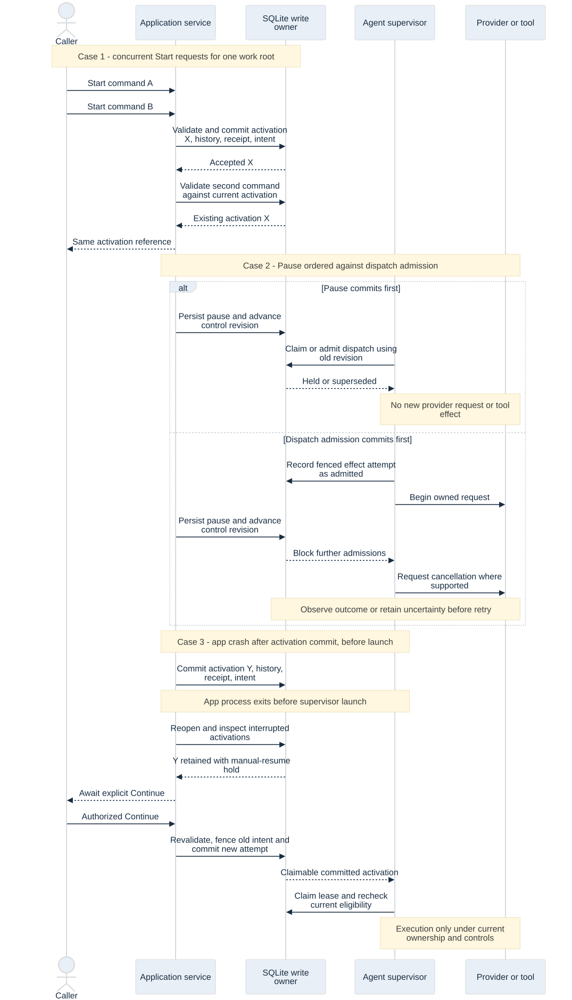

| Boundary case | Durable behavior and result |
| --- | --- |
| Two Start requests race | The first commit establishes the activation. The second observes that activation and returns its reference/current status, or reports a current hold/conflict; it creates no second coordinator or execution. No caller-visible timeout permits another start without checking the command receipt and current activation. |
| Pause wins before dispatch admission | Pause advances the root control revision and retains its hold. Claim/dispatch checks under the newer revision refuse the old pending activation. The supervisor records the prevented activation without launching a provider request or tool effect. |
| Dispatch admission wins before Pause | The effect attempt is already durably admitted and is treated as in flight. Pause blocks subsequent admissions, requests cancellation, and exposes stopping/uncertainty until the actual outcome is observed. A transport may not yet have reached its target; admission does not prove completion or remote rollback. |
| App crashes after activation commit and before launch | **Manual-resume policy confirmed under CONTROL-10:** accepted feature/issue activations that never launched also require explicit Continue after app restart. The committed intent and receipt survive; recovery may inspect/reconcile them without starting feature/issue execution. Adopted mechanics: Continue revalidates current conditions and fences/supersedes obsolete pending intents while preserving lineage and other blockers. |
| Supervisor task fails while the app remains open | Recover from durable state after bounded cause-specific backoff and reconciliation, provided current holds and ownership permit it. This is distinct from app process restart and never clears a user pause. |

Define the normal Pause boundary as a durable control change ordered against `BeginDispatch` admission through the common broker/storage boundary. A preflight read followed by an unchecked later launch is insufficient. Neither operation holds a database transaction across a network request. Dispatches admitted before the pause boundary remain in-flight operations to cancel/reconcile; after that boundary, new admissions fail. This defines a local ordering guarantee, not an exactly-once remote execution guarantee. Confirmed archival retains its immediate-stop exception.

Required no-inference acceptance cases exercise simultaneous Start/Continue commands with identical and different command IDs; crash before commit, after commit and after claim; Pause ordered on either side of dispatch admission; late stale-generation actions/results; app reopen with a pending activation; and supervisor-only failure while the app stays open. Assert one active owner, atomic history/intent, no forbidden post-pause admission, retained uncertainty, preserved lineage and manual-resume rules. These are test specifications, not executed application tests.

Issue delegation does not require feature cards: a root issue, role and scoped brief are sufficient. Child assignments retain that root for controls, independent concurrency allowance, attribution, worktrees, evidence and delivery. Optional referenced tasks must be in the same project and authorized root scope; a task’s absent feature relationship does not prevent delegation.

The activation loop is: obtain an eligible assignment; load its approved brief and instruction revisions; resolve worktrees and graph views; build bounded context; request inference through the router; persist streamed events/tool intentions; invoke permitted tools; reconcile results; evaluate acceptance; continue, wait or finalize. Decisions and evidence are inspectable. Do not record speculative private chain-of-thought as if it were an execution artifact.

Default maximum is **10 concurrently active subagents independently per feature and per issue**; the owning coordinator is not one of its own subagents. Nested delegation counts against the root feature/issue rather than creating another pool. Logical historical sessions are not active slots. A blocked assignment can become dormant with its checkpoint retained so ready work can use an available slot. Ownership and slot reservation are atomic, preventing an eleventh active child under concurrent scheduling.

There is **no global subagent-count cap**. Provider-specific throughput, parser/CPU admission, per-repository integration serialization and named resource capacities can cause visible waits without changing that rule. The coordinator fills useful available capacity; dependency chains are not artificially parallelized. Separate worktrees permit concurrent coding in one repository; only conflicting integration/ref operations serialize.

Keep-working mode is a per-project autonomous queue consumer, off by default. It starts one feature or standalone issue at a time for that mode, using a fresh session for each new item. It stops when no eligible work exists and requires manual restart. This does not invent a project-wide prohibition on manually starting other features or a global cap across projects.

### Parallel tool turns and scoped waits

**Confirmed 1 November 2026 — TOOL-09:** independent tool calls keep running when another call fails or requires approval, unless that failure makes their execution unsafe or invalid. Hold or cancel only affected calls and their actual dependents. Preserve completed results, and reconcile uncertain effects before retry. Parent pauses, archival, revoked authority and shared failures can still invalidate multiple calls; sibling failure isolation is not permission to ignore those controls.

**Adopted technical design:** the following is the internal executable contract. Endpoint-specific encoding still requires adapter validation; no implementation or provider parity is claimed. `ToolBroker` owns admission and operation state; the session turn assembler owns provider-call identity and continuation order; the execution repository persists both through shared transactions. `AgentSupervisor` owns the session/assignment lifetime and applies inherited controls. Human approval is a separate revision-bound record, with execution returning through the same broker.

| Durable record | Content and invariant |
| --- | --- |
| Tool-call envelope | Session, context epoch, provider request/attempt, native call ID, recorded ordinal, capability/schema version, complete validated arguments and source-native block reference. No effect dispatch depends on an incomplete or unrecorded call. |
| Operation/attempt | Stable operation identity, payload digest, work/resource scope, current authority/control/ownership revisions, admission and effect observations. Call receipt, operation completion and work acceptance remain distinct. |
| Call response | Durable output/artifact references or a typed failure/wait/unknown response, tied to the call identity. Delivery progress is tracked without rewriting previously dispatched native history. |
| Approval/wait link | The concrete proposal or blocking operation and its current revision. Returning a wait response does not complete the operation or authorize a future effect. |

A provider transport must establish that a call's identity and arguments are complete before it becomes dispatchable. If its streaming protocol cannot establish per-call completion before the turn ends, wait for that boundary. Persist the envelope/native material first. Broker admission then checks current policy, parent controls, ownership, required approval, dependencies and resource grants. It records effect intent before handing off to a target, under the activation dispatch boundary already described. Partial argument fragments can be shown as progress but never executed.

Run calls concurrently only when their effect/resource contracts permit it. Shared mutable targets serialize or use guarded revisions. Opaque mutating shell/MCP/package calls are not assumed independent merely because they have different names; use verified scope/resource contracts or conservative serialization in the affected mutable scope. This does not claim OS confinement of arbitrary native code and does not create a global subagent-count cap.

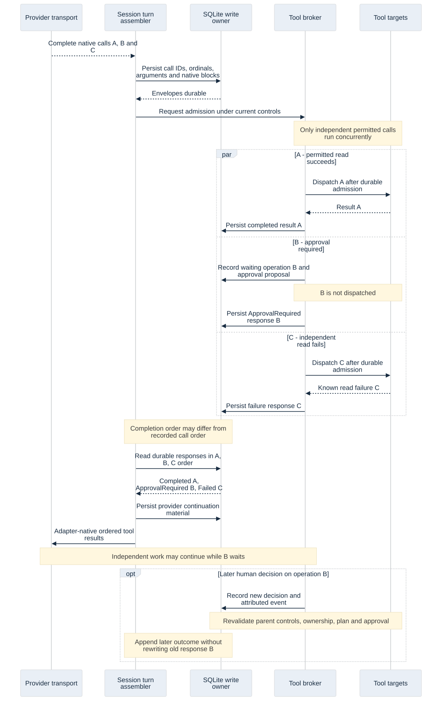

Semantic outcomes include `Completed`, `Failed`, `ApprovalRequired`, `DependencyBlocked`, `CancelledBeforeDispatch` and `OutcomeUnknown`. Failure or cancellation after admission must retain what is known about effects; an interrupted mutation is not automatically a safe failure. An unknown outcome holds the operation and actual dependent work pending reconciliation. Independent safe calls retain their eligibility and may finish. A root Pause blocks further admissions and requests cancellation/reconciliation of admitted calls according to their contracts.

Persist call results as they arrive, with each call's recorded ordinal. Close the current provider tool turn once every emitted call has a durable response, including an explicit wait or unknown-outcome response. Assemble provider-native results in the recorded call order, regardless of completion timing. A human approval wait must not keep a network request or database transaction open. If no independent work remains, the agent becomes dormant with durable context; other eligible assignments continue.

Returning `ApprovalRequired` is the initial call's truthful response while its linked operation remains waiting. Later approval is a new durable decision/event; it does not overwrite that response or manufacture a second result for the old call ID. Any resumed operation revalidates current parent controls, plan/policy revisions, ownership, approval binding and dependencies before admission. Its eventual outcome is appended through a provider-supported new context/tool exchange. The resumption trigger is the durable wakeup contract below. Each provider adapter must encode the new event through a supported conversation boundary, with no invented second result for a closed call ID. Permission to approve an action does not clear a separately imposed feature/issue pause.

Crash recovery reads the call/operation journal before considering replay. Reuse known completed results, retain waits and uncertain outcomes, and track which provider-visible history was durable/dispatched. Recovering a partial provider stream does not redispatch previously admitted tools. Late observations from a superseded owner remain attributable history and cannot overwrite current work or publish newly unauthorized content.

No-inference acceptance must cover out-of-order completions with deterministic native result assembly; a failed or approval-held sibling while independent calls finish; a real dependency invalidated before admission; conflicting writes and opaque-scope classification; pause/revocation during admission; mutation timeout after possible effect; crash after envelope/admission/result persistence; and later approval after a plan/control change. Use actual local storage/process fixtures and scripted provider streams. These are specified tests, not executed application evidence. Serialized tool/provider DTOs and endpoint fixtures still gate protocol freeze; the internal wait/resumption semantics are adopted below.

### Execution eligibility and resume authorization

**Adopted technical design, 1 November 2026 · AD 17 · confidence high.** Separate desired root execution (`Enabled` or `Paused`) from activation phase, assignment state and cause-specific blockers. Do not encode all four as one agent status. A feature/issue Pause controls its entire assignment tree; blockers can apply to a root, assignment, operation or named resource. There is no manual child pause or child Continue command.

| State owner | Authoritative state and permitted transition |
| --- | --- |
| Root execution control | Desired execution, control revision, pause cause and current restart epoch. Only authorized Continue clears covered manual-resume conditions; Start cannot do so. |
| Activation/supervisor | `Pending → Claimed → Running → Stopping → Stopped`, with an attributed termination cause. Normal work acceptance is a separate transition. One root has at most one dispatch-capable supervisor generation. |
| Assignment | `Ready`, `Active`, `Waiting`, `Completed`, `Failed` or `Superseded`, plus current owner/generation and checkpoint. Waiting is not a manual pause. |
| Blocker | Stable ID, subject, cause, originating record/revision and clearance condition. The owning service clears it when evidence satisfies that condition. Continue cannot delete arbitrary blockers. |
| Operation and attempt | Intent, admission, external observations and reconciliation state. Cancellation request, target termination and effect completion remain distinct facts. |

`EvaluateEligibility(subject, purpose)` returns current reasons and relevant revisions, without mutating them. For implementation, require an enabled non-archived project/root, the active approved feature scope (or actionable issue), current applicable feature readiness with no unresolved blocking finding for the affected work, ignoring pending revisions for execution authority, current ownership/boot generation, permitted instructions/tools, satisfied dependencies/approvals and available admission capacity. Explicit feature planning and authorized bounded investigation use their purpose-specific readiness instead of implementation approval. Recheck those same predicates atomically in `BeginDispatch`; a successful earlier query is advisory. A caller-supplied “eligible” flag has no authority.

Use cause-specific blockers: human pause, restart/manual Continue, budget/manual Continue, approval, dependency, reconciliation, missing credentials, capacity/cooldown and storage unavailable. Each carries a useful reason and relevant evidence. Budget adjustment removes budget insufficiency but leaves its manual-Continue latch. Approval resolves only the reviewed operation. Capacity release or credential repair triggers reevaluation automatically; neither clears an independent manual pause. Operator repair that needs an actual decision is reported once with an actionable record, rather than repeatedly retrying the same deterministic failure.

For Continue, the host derives the actor and authoritative user instruction from the UI action, chat invocation or explicitly authorized agent/schedule delegation. Bind the resulting resume command to the exact root, covered pause IDs/revisions and command ID. The transaction clears only those conditions and records the authority source and receipt. A changed or new pause is not covered by an old command. A duplicate command returns its receipt and cannot clear a later pause. No bearer token in model text or tool-supplied actor can create this authority.

The default agent/schedule delegation covers the identified current pause only. If a user explicitly grants standing resume authority, persist its roots, allowed causes, lifetime/usage limits and revocation revision; each use must mint a command bound to the then-current pause and remain within that explicit grant. Do not infer such a grant from “keep working,” a schedule's existence or general tool access. App-restart and budget holds retain their explicit user/manual-resume conditions; an ordinary standing automation grant cannot waive them. A later human Pause invalidates earlier pause-specific authorization. Any broader delegation requires explicit user intent and must not silently weaken these rules.

Continue makes eligible descendants runnable; it does not synchronously launch the whole tree or wait for their execution. The supervisor fills useful capacity under the existing independent root limits. Keep assignment lineage and completed results. Return the root/activation reference, control revision, cleared conditions, remaining blockers and a durable accepted receipt. Dispatch status is queried separately. Semantic outcomes are `Accepted`, `AlreadyActive`, `ContinueRequired`, `Blocked`, `RevisionConflict`, `PermissionDenied` and `Archived`, each with attributable reason references. A valid Continue can be accepted while an operation remains blocked; the UI must show that distinction.

### Durable wakeups and approval completion

**Adopted technical design · AD 17–18 · confidence high.** A saved approval/dependency/resource change and its wakeup event commit together. Durable queue delivery is at least once; unique consumer/event or operation-revision keys deduplicate processing. In-memory notifications only reduce latency. Lost notifications are repaired by scanning ready durable queue entries. Timer/cooldown readiness uses saved ready times, not model polling turns.

An approval response refers to one immutable operation proposal: capability/version, argument digest, effect/resource scope, target identity and relevant expected revisions. Approval authorizes the saved operation, not an agent's rewritten approximation of it. On approval, enqueue the operation for normal broker admission. The broker revalidates parent controls, owner, relevant plan/policy/target revisions, approval and resources, then consumes the approval for that operation's effect admission in the same transaction. Safe transport retry of the same admitted attempt is governed by its effect contract; approval is not a license for repeated independent effects. A materially changed proposal requires renewed approval; unrelated record edits need not invalidate an unchanged proposal.

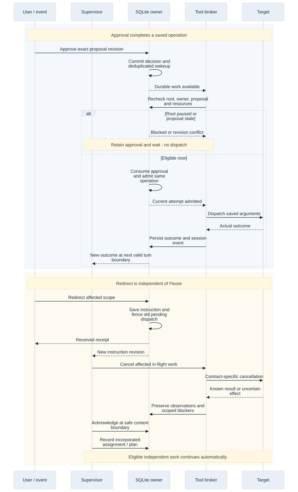

The original call's `ApprovalRequired` response closes that provider call. The saved operation remains waiting. Later approval can resume it without asking the model to issue the action again; its outcome is a new attributed event. If the root is paused, preserve the approval and wakeup but do not dispatch. Continue later reevaluates them. A stale target/proposal yields a revision conflict and a fresh proposal when appropriate; denial/cancellation ends the pending proposal and notifies the affected assignment. No outcome rewrites the old call result.

There is at most one inference/continuation turn in flight per session, although its permitted tools may run concurrently. Queue later events behind that turn at a valid provider boundary, ordered by durable event sequence and consumed once per context epoch. Do not inject a second tool result for an old native call ID, or open concurrent provider continuations for the same session. Adapters encode events as supported new context/tool exchanges; unsupported native continuation uses an explicit reconstructed context epoch from durable history, preserving effect identities. Endpoint compatibility remains G03 evidence work.

A waiting assignment releases its active-agent slot once its current inference/tools have quiesced. Retain its session/checkpoint and durable waits; reacquire a slot before its next active turn. An unresolved external mutation can retain a resource/reconciliation hold even after its agent task is dormant. Never reassign the physical resource merely because a slot or lease was released. When a wait clears, automatically resume eligible work under an enabled root. If no safe independent work is available, sleep until a relevant event or retry deadline; do not spend inference to ask the same question again. Root Pause, feature budget and restart rules continue to dominate.

### Redirect, cancellation and late observations

**Adopted technical design · AD 19 · confidence high.** `Redirect(scope, instruction, expectedRevision, commandId)` saves the user instruction, target scope and new instruction/control revision together with its transcript event. Scope may be a feature/issue or a particular assignment; directing a child does not introduce a manual child pause. Serialize redirects with dispatch admission at the common write boundary. Immediately fence pending dispatch based on superseded instructions in the affected scope. Unaffected assignments keep running.

Expose three distinct durable stages: **received** when the instruction commits; **acknowledged** when the supervisor reaches a safe boundary and binds the next execution context to it; **incorporated** when the updated plan/assignment disposition is recorded. A UI receipt alone cannot claim agent acknowledgment or incorporation. Show old work still stopping/reconciling separately. Coalesce pending wakeups to the latest required context revision while retaining every user instruction and its ordering; do not discard earlier compatible directions.

A safe boundary is before admitting the next provider request/tool call, or after observing/persisting an in-flight call's outcome. Stop an obsolete provider stream when cancellation is supported, preserving its durable partial output and usage uncertainty. Request cancellation of affected in-flight operations according to their registered contracts; a safe cancellation point can be a process checkpoint, not a completed feature or task. Once already-admitted effects have quiesced or been isolated by a reconciliation/resource hold, rebuild context under current directions and continue automatically where eligible. Redirect by itself does not create a manual-Continue latch.

For an in-flight effect, distinguish cooperative cancellation, forced termination of an owned helper, and a remote effect that cannot be recalled. Retain the operation's observations in all cases. A cancel acknowledgment means only what the adapter contract proves. If completion is unknown, block that operation and its actual dependents until reconciled; independent work may proceed. No result from an obsolete owner may directly change current plan/task acceptance. A current owner may explicitly validate compatible old evidence against current requirements and record that adoption, rather than redoing useful work or treating old evidence as automatically current.

A saved role/skill edit uses the same next-boundary instruction adoption, while required approval and tool revocation remain separate enforced gates. Revoked authority blocks new admission immediately. Project archival retains its confirmed immediate fence/interrupt behavior rather than waiting for cooperative adoption. A redirect proposing changed implementation scope saves a pending revision and blocks only work requiring that unapproved scope. Eligible work under the active approved plan continues unless the user explicitly pauses or stops it; routine replanning within that scope does not invent another approval.

### Runtime acceptance scenarios

These are specifications for deterministic tests using actual local storage/process fixtures and scripted provider transports, without real inference. Document checks are not execution evidence.

| Scenario | Required assertion |
| --- | --- |
| Concurrent Start/Continue and duplicate commands | One dispatch-capable owner per root; receipt/history/intent commit together; a reused command cannot clear a later Pause. |
| Continue with mixed descendant blockers | Eligible descendants run subject to slots; approval, dependency, budget and reconciliation conditions remain independent and visible. |
| Approval followed by root Pause, redirect or target edit | No forbidden effect; pause preserves the approved proposal, relevant target changes reject stale admission, and later valid Continue resumes only eligible work. |
| Lost/duplicate wakeups and crash after approval commit | Durable recovery delivers the pending transition; no duplicate external effect or duplicate native call result. |
| Out-of-order parallel calls and sibling failure | Durable results survive independently; provider-visible response order is stable and only actual dependents wait. |
| Two events while one session turn is active | One session continuation at a time; events are delivered once at a valid boundary and no model polling loop is needed. |
| Redirect on both sides of admission | Old pending effects are denied; admitted effects cancel/reconcile honestly; received/acknowledged/incorporated stages reflect actual transitions. |
| Late stale owner result | Attributable history survives; current acceptance cannot be overwritten; compatible evidence requires recorded adoption. |
| Dormant assignment and occupied resource | Slot reuse respects the root cap; uncertain processes/resources remain unavailable until reconciled. |
| Deterministic versus transient failure | Bounded classified retries, persisted attempt/delay/cause and one actionable escalation; independent work continues. |
| Close/crash before commit, claim, dispatch or result save | No success before commit, no feature/issue auto-resume after new boot, and no unsafe replay of possible effects. |
| Wake, scheduled recovery and archived project | Wake preserves pre-existing controls; scheduled runs retain identity and cannot bypass paused feature/issue or archive gates. |

### next_work contract

`next_work(project, feature = null)` atomically claims the highest-priority eligible feature or standalone issue when feature is null, or an eligible child task when feature is supplied. Validate membership, expected ownership, dependencies, plan/readiness semantics and execution holds. Standalone issues and features compete in one project priority queue; child tasks do not separately compete at project scope.

**Confirmed 1 November 2026 — WORK-09:** automatic feature allocation selects only features approved for implementation. Skip incomplete or unapproved feature plans rather than allocating a coordinator merely to finish planning. This applies to `next_work`, keep-working and scheduled work selection. Explicit Start retains its planning-readiness path for an incomplete feature. Clear actionable standalone issues retain their existing immediate-implementation policy without separate feature-plan approval. Check approval against the active plan and its effective scope/acceptance when claiming and again before implementation dispatch. A pending revision leaves that active approval intact and cannot authorize its proposed changes. Existing pauses, dependencies, budgets and other eligibility conditions remain effective.

Adopted tie-break is priority, explicit manual ordering, then creation sequence and stable ID. A retry with the same idempotency key returns its recorded allocation, not another item. Claiming and starting are distinct: return work ID/kind, owner lease, revision and readiness reasons, then use the normal activation path. Explicitly paused work is never made eligible merely because its owner lease expired. Recovery and new allocation are distinguishable outcomes.

### Task priority and blocking dependencies

**Confirmed 2 November 2026 — AR-03 / WORK-02:** humans and permitted agents can reprioritize tasks and add/remove task blockers through the same application operations. `TaskPatch`/`IssuePatch` accept priority; `tasks.prioritize` supports revision-checked bulk priority and ordering for a feature queue or the standalone project-task queue. Optional feature membership never prevents reprioritizing an issue. Priority/dependency coordination within approved scope does not request plan reapproval or invalidate the active plan.

Select eligible work first, then descending priority, ascending explicit queue rank, creation sequence and stable ID. A blocked urgent task cannot leap over its prerequisite. Reprioritizing does not preempt a running assignment or clear a pause, dependency, approval, budget or reconciliation hold. Setting a priority or reordering commits the task edits, owner queue revision, receipt/history and wakeup together. A single-item edit checks the work revision; bulk ordering checks the current owner queue revision. Omitted tasks retain their relative order. `tasks.prioritize` explicitly sets the selected tasks’ priority and moves them to the front of that priority bucket in the requested order; other buckets retain their priority. Standalone tasks use the existing mixed project feature/issue queue, including the unselected feature ranks; there is no second independently authoritative issue ordering.

A directed link `A → B` means **A blocks B**. Store one edge; derive both **Blocked by** and **Blocks** views. The dependency command replaces only B’s incoming links, including explicit empty removal. Validate both endpoints and project access, reject self/duplicate links and cycles across the complete project task graph, and commit under the sole writer so two individually valid concurrent edits cannot create a cycle. Feature-linked tasks, tasks in different features and standalone issues in the same project may participate. A link never changes feature membership or grants access to another project. Bounded validation that cannot establish acyclicity refuses the change visibly.

An unsatisfied link blocks claims and dependent dispatch until the prerequisite has the verified acceptance/integration required by its existing workflow; a manual Done label alone is insufficient evidence. A failed or archived prerequisite remains an explained blocker until explicitly resolved or unlinked. Adding a prerequisite to active work fences affected new dispatch and requests safe interruption; admitted effects finish or reconcile honestly. Completed work is not silently reopened by editing links. Clearing a link or observing accepted completion durably wakes eligible dependents; unrelated pauses, approvals and budgets survive. Source changes may invalidate relevant acceptance and require fresh checks. Dependency ordering does not itself transfer code between branches or bypass normal Git integration.

For keep-working’s one-active-root-per-project rule, a feature whose remaining work is entirely blocked on another root must not monopolize automatic allocation. Once its admitted work has quiesced, retain its coordinator/checkpoint and wait reasons while yielding that mode’s active slot so eligible prerequisite work can run. A later wakeup rechecks mode ownership and all root controls before continuing the saved work. This creates no human pause, duplicate coordinator or global agent-count cap. Task-level acyclicity remains authoritative; coarse root grouping must not reject a valid interleaving of tasks across features.

Task and issue screens expose priority plus navigable Blocked by/Blocks lists and accessible edit controls. Task reads supply bounded reciprocal IDs, coverage and a detail cursor rather than pretending a truncated list is complete. All updates show actor, prior/new values, revisions and resulting eligibility in history. DW-012/013/015 acceptance covers human/agent equivalence, cross-feature/standalone edges, cyclic concurrent edits, priority versus blockers, completed prerequisites, active-work interruption and wakeups without inference.

The current AR-03 catalog contains 352 operation candidates in 48 families, including `tasks.prioritize`; earlier baseline counts below retain their checkpoint meaning. Actual native service behavior remains implementation acceptance.

## Conversation UI and screen context

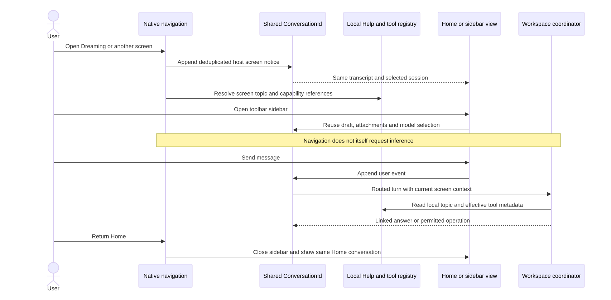

`ConversationView` and `ChatComposer` are shared egui components parameterized by `ConversationId`. Home supplies the current workspace conversation and a right sidebar with Current and Chat History tabs (Current initially selected). Current projects app-wide Needs you, Working and Recently completed with project labels/work links; Chat History retains search, date grouping and selection. New Chat remains in the center header beside Coordinator instructions. Tab changes preserve the session, draft, pending attachments and relevant scroll positions. Every other screen can show that same conversation in a right sidebar, opened from the toolbar. Feature and issue coordinators have separate conversation IDs and retain their dedicated panels.

The sidebar-open flag is navigation state, not a new agent or transcript. It persists while moving among screens and projects, closes explicitly or on return Home, and reuses the same draft, attachments, model selection and session pin. Returning Home restores the full conversation and its Current / Chat History sidebar state. Native pane sizing/docking adapts to available width; a narrow layout may overlay the right edge without changing conversation identity.

`ScreenContext` contains a stable screen ID, actual selected project/work/repository/run/node/tab identifiers, Help topic/version and relevant capability references. Opening the workspace coordinator sidebar appends the current screen as a host-authored notice to the active Home transcript. While it stays open, meaningful screen/selection changes append notices; unchanged re-renders do not. Closed-sidebar browsing and return Home append none, and opening never replays intermediate closed-sidebar navigation. Live `ui.current_screen` queries still resolve the current view independently of transcript capture. A read-only `ui.current_screen` operation supplies current state and effective tool availability without copying form contents, credentials or the whole screen into the prompt.

Navigation notices are informational context and require no independent inference call. Deliver them at the next safe transcript/request boundary; already-dispatched effects continue under their recorded authority. They do not authorize a new feature, remove a hold or grant tools. Preserve prior notices unchanged in transcript/provider history; do not rewrite historical timestamps or insert changing screen state into the stable role/tool prefix. Both Home and sidebar render only the most recent screen notice per conversation in its original position, retaining all ordinary messages and their order. This consolidation is a display projection, not prompt/transcript compaction.

Use typed native navigation targets rather than ad hoc strings: project, feature, issue, repository, node, schema object, agent, artifact, approval, job, Settings section and Help topic. Persist selected IDs and view parameters independently of live view models. Screen registration provides its title, Help topic and applicable capability references so UI and coordinator context cannot drift through separate hard-coded catalogs.

### Approved presentation and navigation

The [approved UI reference](../planning/ui-reference.md) consolidates revision 08. UI-14 places app-wide Approvals directly below Chat with project filtering, moves Activity into project Overview with filters/full history and keeps Intelligence navigation collapsible. UI-15 adopts warm neutral bordered groups throughout. Each header is integrated into its primary pane with one outer border and a body divider; secondary panes align alongside it. Approvals, Knowledge entries/documents, Dreaming run history and Databases place their inner sidebars on the right. Shared native components carry this treatment through every page/subview, including complete empty/error/stale states. Overview/Features use inline value/label summary strips; sidebar version/update text aligns left.

`ChatComposer` uses the accessible plus-only attachment control under UI-08. In workspace views, attachment/model/effort controls align with Send inside the bottom of the input. Scope and pinned model sit below its border on the left, the send shortcut on the right; omit redundant coordinator metadata, conversation-name header rows and the center status strip. Narrow layouts may wrap without losing state or controls.

A shell-owned notification overlay consumes durable verified feature/issue completion records under NOTIFY-05. It floats at the same top-center toolbar anchor on all screens, reserves no layout space and does not take focus or obscure essential controls. Newest-first cards persist until individually dismissed across navigation/restart, expand to expose all messages and link to completed work. Opening or reading work is distinct from dismissal; dismissal preserves history and cannot resolve approvals or resume agents. Persist dismissal by notification identity and suppress duplicate completion events. For completion cards, explicit dismissal uses the existing revision-guarded `notifications.acknowledge` operation; `notifications.read` and opening linked work do not acknowledge. History queries include acknowledged records instead of deleting them. Retain keyboard/accessibility/reduced-motion behavior and the independent required-input OS policy. Prototype checks are design evidence; native layout, persistence, notification projection and platform accessibility acceptance remain unimplemented.

### Configuration and native view contracts

Use typed configuration descriptors with allowed scopes, validation, revision guards, effective-value explanations and local Help IDs. Workspace → project → repository inheritance applies where required, especially delivery and GitHub policies; do not imply that every setting has all scopes. Feature budgets remain feature-scoped, issues have no caps, and mandatory reviewer/main protections are not override values. Native forms reuse application validation while preserving drafts on revision conflicts. The screen registry links typed selection state, Help and tools without imposing a generic generated-form framework on every workspace.

## Inference router and provider contracts


**Adopted technical design, 1 November 2026 · AD 27–32.** One in-process `InferenceRouter` serves every inference purpose, including chat, workers, review, planning, dreaming, compaction, titles, vision extraction, embeddings, optional semantic inference and accepted MCP/package inference. The router owns selection/admission; adapters own provider wire and authentication. The supervisor owns agent/session lifetime; the broker alone admits host tool effects. No old router server, external coding CLI or provider-hosted autonomous agent loop is required.

The inspected simple-router source and CodeGraph index both identify revision `a556b3531b577173195bbc3876b556196447721d`. The [reference audit](validation/router-refinement/source-audit.json) records retained behaviors, source paths/digests and intentional differences. Source inspection is not live subscription compatibility or a claim that its tests were run here.

### Request records and provider boundaries

**AD 27 · confidence high.** Use a typed `InferenceRequest` with a stable logical request ID, purpose, host-bound project/root/assignment attribution, optional conversation session, instruction/context epoch and digest, required modalities/tools/structured output, model/effort constraints, response headroom, deadline/cancellation revision and artifact/native-history references. A service embedding request can have no conversation; it still has durable work attribution. Do not create a fake chat or change a conversation pin merely to title a session or embed a document.

| Record or port | Required content and owner |
| --- | --- |
| Logical request | Router-owned purpose, attribution, current constraints and lifecycle. One request can have multiple explicitly numbered transport attempts. |
| Route decision | Catalog route and connection IDs, actual access mode, capability/catalog/policy/credential revisions, pin revision, selection/fallback reason and capacity grant. Display aliases are not durable identities. |
| Attempt envelope | Exact endpoint profile, resolved request options, request digest/native bytes or immutable references, context epoch, selected pricing snapshot/override, reservation and transport state. Never include secret values in saved headers or diagnostics. |
| Provider stream | Ordered typed events plus provider-native items, observed request/response/generation IDs, stop/error classification and nullable usage fields. A normalized event never replaces required opaque native continuation. |
| Outcome | `Completed`, `ToolCallsReady`, `Incomplete`, `Cancelled`, `Failed` or `OutcomeUnknown`, with effect/cost uncertainty and correlation references. A successful transport response is not work acceptance. |
| Adapter contract | `describe_capabilities`, `prepare`, `send`, `decode`, `build_continuation`, `classify_failure` and optional `observe_request`/`count_tokens`/`discover_models`. Preparation is deterministic for fixed inputs; observation/count/discovery are separately admitted network operations. |

Capabilities are versioned by connection, endpoint/access mode and actual model identity: input/output modalities, tools and parallel calls, tool-schema dialect/limits, context/output limits, reasoning options, cache controls and metrics, cancellation, stateless/server-stored continuation and request observation. Unknown is distinct from supported or unsupported. Required capabilities must be configured or verified before dispatch; do not probe by silently dropping tools/images or paying for a speculative generation. Explicit Test connection can use authentication/model-list checks without inference; any generation test must be a separately disclosed user action.

Each adapter has an allowlist of supported request options and an explicit mapping for required semantics. Reject an unsupported required option; omit an unsupported optional optimization with a recorded reason. Schema conversion may use an equivalent representation plus host validation, but cannot silently weaken required arguments. Preserve image bytes/digest, media type and ordering; resolve provider file references against their account/expiry or reupload the authorized artifact. A connection change must never forward another connection's credentials, file IDs or opaque state.

| Provider profile | Required retained behavior and wire boundary |
| --- | --- |
| Codex subscription | Native device-code login, refresh and account binding from the reference; Responses-style subscription transport, streamed output, call IDs and encrypted continuation. Its accepted parameters can differ from public Responses API: the reference omits unsupported sampling/output-limit fields. Validate the actual subscription profile instead of copying public API options. |
| Claude subscription — optional user risk | Direct simple-router-compatible PKCE/code exchange/refresh and subscription Messages transport, including its bearer/beta/identity behavior. Disabled until explicit human acceptance of the current risk notice. Anthropic does not support this third-party subscription use; compatibility and account access are not guaranteed. No Claude CLI. |
| Anthropic API — API key | Separate `AnthropicMessages` connection using documented key authentication and a pinned API version. Native Messages content/tool/continuation handling and scoped SecretStore references; distinct credentials, capabilities, limits and metered API billing. Never inject the subscription identity/beta behavior into this profile. |
| OpenRouter API key | Provider-level replace/remove key, model discovery, allowed/excluded models and cost/provider-routing constraints; reference Chat Completions profile, reasoning details, generation/resolved model IDs and reported cost. Other endpoint families are separate capabilities, not inferred from its brand. |
| Generic compatible endpoint | Explicit base URL, upstream model and optional key, including Ollama/LM Studio. Default supported profile is Chat Completions; Responses/embedding endpoints require their own declared profile. Preserve base path prefixes and never guess by appending duplicate `/v1` segments. Local template/effort settings do not leak into other providers. |

Connection metadata, model discovery snapshots, enabled flags, price overrides and endpoint profiles live in app storage; token/key values live only in the OS secret facility. A provider package uses the same router capability, host secret handles and adapter contract, not raw host database or unrestricted credential access.

### Concrete provider and session candidates

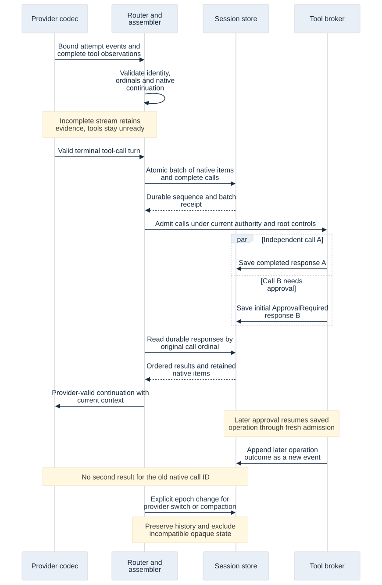

The [provider/session/package contracts](provider-session-package-contracts.html) now define generation versus embedding inputs, host-owned attribution, raw codec observations versus host-classified usage, exact native continuation bindings, typed transcript batches, public user messages and bounded transcript pages. Shared receipts are generic over domain-specific decisions, preserving the root-control contract. Native stream/history models check terminal readiness, duplicate IDs/results, batch replay/atomicity and context epochs without real inference. Actual native wire encoders/parsers, auth and live subscription/API compatibility remain G03; these DTOs do not certify them.

### Direct tier selection effort and SystemOne

**Confirmed ROUTE-18–24; AD 62–63 and AD 80 · confidence high in intent.** Every composer presents DevWorks Auto, Tier Max, Tier High, Tier Mid and Tier Low, followed by the named-model group: Open Router Auto and Auto Beta, Fable, Opus, Sonnet, Haiku, Astra, Sol, Terra and Luna, plus configured custom models. Effort is a separate persistent selector. Tier intent resolves directly to its configured pool ID; do not translate a named model to a tier. Round robin applies to eligible new/replacement session assignments, preserving the already confirmed durable pins. Named-model intent names that model. Open Router Auto and Auto Beta name explicit upstream routes and bypass DevWorks tier classification. Empty pools report why no route is eligible rather than silently changing tier.

Store requested route intent, requested/effective effort and resolved model separately. Treat nondefault explicit effort as an eligibility constraint; a failover cannot silently discard it. Default effort delegates to the selected provider profile. Actual advertised values depend on model/endpoint/access-mode capabilities, not a universal hardcoded effort enumeration. Home and sidebar share both selections. The UI study's effort values are configurable design samples, not verified provider capability claims. Existing `ModelSelection::Pool` can carry the exact registered tier pool ID; the remaining legacy internal `Auto` is not the UI's Open Router Auto.

Retain **SystemOne** decision inference, including models such as Jev. Its configured model ID, upstream model, endpoint, credential revision, enabled/health state and capability declaration are separate from conversational tier membership. Port model discovery and structured decision invocation behind the same host router/authority/accounting boundary: text/JSON state, named choice/noul/score/box questions and supported image/video inputs; preserve typed answers/probabilities/confidence/box coordinates and raw usage provenance. Refuse unsupported known question/media shapes before dispatch. Bound input/output, timeout, cancellation, errors and credentials as for other inference. A returned confidence belongs to that model's answer and is not proof of truth or permission to act.

The reference `SystemOneProxy` selects decision models explicitly rather than through chat tiers, and `SystemOneTools` exposes listing and decision calls. DevWorks retains those capabilities as native `router.decision_models` and `router.decide` operations, not by requiring the old HTTP/MCP server. Unknown question types remain explicit unsupported capabilities until registered/qualified; do not forward unvalidated arbitrary effects. SystemOne decisions still incur attributed inference, price/coverage and feature-budget admission under the existing policies; a decision result cannot approve another operation. Configuring a remote URL does not make usage local/free. Agent decision helpers, jobs and workflows use the same boundary. The complete domain pass now supplies native decision input/result candidates. Actual profile/media/usage behavior remains G03 acceptance; generation and embedding profiles do not imply decision support.

[Router selection verification](validation/router-selection-review.json) records the source audit and mock interactions. These clarify an omitted requirement; they do not qualify native inference or reinterpret the prior candidate results as SystemOne tests.

### First session automatic routing

**Confirmed ROUTE-21–24; AD 80 · confidence high in approved behavior; native acceptance pending.** [The approved routing plan](../planning/auto-routing-plan.html) extends DW-F6 through DW-22 and DW-107. DevWorks Auto classifies immediately before a new session's first generation request, using the initial prompt, role, task/assignment and authorized project context. Explicit named models, explicit tiers and upstream Auto/Auto Beta bypass classification. Saved selections and defaults are preserved. Each new worker session receives its own assignment.

SystemOne owns an independent configurable decision pool, outside conversational tiers. Each new automatically selected logical decision request takes the next eligible member in durable round-robin order, without reading or creating a conversational pin. Deliberate model-ID calls remain exact. Check declared question/media capabilities, full input and physical batch limits, authorization, enabled connection, credentials/credits, cooldowns and capacity. Serialize cursor/receipt allocation through the existing transaction owner; concurrent allocation and restart preserve fairness, while known receipt replay reuses its result without consuming another turn. All retained choice/noul/score/box and supported media behavior remains required under ROUTE-18.

Accept only Low, Mid, High or Max. The initial inspectable/versioned rubric is Low for simple utilities, extraction and straightforward lookups; Mid for specified localized edits with clear verification; High for general implementation, debugging, review and routine coordination; Max for requirements/architecture, difficult investigations and complex coordination. The answer selects a tier, never execution authority. Preserve task-relevant context/media or surface unsupported input.

Try eligible SystemOne candidates within bounded per-model attempts. If no usable decision remains, invoke the next eligible Low model directly as a pinless auxiliary classifier. This lane cannot recursively call Auto or reuse/rewrite the conversation pin. Use shared admission/accounting rather than a separate provider path; the existing auxiliary helper cannot be reused unchanged if it inherits a conversational pin or fails to advance its own allocation cursor. Other-model success cannot reset a failing model's bound. Malformed answers, 401/auth, 402/credits, transport failures and unsupported shapes retain truthful scoped reasons. If neither bounded path succeeds, wait or refuse with a concrete reason; never invent a tier.

Persist the successful tier plus classifier, policy and input provenance before allocating generation within that tier. Concurrent first requests share one assignment. A generation availability wait retains that tier. Later messages, tools, compaction, restart, policy edits and complexity changes do not classify again or change tier. Reuse an eligible generation pin; necessary availability replacement stays in the same tier, is explained and persists. If that tier is empty or cannot satisfy a new capability, wait/refuse without hidden cross-tier fallback. Explicit manual changes remain available. Restoring an established Auto assignment reuses it; a manually started session without one requires a new session for Auto classification. Auxiliary titles, embeddings and other purpose-routed inference neither establish nor invalidate this assignment.

Classifier and generation attempts receive independent authority, cost/usage and feature-budget admission. Existing user, approval, budget and restart holds remain effective. Deterministic native tests and controlled provider fixtures cover UI/host/job entry points, independent workers, cursor races, receipt replay, cancellation/recovery and fixed-tier continuation. Normal CI runs no model inference. Pilot tier agreement supports this plan; it does not establish native correctness, provider compatibility or guaranteed cache savings. DW-61 reuses the resulting item evidence and depends on DW-107.

### Authentication lifecycle and credential revisions

**AD 27 and AD 72 · confidence high in lifecycle; live compatibility is unqualified.** A connection has `Disconnected`, `Authorizing`, `Connected`, `Refreshing`, `ReauthenticationRequired`, `Unavailable` or `Disabled` state with a revision and safe diagnostic. Device polling honors the supported interval, pending/denied/expiry distinctions and a finite authorization lifetime. Browser sign-in binds random state, PKCE verifier and redirect/approved completion method to the initiating connection. Reject mismatched/expired completion; never treat a model-generated URL/code as a trusted auth callback. Short-lived auth secrets stay in memory or the secret facility and are removed on expiry/cancel.

Serialize refresh per connection/credential revision so concurrent requests share one refresh. Save a successfully rotated token even if its initiating chat is cancelled, using bounded credential-finalization work. Secret storage and SQLite are not one transaction: write a new secret handle first, then conditionally publish its metadata reference/revision, then retire the old handle when no admitted attempt needs it. Reconcile orphaned handles without printing secrets. An ambiguous rotated-refresh outcome is not permission for an unbounded repeat of an old refresh token; use the provider's recovery contract or request reauthentication.

One rejected access token may trigger one forced refresh and retry before output, within the same logical request's bounded auth substate. Repeated rejection affects that connection/account, not unrelated accounts or all models with the same provider name. Network failure is an availability event, not automatic credential revocation. Replacement/removal advances the credential/policy revision, blocks new admission under the old reference and requests appropriate cancellation; already accepted remote work retains an honest uncertain outcome. Redirects across origins do not receive authorization automatically. Custom endpoints use their own explicitly configured credential and target.

Discovery refresh atomically publishes a validated model/capability snapshot, preserving user aliases, disabled choices, ordering and explicit price overrides. Before a first successful discovery, an explicitly configured model may be used with declared verified capabilities and a visible unverified-discovery state; an empty/failed fetch cannot erase the last good catalog. A successful authoritative removal makes the old route ineligible. Catalog aliases can be renamed without rewriting historical request identity.

### Selection pins capacity and cooldowns

**AD 28 · confidence high.** Preserve configurable ordered route pools/tiers, deterministic round-robin allocation and persisted cursors from simple-router. The user correction under ROUTE-19 supersedes the old three-tier/local-first convention: expose Max, High, Mid and Low directly. Initial editable members are Max = Fable/Astra, High = Opus/Sol, Mid = Sonnet/Terra and Low = Haiku/Luna, including eligible custom members assigned to a tier. Allocate across the full eligible tier pool without a hidden local-first subset. No model inventory is hardcoded as permanent product truth. Scope the conversational pin to the durable session and its routing policy lane. Reuse it across normal turns, tools, compaction and restart. Auxiliary titles/embeddings/vision pipelines have purpose-specific route decisions and do not silently repin the conversation. Each worker still has its own fresh session and its configured role policy.

Selection first filters current authorization, enabled connection/model, required capabilities, context/input limits, effective model constraints and known health. Then apply cooldowns and capacity. Prefer the current eligible pin. New sessions take one durable cursor turn; an explicitly related session may reuse an eligible parent affinity within the same pool without overriding its role/purpose needs. Commit a new pin, cursor step and route-decision receipt atomically; concurrent first selection cannot consume two turns or establish competing pins. Recheck volatile eligibility/capacity at effect admission; no network probe runs under that transaction.

Manual choice persists until changed or failover. DevWorks Auto follows the one-time assignment above; restoring its established assignment preserves the tier and eligible pin. If the pinned route is ineligible, rate-limited or unavailable, choose an eligible replacement and persist that pin; do not switch back merely because the old route recovers. Preserve catalog selection separately from a provider's internally resolved model, including OpenRouter auto-routing. An upstream's resolved model changing does not itself rename the configured pin. Required-capability changes can cause an explained repin; they can never turn an image request into text-only work.

Distinguish a soft local conversation preference from an actual concurrency/quota limit. Useful local preference from the reference may steer new work, but a declared hard provider/resource capacity is queued rather than exceeded. Route capacity reservations join admission and release on actual local transport quiescence; root subagent caps remain independent and there is no global subagent-count limit. Waiting on capacity consumes neither a live request nor a model polling loop.

A typed fault identifies request, model, endpoint, account or provider scope. Context/schema rejection invalidates the request/profile assumptions, not every route for an arbitrary long cooldown. Honor valid provider reset/Retry-After observations; retain a later applicable reset and do not let caller cancellation erase it. Record raw timing provenance with validated absolute ready time. Suspicious/unparseable dates produce bounded fallback and diagnostics, rather than silently applying the reference's fixed eight-day assumption to all providers.

When all otherwise eligible routes are cooling, schedule one durable wakeup for the earliest applicable reset and recheck then; changed availability revises that wakeup. Without a reset, use capped exponential backoff with jitter for transient availability and bounded retry rounds. Reset retry state after meaningful success or connection/config change; repeated deterministic/auth/schema failures become actionable blockers. Timers do not clear user/budget/restart holds. Never escape the configured model/provider pool because it is temporarily unavailable.

### Streaming tool calls and native continuation

**AD 29 · confidence high; endpoint fixtures still gate compatibility.** Decode SSE incrementally across byte/UTF-8, line and event boundaries, with bounded frame/argument sizes and idle/start deadlines. Handle comments, multi-line data and interleaved block/call indexes. A heartbeat proves transport activity, not model progress. Preserve provider IDs and ordered native items alongside UI deltas. No HTTP 200, open socket or `[DONE]` token alone proves a valid completed answer.

| Profile | Completion and tool-call contract |
| --- | --- |
| Responses | Track response/item/output indexes, text/refusal/reasoning items and function argument deltas. A validated completed item provides call identity/arguments; require the endpoint's terminal response status to finalize the turn. Failed/incomplete/error states remain distinct. Preserve output items and opaque reasoning exactly for eligible same-provider replay. |
| Messages | Track message/content-block indexes, JSON argument deltas, signatures and message stop reason. A closed tool-use block can establish call completion only under the declared profile; `message_stop` finalizes the message. An error after partial output or EOF without the required terminal state is not success. |
| Chat Completions / OpenRouter reference | Track choice/tool-call indexes, complete function name/arguments and a valid finish reason. Handle usage-only trailing chunks and stream errors; require the profile's terminal framing and finish semantics. A bare `[DONE]` without a valid finished choice is truncated. Preserve supported reasoning fields/details. |

Official wire references: [OpenAI streaming](https://developers.openai.com/api/docs/guides/streaming-responses), [function calling](https://developers.openai.com/api/docs/guides/function-calling), [reasoning continuation](https://developers.openai.com/api/docs/guides/reasoning), [Claude streaming](https://platform.claude.com/docs/en/build-with-claude/streaming) and [OpenRouter streaming](https://openrouter.ai/docs/api/reference/streaming). These describe their documented API profiles; they do not certify subscription endpoint parity.

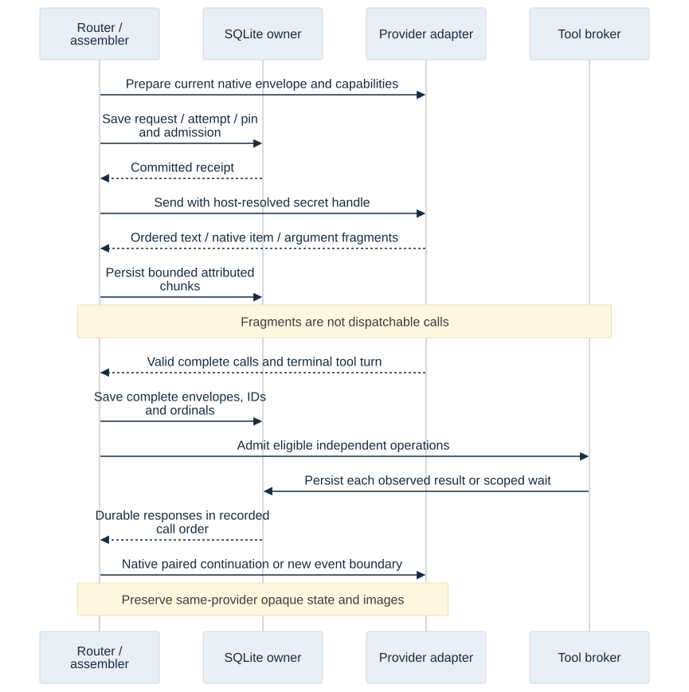

Dispatch a host tool only after complete identity and validated arguments are durable. Default to waiting for a valid terminal tool-call turn; earlier per-call dispatch is allowed only when the adapter proves that call completion and required continuation material are already stable. A later stream failure never erases an admitted call. Schema/name/duplicate-ID errors fail the affected provider turn visibly; an effect is never dispatched from a JSON fragment. Transport adapters emit tool intents, not direct target calls.

Run eligible independent calls through the existing broker contracts. Persist responses independently and assemble them by recorded call ordinal, preserving matching IDs. Responses uses matching function-call outputs; Messages groups the tool-result blocks at the required user-message boundary; Chat uses the required contiguous tool messages following the assistant calls. Later approval outcomes arrive as new events, never a second result for a closed ID. Tool response content can include images/artifact references only through a supported multimodal representation; no silent image-omission marker.

Persist canonical native fragments and stable tool-schema ordering once. Same-provider continuation preserves signed/encrypted/opaque items byte-for-byte in their supported structure; do not synthesize, interpret or display hidden reasoning as a promised audit trace. Cross-provider conversion excludes foreign opaque state and records a new context epoch with user directions, approved plan, completed call/result receipts, unresolved operations and necessary visible content. Current instruction/tool authority wins over any cached/native continuation.

### Retry failover and interrupted turns

**AD 29 · confidence high.** Each logical request has numbered attempts; attempt metadata, native stream buffers and cost observations cannot leak into a replacement attempt. Persist route, request/envelope and admission before sending. Retry/failover follows the recorded exposure/effect boundary, not only the HTTP error code.

| Failure boundary | Automatic recovery contract |
| --- | --- |
| Before send or confirmed rejection with no admitted tool | Retry a transient failure or choose an eligible replacement under current controls. Record even a failed attempt and any known charge; ambiguous send acceptance retains cost uncertainty. |
| Partial visible text, no admitted host effect | Mark the partial attempt interrupted and retain it in history. Retry/restart in a new attempt/context as needed; display replacement output as a separate attributed attempt, not concatenated duplicate text. |
| Complete tool envelopes recorded, none admitted | Revalidate those pending intents and current turn validity. Reuse valid call identity/results where supported; invalidate incompatible unexecuted calls during a recorded context restart. |
| Any host tool admitted or effect uncertain | Reconcile the operation journal before considering another effect. Known completed outputs are reused; unknown effects hold actual dependents. No provider retry can authorize replay of them. |
| Terminal response observed but local final acknowledgment lost | Reuse the durable terminal outcome; query provider status only when the endpoint actually supports it. Stateless subscription transport does not imply a retrievable stored response. |
| Cancellation or app restart | Stop local transport where supported, retain partial output/usage and uncertain billing, and obey root/boot controls. Provider termination is not proof that generation or billing stopped remotely. |


If native continuation cannot be reconstructed safely after a partial stream, create an explicit new context epoch from durable directions and operation receipts, preserving the abandoned native attempt. Do not invent a signed assistant turn or fabricate missing results. Reconcile and isolate opaque effects, then continue independent eligible work. Provider-hosted autonomous mutating tools are not silently enabled as a way around broker admission; any supported native service tool needs an explicit capability/effect contract and current authority.

Limit distinct route attempts per retry round to the eligible pool and persist tried-route/retry state across supervisor recovery. Wait for a relevant event/deadline rather than busy-looping through the same failing candidates. One unsupported route does not erase session identity, approved work, other providers' availability or a user's Pause.

### Cache and context epochs

**AD 30 · confidence high.** Version stable role/instruction/tool prefixes and deterministically order schemas. Append normal turns, native tool exchanges and screen/progress context without reformatting prior messages. Persist prefix/native-envelope digests and schema/instruction revisions. An instruction, skill, permission or scope change creates an explicit adoption boundary even if it reduces cache reuse. Current policy is checked on every broker admission; a cached tool definition grants no execution authority. Revocation also updates the request-visible tool set at its next safe boundary; cache reuse cannot keep a revoked tool available in subsequent requests.

Cache controls are adapter/model/access-mode capabilities. The current OpenAI API distinguishes model-dependent cache keys, retention and breakpoint controls; use its supported profile rather than assume one key/TTL works everywhere. Claude's documented Messages cache controls and token fields differ. Do not add cache-write prewarming that can consume quota or incur charges as an automatic optimization. Start with provider-supported automatic/default caching and validated stable prefixes; choose explicit breakpoints/longer retention only when the configured profile and measured benefit support them. [OpenAI prompt caching](https://developers.openai.com/api/docs/guides/prompt-caching), [Claude prompt caching](https://platform.claude.com/docs/en/build-with-claude/prompt-caching).

Normalize cache usage using declared field semantics: some inputs are inclusive totals with cached subsets; Messages input/cache-read/cache-write categories are disjoint. Do not add a subset twice or treat missing cache metrics as zero. Report reads, writes and TTL/service-tier distinctions where available, plus total input/output, cost source and effective resolved model. Explain known prefix/tool/model/epoch changes; label inferred miss reasons. Never duplicate full sensitive prompts into diagnostic logs just to analyze cache behavior.

At 80% of the actual active model context limit, compact automatically at a safe boundary, accounting for tools, images, native history and output headroom. Prefer a supported accurate count; use a conservative attributed estimator when exact counting is unavailable. Required context/limit unknowns need explicit configuration or a visible blocker, not silent truncation. Recheck after failover to a smaller model. Only declared effort mappings apply. Record requested/effective values; an explicit nondefault effort that a route cannot honor excludes that route instead of being silently dropped. Default delegates to the provider; never send an invented option.

Compaction is its own router request, attributed to the same work/budget, with a stable source epoch/digest. Publish the new summary/epoch only after it durably preserves user directions, approvals, blockers, operation receipts and lineage. A failed compaction leaves the old context intact. If current instructions changed during compaction, its old result cannot replace the new state. Do not compact away unresolved tool exchanges or approval/effect uncertainty. Repeated compaction cannot become a quota-consuming loop when the required context still cannot fit.

### Usage accounting and spending admission

**Confirmed product policy · ROUTE-17:** prefer OpenRouter's reported costs; local-provider usage is free for monetary tracking. A custom provider uses reported cost, then user-configured prices; without either, it remains usable with **price not tracked**, excluded from priced totals. OpenAI/Anthropic subscription usage counts toward feature budgets at API-equivalent estimates, explicitly labeled as estimates rather than actual charges. Untracked usage means a monetary limit has partial coverage; never describe it as a complete financial guarantee.

**AD 31 · confidence high.** A usage observation belongs to one attempt/response identity and carries nullable input/output/cache/reasoning quantities, cumulative-versus-delta semantics, cost/currency, resolved model, charge source and completeness. Preserve reported zero. Merge cumulative observations by field/revision; sum only fields declared as deltas. Reasoning/output and cached/input subsets must not be counted twice. An estimate and a later provider charge are different observations of the same attempt, not two expenses.

The effective cost classification is `ReportedCharge`, `ConfiguredEstimate`, `OfficialEstimate`, `SubscriptionApiEquivalent`, `LocalFree` or `Untracked`. Local-free classification is explicit connection metadata, not a guess from the hostname: a loopback proxy to a paid service is not automatically free. A model/endpoint lacking a usable official or configured rate remains visibly untracked rather than inheriting an unrelated model's price. Provider-resolved model identity controls any fallback estimate; an unresolved OpenRouter auto target cannot use a random catalog price. A reported charge wins over its provisional estimate, with an attributed correction delta and the original observation retained.

Use fixed integer micro-USD for the initial budget ledger, exact decimal tariff parsing and recorded rounding; retain a provider's original currency/amount. Do not silently convert another currency without a configured conversion basis. Each attempt snapshots its selected tariff, model/access/service-tier context and override revision. Updating the current price catalog changes future estimates, not old estimates. A late actual-cost correction can change a historical attempt's effective cost and budget through an explicit ledger event; that is different from retrospective catalog repricing.

Feature admission atomically checks spent tracked cost plus outstanding priced reservations against its current limit. Reserve a conservative estimate from validated input/count, output headroom and applicable input/output/cache-write rates; assume no cache discount before a hit is reported. Include non-token units when the profile exposes them. Unsupported output-limit controls are not sent merely to pretend the reservation is a hard remote cap. Provider billing and uncertain/in-flight generation can exceed estimates.

Unpriced custom requests reserve no invented monetary amount and remain allowed while otherwise eligible; record their untracked coverage immediately. Local usage records a deliberate zero/free classification. Subscription reservations use the selected API-equivalent tariff. Off mode and standalone issues record costs/unknowns without a spending cap or threshold warning. Do not infer a new global, project or scheduled-job cap; configurable role/purpose routing and existing feature attribution still apply.

If outstanding reservations alone consume headroom, wait for settlement and recheck automatically. Try an eligible cheaper route or valid smaller output allocation within current constraints where useful. If no priced request fits the remaining headroom, expose that specific blocker; it is not a fabricated “actual spend reached” event. Reaching the actual tracked budget creates the confirmed manual-Continue hold, warns/updates the coordinator, blocks further feature admissions and requests supported cancellation of remaining inference. Preserve incurred usage and safe in-flight tool observations. Raising/disabling a reached cap does not clear its latch.

At 75% of a configured limit, deliver one durable threshold crossing event plus current budget context; updates remain available without notification spam. Unknown-cost coverage and provisional reservations are shown separately from incurred tracked cost. If durable usage cannot be recorded, stop new dependent inference instead of continuing with an unobservable budget. Later charge corrections cannot silently clear a manual pause. Authentication, scope, approval, tool and root controls remain effective even on free/untracked routes.

### Price catalog refresh and provenance

**Confirmed product direction · ROUTE-16; adopted weekly default · AD 32.** Refresh official OpenAI and Anthropic rates every seven days while the app is open, with manual Refresh now. Fetch when a configured provider has no catalog and check freshness once on reopen; an overdue catalog creates one current refresh, not a replay of missed weekly jobs. App closure still stops all work. This is product pricing maintenance, not a Codex automation created by this planning session.


Use provider-specific native HTTP fetch/parsing adapters for the public official pricing sources, independent of inference credentials. No background model call is required to discover or parse rates. Do not assume a permanent machine-readable pricing API exists. Validate source identity, units/currency, canonical model mapping, service/context tiers, cache read/write rates and supported input modalities; retain source URL/digest, parser version, fetched/verified time and declared effective date when present. [Official OpenAI rates](https://developers.openai.com/api/docs/pricing), [official Anthropic rates](https://platform.claude.com/docs/en/about-claude/pricing).

Stage and validate a complete provider snapshot, compare its expected publication revision, then publish atomically. Unrecognized markup, missing required fields, ambiguous price tiers or implausible parsed units fail the refresh visibly; retain the last good snapshot and label its age. Bounded network retries and a later due wakeup preserve automation without repeated inference or early polling. A stale snapshot is a visible estimate source, not automatically a reason to stop otherwise eligible work. Newly unmapped models remain untracked until correctly priced.

Manual price overrides stay active until explicitly removed and are not overwritten by refresh. Publish a visible price-change/freshness event without retroactively changing prior estimates or pausing healthy work. Rate refresh cannot expand tool authority or silently enable a new provider/model. OpenRouter usage captures its returned charge (with bounded generation-metadata observation when needed and supported), rather than substituting a separately maintained static price for a known reported cost. Local-free and untracked-custom policies are independent of official-catalog availability.

### Router acceptance and compatibility gates

Confidence is **high** in the internal contracts and **medium** in subscription transport/automatic pricing-parser compatibility until G03 evidence exists. Official API documents and inspected source define fixtures; neither proves current user entitlement, a compatible authenticated subscription transport. Provider behavior remains explicit: the user elected to retain direct Claude subscription access at their risk and separately add Anthropic API-key access (AD72). A subscription failure makes that connection unavailable; replacement is restricted to currently eligible connections explicitly included in the saved routing policy. Do not turn an OAuth token into API credentials, silently accept billable API use, or substitute a Claude CLI.

| Deterministic no-inference scenario | Required result |
| --- | --- |
| Concurrent first selection / restart / alias rename | One persisted pin/cursor step, stable historical identities, no feature/issue auto-resume. |
| Pinned route cooled, missing auth, all cooling or hard capacity full | Eligible persisted replacement or one durable wait; no escaped pool, early retry, forced capacity overrun or new manual pause for a transient wait. |
| Fragmented/interleaved streams, malformed JSON, duplicate call IDs, missing terminal marker or error after HTTP 200 | Bounded decoding, exact identity/order, honest incomplete/failure state; no tool dispatch from fragments. |
| Native tools, images and opaque continuation across same-provider replay and cross-provider failover | Valid native pairing and stable prior blocks; no image omission, flattened pending calls or foreign opaque state. |
| Partial output plus admitted mutation / crash at durable boundaries | Recorded attempts, preserved partial UI/history and cost uncertainty, reconciliation/result reuse before any possible replay. |
| Refresh races, cancellation, rotated secret or credential removal | One bounded refresh, correct revision/secret handle, persisted successful rotation and no credential/body leakage. |
| Compaction / role edit / smaller model / image-heavy context | Current instructions and complete unresolved state preserved; count/epoch conflicts visible; no silent truncation or repeated compaction loop. |
| Cumulative cache usage, duplicate report, reported zero, late actual cost and resolved auto model | No double counting or metadata bleed; correct source/identity and attributable ledger correction. |
| Weekly refresh, changed markup, stale/offline catalog or manual override | Last good snapshot retained, freshness/error visible, new tariffs apply prospectively and overrides survive. |
| Priced parallel requests, subscription estimate, local free and unpriced custom route | Atomic priced reservations, explicit partial coverage, 75% event and reached-cap manual Continue; allowed unpriced/local requests still obey existing holds. |

The retained fixtures and probes are architecture evidence only. Full adapter tests must drive actual Rust request encoders/decoders, secret-store substitutes, SQLite and controlled HTTP streams without inference. Live auth/generation/cache compatibility remains a separate explicitly configured qualification step; no real inference or credential sign-in occurs during this architecture pass.

## Tool authority and trust boundaries

**Confirmed 1 November 2026 — SEC-03:** full access is the initial default for new projects, with tighter access selectable. Full access preserves reviewer restrictions, explicit approvals, destructive guards and the prohibition on force-pushing main. **SEC-04:** drive/filesystem roots remain blocked; deliberate deletion of a registered primary repository requires a dedicated user-confirmed action. An approved agent operation cannot substitute for that action.


### Authority profiles and enforcement guarantees

Use one ordinary desktop user context. The trusted application boundary includes domain policy, the broker, storage/secret adapters and qualified launchers. Treat repository instructions, retrieved pages, tool output and extension responses as untrusted content. They can inform a plan but cannot grant authority. A worktree provides a place to write changes; it is not an OS sandbox. A compromised OS, administrator or unrelated process already running with equivalent user authority is outside the app's isolation guarantee.

`AccessPolicy` is workspace configuration with an optional project override. New projects inherit Full unless the user has chosen a tighter workspace default. A project override can deliberately broaden or narrow the inherited profile only through an authenticated local user setting change, with history; agent-written repository configuration cannot change it. Full means broad user-level local execution and configured integrations, not administrator/root elevation, access to another project's internal records, additional integration accounts, or exemption from mandatory controls. Full-mode native processes have the desktop user's ambient OS access; internal project IDs restrict brokered data, not arbitrary filesystem reads by such code.

| Profile | Brokered operations | Native execution and actual guarantee |
| --- | --- | --- |
| Full, initial default | Selected tools, work/role/connection policy and mandatory gates still apply. Local paths may be broadly accessible within the user's OS rights. | Trusted local shell, builds and enabled native packages can run with ordinary user rights. Preflight inspects known destructive intent. This profile makes no confinement guarantee against arbitrary code. |
| Project scope | Broker validates registered repositories/task worktrees, explicit shared artifacts, selected connections/endpoints and declared build/cache roots. Out-of-scope requests require an explicit scope change or a bounded user grant. | Arbitrary shell/package/MCP execution requires a qualified confined launcher covering its requested effects. If unavailable, affected native calls show EnforcementUnavailable; brokered work continues. No fallback to Full. |

Project scope gives immutable inputs/readable source and task-owned writable worktrees/build/temp locations as appropriate to the operation. It does not make the entire home directory, all repository siblings, container engine socket or credential directories implicit build dependencies. Shared compiler/package caches have separately declared rights; prefer per-project writable cache partitions and read-only shared content. Native integration with a Docker socket or desktop input grants substantial authority and requires its explicit capability; container availability is not equivalent to permission to control the host. Ordinary project-local dependency installation follows effective authority; system-wide installation and elevation require their separate explicit approval.

The user may grant a specific native tool execution outside the confined profile after reviewing the resulting access. Record that bounded grant and show the affected invocation as Native with user permissions; do not label it project-confined. Grant identity binds executable/content or approved command contract, project/work, requested paths/network/resources and applicable configuration revision, with explicit lifetime/revocation. Changing arguments cannot reuse a narrowly approved unrelated target. Normal authorized operations within a saved grant do not prompt repeatedly. Restricted mode is useful without a VM; a missing backend never triggers a VM install or weaker execution automatically.

`ToolRegistry` records qualified ID/schema, implementation digest, verified/requested effect classification, scopes/resources, cancellation and reconciliation contracts. Built-in/MCP/package namespaces cannot collide. Compute effective authority as the intersection of tool selection, caller role, work ownership/control, project policy, connection grant, execution-boundary capability and required approvals/consent. A denial dominates. Host-issued context and policy revisions cannot be substituted by caller arguments. The UI invokes the same domain use case; human-only confirmation receipts are minted through the trusted local input path, never by an agent calling a public confirmation command. A notification dismissal is not a receipt. App-managed automation cannot target these confirmation controls. This is a boundary on supported app paths, not an unforgeable physical-user signal against arbitrary native code with the desktop user’s authority.

### Verified reads and revocation races

Reviewers receive the same selected read capabilities as other agents, filtered by a mandatory verified-read requirement. Full access, Select all, edited prompts and a writable connection cannot broaden that role. Verify behavior at the actual adapter boundary: bounded native file reads, Git object/diff reads with hooks/external diff/textconv/fsmonitor and credential helpers disabled, and read-only target-database credentials/transactions with a verified query surface. Do not run arbitrary user-defined database functions or shell snippets as reads. If an engine/adapter cannot constrain a query, expose a typed safe read subset or mark it unavailable to reviewers. Local scratch owned by the host for a read result is not authority to modify the reviewed repository.

External MCP annotations and native package declarations are classification inputs, not evidence. An opaque remote tool remains unverified even if advertised as read-only. A local opaque tool may enter the read set only through a version-bound adapter contract and enforced execution profile that covers filesystem, network, process and indirect integration effects. Filesystem read-only alone cannot prevent a network write or a mutating command to another service. Provider inference for a reviewer remains allowed through the router's separate inference authority; it does not grant arbitrary remote tools. A remote server cannot be confined by sandboxing its local client.

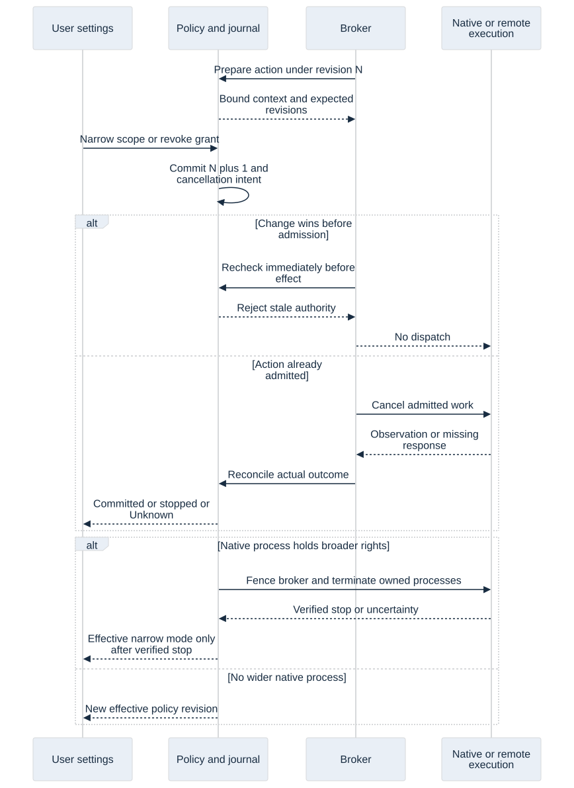

Every prepared action carries `AuthorityRevision`, role, connection revision and current work/control generation. At the effect's linearization point, the broker checks them again before journaling/dispatch. A policy change commits the new revision with history and affected wakeup/cancellation intent. An action fenced before admission performs no new effect. If an external request was already admitted, revocation cancels where possible and reconciles the actual outcome; it cannot undo a completed write. Do not hold a database transaction across network or process work to simulate atomic revocation.

Narrowing Project scope or revoking a native grant fences new dispatch immediately, then terminates/reconciles processes still holding wider OS rights before reporting the narrower mode effective. Display Requested, Transitioning and Effective policy separately. A process cannot be made confined merely by changing a database row. If termination is uncertain, retain its wider-boundary warning and exclusive resources and block only affected work. A broadened policy does not Continue a paused feature or approve a plan. Compatible tool/context schema updates adopt at their safe boundary; revocation takes priority over that convenience.

### Destructive targets and deliberate repository deletion

`DestructivePreflight` is one service used by typed filesystem, worktree cleanup, shell adapters and declared destructive MCP/package operations. Its input is a normalized `EffectPlan`: operation kind, target set/identity, recursion/content-erasure semantics, intended scope, ownership evidence and expected revision. Protect volume/filesystem roots, registered primary repository roots and ancestors or whole-content erasures that would destroy them. Protect the internal application data root from agent file tools; mutations there belong to application operations such as restore. Ordinary removal of bounded source files during implementation remains permitted under normal scope. Deleting all repository contents is not safe merely because the top directory survives. Only the dedicated typed repository-deletion operation can pass the primary-root guard with its current user-confirmation receipt; ordinary agent approval cannot. Drive/filesystem-root protection has no such exception.

Resolve relative paths against the saved working directory; normalize case/drive/UNC forms as the filesystem requires; expand globs into a bounded explicit set; inspect symlinks, junctions/reparse points, mount/volume identity and parent traversal. Check both the named directory entry and the resolved target. Unlinking a link without traversal is a different operation from recursive deletion of its target. Identify registered roots by stable filesystem identity plus registered location so aliases cannot avoid protection. Unknown/oversized target expansion returns NeedsInput or Denied before deletion.

Immediately before each destructive step, operate through verified directory/file handles and no-follow, descriptor-relative APIs where available, checking the expected identity and protected-root registry revision. Do not close the check/act gap by assuming `canonicalize` followed by a path-based delete is atomic. Refuse a path/filesystem case for which the adapter cannot preserve its promised identity rule. Recursive deletion can still be partial if files change or an I/O error occurs: journal actual progress and remaining targets; never report an all-or-nothing result that the filesystem did not provide. Adversarial rename/link/mount interleavings belong in G04 on each OS.

Typed worktree cleanup additionally proves the exact owned worktree identity, branch/work association, stop state, registry revision and absence of active users/pins. It cannot delete a primary checkout, follow an escaping link or broaden to its parent. Preserve failed cleanup evidence and retry under the same guarded operation. Git main/protected-ref mutations use the typed Git adapter and current remote/ref checks; raw user-level native code cannot be described as cryptographically unable to bypass Git policy using credentials it independently possesses.

Shell preflight inspects supported command syntax, redirections, expansions and declared effect plans for recognizable dangerous operations. Arbitrary scripts, interpreter commands and native programs cannot be proven safe by a complete command-string parser. In Full mode record that residual risk; in Project scope require the qualified boundary or explicit native grant. Opaque MCP/package tools with declared destructive intent and unresolved targets are held/denied. Never treat the absence of a recognized `rm` command as proof of harmlessness. These are basic accident guards, not a claim of universal interception of arbitrary user-level code.

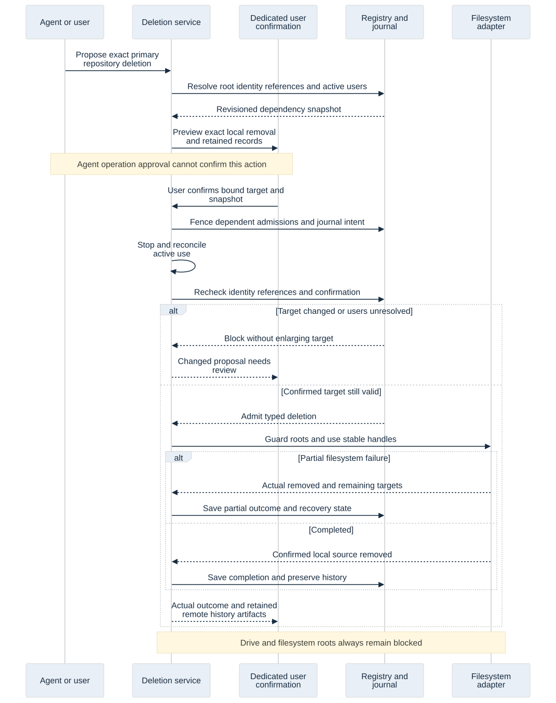

Provide a dedicated repository-deletion proposal and local confirmation surface. An agent may prepare a proposal and its concrete preview; only the user can confirm the dedicated action. The preview identifies the resolved repository/path, project references, owned/unowned worktrees, active work, retained remote/history/artifacts and local data to be removed. Deleting a project record or removing a repository association is a different operation and never implicitly deletes source files. Block while the repository has another live project reference or unresolved external users, until the user separately resolves those dependencies. A confirmation binds the reviewed target/identity/dependency snapshot and expected revisions; it is not a reusable agent exemption.

After confirmation, fence new dependent work, stop/reconcile active use, revalidate all identities and references, then journal and perform the typed deletion. If cleanup reveals a new worktree, reference, changed root or still-running process, return to a changed/blocked proposal instead of silently enlarging the confirmed target. Preserve outcomes and linked work history after local source removal. Network remotes are never deleted by this action. Drive/filesystem-root targets remain permanently blocked, including through this surface. Failure after partial deletion is visible and recoverable only to the extent supported by actual saved data; no automatic backup or guaranteed undo is implied. Full-mode arbitrary code remains subject to the honest interception limit above.

### Credentials external data and diagnostics

`SecretStore` is a native adapter port: macOS Keychain, Windows user-scoped DPAPI-encrypted secret blobs and Linux Secret Service over the user's session bus. Application records hold opaque connection/secret references and credential revisions. [Apple Keychain](https://developer.apple.com/documentation/security/using-the-keychain-to-manage-user-secrets) provides the macOS facility. [Microsoft DPAPI](https://learn.microsoft.com/en-us/windows/win32/api/dpapi/nf-dpapi-cryptprotectdata) is bound to user credentials; it is not isolation from other equivalent-user code. [Secret Service](https://specifications.freedesktop.org/secret-service/latest-single/) can be locked or unavailable. In that case keep affected actions in CredentialsUnavailable; allow the UI and unrelated work to operate. Offer explicit in-memory credentials for the current app session, never a silent plaintext disk fallback. No separate DevWorks authentication server, mandatory OS user switch or system daemon is introduced.

Resolve secrets only in the owning provider/integration transport, with minimum scope and short lifetime. Clear temporary buffers where practical, restrict file/IPC handles and inherit only a minimal child environment. Do not include API tokens in arguments, transcripts, crash diagnostics, package configuration or tool errors. Git/provider credentials use dedicated transport/credential brokers, not the user's entire environment or a general credential-helper escape hatch. A configured stdio MCP server that requires a credential environment is an explicit trusted native connector exception: disclose which connection secret reaches that server, require user authorization and avoid unrelated credentials. Project/full access alone does not select every connection secret. A native process with equivalent user access may still read independently accessible credentials; stronger protection requires a qualified isolation boundary.

Remote native HTTP validates TLS using an explicit trust policy, bounds redirects, sizes and timeouts, and rechecks destination/credential origin on redirects. Do not forward authorization headers to another origin. Plain HTTP is a visible local-loopback or explicitly configured endpoint exception, never an automatic certificate-error fallback. Brokered network grants specify connection/origin/operation; providers do not receive arbitrary app state. URL fetches use their own authority and reject disallowed local/metadata destinations unless that local target is explicitly authorized, with DNS/address checks repeated on connection and redirect. Full-mode native networking has the user's broader ambient network rights.

Show configured provider destinations, model/connection and outbound attachment/context provenance before and in request history without prompting for every ordinary authorized request. Exclude secrets and unauthorized project content before context construction, including embeddings/vision, cache keys and diagnostics. Redaction covers known credential values/headers and typed sensitive fields before persistence/export; it cannot prove arbitrary source text contains no secret. Preserve original authorized transcripts/artifacts under their normal access rules rather than falsely promising universal secret detection. Manual backups/exports omit recoverable credential material under the existing persistence contract and require reauthentication after restore. Diagnostic export has a reviewable bounded selection; no unsolicited telemetry or background upload is introduced.

### Security acceptance and evidence limits

Success means every supported operation states its actual enforcement boundary, mandatory restrictions cannot be bypassed through an alternative broker caller, policy transitions fence new effects, and destructive/credential failures retain honest outcomes. G04/G05/G09/G10 require the following actual-adapter cases without inference.

| Case | Required evidence |
| --- | --- |
| Full default and scope inheritance | A new project defaults to Full; a deliberate workspace/project restriction has visible effective provenance. Repository text/agents cannot alter policy. Full preserves reviewer, approval, main and destructive checks. |
| Project profile and native boundary | Out-of-scope broker reads/writes fail. Unavailable/missing/partial OS isolation never launches native code as confined. A reviewed native exception is labeled broader access and stays bounded to its saved grant. |
| Reviewer indirect effects | Direct writes, helper hooks, SQL functions, read-labeled shell, opaque MCP/package calls, writable connections and network mutations cannot enter the verified-read surface. |
| Revocation races | Change policy/secret/tool/role during prepare, immediately before dispatch and after remote admission. Fence unadmitted calls; reconcile committed/Unknown effects; do not report narrowed native authority while the old process still runs. |
| Target alias and race | Test roots, recursive ancestors, whole-content erasure, relative/glob/UNC/case aliases, links/junctions, replaced parents and volume/mount changes against real disposable targets on every OS. Include partial deletion and unavailable identity APIs. |
| Dedicated deletion | Agent approval cannot delete the primary repo. The dedicated user confirmation binds exact identity/references; changed targets/users block. Controlled deletion removes only confirmed local source and preserves remote/history/artifact rules. Drive roots remain blocked. |
| Credentials and outbound data | Locked/unavailable stores, session-only secrets, revoked connection, poisoned redirects/DNS, child environment, MCP credential exception, log/error/export scrubbing and backup/restore exclusions. Never use real production secrets. |
| Honest containment | Escape-oriented filesystem/network/IPC/child-process tests against each candidate launcher, including access to host credentials/control sockets. Process ownership tests separately verify cancellation and surviving descendants. |

No native enforcement adapter or cross-platform security guarantee is demonstrated by this planning pass. Basic policy/guard contracts are adopted; a platform capability is advertised only after the target-specific cases pass. Failures require a design change or surfaced product tradeoff, not a quieter label or an implicit switch to Full.

## Git delivery and GitHub synchronization


The Git adapter uses a detected compatible Git executable or an explicitly app-managed distribution; absent tooling reports the affected operation unavailable, without breaking local planning/history. Exact bundling and credential-helper support require G10 validation and no silent system-wide installation. Each coding assignment owns a task branch and worktree per repository. An integration worktree serializes feature-branch integration while independent workers continue in their separate trees. Maintain task-to-worktree/branch/PR associations in records, not only model messages. The harness provides automatic Git operations and read-only inspection; it does not implement a manual staging/commit/merge client.

Feature task/group PRs target each repository’s feature branch. The coordinator groups related tasks as useful. Only after implementation and required documentation/verification are complete may it open final PRs to main. Standalone issue PRs target main directly. Never force-push main; resolve the actual destination ref, ownership and remote revision for every guarded push. Automatic force-with-lease is limited to the agent’s owned task branch; feature-branch force-push requires specific human approval.

The review service normally uses configured GitHub automation, and uses a separate verified-read in-app reviewer when automation is absent. **Confirmed AR-06:** failed or stalled automation automatically falls back to that independent reviewer. Fallback changes the review source; required checks, branch protection and other merge gates remain effective. Every actionable finding must be resolved. Default maximum fix cycles is 3, configurable; source fallback itself is not a fix cycle. Exhaustion or an undecidable finding holds only affected work and dependents.

Final feature delivery has a durable readiness barrier containing every final PR and its expected head. All final PRs must pass checks and reviews before the first merge. Merge in a validated acyclic dependency order, rechecking effective authority and relevant head/check state before each action. If conflict resolution changes code, refresh the affected checks/reviews and readiness evidence. Routine conflicts are resolved autonomously with history but no user notification. Unusual unresolved failure pauses the affected delivery/dependents and notifies the user; already merged repositories are recorded, not automatically reverted or described as an atomic rollback.

Feature completion is verified merge of all final PRs. Cleanup, release and deployment have separate state. After verified feature or issue delivery, stop remaining writers and remove only owned worktrees/local branches whose integration and cleanliness are proven. Preserve unintegrated changes, artifacts and history; expose cleanup failures. Release publishing and deployment each inherit Automatic/Ask me/Disabled policies, defaulting to Ask me, independently of Auto-Merge. Their approvals bind revision/version/destination; a failed deployment does not reopen a merged feature.

GitHub integration supports one GitHub.com account with personal and accessible organization repositories. Distinguish API credentials, organization authorization and Git transport credentials. Proposed account adapters use an approved GitHub OAuth/device/PAT configuration rather than assuming provider subscription credentials also authorize GitHub. The authentication choice remains an implementation contract to validate.

Use authenticated conditional polling, stable endpoint queries, pagination, cursors and rate-limit/backoff handling. Observe `x-poll-interval` where returned. Polling is the selected no-public-endpoint approach; do not install webhooks/tunnels. [GitHub polling guidance](https://docs.github.com/en/rest/using-the-rest-api/best-practices-for-using-the-rest-api) supports these efficiency controls.

Commit durable application events with deduplication keys; agent notices and indexing have separate consumer checkpoints. Push/merge events can refresh affected source views. Issue/review-only updates do not reindex unchanged code. Capture existing open and newly reported issues automatically; start routing/triage/verification only through the persisted app-wide intake gate. Linked GitHub issues use inbound observations and verified-resolution publication, as specified below. New local issues stay local until explicitly linked/published. Poll reconciliation cannot resume human-held work or manufacture missed scheduled inference runs.

### GitHub intake, routing and resolution

**Confirmed AR-05:** automatically capture existing open issues on repository connection and all new issues. Keep remote identity `(repository, issue number)` and source owner/URL. Product repositories normally supply project context. When a repository is shared, the triage agent routes the report; there is no repository-wide owning project and no automatic copy in every project. Preserve one intake identity across routing/retries. If triage identifies distinct work for several projects, relate their project-owned tasks to this shared source through integration links; do not impose one project owner on the repository. Persist the required local obligation set and one publisher receipt/lease per remote resolution. Close the remote issue only after the included obligations are verified and integrated; one project finishing early cannot close it for the others. An ambiguous report stays visible in incoming intake and produces a decision notification rather than silently choosing a project. A task always has a project: a shared-repository observation may wait in the local intake inbox until routing creates or reuses its project-owned issue.

Use one app-wide persisted intake queue and one admission clock across all projects/repositories. `github.issueTriageIntervalSeconds` is an app-only positive integer Setting, default **1800**. Commit the claim and next admission time with the triage operation receipt. Start at most one issue's automatic routing/triage/verification per interval, with no agents waiting on queued records. No accumulated credits or restart catch-up burst; coalesce repeated polls/edits into the same issue admission. Re-triage that needs a new agent also uses the queue. The rate gate does not bypass per-root execution concurrency, human pauses or budgets. A verified bug may proceed immediately from its admitted triage to implementation; it does not wait for another rate slot. Existing work can receive same-bug updates without spawning a new triage agent. Changing the interval uses current saved Settings and the last actual admission; shortening it cannot spend multiple missed slots at once.

Triage distinguishes bugs and feature requests. Verify a bug before automatic implementation. Feature requests and unverifiable bugs create an in-app notification; new scope always requires a user decision. Clarification/evidence about the same bug is verified and incorporated. Feature coordinators and the message board expose shared-repository/code overlap across project-owned work, enabling coordination rather than assigning all work to a repository owner; cross-project notices retain authorized access and provenance.

| Information | Inbound GitHub behavior | Outbound behavior |
| --- | --- | --- |
| Title, body, comments, labels, author, source timestamps and remote state/reason | Retain latest remote snapshot and attributable update history; notify responsible agent/coordinator. Preserve local analysis separately. | Local edits are local. No automatic mirroring of intermediate tracking fields. |
| Local priority/status, feature membership, plan, pauses, agents, dependencies, budgets, private transcripts | Remote edits cannot overwrite these execution fields. | Never publish these fields as synchronization. |
| Verified resolution and integration evidence | Retain remote observations for reconciliation. | Publish a concise resolution summary and close automatically after completion and verification. |

Remote closure is an observation, not a stop command. Continue a verified bug already being fixed and approved/planned feature work. Close an unstarted unreproducible local bug; retain feature requests for manual choice. An unclassified closure is reconciled by paced triage; do not discard a verifiable report by guessing. Reopening a remote issue preserves existing pauses and completion history; reconcile new evidence without silently resuming human-paused work.

Resolution publication uses a durable completion binding and outbox journal: one logical summary/close sequence per remote issue and accepted completion. Separate comment acceptance from close acceptance. Reconcile uncertain outcomes through stored observations/attribution before retry; never re-run a successful comment merely because closing failed. A remote issue already closed does not need reopening to record a verified resolution. Preserve both sides of an unresolved conflicting update and notify the user; independent work continues. No runtime host, public webhook or inference call is needed merely to queue incoming observations.

### Review source and completion evidence

For each repository, retain a revisioned review-source descriptor: source kind/identity (GitHub App/bot or registered workflow/check adapter), repository/PR matching, supported observation adapter and a finite wait deadline. Discover only through authorized GitHub configuration/observations and supported adapters; an unrelated passing check or absent comments cannot identify a completed review. Unknown/disabled/missing sources cannot qualify the review gate. Technical default `reviews.automationWaitSeconds` is **900**, configurable through existing inherited Settings; this is an engineering default, not a new user-confirmed product requirement.

Normalize Requested, Running, Completed, Failed, Unavailable, TimedOut and Stale observations. Bind each to source identity, provider run identity, repository/PR, exact head, effective policy and review cycle. Completion requires an explicit terminal observation with complete findings coverage, including explicit zero-findings completion. A successful unrelated check and silence are insufficient. Persist original evidence and deduplicate observations; changed-head evidence stays historical and cannot satisfy the new head.

Failure, unavailability or deadline expiry atomically admits at most one independent in-app fallback for `(repository, PR, head, policy, cycle)` and records the reason. Fallback uses the same exact-head and findings contract and retains mandatory reviewer read-only enforcement. A healthy external source does not launch a duplicate in-app reviewer. Late external actionable findings join the current fix cycle before merge; they cannot disappear because fallback completed. Head changes revoke readiness and require current evidence. Resolve post-merge late findings as attributable follow-up work, not a fabricated rollback authorization. A required GitHub branch-protection check still cannot be waived by replacing the DevWorks review source; surface that concrete external gate if it prevents merging.

### Concrete delivery and recovery candidates

**AD 60–61 · confidence high in contracts.** [Graph, retrieval, artifact and delivery contracts](data-retrieval-delivery-contracts.html) specify exact-head readiness barriers, typed Git/release inputs, async merge observations and independent cleanup/release/deployment outcomes. GitHub acceptance or queue admission does not complete delivery. Its async job may expire; reconcile through the saved PR/head/method before replay. An observed base is not atomic base protection. Partial multi-repository delivery preserves completed merges while holding changed or failed members. Safe owned-worktree removal and expected-object branch deletion cannot discard a concurrent commit. The temporary Git fixture passes 17 checks; GitHub metadata is scripted and actual provider/authority qualification remains open.

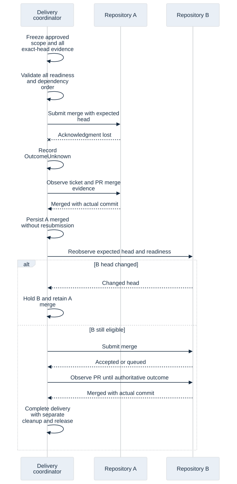

## Indexing graphs and schemas


`IndexCoordinator` discovers source changes, captures an immutable content manifest, runs Tree-sitter extraction, invokes optional semantic packs, validates the result, builds a graph generation, then publishes its manifest. Report grammar coverage, inferred relationships, unresolved references, semantic provenance and each stage’s outcome. Missing grammars yield an honest text fallback. Do not imply compiler semantics from parsing alone.

The shared `GraphView` composes a repository baseline with committed branch changes and staged/unstaged/indexable untracked worktree changes. Its key includes repository identity, baseline/head revisions, worktree identity and local content digest. Changed/deleted paths mask baseline nodes and outgoing edges; incoming relationships resolve to current identities where supported or remain explicitly unresolved. Renames retain provenance. A query requests this scope consistently across search, source, traversal, impact and retrieval. Missing/stale views never silently fall back to main.

Cross-repository views identify the exact generation for every member repository. Do not claim a globally atomic source snapshot across independent repositories. Keep an explicit snapshot set and confidence for links. The inspected CodeGraph overlay implementation is a behavioral reference, including masking and inferred retargeting; its commit-based coverage does not prove uncommitted overlays or all cross-repository semantics are already solved.

All four language packs are in scope: .NET/Roslyn tooling, TypeScript compiler/language-service tooling, Swift IndexStore/SourceKit tooling, and Rust rust-analyzer/SCIP tooling. Accept SCIP and adapted native compiler indexes; normalize symbols/references with source provenance instead of making all languages imitate one compiler’s identity scheme. Helpers declare project/platform/toolchain support and resource limits. Failure or absence leaves structural indexing available. Compiler process trees must be cancelled/reaped and deterministic failures must not create repeated expensive retries.

Repository UI preserves Overview → internal code units/node kinds → containers/members → node detail/source/relationships, with Health and Reviews beside it. Graph visualization supplements those views. Health results record revision, coverage, evidence and limitations. Stale/missing/partial is not a healthy zero. Code review findings are separate from Knowledge conflict approvals.

Schema adapters cover SQLite, MariaDB, MySQL, PostgreSQL and SQL Server, with version/auth/metadata capability matrices. Index only structural metadata: objects, property/column types, keys, views and supported relationships. Source row values must not enter stored indexing logs, transcripts, artifacts, caches or embeddings. External source indexing remains separate from DevWorks' own SQLite app-store adapter. The user explicitly removed the conditional HelixDB schema reader; neither HelixDB nor HydraDB is a target. Reject those engine selectors rather than retaining a hidden reader or inference path. Historical storage experiments do not add an app dependency.

Data reads/writes use a separate connection capability, combining shared-connection project access, connection write enablement and tool/role policy on every call. A migration committed in a worktree is preferred for schema changes; it is not approval to apply it. Direct schema changes require the same target permission and recorded fallback reason. Use adapter-enforced read-only credentials/transactions where possible; parser keyword checks cannot certify arbitrary SQL or Cypher. Unknown-effect mutations need operation-specific reconciliation or an unknown-outcome hold.

### Concrete graph and retrieval candidates

**AD 57–58 · confidence high in contracts.** [The data contract reader](data-retrieval-delivery-contracts.html) defines immutable repository/schema view sets, layer-parent and source digests, bounded pins, whole-unit replacement/deletion, publication comparisons and typed bounded query results. Access and overlay visibility are applied before traversal/ranking and checked again before materializing snippets. Citations name exact source versions/captures; incompatible vectors or missing views cannot silently select another source. A native trait/SQLite fixture passes masking, scoped FTS/vector and access-revocation checks; full source, concurrency, GC, performance and platform acceptance remain pending.

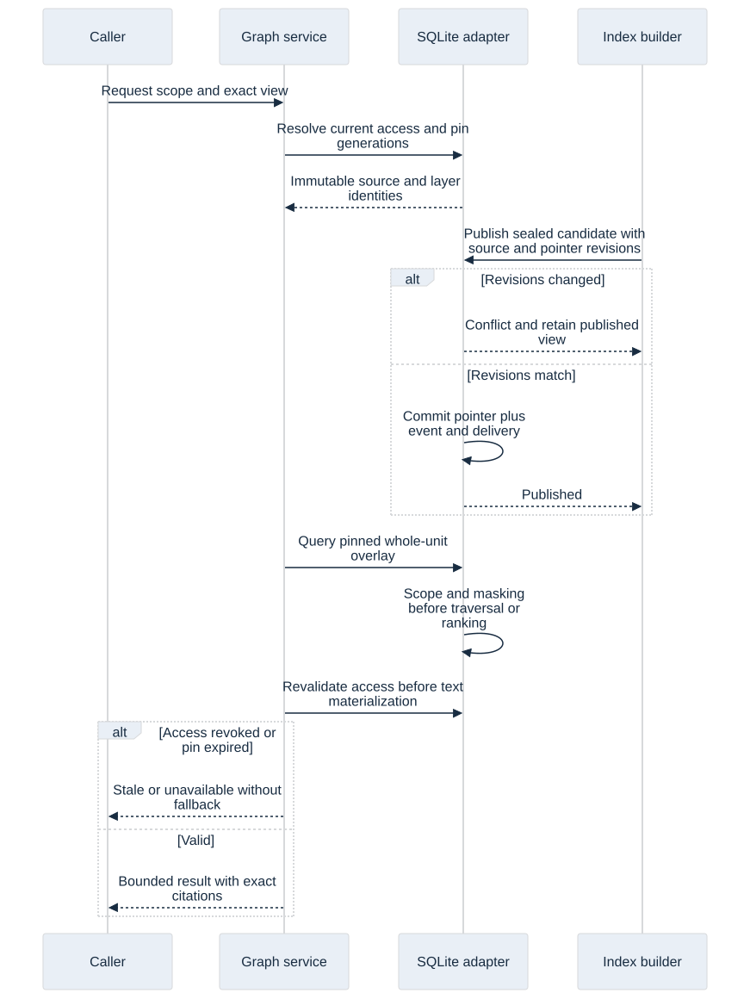

## Knowledge documents and dreaming


One `KnowledgeEntry` model holds authored facts, memory, lessons, decisions and their evidence/relations, differentiated by tags. Scope is independent of tags. A generalized lesson can become automatically available across projects after an authorized non-conflicting consolidation; a project-specific lesson tag does not publish its source data globally. Record applicability and the revisions actually delivered to each agent.

Conventions remain searchable project guidance, not a wiki requirement. Skills remain file-backed: read shared `~/.agents/skills` in place and use a harness-owned directory for local skills and same-name overrides. Resolve referenced documents/assets/scripts relative to the owning versioned skill root; scripts obey ordinary permissions and optional runtime checks. Agent-created/edited skills and role instructions are staged proposals until approved. Shared originals remain untouched when an approved harness override is created.

**Confirmed AR-08 — instruction resolution:** enforced permissions and explicit user directions remain above file instructions; applicable repository instructions override default role instructions. For each target path, start at its authorized repository root, retain applicable ancestor guidance, and apply directories from root to closest. At one directory load CLAUDE.md additions, then apply AGENTS.md for conflicts. A deeper file overrides conflicting ancestor guidance only inside its subtree, regardless of the ancestor filename. Do not search arbitrary external/home ancestors, follow an instruction-file link outside authorized roots, or leak sibling/other-repository rules into the bundle.

Record each effective source's canonical root/path, content digest, origin, applicability, precedence decision and approved revision in an immutable instruction bundle. Keep default role/convention/skill guidance constrained by applicable repository rules; a skill cannot grant permission. Explicit current user directions retain their authority rather than being reclassified as repository data. Settings-saved defaults remain defaults; approved edits to a default role do not silently promote it above repository instructions. Scope explicit workspace/project/feature/session directions to their actual work; preserve all compatible constraints and represent material unresolved same-precedence conflicts as a deterministic conflict record for coordinator reconciliation/user escalation. Refuse only the affected action until resolved, not unrelated work. Repository/tool content cannot declare itself a user direction.

Assemble work spanning multiple paths/repositories from per-path bundles. Before a tool dispatch touching several paths, check every applicable bundle; if their required actions are incompatible, split authorized independent work or hold the affected action visibly. Adopt externally changed instruction files and saved/approved skills/roles at the next safe boundary before new inference/tool dispatch. Preserve digests used for completed and in-flight actions; revalidate stale queued work against current policy, without rewriting history or granting an unapproved skill/role edit.

Users import Markdown, plain text, PDF and Word as managed project artifacts. The pipeline is import → native text extraction → saved page/heading text → chunk → router embedding → lexical/vector publication. Extract existing text directly. Scanned pages use routed vision fallback, enabled by default, with saved source/page/model provenance; no mandatory separate OCR model. Unsupported, encrypted, partially extracted and failed inputs remain visible. Existing valid source extraction is reused rather than billed on each search.

**Confirmed 1 November 2026 — RAG-09:** initial Word ingestion supports modern `.docx` only; legacy binary `.doc` is excluded from initial support. Markdown/text and `.docx` use native extraction adapters; PDF uses a bundled native text/rendering library selected by validation. Core ingestion must not require installed Word, LibreOffice, Python or Node. PDF licensing, renderer distribution, image quality and footprint remain qualification gates.

### Concrete artifact and citation candidates

**AD 59 · confidence high in contracts.** [Artifact lifecycle contracts](data-retrieval-delivery-contracts.html#artifact-mutation-and-deletion) bind bytes, versions, references, extraction locators and expected revisions. Source handles are resolved by the host. Explicit deletion commits logical unavailability before deferred unlink; shared live references preserve their files. Deleting the current version never silently selects an older one. Historical citations retain provenance and can report unavailable. Retained imported document versions and collectible derived code captures have distinct lifecycles. Exporting an authorized stream does not grant arbitrary destination-file access.


### Native DOCX extraction contract

`DocumentService` owns managed source/version identity and durable extraction stages. A bounded worker reads the immutable version through `ArtifactStore`; `DocxExtractor` returns normalized blocks, source locators, annotation/provenance records, extraction coverage and typed diagnostics. It cannot publish an index or change the current document pointer. `KnowledgeIndexer` chunks accepted output, invokes routed embeddings where enabled and publishes a complete generation under the existing checked-publication contract. Cancellation preserves completed source/extraction artifacts, releases the worker and leaves an incomplete generation invisible. Restart reuses output only when source digest, extractor revision and extraction options match. A parse failure never replaces a previously valid search generation.

WordprocessingML consists of paragraphs/runs/text plus distinct document parts; it is not a paginated plain-text format. See [Microsoft’s document structure](https://learn.microsoft.com/en-us/office/open-xml/word/structure-of-a-wordprocessingml-document). Preserve heading/list structure, paragraph order, table rows/cells, hyperlinks as inert references and relevant styles. Extract footnotes/endnotes and headers/footers as separately labeled stories, with references from the body. Keep comments and revision metadata as annotations, separated from asserted document text. Default searchable text uses the final-text view, including insertions and excluding tracked deletions, while the immutable original and annotation provenance remain available. This does not approve or modify tracked changes in the source.

Citations bind document version/content digest, part, block/paragraph and optional table/cell range. Resolve against persisted extracted blocks. Do not invent Word page numbers from paragraph positions: text pagination depends on layout. A preview may show original bytes or extracted content; any rendered pagination identifies its renderer/version. Unsupported text boxes, equations, embedded objects or unhandled revision constructs produce explicit coverage diagnostics and `Partial`, never a false complete result. Image-only content uses the existing routed vision policy only when an approved rendering/image extraction path can supply suitable source images; extraction does not silently create a new model/runtime dependency.

Use standard Rust ZIP/XML libraries behind this port. The narrow [DOCX probe](validation/document-extraction-probe/README.md) pins `zip 9.2.1` and `quick-xml 0.42.0` for reproducibility; these are candidate parser pins, not a final shipped dependency decision. Production validation must check package content types, namespaces/relationships and supported OOXML variants; bound actual compressed and decompressed bytes, parts, XML depth, block/text output and elapsed work. Reject unsafe/duplicate/alias paths and DTD/entity expansion. Never execute macros, OLE code, fields or embedded executables, or fetch external relationships. Encrypted/malformed/unsupported packages return a typed visible outcome. The probe demonstrates main-body runs/table text and selected rejection cases on one host only; auxiliary stories, revisions, rendering, comprehensive hostile-input testing and platform acceptance remain unexecuted.

Acceptance must cover multi-run text, Unicode/entities, headings/lists, merged/nested tables, foot/endnotes, repeated headers, comments, tracked edits, hyperlinks, images and partial unsupported constructs; malformed/encrypted/truncated packages, unsafe paths, inflated sizes, deep XML, cancellation and crash between extraction and index publication. Verify replacement citations still open the original version and no external relationship is fetched. Legacy `.doc` and macro-enabled formats must be reported unsupported, not parsed opportunistically.

Imported bytes have immutable identity and project ownership/sharing metadata. Default association is the current project. Move preserves identity/provenance and removes future retrieval access from the old project unless explicitly shared. Shared artifacts survive deletion of one project reference. Index removal does not delete the managed file. Retain original source/version references in past transcripts; a move cannot undo prior exposure.

**Confirmed 1 November 2026 — RAG-13:** replacement creates a new managed version and retains every previous version until explicitly deleted. Citations identify their original version and never silently resolve to replacement bytes. The persistence section specifies immutable bytes, current-search selection, explicit deletion and shared-reference preservation.

Retrieval validates scope and policy before candidate content/snippets can enter results, caches or model context. Use source membership and scope revision in lexical/vector filters and cache keys; validate the chosen graph adapter can enforce scoped vector candidate selection. Return bounded deduplicated passages with document revision, content digest, chunk and locator. A similarity score is not truth/confidence. Expose lexical-only results if the embedding/vector path is unavailable. Embedding model/dimension changes build a compatible generation; never mix incompatible vector spaces.

Dreaming is a normal checkpointable agent workflow over this same Knowledge service. It records instructions, examined evidence, changes, proposals, cost and incomplete work. Apply non-conflicting consolidation automatically; escalate unresolved conflicts with the competing revisions and rationale. Guarded revert applies only against expected current revisions, preserving subsequent human edits. No second authoritative “memory”, “lesson” or “knowledge” store is introduced.

OxiRS remains an evaluated component candidate, not a selected RDF store or third persistent engine. Any adoption needs a concrete benefit, adapter cost, dependency/footprint comparison and demonstrated scope/recovery behavior. The base architecture does not depend on OxiRS.

## Managed executable packages

One package lifecycle hosts semantic language packs and general harness extensions. Prebuilt executables install for a supported OS/CPU without rebuilding DevWorks. The host and public SDK use Rust; a package may use another implementation language if its declared runtime is available. Normal app use requires no Node, Python, .NET, VM or development toolchain. No Rust ABI or egui object crosses a dynamic-library boundary.

**Confirmed 1 November 2026 — EXT-07:** after the user explicitly trusts a publisher for updates, compatible signed updates may activate automatically at a safe boundary within the approved access scope. Publisher trust does not approve expanded access. New or changed agent-authored executable contents still require explicit approval of the exact version and contents under EXT-02, including when signed by a trusted publisher.


### Package ownership and SDK boundary

`PackageService` owns durable installations, trust receipts, enablement, activation intents and state generations through the core repository/unit-of-work ports. `PackageHost` owns helper processes, protocol sessions and invocation routing. `CapabilityBroker` admits host operations through the shared application boundary. `ContributionRegistry` publishes an immutable `ActivePackageSet` revision, consumed by tools, UI, router and workflow services. None of these consumers reads the internal SQLite store directly.

The SDK contains manifest/protocol DTOs, codecs, handshake helpers, cancellation/progress primitives, typed broker clients, contribution builders and a conformance harness. It does not export database connections, private domain structs, arbitrary egui objects or an alternative agent/router. Public identifiers and schemas have independent protocol versions. A Rust SDK release can add conveniences without changing the negotiated wire version. Other-language implementations can use the same protocol.

A process instance is keyed by package digest, configuration scope/revision and state generation. App-wide contributions use an app scope; project configuration/state uses a separate project instance. Invocations in an instance can multiplex only up to its declared, host-capped concurrency; a package that does not declare concurrent safety defaults to one. Project processes reduce accidental state sharing but are not filesystem isolation. Process identity and invocation tokens are never authority supplied by package parameters.

### Concrete package protocol candidates

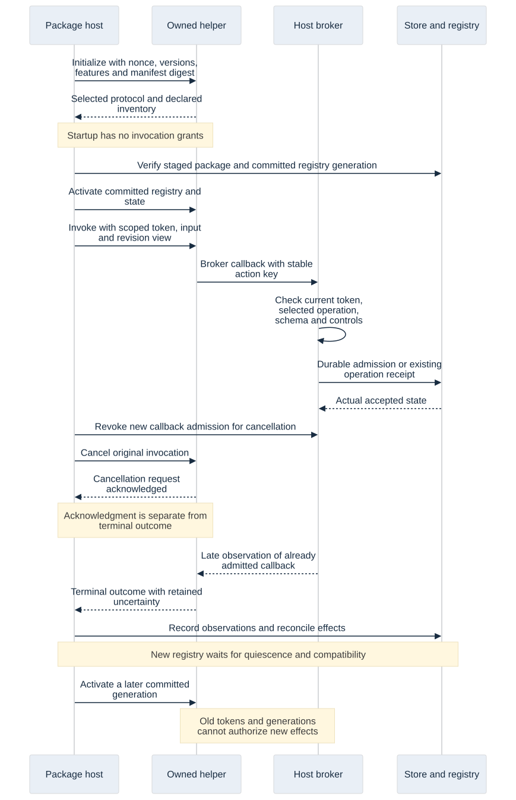

The [boundary contract source](provider-session-package-contracts.html) and [schema manifest](contracts/manifest.json) cover all eight contribution descriptors, manifests/dependencies/schema assets/limits, typed JSON-RPC requests/responses/notifications, broker calls/state CAS, credits and public lifecycle requests. The [native helper evidence](validation/provider-package-contracts/README.md) exercises owned stdio framing, initialization/activation, callbacks, cancellation, stale generation and credit isolation. Host policy/data are scripted; full SDK contribution execution, signed installation, atomic registry/state publication and native security remain unqualified.

A selected capability and its message discriminator must agree before dispatch. A shared union schema for Start/Pause/Continue or package lifecycle operations cannot let a caller select a permitted operation and hide a different mutation in its body. The family register now records that selection constraint alongside each binding. Apply it before normal application authority/admission; the schema alone is insufficient.

### Manifest installation and compatibility

The immutable manifest identifies package/version/publisher, every executable and dependency digest, supported target triples, minimum host/protocol range, contribution IDs and schemas, requested capabilities/scopes/endpoints, configuration and state-schema versions, bundled Help and resource limits. Every contribution has a stable package-qualified ID, input/output schema, effect classification request, timeout/cancellation behavior and required/optional status. Package version strings follow [Semantic Versioning](https://semver.org/); version numbers alone do not establish safety or compatibility.

Static inspection, digest/signature verification, archive path checks and compatibility resolution happen before executable launch. Reject traversal, escaping links, duplicate archive entries and modified signed content. Extraction never executes installer scripts. Install immutable files by staging, verifying and publishing a version directory; an interrupted staging directory cannot become active. Resolve the complete dependency set, target binaries and required runtimes first. Missing prerequisites leave the package unavailable with actionable diagnostics and preserve baseline indexing/unrelated work. Installing a system-wide runtime retains its separate approval requirement.

Publisher trust is a revocable receipt scoped to signing-key identity, package IDs, chosen release stream and approved capabilities. Adopt stable releases within the same package API major as the automatic-update baseline; prerelease or major-version adoption needs an explicit selection. Trust never propagates to an unrelated publisher or new dependency publisher. A signing-key change requires a verified transition signed by the already trusted key or fresh approval; a verification failure never falls back to unsigned execution. Local unsigned development packages require approval of their exact content digest. Running agent-authored tests in an authorized worktree is separate from installing/activating their result. Record proposal provenance even if those contents are later signed; signing cannot erase the exact-version approval requirement. Trust cannot prove that a publisher's code is benign or detect undisclosed authorship.

Automatic eligibility requires valid signatures, applicable trust, compatible host/protocol/target/contribution contracts, no new authority or runtime prerequisite, and a reversible state transition. Compare normalized effective capability envelopes rather than display labels: filesystem scope, endpoint set, secret connection use, process launch and nested operation permissions all count. A changed public tool contract, incompatible state migration or new required contribution requires a reviewed transition instead. Trust revocation fences new host calls and starts disable/reconciliation; it cannot retroactively undo a native process's prior access.

Registration is staged as a complete candidate registry. Validate schemas, namespaced IDs, references, Help links, UI descriptors and provider/tool contracts before publication. A conflict or invalid required contribution rejects the candidate as a whole; optional unsupported contributions remain explicitly unavailable. Never replace a built-in tool or another package through an unqualified name collision. Saved tool selections bind stable contribution identity, while every actual invocation records the resolved digest/schema. A manifest claim of read-only behavior does not establish reviewer eligibility.

### Process protocol and invocation lifetime

Adopt bidirectional JSON-RPC 2.0 envelopes over owned stdin/stdout with a four-byte unsigned little-endian byte length followed by one UTF-8 JSON object. The maximum control payload is 1 MiB in protocol version 1; reject zero/oversized lengths before allocating payload storage, invalid UTF-8, batches and malformed envelopes. These framing, cancellation and flow-control rules are DevWorks additions to the transport-independent [JSON-RPC specification](https://www.jsonrpc.org/specification). External [MCP stdio](https://modelcontextprotocol.io/specification/2025-06-18/basic/transports) uses newline framing and remains a different adapter.

Startup has a configurable five-second handshake deadline. `host.initialize` offers supported protocol major/minor ranges, limits, required features and the expected manifest digest. Its response returns the selected version, observed digest and contribution inventory. The host accepts only a mutually supported major/minor and required features, then checks that the inventory matches the staged manifest. A startup-only session has no mutation, inference, network or secret grants. `host.activate` makes the already committed registry/state generation available; pre-activation calls cannot produce application effects. Compatible minor versions add optional fields/features; required new behavior negotiates explicitly. An unknown required feature or major mismatch makes the package unavailable.

Each direction uses unique string request IDs prefixed with its session nonce and origin. Responses must match exactly one outstanding request; duplicate/unknown terminal responses and malformed streams fail the session visibly. Reserve JSON-RPC's `rpc.` namespace. The DevWorks methods are `host.initialize`, `host.activate`, `host.invoke`, `host.cancel`, `host.shutdown`, `package.progress`, `package.event`, `broker.call`, `broker.streamCredit` and `broker.state`. Requests return one terminal result or error; progress is a bounded notification and never establishes success. `host.cancel` acknowledges receipt separately from the original invocation's terminal outcome. A successful acknowledgement does not mean an external action was stopped.

`InvocationContext` contains host-issued invocation/session identity, package/registry/configuration/state revisions, project/work/assignment identity where applicable, operation ID, authority revision, control generation, deadline, permitted broker operations and input artifact references. The opaque invocation token is checked against host state on every call, scoped to that process and revoked on expiry/cancel/disable/stop. Packages cannot select a different project, elevate role, reuse another invocation's credentials or create authorization merely by returning a command object. Background/event invocations receive their own explicit host context rather than borrowing a finished work token.

Control readers always drain independently of worker execution; bounded per-session queues reject excess requests with a retryable Busy result before admission. Progress may coalesce with a visible dropped-count marker; terminal results never drop silently. Bulk artifacts/SCIP use host-issued scoped references with size, digest, ownership and expiry, then validated publication through the relevant service. References are not arbitrary host paths. Streaming broker responses use sequence numbers and explicit byte credits, initially capped at 256 KiB per stream; senders stop when credits reach zero. Close a session that violates bounds rather than blocking the UI or write owner. Deadlines are durations measured against the host's monotonic clock; durable expiry/recovery uses the existing boot/lease rules.

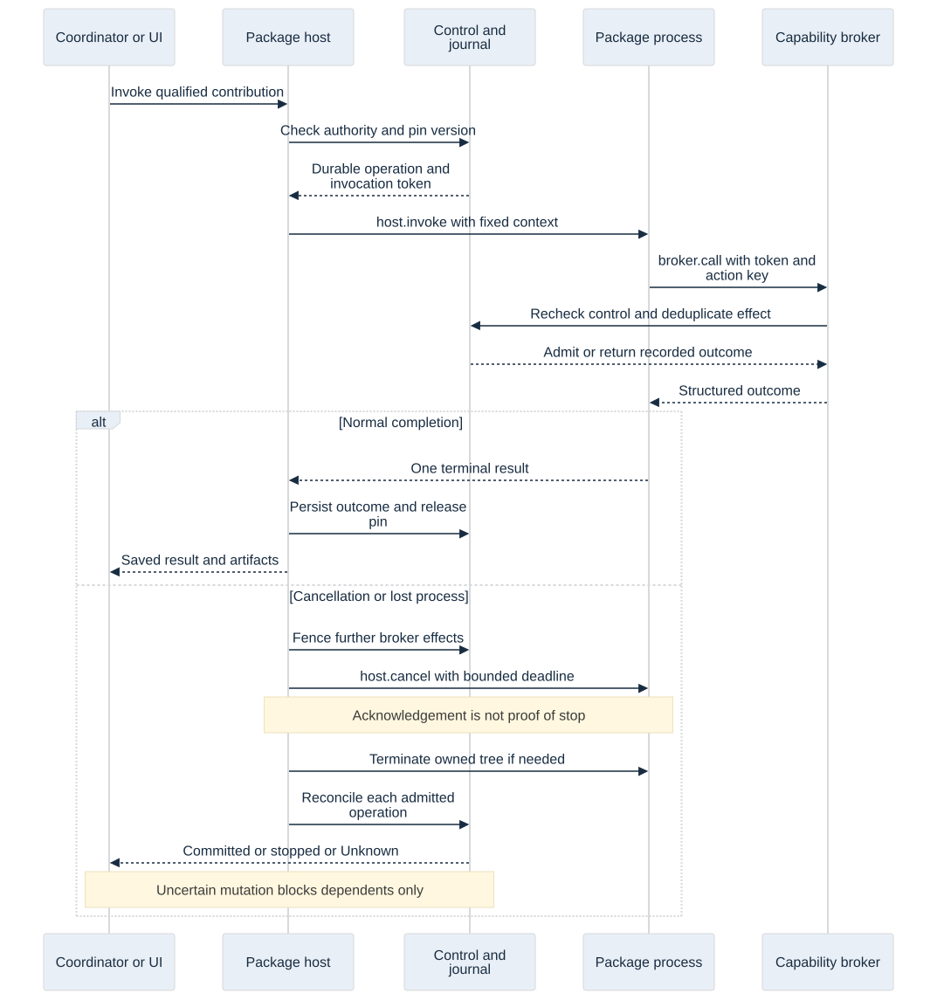

Admission validates the current parent control generation, role/tool selection, permission envelope, resources and operation idempotency before journaling a mutating invocation. Broker sub-operations receive stable child operation IDs derived from the invocation and semantic action key. Retries with the same key/payload recover the saved outcome; a different payload under that key is rejected. Read-only retries can restart under fresh admission. Opaque native mutations require an operation-specific reconcile/status contract before automatic retry; absent such evidence, a lost result is Unknown and blocks the affected dependent work.

Cancellation first fences further broker effects and signals the invocation. Allow five seconds for cooperative cancellation by default, bounded by the enclosing shutdown deadline, then terminate the owned process tree if necessary. A multiplexed process termination also interrupts its other invocations, whose actual outcomes are reconciled separately. Return Cancelled only with evidence that the operation did not commit or stopped as its contract defines. Preserve a committed effect even if cancellation won the race to display; fence late output from changing current work, while retaining it as attributed evidence. Independent calls in other packages continue unless actual dependencies or root controls prevent them.

### Contribution contracts and host authority

| Contribution | Public contract and ownership |
| --- | --- |
| Semantic language pack | Discover projects and report language/toolchain provenance; emit validated SCIP/native index artifacts against an exact source snapshot. The indexing service validates and publishes generations. A pack cannot write graph tables or declare an incomplete index current. |
| Tool and command | Stable qualified ID, schemas, requested effects, Help, bounded execution and structured outcome/artifacts. Commands, shortcuts and UI actions enter the same shared operations as agents. The host owns selection, reviewer classification, approval and operation journaling. |
| Workflow step and verification gate | Versioned input/output/evidence and dependency contracts. Packages can add required checks but cannot remove plan approval, independent review, permission or delivery gates. Missing/failed required checks block only the work that actually requires them. |
| Event handler | At-least-once event delivery with durable subscription cursor and event identity. Acknowledge only after durable processing; effectful handlers use stable event/action operation keys. Replay never implies exactly-once external delivery. Bounded retries with backoff leave a visible failed subscription and do not block core event publication. |
| Context and compaction hook | A bounded transformation over a versioned context snapshot with source/provenance references. The host preserves the original transcript, explicit directions, required constraints, provider continuation and the 80% compaction rule. Invalid output fails validation before publication; hooks cannot rewrite authoritative history or hidden policy. |
| Skill prompt and role | Versioned declarative content with provenance and scoped applicability. Discovery/installation does not activate an agent-created or changed role/skill without its separate approval. Session/context epochs record adopted revisions. |
| Router/provider adapter | Capability catalog plus native request/stream codec through the router's transport port. Host-owned connection/auth/usage/budget/cache/failover contracts remain effective. Broker HTTP allowlists endpoint, method and connection; inject credentials on the host side, redact diagnostic material and restrict redirects. Packages receive neither stored credentials nor a raw authenticated connection. |
| Native UI | Bounded host-rendered forms, tables, reports, panels, statuses, dialogs and notifications, with schema/data bindings and qualified action IDs. Validate depth, row/text/image limits and action targets. Render text safely and dispatch actions through normal authority checks. No WebView or arbitrary egui/widget ABI; new widget primitives can require a host release. |

Notifications and decision hooks have different behavior. Ordinary notifications cannot delay core progress. For ordered context/decision hooks use explicit configured priority, then package ID and contribution ID, against a frozen input revision; validate every output before passing it to the next hook. A required hook timeout/failure fails the affected step visibly. An optional hook can be omitted with a recorded reason, never if that would remove a required constraint or gate. Decision hooks receive read/transform authority only; an event handler needing effects must invoke ordinary broker operations. Provider codecs cannot recursively request inference to encode their own in-flight request; other nested inference uses normal router admission with an invocation ancestry cycle check and a bounded depth of eight.

These controls govern host-brokered operations. An ordinary native executable can use whatever direct OS access its execution environment permits. Separate processes provide crash containment and ownership, not an OS sandbox. Unverified opaque package tools do not enter the verified-read reviewer set. Strong restricted-mode claims, process-tree containment, endpoint/credential protection and destructive-path guards require the security/platform evidence under G04; publisher approval does not waive them.

### Durable package state and atomic activation

| Durable record | Owner and consistency rule |
| --- | --- |
| PackageVersion and dependency set | Immutable manifest/content digests, signature evidence, source/agent provenance, platform, dependency lock, schemas and installed-file publication receipt. Reusing a version string with different contents never overwrites identity. |
| PublisherTrust and ExactVersionApproval | Revocable revision-bound authority, approved scope and signer/package/stream binding; exact agent approval also binds content/dependency/configuration-capability digest. Recheck immediately before activation. |
| PackageEnablement and ActivePackageSet | Desired app/project enablement plus revisioned complete active registry. A compare-and-set transaction commits pointer, state generation, approval/trust revisions, history and activation outbox intent together. |
| PackageActivation and Invocation | Durable preparation/quiescing/commit/start/recovery outcome, expected revisions, boot/process identity, pinned invocations and operation references. External effects stay in the shared operation journal. |
| PackageStateGeneration and EventSubscription | Host-owned bounded key/value/blob-reference namespace with schema version, expected revision and state generation. Subscription cursor/checkpoint commits atomically with package state and effect intent when part of one handler; network completion is outside that transaction. |

**AR-07:** event handlers use the combined [`broker.commit_event` envelope](provider-session-package-contracts.html#atomic-event-handler-commit), binding state CAS, typed outbox intents, host processing receipt and subscription checkpoint in one local transaction. Replay returns the original receipt; a package notification cannot commit state. Remote completion remains separate. Outside event handling, package state is accessed through typed `broker.state` read and compare-and-set batch calls; a batch is one short unit of work. Packages receive no generic SQL escape hatch. Enforce per-package quotas and opaque keys; shared app/domain records can change only through domain operations. Large state objects use the immutable artifact pipeline. The adapter implements these contracts behind the persistence ports; this table is a required schema extension, not a claim that the initial SQL fixture already implements it.


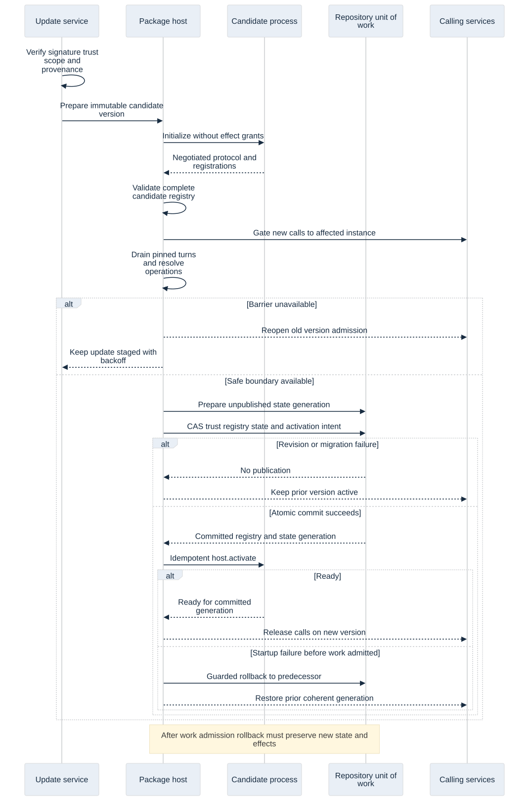

Download/verify/prepare a candidate while the current version runs. Candidate initialization validates registration without mutation/network/inference grants. An activation lease then gates new calls to the affected package instance. A safe boundary means no in-flight provider/tool/hook turn can still dispatch against the retiring registry and no unresolved mutating operation depends on its state. The lease covers provider generation through tool dispatch and persisted terminal results, not just an idle instant between stream chunks. Pending approval/Unknown mutations keep the update staged; routine updates never manufacture a human Pause or require feature Continue. Explicit disable can cancel outstanding work, but cannot invent successful reconciliation.

Drain already admitted invocations, retaining their outcomes. New dependent calls wait under a package-maintenance availability reason; unrelated work continues. If quiescence cannot complete within a configurable 30-second attempt, release admission for the old version and leave the update staged with backoff; do not repeatedly interrupt it. User-requested disable/revocation follows cancellation instead. Adopt the new tool/provider/context contract at the next appropriate session boundary and advance the context epoch when its native prefix changes. Saved pending operations stay pinned until resolved or explicitly cancelled; they are never silently rebound to different code or schemas.

Prepare state migration into a new, unpublished generation and retain the predecessor. The migration sees package-owned state only and has no external effects; failure discards the candidate generation. This is versioned application state, not an automatic user backup. At the barrier, recheck trust, approvals, prerequisites, controls and expected revisions, then atomically publish registry/state pointers and durable intent. Process activation is idempotent under that committed generation. New work remains gated until the matching process acknowledges ready. A crash before commit keeps the old pointer; after commit recovery completes startup or records failure against the committed revision. Never admit both generations to write the same mutable namespace.

Automatic rollback is limited to failed preparation/startup before any new-generation invocation or external effect is admitted, with an expected-current-revision check. Once new work is admitted, rollback needs declared state compatibility or a tested reverse migration that preserves subsequent state; it does not restore an old snapshot over later work. Binary rollback never reverses external actions, approvals, cost or transcript history. If compatibility/reconciliation is unavailable, retain the failed version's state and block affected contributions visibly. Other features and baseline indexing continue.

Disable first fences admission and capabilities, then cancels/drains owned invocations and reconciles effects before verified process retirement. Uninstall removes registrations and eligible executable files only after that retirement; it retains state, history and artifact provenance unless the user explicitly requests eligible data deletion. Keep the immediate predecessor executable/state generation for rollback until explicitly removed, and never garbage-collect a version pinned by pending work or historical source evidence that requires its retained contents. Reinstallation still checks current trust and enablement. Reopening reconstructs enabled packages but cannot resume manually held feature/issue work or restored automation. A package crash receives bounded restart/backoff; repeated startup failure makes only that package unavailable until an update, configuration change or explicit retry.

### Package acceptance and remaining qualification

Success means each retained contribution can be implemented through this public boundary, authorization survives nested calls and failure recovery, and an update changes the active registry/state exactly once without expanding access or losing outcomes. The following are required no-inference host/SDK integration cases under G05, not completed production tests.

| Acceptance case | Evidence required |
| --- | --- |
| Installation and compatibility | Signed/unsigned/modified archive, escaping path/link, dependency/key change, unsupported CPU/runtime, major/minor/required-feature negotiation and startup timeout. Verify no candidate code runs before execution approval. |
| Every contribution | A real out-of-process Rust SDK fixture exercises every row of the contribution table, including semantic artifact validation, host-rendered UI actions and router codec fixtures without model execution. |
| Protocol bounds | Fragment headers/payloads, invalid UTF-8, oversized frames, duplicate responses, stderr floods, exhausted credits, Busy rejection, dead peer and a blocked handler while cancellation still arrives. |
| Authority | Wrong project/work/role/token/generation, revoked trust, expanded endpoint/path/dependency access, nested inference cycle and reviewer indirect mutation attempts all fail before broker effects. Test direct native escape separately under G04. |
| Cancellation and recovery | Kill at journal/admission/commit/result boundaries, race cancellation with committed effects and terminate one multiplexed process. Preserve actual outcomes, Unknown status and independent siblings; never repeat an uncertain mutation blindly. |
| Hooks and events | Stable order, immutable originals, required failure vs optional omission, cursor replay, crash before/after cursor commit, duplicate effect keys and failed subscription isolation. |
| Trusted automatic update | Compatible signed update with unchanged authority activates once at the barrier. Expanded access, unapproved agent contents, changed required contracts and revoked trust remain staged. Recheck authority changed between preparation and commit. |
| Atomic publication | Fail registration/migration; crash before/after pointer commit; race enablement/configuration revisions; hold a stream/tool turn or approval operation open. Observe one coherent registry/state generation and preserve the prior active version when commit fails. |
| Rollback and retirement | Safe pre-admission startup rollback; reject incompatible downgrade after new state/effects; preserve later writes and external history; disable/uninstall/restart while busy with honest process/outcome state. |

Pi and Oh My Pi remain design references, not direct compatibility promises. The targeted Oh My Pi source review at local `0b5c27ab24719c86a5986b95ee55f4e75bc1aaa0` confirms a broader registration surface than tools alone and explicit provider-registration rollback tests; its CodeGraph index was an older revision. DevWorks retains the required contribution categories through native host contracts rather than importing its Bun/TUI runtime. Exact protocol JSON Schemas, SDK signatures and target-specific containment are implementation/qualification deliverables, not frozen by a diagram or a requirement count.

## Integrations automation and resource ownership

Outgoing MCP uses app-launched stdio servers and remote Streamable HTTP connections. Their standard framing and lifecycle are distinct from the private package protocol. Incoming DevWorks MCP support is a separate adapter to the same application gateway. [MCP transport specification](https://modelcontextprotocol.io/specification/2026-07-28/basic/transports)

Namespace server tools and retain schemas, capability versions, discovery state and authentication handles. Enable established read-only tools by default; mutating tools require selection. Treat external annotations as hints during classification. Missing optional Node/Python runtimes or server failures are server-specific limitations, not app startup failures. Accepted sampling requests enter the router with attribution, permission and budget checks; incoming clients use the independently granted server boundary below.

### DevWorks MCP server for other harnesses

**AD76–78 · baseline 1.1 · 2 November 2026.** The user reversed the client-only decision: indexed code, planned work and Knowledge must be available to other MCP clients and harnesses. Keep outgoing server connections. Incoming tools and scoped resources call existing application services through `McpServerAdapter`; there is no second store writer, separate business-policy implementation or mandatory daemon. The complete [MCP server contracts](mcp-server-contracts.html) define the capability manifest, typed administration, transport matrix and acceptance.


Provide a native stdio bridge to the running desktop app and opt-in loopback Streamable HTTP, with explicit 2026-07-28 and 2025-11-25 profiles. Closing DevWorks makes both unavailable. Each human-approved client receives an independently revocable identity and exact project/repository/worktree scopes. Selected reads are the default; work and Knowledge commands need explicit grants and still pass current revisions, approvals, attribution, idempotency and recovery. External clients cannot impersonate human consent, mint grants or clear human-only Continue holds. Context reads do not activate work, request inference or expose credentials.

Tools cover the complete eligible registered code/architecture/source, plan/work/history and Knowledge/evidence/convention/document query surfaces. Scoped resources and optional context prompts preserve revision/view identity, freshness, coverage and citations. Version-specific protocol state remains outside domain authority; cached descriptors and resource URIs are not access grants. Recheck revocation before publication, bound pagination/bytes/concurrency and retain durable receipt/status recovery across disconnect. Configure/export client setup and revoke access in native Settings. No credential value is stored in ordinary configuration or shared snippets.

DW-063 owns native transport/projection and context parity; DW-064 owns client access, UI and command integration. Four new internal `mcp_server` administration operations brought baseline 1.1 to 351 operations in 48 families; AR-03 adds `tasks.prioritize` and AR-04 adds `tasks.set_feature`, making the current catalog 353. The current plan has 353 requirements and 63 active slices. Actual credential/IPC enforcement, two independent clients, both transport/version profiles, denied/authorized writes and close/restore recovery remain G04/G06/G10/G11 acceptance. Existing native probes do not qualify this new adapter. Confidence: high in the ownership design; medium in native interoperability until implementation acceptance.

Browser and desktop testing use a common operation/result model and artifact provenance. A proposed lightweight browser baseline is a Rust-controlled managed Chromium/CDP backend, validated for navigation, DOM/accessibility targets, screenshots, input, uploads, console/network evidence and isolation. A managed Playwright backend is an alternative if the required behavior cannot be delivered reliably; any bundled runtime/download must be explicit. Selecting a backend is a validation gate, not a promise that an arbitrary Rust browser crate already provides the complete required control surface.

Native desktop adapters use available accessibility/capture/input facilities on macOS and Windows, and an explicit Linux X11/Wayland capability matrix. Wayland and permission differences must remain visible. Do not claim equivalent cross-platform computer control solely because egui renders everywhere. UI automation mutates the test target and therefore runs under an authorized implementation/testing agent, not a read-only reviewer.

Named resource reservations have canonical physical identities across projects, capacity, lease/fence, owner, priority and FIFO order within priority. Desktop input has capacity one. A desktop reservation is separate from user consent: when the user is not idle, ask **OK or Wait** before taking focus or sending input. Bind consent to the pending session/target/operation and revoke it when that control session ends or its relevant conditions change. A silent timeout or Wait is not consent. Idle threshold and consent lifetime remain proposed policy values to review.

Container adapters honor workspace default and project override for Docker, Podman and Apple’s separate container tooling on supported Macs. Detect installation/capabilities and unsupported Compose/network/volume operations; never silently switch engines. Track ownership by stable runtime/container identity and work, not just a name prefix. On app close, stop containers launched for agent work while preserving manually managed/pre-existing containers, data, images and volumes. Core app use never requires a container engine.

## Scheduling lifecycle and project deletion


Schedules are durable app/project records with saved instructions/parameters, timezone, enabled state, next occurrence and run history. Inference jobs use the same agent engine, router and configured tools as other authorized coordinators. Maintenance jobs call the same application operations as manual controls. Each run records scope, source cursors, effect identities, artifacts, usage and actual outcome.

**Confirmed 1 November 2026 — JOB-09:** scheduled inference jobs report usage and have no job spending limits, monetary cap settings or monetary-limit holds. Attribute each request/attempt to its run and preserve reported, estimated, free and untracked prices under ROUTE-17. Operational cancellation, deadlines, resource reservations and provider availability still apply; they are not spending controls.

Work ownership determines budget ownership. A scheduled agent’s own discovery/orchestration requests belong to that job run and are usage-only. Once it starts or dispatches work owned by a feature, those requests carry the feature identity and pass the existing feature-budget reservation/admission contract, even when the caller is a scheduled agent. Record run provenance as a secondary link without charging twice. Standalone issues retain their existing usage-only policy. A schedule cannot relabel feature requests as generic job requests, grant Continue or clear a human pause merely to avoid a feature limit. A blocked feature does not stop unrelated eligible job activity. Test that a job continues its own permitted scan while feature dispatch remains budget-blocked, including concurrent admission and restart.

On reopen, recompute the next future occurrence and record missed runs as missed where required for history; never enqueue a startup catch-up batch. Resume an interrupted maintenance/inference run with its existing identity after reconciliation. A new inference occurrence while its prior run is active is **Skipped**, not queued. An automatically resumed scheduled agent may inspect work, but cannot silently resume a feature/issue held by app closure or bypass plan approval.

Closing the main window stops admission, persists controls/transcripts/checkpoints, requests safe cancellation and exits. There is no tray/background agent mode. Use a bounded shutdown protocol with visible progress, process-tree ownership and durable unknown outcomes when a target cannot be confirmed stopped. The adopted bounded shutdown protocol below defines the configurable deadline and retains uncertainty for remote effects. Owned agent-work containers must also be stopped/reconciled; failure remains diagnosable on reopen.

After close/reopen, feature and issue agents require manual selective Continue. **STORE-13 exception for backup restore:** restored schedules and keep-working remain stopped until explicitly reactivated; ordinary reopen resumption cannot bypass that restore hold. Separate explicit user/budget/approval holds survive. While the app remains open, sleep/wake automatically continues previously active work after lease/connection reconciliation, without adding a manual hold. Optional keep-awake is Off by default and requests prevention of idle system sleep while open, including idle periods; it allows display sleep and cannot override every OS power policy.

Project archival is a deliberate exception to ordinary safe-step control. With active agents, warn and require confirmation. On confirmation, synchronously fence new dispatch and immediately cancel/terminate project activity without waiting for a cooperative checkpoint. Persist that stop epoch through the write owner. Shared storage must still finish or roll back an already-entered critical transaction; its late results cannot publish as current project work. Distinguish immediate stop requested from verified process/remote termination instead of displaying a fabricated cancellation result. External requests already accepted by remote systems can remain uncertain; immediate local stop is not proof of remote rollback. Other projects continue. Archived projects cannot allocate work via chat, packages, schedules or keep-working. Restore leaves work/schedules/keep-working stopped until explicitly reactivated.

Permanent project deletion uses a reviewed deletion manifest after activity is quiescent. Delete only owned harness records and artifact references/bytes with no surviving share; preserve shared artifacts and independently owned history. Do not run Git cleanup or delete local repository files, branches, worktrees or GitHub resources. Retained cross-scope references must show deletion honestly. Detailed shared-history ownership and purge semantics must be frozen before implementation; project deletion is not a blanket remote cleanup operation.

### Shutdown and recovery protocol

**Adopted technical design · AD 20 · confidence high.** The application lifecycle owner coordinates shutdown; the supervisor, broker, router, process host and storage owner report their own completion. Main-window close transitions `Open → Quiescing → Persisting → Exiting`. Keep a shutdown progress surface responsive while the app is closing; there is no ongoing tray/daemon mode. Use one bounded shutdown budget shared by adapters, rather than adding every child's timeout sequentially. The initial engineering default is 30 seconds, configurable and subject to G10 target validation; it is a bound on cooperative shutdown work, not a promise that remote effects finish within it.

1. Fence ordinary admission in memory immediately, then commit the shutdown/boot control transition through the write owner. Mark active and pending feature/issue activations as requiring manual Continue. Freeze schedule admission and keep-working allocation. Cancellation, evidence collection, storage flush and read-only reconciliation use an internal lifecycle path that cannot start ordinary work.
2. In parallel request cancellation of provider streams, tool operations and owned processes, stop owned agent-work containers, and checkpoint quiescent sessions. Preserve unrelated or manually managed containers. Persist operation outcomes as they become known; flush ordered transcript chunks and artifact references before their dependent checkpoints.
3. At the deadline, terminate owned killable process trees using target-specific handles, stop local transport tasks and mark unconfirmed effects/resources for reconciliation. Do not delete worktrees or retained artifacts as part of shutdown. Never identify an old process solely by a reusable numeric PID.
4. Commit final known checkpoints, cancellation observations and the shutdown status; release the data-root lock and exit. A completed critical database transaction must finish or roll back. A storage/OS failure may prevent graceful final persistence; show that failure while possible and rely on boot-epoch fencing on the next launch, rather than claim a checkpoint was saved. The deadline does not make a blocked OS storage call safely cancellable.


Acquire exclusive application ownership of the data root before opening it for writes. Each process launch obtains a new durable `AppBootId`. All dispatch compares the activation's boot identity with the current boot and applies recovery-class eligibility, so a crash cannot bypass manual-resume rules merely because no graceful shutdown record was written. On initialization, old active/pending feature/issue activations are treated as interrupted and held for explicit selective Continue. Materialize their visible hold/history before offering controls; admission remains closed for them throughout initialization. Preserve the logical coordinator, assignment lineage, native history, model pin and known results.

Startup reconciliation may inspect local/remote state and record observations without resuming feature/issue execution. Use persisted operation identity, target revisions, process birth/ownership handles and container identity; old ownership timestamps alone prove neither termination nor absence of effects. Reconcile possible effects before any retry. A reconciler needing a new mutating action must go through current broker authority and recovery-class eligibility; “startup cleanup” cannot bypass a manual hold. Live/unknown exclusive resources stay held until they can be safely transferred.

| Recovery class | Automatic behavior |
| --- | --- |
| Feature/standalone issue after any new app boot | Inspect/reconcile; remain held, including accepted-but-unlaunched activations. Explicit authorized Continue is required before work resumes. |
| Interrupted scheduled maintenance/inference run | Resume the existing `JobRunId` after reconciliation if its schedule/project is enabled and independent holds permit it; do not create another run or clear a feature/issue pause. |
| Future scheduled occurrences | Recompute the next future occurrence; record missed occurrences, never enqueue a catch-up batch. Skip an inference occurrence if its previous run remains active. |
| Keep-working after reopen or an exhausted queue | Remain stopped until explicitly restarted; restored mode cannot implicitly Continue paused work. |
| Same-process supervisor failure, temporary connection loss or sleep/wake | Reconcile and retry with bounded cause-specific backoff under current eligibility; do not add a restart/manual hold or clear an existing one. |
| Archived project | No work, queue allocation or schedule dispatch. Restoration preserves stopped state until explicit reactivation. |

Recovery is an idempotent pass with durable progress and independent per-operation outcomes, not a single global lock held across network calls. Show unresolved resources and affected work, while opening the UI and allowing unrelated eligible work. Retry transient observation failures with bounded backoff; repeated deterministic errors create a visible actionable blocker. Interrupted recovery resumes its progress on the next launch. Never mark all work recovered just because the app window opened.

## Managed paths and relocation

Adopt these initial defaults under delegated architectural discretion. Preferences may override future clone/worktree destinations globally and per project. Existing registered repositories keep their exact path; changing a preference does not move or reclone anything.

| Content | Default and owner | Consistency and recovery rule |
| --- | --- | --- |
| New clones | `~/DevWorks/Repositories/<host>/<owner>/<repository>`; repository service | Canonical remote identity plus sanitized path components. On collision, inspect the existing checkout identity or require a destination choice; never overwrite it. |
| Managed worktrees | `~/DevWorks/Worktrees/<project-id>/<repository-id>/<work-id>/<assignment-id>`; Git/worktree service | Stable compact IDs, safe Windows names and bounded path length. Branch names and untrusted URL segments cannot become unchecked paths. Register exact Git/worktree identity, not only its basename. |
| Authoritative app data | macOS `~/Library/Application Support/DevWorks`; Windows `%LOCALAPPDATA%/DevWorks`; Linux `$XDG_DATA_HOME/devworks`, falling back to `~/.local/share/devworks`; workspace store | SQLite, immutable artifacts, managed document versions, local skill overrides and retained application evidence. Keep source checkouts/worktrees outside this root. |
| Disposable cache | OS cache directory under DevWorks; cache service | Rebuildable downloads, thumbnails and temporary indexes only; never sole copies of authored records, source versions or required recovery evidence. |
| Shared skills | Existing `~/.agents/skills`; external file owner | Read in place; approved harness overrides live under managed app data. Do not relocate or rewrite shared originals. |

Resolve platform directories through an OS path adapter, respecting [XDG data/cache distinctions](https://specifications.freedesktop.org/basedir/) and native [local-data directory mappings](https://docs.rs/dirs/latest/dirs/fn.data_local_dir.html). Keep the saved canonical identity and user-facing path separate. Validate SQLite-compatible local filesystem semantics, free space, write access, symlink/junction resolution and path collisions before registration. An unavailable root blocks affected work with a diagnosable reason; never fall back to another path that could create a second workspace or duplicate effects. Do not advertise network/shared filesystem support without durability and locking qualification.

Relocation is an explicit operation with a reviewable source/destination/ownership plan. Quiesce affected work; hold source/destination ownership locks; journal the operation in a stable per-user locator directory outside the movable data root; copy to staging; verify the database image and immutable-file manifests; then atomically switch the locator to the verified root. Startup reads that journal before opening either store. Before the switch, the source remains authoritative; after it, only the new root admits writes. Keep the old copy visibly marked inactive until explicitly authorized cleanup. This user-requested move is not a periodic backup and cannot make automatic backup policy appear implicitly. A crash must select one authority without replaying effects. Repository/worktree moves use Git-aware operations and separate ownership journals; moving the application data root never moves source directories. Manual backups include authoritative app data and exclude external checkouts/worktrees, secret values and replaceable app/package binaries as specified by the backup manifest.

Acceptance covers fresh defaults on all targets, user/project overrides, an existing clone collision, Unicode/long/reserved paths, symlink/junction swaps, disk-full and unavailable roots, restart on each side of the locator switch, and permission-preserving Git worktree relocation. No relocation is implied by a settings edit or update installation.

## Supported platforms and execution adapters

### Target matrix and qualification status

PLAT-01 retains macOS 26.2 and Windows 10 as the minimum product OS families, plus explicitly selected Linux distributions. Adopt the matrix below as the qualification target under delegated engineering discretion. **Every row is currently unqualified for the DevWorks app.** It is a concrete build/test obligation, not a claim that an executable exists or that Rust target support establishes product support. A failed retained row requires a resolved design/product decision before the implementation plan is called complete.

| OS qualification row | CPU and native target | Distribution and scope |
| --- | --- | --- |
| macOS 26.2 and a supported newer macOS release | arm64 `aarch64-apple-darwin`; x86_64 `x86_64-apple-darwin` on hardware supported by that OS | Signed/notarized `.app` in a DMG, per-architecture assets. Native UI, Keychain, accessibility/capture permissions and owned helpers. No emulation-only evidence for a native row. |
| Windows 10 22H2, build 19045 | x86_64 `x86_64-pc-windows-msvc` | Signed native user-level installer and owned helper assets. This specifies the Windows 10 baseline instead of promising every historical build. Core paths cannot require a Windows-11-only API. |
| Windows 11 on an in-support feature release, recorded exactly for acceptance | x86_64 `x86_64-pc-windows-msvc`; arm64 `aarch64-pc-windows-msvc` | Native assets for both CPUs. Validate native browser/semantic helper availability separately; an emulated helper is explicitly identified, never evidence for its native target. |
| Ubuntu 24.04 LTS and 26.04 LTS, current patched point releases at qualification | x86_64 `x86_64-unknown-linux-gnu`; arm64 `aarch64-unknown-linux-gnu` | `.deb` and versioned relocatable archive using a documented system-library floor; GNOME Wayland and X11 sessions are separate cases where available. |
| Debian 13, current patched point release at qualification | x86_64 `x86_64-unknown-linux-gnu`; arm64 `aarch64-unknown-linux-gnu` | The same Linux native targets with Debian packaging/dependency checks; qualify KDE Plasma Wayland and X11 separately where available. |

Build Linux assets against the oldest selected supported runtime-library floor and record the actual glibc/libstdc++/graphics/windowing dependencies from the final binaries. Do not infer compatibility from Rust's standard-library minimums or copy a newer developer-machine executable into an older package. No forced CPU instruction set beyond the recorded baseline; runtime-dispatch optional optimized paths. No mandatory AVX/accelerator/inference runtime for launch. Other distributions/32-bit/musl/Windows-on-ARM-10 targets are not advertised as qualified by this matrix; extensions to the matrix require the same complete evidence, not just a successful cross-compile.

The [Rust target catalog](https://doc.rust-lang.org/rustc/platform-support.html) is evidence of toolchain target categories only. [Ubuntu's release list](https://ubuntu.com/project/docs/release-team/list-of-releases/) and [Debian's release record](https://www.debian.org/releases/) establish the selected release families, not DevWorks compatibility. Windows 10 remains the confirmed compatibility target even though its normal Microsoft support ended on 14 October 2025; [Microsoft's lifecycle guidance](https://learn.microsoft.com/en-us/lifecycle/faq/windows) distinguishes extended servicing. DevWorks compatibility does not promise OS vendor security maintenance or enforce a particular ESU enrollment. Recheck lifecycle and dependency floors at release qualification.

### Platform ports and optional capabilities

`PlatformCapabilities` is a versioned, locally probed record of OS/build/CPU, display session, graphics backend, secure store, process ownership, filesystem identity APIs, isolation guarantees, desktop capture/input/accessibility permissions, managed browser targets, semantic runtimes and selected container engine. Each feature is Available, PermissionRequired, MissingPrerequisite, Unsupported or Failed with evidence and remediation. Capability availability is distinct from user/tool authority. Probe updates invalidate affected admissions; UI, tools, Help and diagnostics consume the same record. Do not require a privileged inventory scan or network call merely to browse local history.

| Port | Adopted boundary |
| --- | --- |
| ProcessSupervisor | Own native process identity/birth and launch generation, descendants, exit observations, deadlines and logs. On Windows attach before execution to a non-breakaway Job Object with kill-on-close, subject to actual nested-job behavior. On Unix use owned process groups and child tracking; a process group is not an inescapable sandbox. Reconcile escaped/unknown descendants rather than claiming verified stop from parent exit. |
| ExecutionBoundary | Accept an explicit filesystem/network/process profile and return the exact enforced guarantee/capability revision. Fail closed if required rights cannot be constrained. This port is independent of the Full-mode process launcher and never changes the parent UI's user authority. |
| Filesystem | Native stable handle/volume identity, no-follow destructive operations, case/path semantics, atomic publication and durability primitives. Unsupported network/virtual filesystems do not receive an untested local-durability claim. |
| DesktopAutomation | macOS accessibility plus capture authorization; Windows accessibility/input/capture with integrity-level restrictions; Linux X11 or Wayland portal capabilities. OS prompts and the app's OK/Wait resource consent are separate requirements. Permission denial is an affected capability state, not app failure. |
| Distribution | Signed target-specific immutable assets, declared dependency/optional-runtime inventory, verified installation/update rollback, local Help matching versions and no background service. User-level installs do not request elevation unless an explicitly approved component needs it. |

Windows [Job Objects](https://learn.microsoft.com/en-us/windows/win32/procthread/job-objects) support process grouping/termination but are not filesystem/network confinement. Do not let a child inherit broad job/control/secret handles, and test alternative child-launch routes. A launcher failure after process creation is a reconciliation case; no untracked process may be silently left running.

### Confined execution candidates and fail-closed rules

Select native candidate backends for G04: Linux Landlock plus syscall/network/IPC restrictions, Windows AppContainer plus narrow brokered resources, and a separately signed macOS sandboxed helper/XPC boundary with verified child inheritance and scoped file access. These are concrete candidates to qualify, not a claim that interchangeable APIs already meet the whole contract. Do not base the shipping boundary on an undocumented/deprecated sandbox command or on a mandatory container/VM. The full native launcher remains available according to Full policy if confined execution is unsupported; a Project-scoped invocation cannot choose that fallback on its own.

Linux qualification detects the actual Landlock ABI and enabled policy, including rights not covered on older ABIs, pre-opened descriptors, networking beyond TCP ports, metadata mutation and IPC. The [kernel documentation](https://www.kernel.org/doc/html/v6.12/userspace-api/landlock.html) describes inheritance and explicit limitations. Complete the requested profile using a validated syscall/IPC boundary and brokered network transport; a partial Landlock ruleset cannot be labeled complete confinement. Remove inherited sensitive handles before launch. If the current kernel cannot meet the profile, report EnforcementUnavailable rather than silently dropping restrictions.

Windows [AppContainer](https://learn.microsoft.com/en-us/windows/win32/secauthz/appcontainer-isolation) offers a resource isolation boundary. Qualification must prove exact file/registry/network/IPC/child rights for the selected builds and arbitrary toolchains, avoid broad user-directory ACL grants and retain cleanup of any app-owned ACL/state. A restricted token, working directory or Job Object alone is insufficient. Do not pass desktop automation, container sockets or credential brokers into a confined build process through an unexamined exception.

Apple's [App Sandbox guidance](https://developer.apple.com/documentation/security/protecting-user-data-with-app-sandbox) and [helper inheritance rules](https://developer.apple.com/documentation/xcode/embedding-a-helper-tool-in-a-sandboxed-app) require correct signing/entitlements. Qualify the separately sandboxed helper, dynamic/scoped file rights and every child package/toolchain. Do not assume an unsandboxed parent or arbitrary downloaded binary automatically gains a useful isolated profile. If signing, dynamic rights or native tool compatibility cannot meet the requested guarantee, block the confined invocation and surface the capability gap. Do not re-sign an immutable trusted package silently to make a launcher work.

Confined read workloads expose only immutable source and read grants, with host-owned result output; confined implementation exposes task-owned write roots. Brokered network access does not mean a helper receives all connection credentials. Treat every additional directory, executable, IPC endpoint and resource as part of the effective capability digest. A backend must demonstrate the same profile semantics as the other platforms; differing enforcement features remain explicit capabilities.

### Desktop browser semantic and container coverage

Wayland desktop control depends on the actual compositor, portal implementation and user permission/session. The [RemoteDesktop portal](https://flatpak.github.io/xdg-desktop-portal/docs/doc-org.freedesktop.portal.RemoteDesktop.html) defines session/persistence mechanisms, not universal unattended input support. Detect capture/input/accessibility separately; a usable egui window does not establish computer-control parity. A restore token or remembered OS permission does not replace the user's current OK/Wait consent when the desktop is busy. Never switch to an X11 backend on an unavailable X11 session or claim unsupported secure/elevated desktop control works.

Managed Chromium/CDP browser automation, native document extraction and .NET/TypeScript/Swift/Rust semantic packs each have a separate target/prerequisite row per OS/CPU. A missing optional pack/runtime cannot prevent core launch or baseline code indexing. Qualify the entire required language/tool capability surface; if a pack cannot ship on an adopted target, record the exact gap and resolve it before claiming complete parity. Compiler/toolchain compatibility, Swift distribution on the selected systems, native PDF dependencies and Chromium arm64 assets are explicit probes, not assumed from the app's Rust build.

Docker/Podman capability is per engine/version/OS/CPU with project override, installed-state detection and app-owned container identity. Apple's container backend is an additional supported-Mac capability to qualify separately; its absence on Intel/other platforms does not trigger an engine substitution. No engine is a core startup dependency. Container or browser subprocess ownership, port collisions and shutdown/restore must preserve manual/pre-existing resources and the existing manual Continue rules.

### Platform acceptance and unresolved evidence

Each matrix row records an actual binary digest, Rust/dependency lock, OS/build/CPU and display/kernel versions. Test clean user-level installation and launch with Node/Python/.NET/build tools absent; offline browsing/planning/history; SQLite/vec/FTS and filesystem durability; native UI/fonts/clipboard/accessibility/attachments; key store locked/unavailable; process shutdown/reopen; signed update/manual restore and Help. Measure footprint/startup/idle/query/index behavior separately. Test native architecture on real target hardware; VM tests may supplement compatible UI/storage cases but cannot substitute for actual GPU, accessibility, power or isolation evidence.

Publish separate pass/fail/unsupported/permission/prerequisite results for confined execution, browser/desktop control, every semantic pack, document formats and container backends. A disabled optional feature is not a successful test of it. G02/G04/G05/G08/G09/G10 own that integrated matrix; G12 owns representative performance. Current evidence is source/API feasibility and the earlier local storage probes only. No app build, native confinement implementation or supported-platform acceptance has run in this pass. Backend failures remain design blockers to resolve, not grounds to remove a retained requirement silently.

## Offline Help diagnostics updates and migration

Help has stable versioned topic IDs and locally bundled Markdown/assets for the app and each installed package. A local FTS index serves the same search/read contracts for humans and agents. The screen/capability registry connects contextual Help to every screen, Settings topic and tool. Source documentation explains module responsibilities, invariants and hard interactions. Structural and workflow diagram sources live with the code and are maintained with changed contracts.

Self-improvement is ordinary managed project work. Its plan and acceptance include the affected Help, developer/extension docs, examples, source comments and diagrams. Missing required documentation blocks completion and delivery. Roles, skills and packages keep their separate approval rules; a reviewed merge does not install a new running app.

Diagnostics separate application health from repository health. Correlate queue/projection lag, operation IDs, provider attempts, source snapshots, package versions, resource owners and indexing stages. Logs are bounded/paged/redacted with explicit retention configuration; retained work evidence is not silently discarded as a disposable log. Record process exit and stream completion separately from task acceptance. Usage distinguishes reported, estimated, subscription, local/unpriced and unknown values.

### App update discovery, approval and recovery

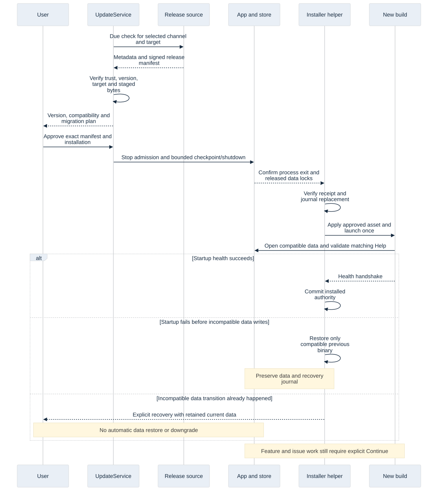

Adopt **stable releases by default**, with explicit prerelease opt-in in Settings. Poll [SceneWorks/DevWorks releases](https://github.com/SceneWorks/DevWorks/releases) hourly while open. After the first frame on launch/reopen, perform one freshness check when the saved successful check is due; never replay missed hourly checks. Manual Check now may request a fresh check. Keep one request in flight with ETag/cached results, bounded exponential backoff, jitter and rate-limit awareness. Offline/failure preserves the last known result and visibly dated status. The lower-left indicator always shows the installed version and any eligible available version.

`UpdateService` owns saved channel preference, discovery results, staged manifests, approval receipts and the install journal through repository contracts. A native `ReleaseSource` adapter normalizes [GitHub release metadata](https://docs.github.com/en/rest/releases/releases). Use parsed semantic versions and eligible channel/OS/CPU assets, excluding drafts and nonmatching targets; timestamps and a single latest-release response are insufficient version/compatibility authority. A prerelease opt-in allows eligible stable or prerelease versions newer than installed. Switching back to stable while installed ahead of stable does not downgrade automatically. Malformed versions, revoked releases or missing compatible assets yield an explicit unavailable/rejected result.

Automatically download eligible updates in bounded background work. Verify a detached signature over exact release-manifest bytes against the app's trusted signing keys before trusting asset names/URLs/digests. Use a maintained standard signature implementation such as [ed25519-dalek](https://docs.rs/ed25519-dalek/latest/ed25519_dalek/), not custom cryptography. The signed manifest binds release/build identity, channel, OS/CPU, archive size/digest, bundled Help digest, installer type, application-data read/write compatibility and migration identities. Reverify bytes before installation. Archive extraction rejects escaping paths and unbounded expansion; network credentials stay origin-scoped. Failed integrity, staging or disk checks leave the installed version running. Key rotation must be authorized by an already trusted key or a separate explicitly verified trust action; fetched GitHub metadata alone cannot establish a new signing root.

**UPDATE-04 remains authoritative:** every app installation/restart requires explicit approval bound to the exact staged release, target, manifest digest and migration plan. Trusted package-publisher automatic updates under EXT-07 do not waive this app-level rule. A new manifest or changed migration plan invalidates the receipt. Approval cannot erase current pauses, outstanding effects or the restore-specific automation stop. The UI presents the concrete version and any compatibility consequence before asking.

After approval, stop admission, checkpoint/quiesce the app using the normal bounded shutdown protocol and reconcile/retain uncertain effects. A narrowly scoped installer helper verifies the approved process/build and lock release, writes a durable replace journal outside the installation directory, applies the staged version and launches it once. If owned processes or data locks cannot be released safely, remain in a visible waiting/failed state; do not replace running binaries on a timeout assumption. The helper is not a persistent agent daemon. Installation requires matching versioned Help and a startup health handshake before committing success; completed work/history survive throughout.

Use an installation-owner port: macOS signed app bundles, Windows installer/per-user install and Linux standalone versus package-manager-owned files require different replacement/uninstall rules. Do not overwrite package-manager files or silently elevate privileges. A supported manager-owned installation must use an explicitly approved matching package transaction; missing installer support remains an unqualified distribution target. A utility such as [self-replace](https://docs.rs/self-replace/latest/self_replace/) may serve a single-executable target, but does not implement bundle installation, trust or data migration.

Do not introduce automatic database backups during update preparation: backups are manual only. Migration compatibility determines whether binary rollback is safe. Before any authored-data write incompatible with the previous build, automatic rollback may restore only a schema-compatible previous binary; never restore old data automatically. After an incompatible transition or later user writes, retain the new data and enter explicit recovery with a compatible build or user-initiated restore. Destructive/irreversible authored-data migration requires the existing verified user-initiated compatible backup and explicit migration action. A failed startup must not loop launch/install indefinitely. Record which file replacement, schema transition and health stage actually completed and reconcile that journal on next launch.

Acceptance covers channel changes, semantic version ordering, missing targets, offline/rate-limit recovery, changed/revoked manifests, wrong signatures/digests/Help, interrupted download, archive paths, disk failure, changed approval, active-work shutdown, helper/process identity races, power loss before/after replacement, schema-compatible rollback and refusal of incompatible downgrade. Verify every crash leaves one discoverable installed authority, preserves data and resumes feature/issue work only by explicit Continue. Native installer qualification remains pending.

Import CodeGraph projects, features, tasks and their histories from a consistent read-only export/snapshot. Map source IDs, memberships, plans, workflow semantics, priorities, dependencies, agent/session/transcript links and Git/review/decision/evidence references. Preserve original provenance and report missing relationships or inaccessible evidence. Import is resumable/idempotent with count/link reconciliation, and starts nothing automatically. Existing code indexes and old Knowledge/memory/lessons/conventions are excluded; fresh indexing is a separate pipeline.

## Capability coverage and validation workloads

The [source inventory](codegraph-capability-inventory.json) accounts for 558 entries from immutable CodeGraph Git revision `afe73560215bbe7593fc59451de5cc3237e3eeca`, matching the CodeGraph index and local `origin/main` observed during review. The reference checkout's working branch is a different revision and was not silently substituted. The boundary includes attributed HTTP/MCP/resources, the dynamic work registry, assistant tool definitions, all job-command and message-consumer classes, UI route declarations and supporting extraction/linking stages. These entries overlap; **558 is not a count of distinct retained features or proof of parity**.

**Confirmed 1 November 2026 — OP-03:** exclude the legacy Shortcut and RabbitMQ integrations from DevWorks. Preserve general external MCP client support. Existing imported work may retain inert historical source references; that does not require a live legacy connector. RabbitMQ's role as CodeGraph's internal transport is replaced by local durable delivery, independently of excluding its administration tools.


### Source inventory and native operation bindings

Each inventory entry has a source path/span, immutable span/file digest, source kind, disposition, native operation IDs and an acceptance-contract ID. The [capability review reader](capability-review.html) searches the source entries, dispositions and targets. The public catalog remains an architecture contract, not shipped Rust API schemas. Source aliases can converge on one native use case; no duplicated implementation is implied by retaining both an old HTTP action and a tool name.

| Source surface | Entries | Interpretation |
| --- | ---: | --- |
| HTTP controller actions and local readiness mapping | 259 | Includes aliases across API/indexer/memory hosts; native operations replace their server transport. |
| MCP tools/resources, dynamic work tools and assistant tools | 168 | Includes 115 attributed tools, five resources, 30 work definitions and 18 assistant definitions; consolidated modes retain all declared operations. |
| Job commands and message consumers | 23 | Thirteen jobs and ten event consumers map to native scheduling/queue handlers or explicit adapted behavior. |
| Extractor/semantic support types and indexing/linking stages | 51 | Supporting code accounts for language and relationship behavior; these are not 51 independent public APIs. |
| Angular route declarations | 57 | Native workspaces retain the selected data/actions; route nesting is not a native screen specification. |

Disposition accounting: 187 direct native bindings, 226 adapted entries, 19 replaced server mechanisms, 64 explicit exclusions, 51 retained support entries and 11 consolidated aliases. Of the exclusions, 63 are legacy Shortcut/RabbitMQ tool entries and one is a legacy-memory import candidate endpoint excluded by IMPORT-01. This mechanical partition is source accounting. Actual argument/result parity, edge semantics and native behavior must pass the assigned cases.

The audit also makes formerly broad catalog owners concrete: repository management/index removal, durable queue inspection/recovery, selected CodeGraph import, controlled maintenance and repository documentation have explicit operation families. Node trust, file impact/hotspots, data-lineage and publisher/consumer traversal, claim/entity bundles/frontiers, review diagnostics and usage filters remain represented. Do not substitute a generic `search` or `health` implementation for those retained operations.

The source tree distinguishes two documentation flows: `RegenerateMcpDocsJob` generates tool documentation, while `AnalysisSynthesisCompletedConsumer` writes repository CODEGRAPH.md files. Preserve capability Help generation locally and repository-document generation through the normal owned-worktree/review/delivery boundary. Project analysis, repository synthesis and document generation are separate recoverable stages. A failed synthesis retains prior/project evidence and explicit partial state; publishing a source-style completion notification cannot fabricate successful analysis.

Native scope changes are deliberate: one desktop user replaces web-login/admin/PAT mechanisms; one tagged Knowledge service replaces separate memory/lesson/wiki storage; conventions retain versioned content/resources without a mandatory wiki UI; enforced canonical resources replace advisory project holds. Existing CodeGraph work/history import replaces the old Shortcut/Kanban live-source import adapters. Pruning utilities remain controlled maintenance operations with explicit eligible target selection, not copied destructive default schedules. Preserve required history/artifact/reference rules.

### Acceptance contracts and retained language behavior

The [33 acceptance contracts](capability-validation-contracts.json) define positive/scope assertions plus failure/recovery cases. Every source entry references one; exclusions have negative acceptance rather than an invented native target. Normal integration tests must exercise real Rust services/storage/files/processes and actual protocol codecs with controlled external responses. A mock answer does not establish extraction quality, provider compatibility or permission enforcement. No real inference, including tiny/synthetic models, is permitted in those suites.

Language golden inputs cover the frozen adapter surface: C/C++, C#, JavaScript/TypeScript/JSX/TSX, Python, Go, Java, Ruby, PHP, Bash, Rust, Swift, SQL, Terraform/HCL, Ansible/YAML and ColdFusion. Assert exact source spans, definitions/imports/calls and supported domain relationships with positive and negative examples. Separate Tree-sitter structural coverage from .NET/TS/Swift/Rust compiler-backed semantics and record toolchain/indexer versions. A missing grammar's honest text fallback does not count as retaining an existing supported language's extraction behavior.

Cross-language/repository fixtures cover HTTP/messaging endpoints, NuGet/npm/Cargo/Swift package identities, React/Angular/Next.js module relationships, backend registrations, Swift type/import ownership, Rust semantic reference mapping and Tauri frontend/backend operations. Preserve inferred/ambiguous/unresolved classifications and both repository snapshot identities. Incremental deletion, rename, exclusion, changed package exports and overlay masking are first-class cases; a single positive edge is insufficient. Native/source fixture inspection must establish exact supported constructs before the implementation slice is accepted.

The acceptance groups also cover typed work/plan transitions and claim races; native session/provider history; immutable scoped Knowledge and contradiction handling; dreaming checkpoints/revert; separately permitted database schema/data access; repository/project review; effective settings; import ID/link reconciliation; safe resource transfer; queue replay; diagnostics and native navigation. Source fixtures available under `src/CodeGraph.Tests/Fixtures` include static callers, Swift, GitHub events and malicious restore cases. Import fixtures for legacy live services are reference evidence only. Never execute hostile build fixtures on an unrestricted developer checkout during review.

### Representative workloads and provisional budgets

The [workload specification](validation-workloads.json) defines 12 measured suites: clean installation/idle; planning/history; transcript streaming; structural/semantic indexing; graph queries; overlays; document retrieval; event backlog/recovery; concurrent application load; fault/resource pressure; packages/MCP; native platform capability coverage. Inputs freeze source digests, deterministic seeds, graph topology, vector dimensions and relevance labels. Precomputed vectors and scripted extraction/provider responses keep normal workloads free of inference compute.

Measure small and typical workspaces separately from synthetic graph scale and stretch data. Typical extraction uses 10,000 files/one million LOC; graph probes use 100,000/one million nodes with five edges per node and a five-million-node stretch; document probes include 100,000/250,000 vector chunks. These are chosen engineering workloads, not observed customer distributions or existing measurements. Report actual generated counts and discovered graph output; do not force extraction to match a synthetic node count. Failed/bounded/partial outcomes remain part of the result.

Adopt provisional reference-hardware budgets: p95 first interactive frame within three seconds; settled core RSS at most 200 MiB and idle CPU at most 0.5% of one core; core installed size at most 200 MiB; warm bounded local reads within 250 ms p95, document top-k within 500 ms, ordinary control admission within 100 ms and interactive frames within 33 ms. Target core RSS during typical indexing is at most 1 GiB; report compiler/browser/helper and GPU allocations separately and combined. These are initial engineering targets to calibrate on the first actual build, with recorded reasons for changes. They are not confirmed product performance claims and cannot be passed by excluding a process from accounting.

Record actual native CPU/cores/RAM/SSD/power/OS/build/GPU/display and binary/dependency digests. The reference profile is a 16-GiB SSD workstation; publish constrained-device behavior separately. Use at least 20 fresh-process starts and 1,000 query samples after recorded warmup for distributions, including failures and p50/p95/p99. A cold process does not establish cold OS page cache. Measure SQLite writer contention, WAL growth, control latency, durable stream lag and oldest eligible queue age under concurrent indexing/queries/tool calls rather than relying on isolated queue throughput.

### Coverage drift and handoff conditions

The source scanner and semantic binding rules live in `tools/planning/inventory_codegraph.py` and `map_codegraph_inventory.py`; acceptance/workload content lives in `capability-validation-contracts.json` and `validation-workloads.json`. Read immutable Git blobs, not a mutable reference worktree. The C# scanner uses Tree-sitter 0.25.2 with the C# grammar package 0.23.5 as authoring dependencies; these versions are not app grammar pins. An initial authoring run with Tree-sitter 0.26.0 crashed and produced no usable inventory; the pinned run succeeded. Preserve that limitation in reproduction evidence rather than calling the failed run a pass.

On a changed reference source, regenerate and compare entry IDs, schemas/spans/digests, registration lists and job/consumer catalogs. New or changed behavior requires updated native bindings and meaningful acceptance; the mapper rejects unknown entries. A removed/renamed source declaration is not permission to remove a retained product capability. The declared scan boundary is not a proof that every internal algorithm is semantically reproduced: language/linking golden fixtures and native interaction tests close that gap.

Before an implementation handoff, every retained operation must have reviewed input/result/authority/recovery contracts, every material source gap must be resolved, the relevant dependency/platform gates must have evidence or an explicit blocking decision, and the local implementation breakdown must cover every requirement and retained behavior. Current status is source/design accounting and specified workloads. No native implementation, parity suite, benchmark result or universal readiness claim is made by this pass.

## Testing and evidence


**Unit and integration tests must not execute real inference.** This includes live endpoints and local tiny/synthetic models. The normal test binary/configuration must not load real provider credentials or automatically contact a compatible local inference endpoint. Use scripted provider streams, tool fixtures and injected clocks/IDs to test actual orchestration and state transitions. Real-inference end-to-end tests remain a distinct suite to introduce later, with explicit configuration and attributable evidence; they are not required for this architecture review.

| Validation family | Actual components exercised without inference | Important fault cases |
| --- | --- | --- |
| Domain and policy | pure work/dependency/approval/routing/hold rules | stale revisions, cycles, policy revocation, root limits and nested delegation |
| Durable runtime | application services, SQLite, queues and deterministic provider streams | crash at each effect boundary, lease loss, sleep/reopen, partial output and duplicate delivery |
| Storage/graph | real SQLite/sqlite-vec adapter plus shared persistence conformance suite | atomic rollback, competing claims, publication crash, stale cache/view, dimension mismatch, disk full and schema upgrade |
| Git/delivery | real temporary Git repositories/worktrees and controlled GitHub fixtures | conflicting task branches, changed review head, readiness barrier, force-push denial, cleanup failure |
| Extensions/MCP | actual disposable Rust protocol test executables and fixture servers | malformed/oversized frames, incompatible version, missing dependencies, crash, timeout, cancellation, replay and rollback |
| Knowledge/schema | deterministic extraction/chunk fixtures and local target DB fixtures | cross-project leakage, moved/shared docs, encrypted/partial files, source-value retention and read-only bypass attempts |
| Native UI/platform | egui view-model/component tests plus explicitly separated automation harness | input/clipboard/drop behavior, screen notices, pane identity, required OS permissions and cancellation |
| Help/update/import | actual local bundles/import snapshots and fake release service | stale docs, offline search, signature failure, interrupted update, unsupported migration and missing source links |

Integration coverage uses real local storage/Git/process paths where meaningful, not only fake repositories that mirror the implementation. Provider and other remote behavior remains controlled. Run local target database fixtures in a separately provisioned test environment where needed; this does not make Docker or a DB server a runtime prerequisite. No numerical coverage percentage is imposed. Every important invariant must have an explicit executable test owner.

Add property/state-machine tests for work transitions, policy intersections, queue claims, graph-scope isolation and event ordering. Use fault injection at durable boundaries and deterministic interleavings rather than sleeps to discover concurrency defects. Adapter conformance suites run against every implementation. Provider-wire golden fixtures check ordered native blocks, IDs, schema stability, compaction and fallback; they prove request behavior, not live model quality or cache hits.

Architecture/document checks reject missing requirement mappings, nonexistent design anchors, dependency cycles, stale generated capability/Help indexes and unrenderable diagrams. A documentation gate cannot be satisfied merely by adding a filename: review the described behavior against the actual change. Native release tests must measure clean install, startup, idle CPU/RSS, installed size, rendering latency, active-index memory and concurrent-agent behavior separately. Numeric product thresholds remain to be set from representative measurements.

## Evals

The evaluation services, grader adapters and trial runner own **EVAL-01 through EVAL-14**. Suites are separately versioned measurement assets; recorded-work grading reads durable session, tool, Git, review and work records without changing them, attributes each step to its effective revisions and keeps mixed-revision evidence explicit. Comparison and adoption evidence retain the measured subject, baseline and measurement identities, outcome denominators, coverage and uncertainty. Suite activation, exceptions, proposal overrides and rollback use their required human authority; a subject cannot approve or change its own measurement.

The same domain owns permitted UI/tool execution, the Evals view, package-contributed suites and versioned Help. Trials write only to disposable snapshots and substitute services with no production credentials. Live trials and model judging use the internal router with attributed costs and the EVAL-10 controls: on-demand and proposal runs may pause at their spending limit; scheduled runs follow JOB-09. Normal tests exercise this machinery with recorded fixtures and scripted judges, never inference. Confirmed and Proposed requirement statuses remain as recorded in the requirements source.

`EvaluationService` owns `evals.grade` (a scoped local Command) and `evals.results` (a scoped Query) through the shared typed application gateway. DW-71 owns both contracts and their deterministic recorded-session walking skeleton. A grade request supplies one session ID and an immutable suite snapshot with deterministic checks, check-to-rule references and an EnforcedRule or Proxy declaration. Supplied measurements are draft inputs; this command cannot activate a suite, approve measurement changes or confer proposal-gating evidence. Both built-in predicates require Proxy; a recorded successful tool response or matching text does not prove a broader policy was enforced. `ToolSucceeded` grades matching recorded tool calls and their initial durable responses. Its `operation` matches the exact qualified capability ID (for example, `native/git.commit`); `*` selects all recorded calls for an observational suite. `TranscriptContains` examines only recorded visible text in `UserMessage` and `AssistantAttempt` entries; an unsupported kind returns `grader_error`, since a pure grader cannot resolve arbitrary artifact contents. The results query pages persisted immutable reports for the visible session, without recomputation.

Each report retains its supplied suite and measurement digest, session revision, last durable session sequence, source watermark, and per-step source references. Exact attribution needs the complete host-recorded effective revision manifest at that step; otherwise an explicit Mixed group retains known sources and the missing-attribution reason. The immutable run identity and commit compare-and-set fence both session revision and last durable transcript sequence; a host transcript append need not advance the session lifecycle revision. Never stamp historical steps with current settings, routing, instruction or application revisions. Instance, run and suite/report levels each carry one of `passed`, `failed`, `unclear`, `not_applicable`, `evidence_unavailable`, `grader_error`, `cancelled` or `budget_exhausted`, plus eligible/graded/ungraded coverage and per-outcome ungraded reasons. Only passed and failed count as graded and enter `passed / (passed + failed)`; no denominator means no pass rate. No-match is not applicable and absent durable response evidence is evidence unavailable. Grading changes only evaluator reports, command receipts and audit history, preserving all work, repository and Knowledge records.

Grading retains at most 499 individual matching instances and one explicit `budget_exhausted` summary. The full supplied suite is limited to 64 KiB of compact serialized JSON before grading. It scans bounded source pages and counts omitted matches in eligible/ungraded coverage and ungraded reasons; output-budget limits (512 KiB serialized report) never silently turn partial evidence into complete or passed evidence.

Suite lifecycle and separation controls (DW-72), judges (DW-73), trials (DW-74), comparisons (DW-75), proposal gates (DW-76), triggers (DW-77), adoption monitoring (DW-78), UI/tools (DW-79), package suites (DW-80), external MCP records (DW-81), and terminal integration (DW-82) retain their separately tracked full acceptance scope. These contracts do not claim acceptance of those capabilities. Confidence: high in the bounded ownership and evidence contract; native acceptance is established by the owning implementation evidence.

## Native backend feasibility and planning coverage

**AD64–68 · confidence high in narrow evidence and coverage; medium in target integration.** The [native backend reader](native-backend-feasibility.html) records explicit candidates, ownership and failure boundaries for egui 0.37, PDFium 7881 through pdfium-render 0.9.5, a native owned Chromium/CDP adapter, structured SystemOne fixtures and handle-relative verified reads. Thirty-nine narrow checks pass on macOS arm64 without inference or a visible browser tab. That 39-check checkpoint did not qualify an eframe window, production security, full provider/SDK behavior or the six target builds. AD73 subsequently adds narrow hidden-window evidence; production and OS accessibility acceptance remains pending.


The [local implementation plan](implementation-plan.html) assigns 76 planned slices (64 native delivery slices including approved DW-107, and 12 approved EVAL items) with concrete outcomes and dependency order. Its [machine-readable coverage](implementation-plan.json) binds all 374 requirements, 356 operations, 494 retained source entries, 33 acceptance groups and 12 workloads. The 64 excluded entries retain their reasons. Each operation has exactly one primary slice; source entries may overlap. Proposed requirements remain Proposed. Coverage is complete ownership accounting, not completed contracts or authorization to implement.


The 1 November checkpoint had 58 input candidates and 289 pending inputs. The domain-schema pass plus MCP amendment and AR-03 now supply all 352 input and result candidates; actual contract adoption still precedes operation admission. The draft assigns native authority, SDK/provider, desktop/container/SecretStore and all platform qualification to explicit slices. Any demonstrated conflict that changes behavior, authority, risk or retained scope returns to architecture review. No further product answer is requested from this probe pass.

## Complete domain operation schemas

**AD69–71 · 2 November 2026 · confidence high in wire coverage and recorded pure invariants; medium in production conformance.** The [domain contracts](domain-operation-contracts.html), [field reference](domain-operation-reference.html) and [coverage register](contracts/family-coverage.json) close the remaining 289 unbound inputs. The original 347 catalog operations in 47 families gained concrete input candidates, qualified typed result tags and explicit mode, authority, effect and recovery contracts. Five names have separate Query/Command variants; a read selection cannot authorize their mutations. Durable agent sends, route pin allocation, schema-bound SystemOne questions/results and host-owned attribution/provenance are explicit.


The original domain experiment passed 44 schemas, 707 domain messages and 1,029 total fixtures, including 46 new negatives. The baseline 1.0 review passed 1,036 combined fixtures (714 domain messages, 49 negatives) after the provider/risk and removed-reader changes, with all 347 input/result bindings. Twelve existing native stream/transcript scenarios (26 steps) also pass. The source audit verifies 111 frozen inventory files and resolves all 494 retained entries; 64 intentional exclusions remain documented. Schema/source counts do not establish retained argument semantics or actual service behavior. No inference, live provider, new package-helper execution or production/platform acceptance occurred. The baseline 1.1 [MCP amendment checks](validation/mcp-server-amendment/README.md) now cover 351 operation bindings and 1,049 combined fixtures (727 domain messages, including 54 negatives), with 204 domain type definitions. Actual native MCP integration is unimplemented.


This completes operation-schema ownership and wire-shape planning, while actual host authority, descriptor validation, repositories, provider/SDK behavior, retained source quirks and target enforcement still need implementation and qualification. The [63-slice local plan](implementation-plan.html) now carries 352 input bindings, zero unbound inputs and all result/mode bindings. Existing specialized candidate reply projections retain their receipt semantics; the schema registry/version chooses the exact projection. No public SDK freeze or product implementation is implied.

## Final architecture feasibility review

**Adopted 2 November 2026 · AD72–75.** [The review](architecture-feasibility-review.html) resolves native credential/process/security boundaries, provider authentication and host/SDK ownership, eframe/accessibility integration and the user’s removal of external Helix metadata indexing. [Native evidence](validation/architecture-gates/README.md) records the exact host, pins, results and limits. The [handoff](architecture-handoff.md) is the current closure checklist. No real inference or application implementation ran.

Anthropic API and direct Claude subscription are independent connection profiles. The subscription option follows simple-router revision `a556b3531b577173195bbc3876b556196447721d`, including its subscription-specific identity injection. The user chose this unsupported path at their risk after reviewing the alternative of `claude -p`; that CLI alternative is not adopted. Show a concise notice before enablement and require authenticated human acceptance bound to connection/account/profile and exact notice digest. An agent, package, import or restored backup cannot supply that human decision. Changing the account/profile or notice, revoking acceptance or restoring the workspace disables subscription admission until fresh acceptance. Ordinary successful token refresh retains acceptance for the same verified account/profile.

Keep `AnthropicMessages`/API-key and `ClaudeSubscriptionMessages`/subscription credentials, capabilities, rate limits, pins/native continuation, estimates and reported charges distinct even for the same display model. Explicit routing configuration may include both connections with their billing classifications; existing failover applies only to that configured set. API-key usage follows reported charges where available and otherwise dated API-rate estimates; subscription uses labeled API-equivalent estimates under ROUTE-17. Unknown prices remain unknown. The public API profile never adds the subscription identity/beta transformation. Native adapters, not a provider SDK agent loop, own transport/auth; all host effects still enter the broker.

## Architecture decisions and validation gates

The register distinguishes confirmed product constraints, adopted technical choices under delegated discretion, and remaining proposals. Confidence describes design reasoning, not unperformed platform acceptance.

| Decision | Proposal and reason | Status and confidence |
| --- | --- | --- |
| AD 01 | One native modular process with owned helpers; six packages and inward dependencies | Proposed · high |
| AD 02 | Plain SQLite plus sqlite-vec; application-owned graph tables and no GraphQLite | Confirmed engine choice; initial single-database schema adopted · high; scale/target evidence pending |
| AD 03 | Durable intent/outbox, fenced activation and operation-specific reconciliation | Adopted runtime semantics · high; schema/platform conformance pending |
| AD 04 | One validated application boundary for UI, agents, packages and schedules | Required direction; proposed concrete contracts · high |
| AD 05 | Shared ConversationId and screen/capability registry for Home/sidebar context | Required behavior; proposed registry implementation · high |
| AD 06 | Deterministic routing policy plus native provider transport envelopes and context epochs | Adopted internal contract · high; G03 endpoint qualification pending |
| AD 07 | Immutable snapshot generations for baseline/branch/uncommitted overlays and document indexes | Adopted publication/masking protocol · high; real-adapter conformance pending |
| AD 08 | Unified executable package host with public protocol/SDK and host-rendered egui descriptions | Adopted semantic contract · high; Rust SDK/target conformance pending |
| AD 09 | Shared SQLite FTS, sqlite-vec and scoped graph/query ports; no third persistent store | Adopted scoped exact-query baseline · high; vector/scale qualification pending |
| AD 10 | Verified-read adapters, target-identity destructive preflight and explicit native trust limits | Adopted semantic contracts · high; actual enforcement and containment qualification pending |
| AD 11 | Immutable document versions and revision-bound citations | Retain all versions until explicit deletion confirmed under RAG-13 · high |
| AD 12 | Native extraction and managed browser/desktop adapters behind explicit capability contracts | DOCX scope settled under AD 44; PDF/browser/native backends pending qualification · medium |
| AD 13 | Domain/unit and integration tests without inference; later separate live E2E | Confirmed testing rule; proposed fixture/entry-point design · high |
| AD 14 | Local versioned Help and content-bound signed update/package staging | Update/trust semantics adopted under AD 34/47; native installation qualification pending · high in contract |
| AD 15 | Core-owned persistence traits; transaction-scoped repositories and adapter-local SQL; composition-root injection | Adopted contracts · high; small native trait/SQLite subset passed, complete repositories/conformance pending |
| AD 16 | One SQLite write owner with bounded blocking requests, independent read snapshots and yielding index batches | Adopted technical design · high; contention proof pending |
| AD 17 | Cause-specific blockers, revision-bound Continue grants and durable wakeups; no manual child controls | Adopted technical design · high |
| AD 18 | Durable tool responses close provider turns; later approval resumes the saved operation through normal admission | Adopted internal contract · high; provider encoding validation pending |
| AD 19 | Redirect records received/acknowledged/incorporated revisions and fences incompatible dispatch | Adopted technical design · high; per-adapter cancellation proof pending |
| AD 20 | Bounded close, fresh app boot epoch and recovery classes preserving manual feature/issue Continue | Adopted technical design · high; OS/process/container acceptance pending |
| AD 21 | Single database/write owner, verified WAL/FULL/FK configuration and short repository units of work | Adopted technical design · high; target durability and contention pending |
| AD 22 | Relational identity/control/history/queue core, unique live ownership and conditional fenced claims | Adopted initial schema/index specification · high; fixture is not production adapter proof |
| AD 23 | Immutable unit-replacement overlays, checked publication, leased view pins and scoped exact vector ranking | Adopted correctness contract · high; G06/G12 qualification pending |
| AD 24 | Journaled immutable blob publication and explicit shared-reference-aware deletion | Adopted technical design · high; filesystem fault acceptance pending |
| AD 25 | Checksummed transactional migrations, compatibility gates and manual-backup prerequisite for destructive changes | Adopted technical design · high; migration fixtures/target acceptance pending |
| AD 26 | Manual consistent workspace image, staged journaled restore and separate logical project export | Adopted technical design; post-restore automation stop confirmed under STORE-13 · high |
| AD 27 | Typed inference requests/attempts and connection-scoped auth/capability revisions | Adopted design · high; subscription wire/auth compatibility medium until qualified |
| AD 28 | Atomic conversational pins/cursors, purpose lanes, scoped cooldowns and hard-capacity waits | Adopted design · high |
| AD 29 | Profile-specific terminal/tool/native continuation contracts and effect-aware failover | Adopted design · high; actual Rust adapters pending |
| AD 30 | Stable native prefixes, capability-specific cache controls and guarded context epochs | Adopted design · high; live cache behavior not claimed |
| AD 31 | Attempt-scoped observed/estimated/free/untracked costs, reservations and partial monetary coverage | User cost policy confirmed under ROUTE-17; technical ledger adopted · high |
| AD 32 | Weekly official OpenAI/Anthropic price snapshots, manual refresh and prospective rates | Regular refresh confirmed under ROUTE-16; weekly scheduling/parser design adopted · high; source parser qualification pending |
| AD 33 | Versioned framed JSON-RPC helper protocol, bounded queues/credits and host-bound invocation tokens | Adopted design · high; executable SDK conformance pending |
| AD 34 | Explicit publisher trust permits compatible signed updates without expanded authority; exact agent-version approval remains | Product policy confirmed under EXT-07; trust/signature/compatibility mechanics adopted · high |
| AD 35 | Complete staged registry, quiescent turn barrier, atomic registry/state generation and guarded rollback | Adopted design · high; real adapter/process fault tests pending |
| AD 36 | Shared contribution contracts, durable replay cursors and effect-aware cancellation through the common broker | Adopted design · high; G04/G05 enforcement qualification pending |
| AD 37 | Full new-project default with workspace/project overrides; narrower authority requires effective process transition | SEC-03 product default confirmed; policy/revocation contracts adopted · high |
| AD 38 | Stable-target destructive preflight and dedicated user-confirmed primary-repository deletion | SEC-04 product authority confirmed; adapter/race qualification pending · high in contract |
| AD 39 | Native SecretStore adapters, scoped transport credentials and bounded outbound diagnostics | Adopted design · high; secure-store/transport/platform tests pending |
| AD 40 | Six native build targets with explicit OS/display/optional-capability qualification matrix | Adopted engineering target matrix · medium until actual packaging and capability acceptance |
| AD 41 | Reuse Tokio channels for live dispatch and same-transaction SQLite event/delivery records for recovery | Adopted design · high; native queue/load/fault qualification pending |
| AD 42 | Frozen CodeGraph entry accounting, explicit native bindings and user-confirmed legacy integration exclusions | OP-03 confirmed; source/design inventory verified; semantic parity not claimed |
| AD 43 | Named behavioral acceptance groups and representative no-inference workloads with provisional engineering budgets | Adopted validation design · medium pending actual native evidence and budget calibration |
| AD 44 | Modern .docx only, bounded native extraction with revision-bound part/block citations and explicit coverage | RAG-09 scope confirmed; extraction contract adopted · high; narrow body probe passed, full adapter pending |
| AD 45 | Scheduled inference usage-only with no job cap; dispatched feature work retains feature budgets | JOB-09 confirmed; attribution contract adopted · high |
| AD 46 | Separate configurable clone/worktree roots and OS data/cache roots; explicit journaled relocation | Adopted technical defaults · high; native filesystem/Git relocation qualification pending |
| AD 47 | Stable default, explicit prerelease opt-in, signed staging and exact app install/restart approval | Adopted technical design; UPDATE-04 authority preserved · high; target installer qualification pending |
| AD 48 | Host-created invocation authority with strict typed/versioned command, query and event representations | Adopted design · high; five schema/DTO candidates checked on one host, production boundary pending |
| AD 49 | Scoped retry identity, normalized JCS fingerprint, immutable decision receipts and separate admission/effect uncertainty | Adopted design · high; deterministic SQLite contract model passed, native gateway/JCS pending |
| AD 50 | Root-only revision-bound Start/Pause/Continue, renewed Pause latches and accepted-versus-runnable results | Adopted detailed schema/transition contract · high; actual supervisor/process conformance pending |
| AD 51 | Stamped bounded queries, visibility-bound cursors and required event delivery without schema skipping | Adopted design · high; event DTO/model checks passed, actual projection/consumer conformance pending |
| AD 52 | Distinct untrusted inference specs/codec observations and host-owned purpose, attribution and normalized usage | Adopted candidate schemas · high; actual profile codec/auth and accounting integration pending |
| AD 53 | Bound native continuation, atomic sequenced transcript batches, explicit epochs and one native result per call | Adopted candidates and native state models · high; production session/store/provider conformance pending |
| AD 54 | Complete package contribution/manifest descriptors and closed bidirectional framed JSON-RPC messages | Adopted candidates; owned-helper protocol experiment passed · high; full SDK/target qualification pending |
| AD 55 | Scoped callback/state/credit generations and separate cancellation acknowledgment, outcome and update barrier | Adopted design and helper/model checks · high; actual authority/effect/bulk/state publication pending |
| AD 56 | Bind selected operation to schema discriminator before ordinary authority and dispatch | Adopted explicit registry contract · high; fixture binding checks passed, production gateway pending |
| AD 57 | Exact immutable repository/schema view sets, checked layer publication and bounded access-checked pins | Adopted candidates · high; native subset passed, full view/GC/target qualification pending |
| AD 58 | Visibility and overlay masking before traversal/ranking, exact embedding spaces and version-bound citations | Adopted candidates · high; scoped native FTS/vector/revocation fixture passed, full workloads pending |
| AD 59 | Immutable artifact versions, revision-bound reference/deletion and logical unavailability before physical cleanup | Adopted candidates · high; lifecycle schemas checked, production journal/service acceptance pending |
| AD 60 | Fixed-head readiness barrier, distinct accepted/queued/merged outcomes and observation-first partial recovery | Adopted candidates · high; temporary Git fixture passed, real GitHub/method/queue qualification pending |
| AD 61 | Registered owned-worktree cleanup with expected-ref deletion and separate release/deployment authority | Adopted candidates · high; temporary cleanup race fixture passed, native enforcement and release service pending |
| AD 62 | Direct Max/High/Mid/Low or named-model intent with independent effort, editable membership and durable round-robin pins | ROUTE-19–20 confirmed · high; mock interactions checked, actual selection/effort adapter conformance pending |
| AD 63 | Native SystemOne discovery and structured decision inference outside conversational tiers | ROUTE-18 confirmed · native input/result candidates checked; actual model/profile/media/usage transport qualification pending |
| AD 64 | egui 0.37 candidate with service-owned projections/session state and bounded native transcript rendering | Adopted candidate · high in headless subset; eframe/window, variable blocks and OS accessibility pending |
| AD 65 | Explicit version-matched PDFium native text/render adapter, bounded owned extraction and exact page/version evidence | Adopted candidate · high in eight fixture checks; worker, supply chain, full corpus and targets pending |
| AD 66 | Native CDP client over an owned managed Chromium profile/process with revisioned handles and host file grants | Adopted candidate · high in nine owned-browser checks; full surface, tree/transport enforcement and targets pending |
| AD 67 | Host-authorized registered-root no-follow reads, bounded bytes and current authority at publication | Adopted approach · high in six macOS adapter checks; production authority, destructive races and other targets pending |
| AD 68 | Complete local slice ownership with source-bound coverage, contract gates and final acceptance awaiting every retained slice | Adopted planning rule · high in structural coverage; implementation authorization and production acceptance absent |
| AD 69 | All catalog inputs bound to strict Query/Command actions, with five mode-dependent names and exact selected operation admission | Adopted candidates · high; 347 input bindings/294 new mode variants checked, actual gateway/authority pending |
| AD 70 | Operation-qualified typed results, revision-dimension faults and distinct receipt/async/uncertain outcomes | Adopted candidates · high; all 347 result tags and negative outcome checks passed, actual service recovery pending |
| AD 71 | Descriptor-bound dynamic values and native SystemOne question/media/output contracts with host-owned attribution | Adopted candidates · high in DTO/fixture scope; installed registry, native transports and live compatibility pending |
| AD 72 | Separate Anthropic API-key access and direct simple-router Claude subscription access as an explicit user-risk opt-in; no external Claude harness | User decision · high in intent/source audit; live compatibility unqualified |
| AD 73 | Native SecretStore/process ownership and eframe/AccessKit integration have concrete ports, fail-closed capability admission and narrow native evidence | Design feasibility resolved · high locally; per-target/security/assistive acceptance remains |
| AD 74 | Remove the conditional external HelixDB schema reader; keep SQLite/FTS5/sqlite-vec for all internal code/Knowledge indexes | Explicit user scope removal · high; DW-038 retired, historical comparisons retained |
| AD 75 | Adopt architecture baseline 1.0 and separate G01–G12 implementation acceptance from design closure | Architecture review complete · high in design consistency; no production or public SDK freeze |
| AD 76 | Supersede client-only MCP; expose indexed code, planned work and Knowledge through the shared application gateway | User-confirmed scope; high in ownership design; complete registered surface and actual client parity required |
| AD 77 | Native stdio bridge and opt-in loopback Streamable HTTP; explicit current/previous protocol profiles and desktop lifetime | Adopted design; medium in interoperability; no mandatory daemon or second store writer |
| AD 78 | Per-client scopes/read defaults, explicit command grants, human-owned registration and current publication/recovery authority | Adopted candidates; high in boundary consistency; credential/IPC/revocation and two-client acceptance pending |
| AD 79 | Mandatory feature readiness with autonomous resolution before escalation, justified material blockers, bounded investigations and revision-bound reusable assessments | User-confirmed AGENT-12/18–20; high in contract; native coordinator, shared UI/tool records and admission acceptance pending |
| AD 80 | Classify DevWorks Auto only before a new session's first generation request through request-level SystemOne round robin or direct Low fallback; persist its tier and eligible generation pin | User-approved ROUTE-21–24; high in intent; DW-22 and DW-107 native acceptance pending |

### Implementation acceptance gates

The four architecture feasibility questions are resolved at design level in the [final feasibility review](architecture-feasibility-review.html). G01–G12 below remain implementation and capability-admission gates. They do not keep the architectural baseline open. The [handoff checklist](architecture-handoff.md) assigns each to concrete slices. Architecture adoption does not freeze public SDK version 1, qualify an operating-system target, approve Proposed requirements or declare the application implemented. A demonstrated contradiction with a baseline contract reopens that decision; an ordinary failing implementation test stays in its slice.

| Gate | Required evidence | Blocks or constrains |
| --- | --- | --- |
| G01 Embedded storage | SQLite/sqlite-vec selected; common local tests and fault probes passed. A native driver-free trait subset passes 25 SQLite/vec checks plus a transaction-lifetime compile-fail doctest on macOS arm64; Validate real-adapter repository/transaction conformance, atomic claims/history, generation publication, cache freshness, migrations/manual restore, indexing contention, retained operations, representative scale and target builds | production schema, driver/extension pin and persistence implementation; engine selection is settled |
| G02 Native UI | Headless egui 0.37 paging/tessellation/AccessKit and matching native hidden eframe/Glow initialization passed; qualify actual transcript streaming, boards/diffs/schema/graph navigation, global sidebar beside feature chat, files/images/drop/paste, keyboard/accessibility and clean install on target matrix | production pane/assistive/platform acceptance |
| G03 Provider contracts | Candidate request/codec/event/session and SystemOne question/result DTOs checked; native stream/history models checked; inspect/reference each simple-router transport; deterministic wire fixtures for auth, tools, images, cache fields, partial streams, failover and cooldown; later explicit live compatibility is separate | provider/auth feature claims and request contract |
| G04 Tool enforcement | Six macOS root-relative read checks passed, with fixture policy only. Qualify actual verified-read adapters, full/project policy transitions, stale-authority races, stable-target destructive guards, dedicated user confirmation, credential/outbound isolation and escape tests for each proposed confined launcher. Scenarios in Security acceptance remain unexecuted | actual security enforcement and per-target confined capability admission; authority semantics are settled |
| G05 Extension contract | Candidate manifest/contribution/RPC DTOs and owned-helper framing/cancellation experiment checked; real Rust host/SDK round-trip for every contribution type; bounded framing/credits, cancellation and uncertain effects; nested authority, event replay, signed/exact-version approval, quiescent registry/state publication, guarded rollback and UI descriptors. Scenarios are specified in the package acceptance section; implementation evidence remains pending | public SDK/protocol version 1 freeze |
| G06 Snapshot and scope | Concrete view/query/citation candidates and native masking/scoped FTS/vector/revocation subset passed. Complete changes/deletions/renames/uncommitted/cross-repo workloads, source locators and generation GC remain pending | code/Knowledge query correctness contract |
| G07 Git and recovery | Seventeen temporary Git checks passed for readiness/dependency barriers, changed heads, uncertain regular merges, partial delivery and safe cleanup. Real GitHub, squash/rebase, queues, task/group integration, cancellation and conflicts remain pending | autonomous delivery state machine freeze |
| G08 Documents and DB | Modern .docx scope settled and narrow body probe passed; full Markdown/text/PDF/.docx extraction matrix, scan rendering/vision fixtures without model execution, supported DB metadata/read-only contracts and the selected relational metadata adapters | format/adapter platform acceptance; HelixDB reader exclusion is recorded in AD74 |
| G09 Automation and containers | Nine native owned-headless-browser CDP checks passed. Complete browser-control operation coverage and native OS permissions; desktop OK/Wait with reservation/fencing; selected container capabilities/ownership | browser backend, Linux automation matrix, Apple parity claims |
| G10 Distribution and recovery | Exact native build/OS/CPU matrix, clean-install optional-runtime audit, OS SecretStore and process ownership, offline Help, manual backup/restore, signed update/migration/rollback and no-server audit | install/update/restore acceptance and release packaging |
| G11 Legacy capability inventory | Frozen source inventory and 33 acceptance groups recorded; validate every retained argument/result/authority/recovery contract and language/linking golden case against actual native services. Resolve source drift and selected import scope; retain separate router parity qualification | native parity acceptance; local breakdown now maps all retained entries and complete input/result candidates, no silent omitted capability |
| G12 Performance | Twelve versioned workload specifications and provisional budgets recorded; generate exact corpora and measure native clean-start/idle/index/query/transcript/queue/concurrent work, dependency/license/size and process-tree resource use | footprint promises and numeric acceptance targets |

A failed gate must produce a recorded design adjustment or a surfaced product decision. The SQLite/sqlite-vec selection is settled; do not reopen it implicitly, add a server/VM, require an installed runtime, drop a language pack or call an unsupported format complete to make a gate pass.

### Product choices and remaining qualification

The choices carried into this pass are resolved: all imported document versions are retained until explicitly deleted; restored automation stays stopped until reactivated; provider usage follows reported/estimated/free/untracked prices; explicitly trusted compatible package updates may activate within existing access; new projects default to Full access; registered primary-repository deletion requires a dedicated user action; legacy Shortcut/RabbitMQ integrations are excluded; initial Word support is `.docx` only; scheduled inference has no job spending caps. Stable app releases with explicit prerelease opt-in and configurable path defaults are adopted under delegated technical discretion.

Architecture baseline 1.1 incorporates the MCP server amendment after the [feasibility review](architecture-feasibility-review.html) and the user’s direct-subscription/API decision. All catalog input/result candidates are concrete and the complete local implementation plan is recorded. No known product decision remains open. Actual service/SDK/provider/security/platform conformance and all production workloads remain acceptance obligations. A material contradiction must return with evidence and alternatives; it cannot silently reduce capability scope, expand authority or add a required runtime/server.

## Planning sequence

This is the architecture-to-implementation handoff order, not an estimate or an approved backlog. Planning stays in local files; **do not create Shortcut records**. No native implementation is started by this document.

1. Use baseline 1.1, the requirement traceability and the complete local slice register as the architecture handoff. Requirements retain their Confirmed/Proposed distinction.
2. Revalidate the affected slice and source revisions before implementation. Implement the complete assigned capability, shared application/tool boundary and deterministic no-inference acceptance; no capability may bypass its admission gate.
3. Qualify each provider profile, SDK contribution and optional/target adapter before exposing its promise. Dependency patches and adapter-local fixes that preserve baseline contracts stay in their owning slices.
4. Run integrated correctness/recovery, retained capability, platform/installer and performance acceptance under G01–G12. Public SDK version 1 is frozen only after actual host/SDK interoperability. Live provider compatibility and inference E2E use their separately authorized suite.
5. Reopen an architectural decision only when concrete evidence requires changed product behavior, authority, persistence/recovery semantics, retained scope or a mandatory runtime/server. Keep the local plan and source documents aligned.

## Evidence and dependency status

The requirements input is `docs/planning/requirements-content.json`, 374 unique requirements, including the approved 5 November Auto-routing amendment and prior interview/UI/EVAL revisions. The traceability register records an input digest so future edits can detect drift. Confirmed versus Proposed remains preserved from that source.

Earlier CodeGraph discovery reported DevWorks indexed at local HEAD `20715bbefe7ae356d81696a39ea36223e736e538`, with no native application graph. simple-router source/index agree at `a556b3531b577173195bbc3876b556196447721d`; `Routing/ModelSelector.cs` was inspected for pin/eligibility behavior. CodeGraph index `afe73560215bbe7593fc59451de5cc3237e3eeca` differs from its local checkout HEAD `bec77ed044d3ace42366c8143444fa82dafde7aa`; targeted `WorkTools.cs` and `Overlays/OverlayGraphView.cs` were read from the indexed Git objects. The most recent service-summary query returned no analysis for DevWorks; the local planning sources are authoritative for these edits. The source graph is not treated as proof of current uncommitted behavior.

Storage evidence is preserved in the historical [four-engine evaluation](devworks-storage-evaluation.html), [GraphQLite follow-up](devworks-graphqlite-evaluation.html) and their reproduction archives. The selected implementation is plain SQLite plus sqlite-vec; tested versions are candidate dependency pins pending target packaging and real-adapter conformance. No Helix source dependency or GraphQLite runtime library belongs in the app dependency graph.

The native backend pass pins egui 0.37 API experiments and records 39 narrow UI/PDF/browser/decision/read checks. A subsequent disposable matching eframe 0.37.0/Glow window runs two invisible frames on this host; it remains separate from an implemented DevWorks app and OS accessibility acceptance. The [native evidence reader](native-backend-feasibility.html) distinguishes concrete results from G02/G04/G08/G09/G10 integration and target qualification. The [Mermaid documentation](https://mermaid.js.org/config/usage.html) supplies the editable diagram notation; rendered SVGs are bundled locally so reading this plan does not need a CDN.

Source references establish narrow API/behavior facts. Baseline 1.1 adopts the architecture, ownership decisions and validation assignments; external serialized contracts remain versioned candidates pending actual interoperability. The recorded native storage evaluation workloads and owned-process fault probes are complete. No native DevWorks application build, production integration suite, real inference or full target-platform acceptance is claimed by this planning artifact.
