# Operation schemas and domain contracts

Current baseline 1.1 adds [incoming MCP server contracts](mcp-server-contracts.html) and four typed internal administration operations. The current register has 359 operations in 49 families; historical counts below describe their original checkpoints. New MCP transport/authentication/client behavior remains DW-063/064 implementation acceptance.

2 November 2026 · Architecture candidate `1.0-draft.1` · All catalog inputs and result tags assigned. This closes the unbound operation-schema planning gap; it is not a public SDK freeze or production acceptance.

All **347 operations in 47 families** now have concrete input candidates and operation-specific result tags. The 58 earlier bindings remain; 289 new operations contribute 294 request variants because five names support both a read and a mutation. The [coverage register](contracts/family-coverage.json) records each selected operation, allowed modes, payload/result schema, authority, effect and recovery rules. The [schema manifest](contracts/manifest.json) contains 44 schemas. The [field reference](domain-operation-reference.html) lists every operation and domain type.

Confidence is high in the machine-checked wire coverage, selected-mode boundaries and recorded pure invariants. Confidence remains medium in production conformance until actual services, authority/SDK/provider adapters and target platforms pass their assigned gates. Requirements remain 208 Confirmed and 137 Proposed. No additional product choice was needed.

## Approval and notification revision 3

DW-14 adds exact source-bound `ApprovalContent`: immutable settings entries, an existing feature-plan proposal reference, a finding/assessment revision, or a saved registered operation and schema revision. Inspect exposes exact typed `reviewedSource` settings entries or feature `PlanDraft`, including legal source content larger than the 512 KiB DynamicJson metadata limit. List rows omit this heavy detail; `reviewedContent` remains bounded metadata. Source detail is never silently truncated. The approval-only `ApprovalViewRecord` preserves the original settings/work-owned `ProposalRecord` and folds back to that exact name below revision 3. Optional review metadata exposes immutable reviewed content, stale state, requester, scope digest and actual admission-derived preview; it never exposes host witness, original authority context or internal resume grants. A saved operation carries only its closed argument body. The service uses registered admission and current owner preflight; a human decision cannot waive disabled/read-only capabilities, enforced permissions, required prerequisites or verification. Original agent attribution remains original, with the actual human decision recorded separately.

`approvals.review_queue` is a revision-3-only query returning a dedicated bounded `KnowledgeReviewPage`. Under adopted KNOW-03/05, challenged entries, proposed-rule candidates and contradiction pairs are informational links to existing Knowledge actions; no autonomous acknowledgment or rule-approval authority is introduced. Source-derived priority ranks Prompt/RelayedPrompt highest and Review/RelayedReview high, followed by recurrence descending, oldest first and entry ID. The interactive page defaults to 20, is limited to 50, scans at most 500 candidates per kind and shows at most three open challenges with an explicit remaining count. Unsupported future producers are not advertised.

Notification detail remains a pure query. Revision-3 `notifications.mark_read` explicitly changes per-recipient read state; the existing `notifications.acknowledge` explicitly dismisses one persistent completion card while retaining history. Neither mutation resolves a linked decision or resumes work. Completion records use category `Completion`, stable newest-first ordering and source identity for deduplication, with typed work links and independent read/acknowledgment state. Schema metadata and fixtures do not establish native OS, ingress or UI behavior; [contract qualification](validation/approval-notification-contracts/README.md) records the narrower evidence.

## Selected operation and request mode

AD69 makes the catalog-qualified operation and effective action part of admission. An operation name alone is not an access grant. The host checks strict schema/version, selected operation, effective mode/action, current role/scope/tool selection and authority before acquiring a command receipt or dispatching work. IDs, schema references, desired execution profiles and approval IDs supplied by a caller are references to host records, never proof of access.

The new envelope has two closed variants:

```json
{
  "mode": "Query",
  "protocol": "1.0-draft.1",
  "queryId": "query-a",
  "body": {
    "kind": "projects.get",
    "projectId": "project-a"
  }
}
```

```json
{
  "mode": "Command",
  "protocol": "1.0-draft.1",
  "requestKey": "request-a",
  "body": {
    "kind": "projects.edit",
    "projectId": "project-a",
    "expectedRevision": "1",
    "changes": {
      "name": "Updated name"
    }
  }
}
```

A Query requires `queryId` and a query body. A Command requires `requestKey` and a command body. Each body names the exact registered operation; the selector is `/body/kind`. The schema and typed enums reject a command hidden in a query envelope, unknown fields and unknown operation names. Query IDs and request keys cannot be swapped to obtain another execution path. Existing specialized input envelopes retain their recorded selector paths.

A Query can perform an authorized external read and maintain an internal observation/evidence cache. It cannot start inference, allocate a route pin, send a message, acknowledge an inbox, or mutate user work under a read entitlement. Those are Commands. Internal observation caching does not mint a user mutation receipt or grant access to cached bytes after scope revocation.

| Catalog operation | Query payload | Command payload |
| --- | --- | --- |
| `browser.sessions` | List scoped owned sessions with bounded pagination | Create an owned profile/process or close a specific current session |
| `github.account` | Read current account/authentication state | Begin/complete sign-in, refresh or disconnect through host credential flow |
| `dreaming.settings` | Read scope, current revision and configuration | Replace exact configuration with expected revision |
| `dreaming.instructions` | Read versioned base/project instructions | Stage/edit exact scoped instructions; adoption obeys current policy |
| `notifications.settings` | Read current revision and preferences | Save an expected-revision configuration |

The schema distinguishes both variants of these five names. Authorization further classifies the effective action before admission and fingerprints that action. A read selection never enables Create/Close or a configuration write. Human configuration permits only the established host credential/configuration lifecycle; it is not a fresh human-decision token. Ordinary scheduled credential refresh within an authorized connection remains possible. `HumanDecision` requires authenticated human interaction, and host maintenance uses the trusted host context, not a caller-claimed actor.

**AR-01 correction, 2 November 2026:** tasks belong to a project and have an optional feature relationship. `tasks.create.parentId` is optional; absent/null means no feature. Standalone tasks are shown as issues and retain one work identity across task/issue entry points. Task results accept `Task` or `Issue` representations; neither tag grants execution authority. The host validates current project/feature membership and root ownership. `agents.delegate.taskIds` may be empty: an issue root and scoped brief suffice. Assignment hierarchy is independent of feature association. Feature-linked tasks retain feature controls; standalone tasks retain issue usage and delivery rules. Actual service enforcement remains DW-012/013/015 acceptance.

Feature, issue and task edits have distinct patch types. Task-only inheritance fields cannot enter a feature edit; plan/acceptance changes are saved in the feature’s pending slot, preserving the active approved plan until exact human approval replaces it. Editing a pending draft invalidates only its pending approval request.

`agents.messages` is a durable send command. `agents.inbox` reads inbound/outbound messages; `agents.acknowledge` persists acknowledgment. `router.route` and `router.pin` are durable commands because allocation changes the pin/cursor. `router.availability` remains a read. Neither a route request nor any queue/schedule command can clear a root pause or manufacture Continue authority.



**AR-02 correction, 2 November 2026:** plans are feature-owned. `WorkRecord.plan`/`approval` describe the active plan; optional `pendingPlan` contains the proposed replacement and its approval request. `features.edit_plan` saves only that pending draft. Request/reject leaves active authority unchanged; authenticated approval atomically promotes the reviewed draft and updates effective scope/history. Initial unapproved features have only a pending plan. `planRevision` and pending `revision` are internal concurrency tokens, not a user-facing version system. Actual state/approval/admission enforcement remains implementation acceptance.

**AR-03 correction, 2 November 2026:** `tasks.prioritize` adds a shared UI/agent priority/order command; task and issue patches accept numeric priority. `tasks.dependency_links` replaces only the target’s incoming links: predecessor blocks successor, with the target required as successor. Self/duplicate/wrong-target shapes are rejected; the host atomically checks project membership and the full project DAG, updates reciprocal reads and queue revisions, then emits eligibility wakeups. Blockers dominate priority. The current catalog has 352 candidates; actual authority/graph/dispatch enforcement remains implementation acceptance.

## Typed results, receipts and publication

AD70 adds a concrete `OperationResult` variant for every catalog operation. Each result carries the exact qualified `kind` and a typed `value`. The selected result discriminator must match the originating operation before publication. Shared record types do not allow a task response to be relabeled as a feature, or a source result to satisfy a graph search. Existing input aliases remain disclosed in the verification report; they do not merge their operation entitlements or result tags.

Queries return a query ID, current `ReadStamp` and typed result, or a structured fault. A stamp binds store, restore epoch, sequence, policy and scope revisions. Pagination binds the exact query/scope/view. A Page has at most 500 items; `hasMore` and `nextCursor` must agree. Large work details carry coverage/counts and a detail cursor, rather than presenting an omitted history as empty. Revocation and exact source/view identity are revalidated before materialization as already specified in the shared/data contracts.

Commands preserve the [existing receipt semantics](shared-operation-contracts.html): Recorded, pre-admission Rejected and CommandStatusUnknown remain distinct. The generic domain decision is Applied, NoChange, Accepted with a durable operation ID, or Refused with a fault. Applied/NoChange carry a selected typed result. Accepted must match the receipt's operation ID. Refusal after an uncertain external effect retains a durable operation ID and reconciliation advice; it cannot appear as a successful no-op.

Earlier specialized root/session/package/artifact decision schemas remain candidate projections of the same receipt semantics; they are not redefined as published compatible SDKs. The new domain envelopes supply the complete catalog result/fault surface. At host integration, the registered schema revision determines the exact projection. A host cannot choose an older, weaker projection to discard an outcome, field or authority requirement. Schema/version upgrades need explicit readers/upcasters before stored records are consumed; no historical request is rewritten in place.

**Negotiated schema revisions and artifact tags (3 November 2026).** Operations negotiate a registered schema revision per request as specified in the [shared contracts](shared-operation-contracts.html): the envelope member `schemaRevision` (absent means 1) selects that revision's strict reader, enters the fingerprint and the receipt, and decides the result projection. Unregistered revisions are refused before authority. ART-02 tags are the first revision-2 members. `artifacts.save` at revision 2 accepts `command.tags`: at most 32 opaque labels of 1–64 characters (no NUL), with no duplicates. Tags are a set, so decoding sorts them by byte order; normalization, fingerprinting and persistence use that order, and an empty set means no tags. `artifacts.list` at revision 2 accepts `query.tags`, an all-of filter under the same bounds; its cursor binds the filter. `ArtifactRecord.tags` is a revision 2 member. A revision-2 caller always receives it, possibly empty. A revision-1 caller receives the exact revision-1 record, and a revision-1 request carrying tags is refused rather than having them ignored. Tags persist in `artifact_tags` with the artifact's metadata and survive restart. `artifacts.reference`, `.read`, `.preview`, `.export` and `.delete` stay at revision 1. The [schema/binding report](validation/schema-revisions/schema-model-results.json) checks every operation at every registered revision, including the revision-2 inputs and results and their negative cases.

Asynchronous completion is separately Succeeded, Failed or OutcomeUnknown, with the durable operation ID and revision. Completion observations must also match current operation ownership/fences before they can advance state. A cancellation acknowledgment or transport failure does not establish that an external effect did not occur. Late results can be evidence without becoming current state.

| Effect class | Durable boundary and recovery |
| --- | --- |
| Local command | Domain mutation, receipt, history and outbox commit together; same request key replays the original decision |
| Journaled work | Receipt records durable intent; supervisor claims/fences before launch and revalidates current root/authority |
| External mutation | Persist exact target/input/attempt before dispatch; observe saved remote identity or hold uncertain before retry |
| Inference | Host derives purpose/attribution, route/credential/price/budget context; partial/unknown tails settle conservatively, never blind replay |
| External read | Authorize target/redirect/credentials, bound untrusted evidence; repeat reads against a fresh declared snapshot if appropriate |

Retry advice is a routing hint, not permission, a timer, or a waiver of Pause/Continue, approval, budget or capacity holds. A changed expected revision is a new command intent. Mode/action and ordered arrays remain part of the normalized fingerprint. Optional null and omission have the same typed absence; clearing uses the documented explicit field/action. Set identities reject duplicates; tier member order and other ordered lists are preserved.

Artifact read results expose either bounded text with byte progress or a scoped expiring binary stream handle. Preview binds the exact source version and derived preview. Export returns an authorized stream and suggested name; choosing/writing an arbitrary filesystem destination needs independent host permission. These handles are not self-authenticating bearer authority. The host still resolves current scope and lifetime for every use.

## Fault model

The new closed `DomainErrorCode` set covers NotFound, RevisionConflict, InvalidArgument, PermissionDenied, UnsupportedCapability, UnsupportedTarget, CredentialsRequired, ApprovalRequired, ContinueRequired, DependencyBlocked, CapacityWait, BudgetHold, SchemaMismatch, SourceChanged, ViewUnavailable, CursorExpired, LeaseLost, Conflict, Cancelled, ExternalFailure, OutcomeUnknown and StorageUnavailable.

Faults contain correlation ID, retry advice, optional target kind/ID, revision dimension and expected/current revisions, blocker IDs and an optional diagnostic reference. They do not serialize raw credentials, SQL rows, provider response bodies or an unrestricted stack trace. Host policy decides whether existence/revision details may be disclosed. A denied caller must not learn an inaccessible object's current revision merely by causing a conflict.

RevisionConflict names expected/current revisions and requires refresh/new intent. OutcomeUnknown requires reconciliation. PermissionDenied cannot request automatic same-command retry. Approval/Continue/budget faults stay attached to their current host blockers. Unsupported means a capability could not be supplied under the qualified current target/profile; it cannot silently downgrade an effort, substitute a tier, or declare an unqualified target supported.

## Bounded domain values and extension schemas

AD71 confines open-ended data to named, purpose-specific boundaries. All ordinary records, tagged actions and operation payloads reject unknown fields. The candidate bounds are engineering limits and may be tuned with recorded evidence; they are not agent-count limits.

| Value | Candidate wire rule |
| --- | --- |
| Opaque identity | Existing 1–128 ASCII identifier; lookup/ownership required |
| Counter/revision/time | Canonical exact signed-64 decimal strings; revisions positive, zero permitted for initial watermarks |
| Label / text / content | 1–256 / 1–4096 / 0–65536 Unicode scalar values; NUL rejected |
| Ordinary lists | At most 128 elements; required lists have at least one; bounded pages at most 500 |
| Atomic plans | Up to 20 feature drafts, 200 tasks per feature and 500 dependency edges per inline plan; explicit validated staging handles preserve larger wire payloads without discarding atomicity or source references |
| Byte-range request | Positive and at most 1 MiB; host may return smaller chunks with explicit progress/partial state |
| Explicit money | Nonnegative decimal dollar strings with at most 12 integral and 12 fractional digits; no binary-float budget arithmetic |
| JSON state/data | At most 512 KiB, depth 64 and 10,000 nodes, inside the overall 1 MiB ingress frame; reject duplicate JSON members before typed decoding |

Relative source paths use logical `/` components, reject NUL/absolute/parent traversal, and preserve valid native filename characters. The host additionally rejects platform-specific absolute paths, drive/alternate-stream/reparse escapes and scope violations using the selected registered root; a path string never proves filesystem confinement.

Typed decoding supplies range and cross-field checks that JSON Schema alone cannot prove. Examples include signed-64 overflow, exact replacement target/revision pairing, unique choices, nonempty Knowledge writes, matching claim/revision sets, explicit effort preservation and uncertainty retry rules. Application services additionally validate live relationships, actual byte ranges/digests, descriptor schemas, current authority, clocks, leases, grants and ownership. A valid DTO is never evidence that those checks passed.

`SchemaValue` binds an exact schema ID/revision/digest and bounded JSON. Installed settings, package configuration, MCP prompt/native job arguments and extension question/results must resolve that schema through the current trusted capability registry, validate it, and recheck its owning contribution/version before use. Unknown or changed schema is an explicit mismatch/hold. A caller-provided schema reference cannot register a schema, select an executor or claim verified-read status. The payload is data, never an alternative operation envelope. Plain bounded Knowledge JSON values and SystemOne state are deliberately untrusted content, not executable schema definitions.

No layer should copy this large probe union into a monolithic application dispatcher. The generated union proves a coherent wire catalog; production services remain domain modules behind the shared admission boundary. A contribution's published schema and compatibility lifecycle stay owned by its registered adapter/package.

## SystemOne and route contracts

The decision input is now concrete: exact model ID/revision, bounded state, uniquely named questions, typed image/video references and timeout. The host derives attribution from the authenticated invocation; the payload cannot relabel feature work as workspace usage. Model capabilities and credential/upstream mapping come from current configuration, not request claims. `router.decision_models` returns the exact supported question/media/extension/output schema declarations.

Choice, Noul, Score and Box are strict variants. The native adapter converts their tags to upstream lowercase `type` values; choice criteria become name-to-description/null entries, score criteria preserve order and named questions become the upstream question map. A schema-bound Extension question supports a future declared model type without allowing an arbitrary unknown type to execute or bypass validation. Unsupported types/media fail before send. Check embedded image/video parts in state/extension content as well as top-level media; external URLs require ordinary outbound/redirect authority and artifact references require current file access.

The output preserves schema-bound structured data, original raw-response artifact and attributed usage. Unknown provider fields remain untrusted observations; no normalization may silently drop source content. A result schema/capability mismatch is visible and retains allowed diagnostic evidence. A probability/score/output field is never a human decision or tool authorization. Decision model IDs such as Jev remain outside conversational tier membership.

Direct Max/High/Mid/Low or named/Auto intent and separate effort are typed. The host maintains durable round-robin pins/cursors and qualified eligibility. Explicit nondefault effort cannot silently change. Reported OpenRouter zero is Reported, local zero is Free, subscription API-equivalent usage is Estimated and unpriced custom usage is Untracked with no fabricated amount. Feature budgets retain these agreed semantics; job creation has no spending-limit field.



## Retained data and source accounting

Knowledge contracts retain entity-only/evidence-only writes, claim JSON/text/object values, evidence source references/snippets, supersession/effective dates, contradictions and bounded entity/claim/evidence/neighbor queries. Work records retain requirements and explicit drop decisions, acceptance state/evidence, caller refs, dependency/inheritance links, comments, handoffs, attempts and Git links. Atomic plan staging preserves larger transactions without weakening authorization or losing caller reference identity. Source arguments/results may be adapted into these native models; they are not a promise of compatibility with old HTTP/MCP spellings or advisory claim semantics that the new design supersedes.

The frozen source audit verifies all 111 inventory file hashes at the recorded CodeGraph revision and resolves all retained operation bindings. All 494 retained entries stay assigned; the 64 intentional exclusions keep their reasons. It does **not** establish semantic parity of every source method. The 33 CAP groups and actual native adapters still own argument/result/authority/recovery behavior, source quirks and drift reconciliation. No counter or valid schema can stand in for those acceptance cases.

The 61-slice [local implementation plan](implementation-plan.html) now uses 347 input bindings and zero pending inputs, with all result types/modes linked. Actual host integration must adopt and enforce these contracts, including descriptor/cursor/relationship/race checks. This pass does not run production services, the SDK, inference, platform enforcement, live providers, the earlier PDF/browser probes or any of the twelve production workloads.

## Verification and reproduction

[Original domain checkpoint evidence](validation/domain-contracts/README.md) records 44 schemas, 707 new messages and 1,029 total messages checked against native typed expectations and JSON Schema. All 347 input bindings and result tags have conforming fixtures, with both modes checked for the five hybrid names. Forty-six new negative cases exercise unknown fields/operations/modes, authority/provenance injection, scalar/list limits, stale-shape comparisons, unsupported choices, root-only controls and uncertainty. Twelve earlier native stream/transcript scenarios (26 steps) also pass. Fifty-five old helper frames are replayed as data; no new helper-process execution is claimed.

The evidence distinguishes structural schema rejection from stricter native cross-field rejection. Simple generated conforming examples prove coverage/round-trip shape, not business correctness. Handwritten adversarial cases supplement them. The source-byte audit and reader/diagram checks are separate records.

Edit [domain-spec.json](../../tools/contracts-eval/domain-spec.json), regenerate typed source/schemas/fixtures/register, run the verifier and rebuild the readers/implementation coverage. Native framing/authority/SDK/provider/platform acceptance remains explicit. Routine decisions are recorded as AD69–71; there is no pending product question from this schema pass.

## Anthropic profile clarification 2 November 2026

AD72 retains both `AnthropicMessages` and `ClaudeSubscriptionMessages`. `RouterConfigAction::SubscriptionRisk` requests acceptance/revocation for the current connection revision and exact notice digest. Host-authenticated human interaction, the current notice/profile/account binding and fresh eligibility remain mandatory; setting `accepted=true` in agent JSON cannot enable the connection. The host derives `ConnectionRecord.subscriptionRiskAccepted` and `riskNoticeSha256`. API-key access is separately configured and priced. Both remain routed through the shared native authority/accounting boundary. No public operation is added and the catalog remains 347.

The baseline review rechecks 1,036 combined messages, including 714 domain fixtures and 49 negative cases, after the Anthropic profile/risk action and Helix engine removal. [Current evidence](validation/architecture-gates/schema-model-results.json) supersedes the original checkpoint counts for the current schema bytes; actual host human-authority enforcement remains implementation acceptance.
