# Local implementation plan

Status: architecture baseline 1.1. This is the complete ownership and dependency breakdown of the captured scope, not implementation authorization or a frozen public API. Requirements remain 223 Confirmed and 147 Proposed; a planned slice does not approve a Proposed requirement. CodeGraph remains the operational source of truth.

## Success and remaining commitments

The register assigns all 370 requirements, 354 operations across 48 families, 494 retained source entries, 33 acceptance groups and 12 workloads. The 64 excluded source entries retain their reasons and an exclusion audit. There are 75 local slices and no unowned operations, requirements or retained entries.

All 351 operation inputs now have candidate schema bindings, with typed qualified result tags and fault/receipt/completion contracts; no catalog input remains unbound. Actual adoption of those contracts, host authority/SDK/provider behavior, confinement, full native UI integration and all six OS/CPU builds remain implementation acceptance below. The four original architecture feasibility questions are resolved in the final review. AD76–78 adds incoming MCP support in DW-063/064; actual protocol/authentication and two-client acceptance remain explicit. A material failure returns to architecture review with alternatives, without dropping scope or expanding authority.

[Machine-readable register](implementation-plan.json) preserves each requirement statement/status, every frozen source span/digest, resolved operation binding, acceptance text and workload specification. [Editable slice source](implementation-slices.json) owns sequencing and concrete outcomes. [Handoff gates](architecture-handoff.md) distinguish interface decisions from later production acceptance.

## Execution and dependency rules

Complete concrete contracts before exposing their operations. Build vertical UI/service/tool behavior in its owning slice, using the shared shell and authority boundary. Foundation slices do not create a second UI-only data model. Language/semantic packs and all eight SDK contribution types remain retained scope. The native baseline and EVAL feature each retain their approved terminal acceptance dependencies. Optional dependencies must fail visibly and locally without making a server, VM or preinstalled general-purpose runtime a core requirement.

The dependency order is a valid topological order, not a timeline or resource estimate. It allows independent work once prerequisites are satisfied. Integration qualification may hold a particular capability without falsely declaring the product ready. Routine engineering decisions remain delegated; no further product question arose from the native probes.

Unit and integration suites use deterministic fixtures without inference compute. Real inference compatibility and end-to-end runs retain their separate, later authorized entry point. Workload IDs describe unexecuted production measurements.

DW-038 (conditional external HelixDB reader) was removed by explicit user decision on 2 November 2026. Its ID is retired, not reassigned; 75 planned slices are now represented, including the separately approved EVAL feature. No HelixDB source adapter or engine is an app dependency.

## Dependency order

DW-001 → DW-002 → DW-003 → DW-004 → DW-005 → DW-006 → DW-007 → DW-008 → DW-009 → DW-010 → DW-011 → DW-012 → DW-013 → DW-014 → DW-015 → DW-017 → DW-016 → DW-018 → DW-019 → DW-020 → DW-021 → DW-022 → DW-023 → DW-044 → DW-045 → DW-024 → DW-025 → DW-026 → DW-027 → DW-028 → DW-029 → DW-030 → DW-031 → DW-032 → DW-033 → DW-034 → DW-035 → DW-036 → DW-037 → DW-039 → DW-041 → DW-042 → DW-040 → DW-043 → DW-046 → DW-047 → DW-048 → DW-049 → DW-050 → DW-051 → DW-052 → DW-053 → DW-054 → DW-055 → DW-056 → DW-057 → DW-058 → DW-059 → DW-060 → DW-061 → DW-064 → DW-063 → DW-062 → DW-071 → DW-072 → DW-073 → DW-074 → DW-075 → DW-076 → DW-077 → DW-078 → DW-079 → DW-080 → DW-081 → DW-082

## Slice register

| Slice | Outcome | Prerequisites | Gates |
| --- | --- | --- | --- |
| [DW-001](#dw-001) | Freeze shared messages, errors and dispatch selection | None | G11 |
| [DW-002](#dw-002) | Implement the transaction owner and operational repositories | DW-001 | G01 |
| [DW-003](#dw-003) | Deliver durable events with fenced claims and recovery | DW-002 | G01, G11 |
| [DW-004](#dw-004) | Save typed scoped configuration and explain effective values | DW-002 | G11 |
| [DW-005](#dw-005) | Enforce invocation authority and verified native reads | DW-001, DW-004 | G04 |
| [DW-006](#dw-006) | Own processes, cancellation and physical resource reservations | DW-002, DW-005 | G04, G10 |
| [DW-007](#dw-007) | Publish immutable artifacts and revision-bound references | DW-002, DW-005 | G01, G06 |
| [DW-008](#dw-008) | Persist sessions, transcript batches and complete lineage | DW-002, DW-007 | G01, G03 |
| [DW-009](#dw-009) | Run root Start Pause Continue and redirect recovery | DW-003, DW-008, DW-006 | G01, G04 |
| [DW-010](#dw-010) | Build the native egui shell and reusable pane bindings | DW-001, DW-004 | G02, G10 |
| [DW-011](#dw-011) | Manage projects, memberships and repository registrations | DW-002, DW-005, DW-010 | G01, G04, G11 |
| [DW-012](#dw-012) | Plan features, standalone issues and task cards | DW-011, DW-008, DW-007, DW-010 | G07, G11 |
| [DW-013](#dw-013) | Configure statuses and atomically allocate eligible work | DW-012, DW-009 | G01, G11 |
| [DW-014](#dw-014) | Record exact human decisions and notifications | DW-005, DW-012, DW-009 | G04, G10 |
| [DW-015](#dw-015) | Coordinate child assignments and durable agent inboxes | DW-009, DW-013, DW-014 | G03, G04 |
| [DW-016](#dw-016) | Deliver Home chat and its shared coordinator sidebar | DW-010, DW-008, DW-015, DW-017 | G02, G11 |
| [DW-017](#dw-017) | Resolve direct tiers, named models and availability | DW-004, DW-009, DW-006 | G03 |
| [DW-018](#dw-018) | Integrate provider authentication and native secret storage | DW-005, DW-004, DW-017 | G03, G04, G10 |
| [DW-019](#dw-019) | Implement native provider transports and streaming codecs | DW-017, DW-018, DW-008 | G03 |
| [DW-020](#dw-020) | Bridge provider tool turns and context epochs | DW-019, DW-015, DW-005 | G03, G04 |
| [DW-021](#dw-021) | Attribute prices, budget reservations and cache metrics | DW-017, DW-018, DW-002 | G03, G12 |
| [DW-022](#dw-022) | Retain native SystemOne model discovery and decisions | DW-017, DW-018, DW-021, DW-005 | G03 |
| [DW-023](#dw-023) | Discover repositories and publish structural indexes | DW-011, DW-003, DW-007 | G01, G06 |
| [DW-024](#dw-024) | Ship the managed .NET semantic pack | DW-023, DW-045 | G05, G06 |
| [DW-025](#dw-025) | Ship the managed TypeScript semantic pack | DW-023, DW-045 | G05, G06 |
| [DW-026](#dw-026) | Ship the managed Swift semantic pack | DW-023, DW-045 | G05, G06 |
| [DW-027](#dw-027) | Ship the managed Rust semantic pack | DW-023, DW-045 | G05, G06 |
| [DW-028](#dw-028) | Read exact graph views, source and impact | DW-023, DW-005 | G06, G12 |
| [DW-029](#dw-029) | Run retained health, linking, security and metrics analysis | DW-028, DW-017, DW-003 | G06, G11, G12 |
| [DW-030](#dw-030) | Manage unified claims, entities, evidence and lessons | DW-002, DW-007, DW-005, DW-017 | G06, G11 |
| [DW-031](#dw-031) | Read Knowledge bundles, graph frontiers and summaries | DW-030, DW-028 | G06, G12 |
| [DW-032](#dw-032) | Consolidate Knowledge with checkpointed proposals and revert | DW-030, DW-031, DW-014, DW-003 | G01, G03, G11 |
| [DW-033](#dw-033) | Manage versioned conventions and retrieval resources | DW-030, DW-007 | G06, G11 |
| [DW-034](#dw-034) | Stage approved roles and file-backed skills | DW-007, DW-014, DW-005 | G04, G05 |
| [DW-035](#dw-035) | Ingest and retrieve retained documents with exact citations | DW-007, DW-017, DW-021, DW-028 | G06, G08, G12 |
| [DW-036](#dw-036) | Index SQL database structural metadata | DW-023, DW-005 | G08 |
| [DW-037](#dw-037) | Execute separately permitted database operations | DW-036, DW-014 | G04, G08 |
| [DW-039](#dw-039) | Manage owned worktrees, commits, pushes and task PRs | DW-012, DW-006, DW-005, DW-007 | G07 |
| [DW-040](#dw-040) | Reconcile final delivery and clean up owned Git resources | DW-039, DW-014, DW-003, DW-042 | G07 |
| [DW-041](#dw-041) | Synchronize GitHub accounts, issues and observed changes | DW-018, DW-011, DW-012, DW-039 | G07, G10 |
| [DW-042](#dw-042) | Resolve exact-head reviews and merge readiness | DW-041, DW-039, DW-028, DW-014 | G04, G07 |
| [DW-043](#dw-043) | Prepare, publish and deploy revision-bound releases | DW-040, DW-042, DW-014 | G07, G10 |
| [DW-044](#dw-044) | Install and activate trusted executable packages | DW-007, DW-005, DW-006, DW-003 | G05, G10 |
| [DW-045](#dw-045) | Implement every SDK contribution and callback boundary | DW-044, DW-020 | G04, G05 |
| [DW-046](#dw-046) | Connect external MCP servers and selected capabilities | DW-005, DW-020, DW-006 | G04, G05 |
| [DW-047](#dw-047) | Control an owned browser through a native adapter | DW-005, DW-006, DW-007 | G04, G09, G10 |
| [DW-048](#dw-048) | Broker native desktop control and consent | DW-005, DW-006, DW-014, DW-007 | G04, G09 |
| [DW-049](#dw-049) | Execute authorized processes and dependency operations | DW-005, DW-006, DW-014 | G04, G10 |
| [DW-050](#dw-050) | Manage supported engines and owned containers | DW-049, DW-004 | G09, G10 |
| [DW-051](#dw-051) | Run durable schedules and manual jobs | DW-003, DW-009, DW-017, DW-006 | G01, G03 |
| [DW-052](#dw-052) | Search and retrieve web sources through shared tools | DW-005, DW-017, DW-007 | G04 |
| [DW-053](#dw-053) | Ship version-matched offline Help and screen bindings | DW-010, DW-044 | G02, G10, G11 |
| [DW-054](#dw-054) | Generate repository documentation with retained behavior | DW-028, DW-007, DW-017 | G06, G11 |
| [DW-055](#dw-055) | Import only the selected legacy work and history | DW-011, DW-012, DW-008, DW-039 | G01, G11 |
| [DW-056](#dw-056) | Prune only explicitly eligible operational data | DW-008, DW-007, DW-014 | G01, G11 |
| [DW-057](#dw-057) | Expose bounded local diagnostics and recoverable logs | DW-003, DW-004, DW-007 | G01, G10 |
| [DW-058](#dw-058) | Migrate, manually back up and restore the app store | DW-002, DW-007, DW-051, DW-044 | G01, G10 |
| [DW-059](#dw-059) | Discover and install approved signed app updates | DW-058, DW-044, DW-014 | G10 |
| [DW-060](#dw-060) | Qualify native target installers and optional assets | DW-010, DW-018, DW-047, DW-048, DW-050, DW-058, DW-059 | G02, G04, G08, G09, G10 |
| [DW-061](#dw-061) | Measure all representative workloads without inference | DW-060, DW-057 | G12 |
| [DW-062](#dw-062) | Reconcile full retained behavior and release readiness | DW-001, DW-002, DW-003, DW-004, DW-005, DW-006, DW-007, DW-008, DW-009, DW-010, DW-011, DW-012, DW-013, DW-014, DW-015, DW-016, DW-017, DW-018, DW-019, DW-020, DW-021, DW-022, DW-023, DW-024, DW-025, DW-026, DW-027, DW-028, DW-029, DW-030, DW-031, DW-032, DW-033, DW-034, DW-035, DW-036, DW-037, DW-039, DW-040, DW-041, DW-042, DW-043, DW-044, DW-045, DW-046, DW-047, DW-048, DW-049, DW-050, DW-051, DW-052, DW-053, DW-054, DW-055, DW-056, DW-057, DW-058, DW-059, DW-060, DW-061, DW-063, DW-064 | G11 |
| [DW-063](#dw-063) | Expose indexed code, planned work and Knowledge to MCP clients | DW-001, DW-028, DW-029, DW-012, DW-013, DW-030, DW-033, DW-035, DW-007, DW-008, DW-064 | G04, G06, G10, G11 |
| [DW-064](#dw-064) | Authorize external MCP clients and selected work or Knowledge commands | DW-005, DW-018, DW-004, DW-010, DW-009, DW-014 | G04, G10, G11 |
| [DW-071](#dw-071) | Grade recorded work end to end | None | G11 |
| [DW-072](#dw-072) | Manage versioned suites with separate measurement | DW-014, DW-071 | G11 |
| [DW-073](#dw-073) | Judge rubrics with votes and calibration | DW-017, DW-019, DW-071 | G11 |
| [DW-074](#dw-074) | Run repeatable trials in throwaway workspaces | DW-015, DW-020, DW-039, DW-049, DW-071 | G11 |
| [DW-075](#dw-075) | Compare revisions honestly and label evidence | DW-071, DW-072 | G11 |
| [DW-076](#dw-076) | Gate improvement proposals on eval evidence | DW-014, DW-017, DW-032, DW-033, DW-034, DW-059, DW-074, DW-075 | G11 |
| [DW-077](#dw-077) | Run suites on demand, on proposal and on schedule within budget | DW-021, DW-051, DW-076 | G11 |
| [DW-078](#dw-078) | Act on results after adoption | DW-014, DW-030, DW-032, DW-033, DW-034, DW-059, DW-075 | G11 |
| [DW-079](#dw-079) | Show evals in the app and to agents | DW-014, DW-020, DW-053, DW-075, DW-076 | G11 |
| [DW-080](#dw-080) | Accept suites contributed by packages | DW-045, DW-072 | G11 |
| [DW-081](#dw-081) | Grade external MCP client activity | DW-064, DW-071 | G11 |
| [DW-082](#dw-082) | Integrate and accept DW-F13 | DW-071, DW-072, DW-073, DW-074, DW-075, DW-076, DW-077, DW-078, DW-079, DW-080, DW-081 | G11 |

## Concrete outcomes and acceptance

### DW-001

**Freeze shared messages, errors and dispatch selection** · Chore · Planned; implementation not authorized or started.

Adopt the recorded complete catalog input/result/fault/receipt candidates into actual domain modules and gateway validation. Qualify identity/scope/receipt/event rules, strict selected-operation/mode checks, descriptor schemas and version/replay behavior before admission. Unknown versions never grant authority.

Implement the recorded strict input/result/error schemas and selected-operation/mode binding, current authority, durable receipt/effect/cancellation/recovery behavior, and meaningful native success/fault cases. Expose the same domain service to native UI and applicable agent tools; no parallel business implementation. Preserve source arguments/results/quirks traced here. Do not advertise unqualified targets or infer product acceptance from fixture tests.

**Operations:** Cross-cutting implementation/qualification; no separate public operation.

**Primary requirement cases:** AT-ARCH-01, AT-ARCH-02, AT-ARCH-03, AT-ARCH-04, AT-ARCH-05, AT-ARCH-06, AT-OP-01, AT-OP-02, AT-OP-03, AT-ARCH-07, AT-ARCH-08

**Supporting requirements:** TEST-01, TEST-02, TEST-03, TEST-04

**Behavior/workload obligations:** CAP-SERVER_REPLACEMENT. Frozen source entries bound: 0. Pending input schemas: 0.

### DW-002

**Implement the transaction owner and operational repositories** · Chore · Planned; implementation not authorized or started.

Core-owned repository traits compile without driver types. One bounded writer commits domain state, receipts, history and outbox atomically; scoped snapshots, WAL/FULL/FK, drop rollback and cancellation semantics pass real-adapter tests.

Implement the recorded strict input/result/error schemas and selected-operation/mode binding, current authority, durable receipt/effect/cancellation/recovery behavior, and meaningful native success/fault cases. Expose the same domain service to native UI and applicable agent tools; no parallel business implementation. Preserve source arguments/results/quirks traced here. Do not advertise unqualified targets or infer product acceptance from fixture tests.

**Operations:** Cross-cutting implementation/qualification; no separate public operation.

**Primary requirement cases:** AT-STORE-01, AT-STORE-02, AT-STORE-03, AT-STORE-04, AT-STORE-05, AT-STORE-06, AT-STORE-07, AT-STORE-08, AT-STORE-09, AT-STORE-10, AT-STORE-11, AT-STORE-12, AT-STORE-13

**Supporting requirements:** ARCH-01, ARCH-02, ARCH-03, ARCH-04, ARCH-05, ARCH-06, ARCH-07, ARCH-08

**Behavior/workload obligations:** CAP-SERVER_REPLACEMENT, W10. Frozen source entries bound: 0. Pending input schemas: 0.

### DW-003

**Deliver durable events with fenced claims and recovery** · Feature · Planned; implementation not authorized or started.

Atomic claims, leases/fences, consumer order, replay, retries, poison state, bounded wakeups and sleep/restart repair use SQLite plus Tokio. A missing wakeup cannot lose required work; uncertain external outcomes cannot be blindly retried. Package event handlers commit state CAS, typed effect intents, host receipt and event checkpoint in one transaction; inject crashes before/after commit and replay once without losing or duplicating logical state/effects.

Implement the recorded strict input/result/error schemas and selected-operation/mode binding, current authority, durable receipt/effect/cancellation/recovery behavior, and meaningful native success/fault cases. Expose the same domain service to native UI and applicable agent tools; no parallel business implementation. Preserve source arguments/results/quirks traced here. Do not advertise unqualified targets or infer product acceptance from fixture tests.

**Operations:** `queue.inspect`, `queue.resolve`, `queue.retry`, `queue.consumer_status`, `queue.reconcile`

**Primary requirement cases:** See supporting and integration obligations.

**Supporting requirements:** STORE-01, STORE-02, STORE-03, STORE-04, STORE-05, STORE-06, STORE-07, STORE-08, STORE-09, STORE-10, STORE-11, STORE-12, STORE-13, POWER-01, POWER-02

**Behavior/workload obligations:** CAP-QUEUE, CAP-SERVER_REPLACEMENT, W08. Frozen source entries bound: 2. Pending input schemas: 0.

### DW-004

**Save typed scoped configuration and explain effective values** · Feature · Planned; implementation not authorized or started.

Validate complete revisions, inheritance and expected revisions, show source/effective value and adoption boundaries, reject reviewer writes and stale/unknown fields. No credential values in normal configuration.

Implement the recorded strict input/result/error schemas and selected-operation/mode binding, current authority, durable receipt/effect/cancellation/recovery behavior, and meaningful native success/fault cases. Expose the same domain service to native UI and applicable agent tools; no parallel business implementation. Preserve source arguments/results/quirks traced here. Do not advertise unqualified targets or infer product acceptance from fixture tests.

**Operations:** `settings.read_effective`, `settings.validate`, `settings.save_revision`, `settings.explain_source`

**Primary requirement cases:** AT-SET-01, AT-SET-02, AT-SET-03, AT-SET-04, AT-SET-05, AT-SET-06, AT-SET-07, AT-SET-08

**Supporting requirements:** ROUTE-19, UI-01, UI-02, UI-03, UI-04, UI-05, UI-14, UI-15, UI-06, UI-07, UI-08, UI-09, UI-10, UI-11, UI-12, UI-13

**Behavior/workload obligations:** CAP-SETTINGS. Frozen source entries bound: 13. Pending input schemas: 0.

### DW-005

**Enforce invocation authority and verified native reads** · Chore · Planned; implementation not authorized or started.

Implement host-created authority/revocation, role/tool restrictions, scoped grants, bounded no-follow reads and stable-target destructive checks. Dedicated primary-repository deletion remains human-only. Prove races and deny unsupported profiles.

Implement the recorded strict input/result/error schemas and selected-operation/mode binding, current authority, durable receipt/effect/cancellation/recovery behavior, and meaningful native success/fault cases. Expose the same domain service to native UI and applicable agent tools; no parallel business implementation. Preserve source arguments/results/quirks traced here. Do not advertise unqualified targets or infer product acceptance from fixture tests.

**Operations:** Cross-cutting implementation/qualification; no separate public operation.

**Primary requirement cases:** AT-SEC-01, AT-SEC-02, AT-SEC-03, AT-SEC-04, AT-SEC-05

**Supporting requirements:** ADDON-01, ADDON-02, ADDON-03, ADDON-04, ART-01, ART-02, ART-03, ART-04, ART-05, CONTAINER-01, CONTAINER-02, CONTAINER-03, CONTAINER-04, MCP-01, MCP-02, MCP-03, MCP-04, MCP-05, MCP-06, MCP-07, MCP-08, MCP-09, MCP-10, MCP-11, SKILL-01, SKILL-02, SKILL-03, SKILL-04, SKILL-05, SKILL-06, SKILL-07, SKILL-08, SKILL-09, OP-01, OP-02, OP-03

**Behavior/workload obligations:** Slice-specific acceptance above.. Frozen source entries bound: 0. Pending input schemas: 0.

### DW-006

**Own processes, cancellation and physical resource reservations** · Feature · Planned; implementation not authorized or started.

Canonical resources, fenced acquire/renew/release and waiters survive crash; slots do not release uncertain physical resources. Owned process trees quiesce/reap with bounded cancellation on each supported target.

Implement the recorded strict input/result/error schemas and selected-operation/mode binding, current authority, durable receipt/effect/cancellation/recovery behavior, and meaningful native success/fault cases. Expose the same domain service to native UI and applicable agent tools; no parallel business implementation. Preserve source arguments/results/quirks traced here. Do not advertise unqualified targets or infer product acceptance from fixture tests.

**Operations:** `resources.list`, `resources.acquire`, `resources.renew`, `resources.release`, `resources.holders`, `resources.waiters`

**Primary requirement cases:** AT-RES-01, AT-RES-02, AT-RES-03

**Supporting requirements:** GIT-01, GIT-02, GIT-03, GIT-04, GIT-05, GIT-06, GIT-07, GIT-08, GIT-09, GIT-10, GIT-11, GIT-12, GIT-13, GIT-14, GIT-15, GIT-16, GIT-17, SEC-01, SEC-02, SEC-03, SEC-04, SEC-05, CONTAINER-01, CONTAINER-02, CONTAINER-03, CONTAINER-04, POWER-01, POWER-02

**Behavior/workload obligations:** CAP-RESOURCES, W09. Frozen source entries bound: 7. Pending input schemas: 0.

### DW-007

**Publish immutable artifacts and revision-bound references** · Feature · Planned; implementation not authorized or started.

Journal file staging/flush/digest/metadata; preserve retained authored/imported versions until explicit deletion, with separate collectible derivative rules. Authorize full reference sets, tombstone before unlink, preserve surviving shares/readers/backup pins and exact old citations. Export stream and destination write are separately authorized.

Implement the recorded strict input/result/error schemas and selected-operation/mode binding, current authority, durable receipt/effect/cancellation/recovery behavior, and meaningful native success/fault cases. Expose the same domain service to native UI and applicable agent tools; no parallel business implementation. Preserve source arguments/results/quirks traced here. Do not advertise unqualified targets or infer product acceptance from fixture tests.

**Operations:** `artifacts.save`, `artifacts.list`, `artifacts.read`, `artifacts.preview`, `artifacts.export`, `artifacts.reference`, `artifacts.delete`, `artifacts.tag`

**Primary requirement cases:** AT-ART-01, AT-ART-02, AT-ART-03, AT-ART-04, AT-ART-05

**Supporting requirements:** STORE-01, STORE-02, STORE-03, STORE-04, STORE-05, STORE-06, STORE-07, STORE-08, STORE-09, STORE-10, STORE-11, STORE-12, STORE-13, HISTORY-01, HISTORY-02, IMPORT-01, IMPORT-02, DOC-01, DOC-02

**Behavior/workload obligations:** CAP-SOURCE, CAP-HISTORY. Frozen source entries bound: 1. Pending input schemas: 0.

### DW-008

**Persist sessions, transcript batches and complete lineage** · Feature · Planned; implementation not authorized or started.

Append attributed ordered batches atomically with calls/results/checkpoints; immutable native references, compaction epochs, bounded scoped history and separate operation updates survive duplicate replay and crash.

Implement the recorded strict input/result/error schemas and selected-operation/mode binding, current authority, durable receipt/effect/cancellation/recovery behavior, and meaningful native success/fault cases. Expose the same domain service to native UI and applicable agent tools; no parallel business implementation. Preserve source arguments/results/quirks traced here. Do not advertise unqualified targets or infer product acceptance from fixture tests.

**Operations:** `sessions.list`, `sessions.get`, `sessions.transcript`, `sessions.briefing`, `sessions.append_message`, `sessions.context_sources`, `sessions.start`, `sessions.end`, `history.events`, `history.work_lineage`, `history.git_links`, `history.evidence_links`, `history.operation_status`, `history.tool_usage`, `history.command_receipt`

**Primary requirement cases:** AT-HISTORY-01, AT-HISTORY-02

**Supporting requirements:** CACHE-01, CACHE-02, CACHE-03, CACHE-04, CACHE-05, CACHE-06, CONTEXT-01, CONTEXT-02, CONTEXT-03, CONTEXT-04, CONTEXT-05, CONTEXT-06

**Behavior/workload obligations:** CAP-SESSIONS, CAP-HISTORY, W02. Frozen source entries bound: 37. Pending input schemas: 0.

### DW-009

**Run root Start Pause Continue and redirect recovery** · Feature · Planned; implementation not authorized or started.

One coordinator owner per root and one continuation per session. Explicit Continue, renewed holds, accepted/unlaunched recovery, eligible descendants, parallel-tool isolation and received/acknowledged/incorporated redirect stages pass deterministic races. Eligibility uses the active approved plan while a revision is pending; pending changes cannot authorize dispatch. Approved replacement adopts at safe boundaries and fences only incompatible work.

Feature implementation dispatch requires current readiness evidence for the affected approved scope, independently of plan approval. Start permits planning; Continue reuses current assessments. Changed scope/evidence fences affected dispatch without clearing pauses or blocking unaffected assessed work. UI, tools, schedules and delegated entry paths cannot bypass the gate.

Implement the recorded strict input/result/error schemas and selected-operation/mode binding, current authority, durable receipt/effect/cancellation/recovery behavior, and meaningful native success/fault cases. Expose the same domain service to native UI and applicable agent tools; no parallel business implementation. Preserve source arguments/results/quirks traced here. Do not advertise unqualified targets or infer product acceptance from fixture tests.

**Operations:** `runs.start`, `runs.pause`, `runs.continue`, `runs.redirect`, `runs.inspect`, `runs.stop`, `runs.eligibility`

**Primary requirement cases:** AT-CONTROL-01, AT-CONTROL-02, AT-CONTROL-03, AT-CONTROL-04, AT-CONTROL-05, AT-CONTROL-06, AT-CONTROL-07, AT-CONTROL-08, AT-CONTROL-09, AT-CONTROL-10, AT-CONTROL-11, AT-CONTROL-12, AT-CONTROL-13, AT-POWER-01, AT-POWER-02

**Supporting requirements:** AGENT-01, AGENT-02, AGENT-03, AGENT-04, AGENT-05, AGENT-06, AGENT-07, AGENT-08, AGENT-09, AGENT-10, AGENT-11, AGENT-12, AGENT-13, AGENT-14, AGENT-15, AGENT-16, AGENT-17, AGENT-18, AGENT-19, AGENT-20, WORK-01, WORK-02, WORK-03, WORK-04, WORK-05, WORK-06, WORK-07, WORK-08, WORK-09, WORK-10, WORK-11, WORK-12, WORK-13, WORK-14, WORK-15, WORK-16, WORK-17, JOB-01, JOB-02, JOB-03, JOB-04, JOB-05, JOB-06, JOB-07, JOB-08, JOB-09, OP-01, OP-02, OP-03

**Behavior/workload obligations:** W09. Frozen source entries bound: 10. Pending input schemas: 0.

### DW-010

**Build the native egui shell and reusable pane bindings** · Feature · Planned; implementation not authorized or started.

Pin matching egui/eframe and rendering stack. Native window, keyboard/focus/accessibility, incremental projections, row/variable-block virtualization, images/file handles, pane restoration and clean optional-runtime absence work. No WebView UI. Implement UI-14/15 shared navigation, integrated pane headers, aligned secondary panes/right inner sidebars, warm bordered surfaces, inline summary strips and left-aligned sidebar footer across all routes/subviews. Preserve form, filter, selection and scroll state, keyboard/accessibility and responsive layouts; use the approved UI reference.

Implement the recorded strict input/result/error schemas and selected-operation/mode binding, current authority, durable receipt/effect/cancellation/recovery behavior, and meaningful native success/fault cases. Expose the same domain service to native UI and applicable agent tools; no parallel business implementation. Preserve source arguments/results/quirks traced here. Do not advertise unqualified targets or infer product acceptance from fixture tests.

**Operations:** Cross-cutting implementation/qualification; no separate public operation.

**Primary requirement cases:** AT-UI-01, AT-UI-02, AT-UI-03, AT-UI-04, AT-UI-05, AT-UI-14, AT-UI-15, AT-UI-06, AT-UI-07, AT-UI-08, AT-UI-09, AT-VIS-01, AT-VIS-02, AT-VIS-03, AT-UI-11, AT-UI-12, AT-UI-13

**Supporting requirements:** ARCH-01, ARCH-02, ARCH-03, ARCH-04, ARCH-05, ARCH-06, NOTIFY-01, NOTIFY-02, NOTIFY-03, NOTIFY-04, NOTIFY-05, PLAT-01, PLAT-02, PLAT-03, SET-01, SET-02, SET-03, SET-04, SET-05, SET-06, SET-07, SET-08, ARCH-07, ARCH-08

**Behavior/workload obligations:** CAP-NAVIGATION, CAP-SERVER_REPLACEMENT, W01, W03. Frozen source entries bound: 0. Pending input schemas: 0.

### DW-011

**Manage projects, memberships and repository registrations** · Feature · Planned; implementation not authorized or started.

Create/edit/membership/archive/restore/delete preserve exact scope and shared references. Archive fences active work immediately. Project deletion never deletes source Git resources. Native screens and agent operations share commands.

Implement the recorded strict input/result/error schemas and selected-operation/mode binding, current authority, durable receipt/effect/cancellation/recovery behavior, and meaningful native success/fault cases. Expose the same domain service to native UI and applicable agent tools; no parallel business implementation. Preserve source arguments/results/quirks traced here. Do not advertise unqualified targets or infer product acceptance from fixture tests.

**Operations:** `projects.list`, `projects.get`, `projects.create`, `projects.edit`, `projects.membership`, `projects.archive`, `projects.restore`, `projects.delete`, `repositories.list`, `repositories.get`, `repositories.remove_index`, `repositories.readme`, `repositories.summary`, `repositories.search`

**Primary requirement cases:** See supporting and integration obligations.

**Supporting requirements:** MODEL-01, MODEL-02, MODEL-03, SET-01, SET-02, SET-03, SET-04, SET-05, SET-06, SET-07, SET-08

**Behavior/workload obligations:** CAP-REPOSITORIES. Frozen source entries bound: 35. Pending input schemas: 0.

### DW-012

**Plan features, standalone issues and task cards** · Feature · Planned; implementation not authorized or started.

Multi-repository work, editable requirements/plans/acceptance, task dependencies/assignments and evidence links use revisions. Plan approval is scope-bound; clear standalone issues retain immediate implementation behavior. Native list/board/detail and tools share the same operations. Every task requires a project and accepts an optional feature relationship. Standalone tasks use the issue view of the same identity; task/issue entry points never duplicate work. Validate feature membership and existing standalone execution/accounting/delivery semantics. Plans belong to the feature: one active approved plan and one pending replacement. Draft edits, submission and rejection preserve active authority and eligible work; no plan-version management UI. Shared human/agent task and issue priority edits plus bulk task ordering commit revisioned history. Screens expose Blocked by/Blocks and editable same-project cross-feature/standalone links; reject invalid/self/duplicate/cyclic changes without partial writes. Human/agent tasks.set_feature and optional feature at issue creation share authoritative membership. Link authorizes delivery without revised-plan approval; clear pauses until manual resume. Preserve stable identity, active agent/workspace, history and holds; coordinator owns integration. Direct transfers retain holds without creating a pause. In project Overview, provide Activity filters and full history without a separate navigation destination. Use shared integrated headers and bordered panes throughout work views, align summary values/labels inline as on Features, and preserve existing navigation/selection/filter/scroll behavior under UI-14/15.

Shared native work detail and agent tools retain revision-bound readiness assessments, requirement-linked findings, resolved decisions with confidence/evidence, investigation limits/dependent-work gates, attempted resolutions, specific questions/recommendations and closure evidence. Present remaining findings together; approval is visibly distinct from readiness. Reuse current evidence and invalidate only affected scope on material change.

Implement the recorded strict input/result/error schemas and selected-operation/mode binding, current authority, durable receipt/effect/cancellation/recovery behavior, and meaningful native success/fault cases. Expose the same domain service to native UI and applicable agent tools; no parallel business implementation. Preserve source arguments/results/quirks traced here. Do not advertise unqualified targets or infer product acceptance from fixture tests.

**Operations:** `features.list`, `features.get`, `features.create`, `features.edit_plan`, `features.prioritize`, `features.dependencies`, `features.request_plan_approval`, `features.edit`, `issues.list`, `issues.get`, `issues.create`, `issues.edit`, `issues.prioritize`, `tasks.list`, `tasks.get`, `tasks.create`, `tasks.edit`, `tasks.prioritize`, `tasks.move`, `tasks.assign`, `tasks.dependency_links`, `tasks.acceptance_evidence`, `tasks.sync_plan`, `tasks.set_feature`

**Primary requirement cases:** AT-MODEL-01, AT-MODEL-02, AT-MODEL-03, AT-WORK-01, AT-WORK-02, AT-WORK-03, AT-WORK-04, AT-WORK-05, AT-WORK-06, AT-WORK-07, AT-WORK-08, AT-WORK-09, AT-WORK-10, AT-WORK-11, AT-WORK-12, AT-WORK-13, AT-WORK-14, AT-WORK-15, AT-WORK-16, AT-WORK-17

**Supporting requirements:** AGENT-12, AGENT-18, AGENT-19, AGENT-20, UI-01, UI-02, UI-03, UI-04, UI-05, UI-14, UI-15, UI-06, UI-07, UI-08, UI-09, MCP-07, MCP-08, MCP-09, MCP-10, MCP-11, UI-11, UI-12, UI-13

**Behavior/workload obligations:** CAP-WORK, W02. Frozen source entries bound: 15. Pending input schemas: 0.

### DW-013

**Configure statuses and atomically allocate eligible work** · Feature · Planned; implementation not authorized or started.

Priority features/issues share a project queue; automatic feature claims require current implementation approval. Child-task claims stay within their feature. Status removal reassigns occupied records atomically; inspect/release claims obey ownership fences. Filter unsatisfied dependencies before priority and manual rank; use atomic queue revisions for edits/claims. Prove concurrent dependency edits cannot form a project-wide cycle and high-priority blocked tasks cannot bypass prerequisites. No automatic preemption on priority changes. Keep-working yields a fully dependency-blocked root only after quiescence, allowing prerequisite roots to run while preserving one active root, coordinator lineage and explicit holds; valid task-level interleaving across features must not deadlock. Membership changes update root/feature queue eligibility atomically and fence stale claims; an owned task never gains a second execution. Relinking cannot clear an unlink pause.

Automatic allocation skips incomplete/unapproved plans and wholly blocked roots without eligible independent work. An otherwise eligible approved feature with missing/stale assessment can activate its coordinator to assess readiness, but cannot dispatch implementation until cleared. Locally blocked roots may allocate assessed independent tasks. Activation/dispatch rechecks changed readiness and finding revisions; keep-working and schedules preserve the shared gate and independent holds.

Implement the recorded strict input/result/error schemas and selected-operation/mode binding, current authority, durable receipt/effect/cancellation/recovery behavior, and meaningful native success/fault cases. Expose the same domain service to native UI and applicable agent tools; no parallel business implementation. Preserve source arguments/results/quirks traced here. Do not advertise unqualified targets or infer product acceptance from fixture tests.

**Operations:** `workflows.list`, `workflows.create_status`, `workflows.rename_status`, `workflows.order`, `workflows.reassign_and_remove`, `next_work.claim_project_queue`, `next_work.claim_feature_task`, `next_work.inspect_claim`, `next_work.release_claim`

**Primary requirement cases:** See supporting and integration obligations.

**Supporting requirements:** COORD-01, COORD-02, COORD-03, COORD-04, COORD-05, COORD-06, COORD-07, COORD-08, AGENT-12, AGENT-18, AGENT-19, AGENT-20, WORK-01, WORK-02, WORK-03, WORK-04, WORK-05, WORK-06, WORK-07, WORK-08, WORK-09, WORK-10, WORK-11, WORK-12, WORK-13, WORK-14, WORK-15, WORK-16, WORK-17, COORD-09, COORD-10

**Behavior/workload obligations:** CAP-WORK. Frozen source entries bound: 2. Pending input schemas: 0.

### DW-014

**Record exact human decisions and notifications** · Feature · Planned; implementation not authorized or started.

Approval proposals bind contents/target/revision, only host human interaction mints decisions, and approval wakeups re-admit saved operations without clearing pauses. Notifications and acknowledgment never resolve their linked decisions. Native OS denial retains in-app access. Feature-plan approval atomically promotes the exact pending draft with active scope/acceptance and history. Stale approval/edit races preserve the original plan; rejection leaves it approved. Approval never clears a pause. Expose app-wide Approvals directly below Chat with project filtering under UI-14. Implement NOTIFY-05 verified feature/issue completion cards as a top-center floating newest-first stack on every page, persistent until explicit individual dismissal across navigation/restart, expandable with work links and retained history. Prevent duplicates, layout shifts, focus theft and essential-control obstruction; reading/opening is not dismissal and grants no decision/resume authority.

Generic plan approval or notification acknowledgment cannot close readiness findings. Finding-specific human risk acceptance binds the finding/scope/revision and rationale, preserves history and still requires actual prerequisites, enforced permissions and required verification; stale decisions cannot clear changed findings or make incomplete work complete.

Implement the recorded strict input/result/error schemas and selected-operation/mode binding, current authority, durable receipt/effect/cancellation/recovery behavior, and meaningful native success/fault cases. Expose the same domain service to native UI and applicable agent tools; no parallel business implementation. Preserve source arguments/results/quirks traced here. Do not advertise unqualified targets or infer product acceptance from fixture tests.

**Operations:** `approvals.list`, `approvals.inspect`, `approvals.propose`, `approvals.record_human_decision`, `notifications.list`, `notifications.read`, `notifications.acknowledge`, `notifications.settings`

**Primary requirement cases:** AT-NOTIFY-01, AT-NOTIFY-02, AT-NOTIFY-03, AT-NOTIFY-04, AT-NOTIFY-05

**Supporting requirements:** AGENT-12, AGENT-18, AGENT-19, AGENT-20, CONTROL-01, CONTROL-02, CONTROL-03, CONTROL-04, CONTROL-05, CONTROL-06, CONTROL-07, CONTROL-08, CONTROL-09, CONTROL-10, CONTROL-11, CONTROL-12, CONTROL-13, DREAM-01, DREAM-02, DREAM-03, DREAM-04, DREAM-05, REVIEW-01, REVIEW-02, REVIEW-03, SELF-01, SELF-02, SELF-03, SELF-04

**Behavior/workload obligations:** CAP-DECISIONS. Frozen source entries bound: 6. Pending input schemas: 0.

### DW-015

**Coordinate child assignments and durable agent inboxes** · Feature · Planned; implementation not authorized or started.

Root coordinators delegate within independent per-root caps, retain role/scope/lineage, durable messages/acks/checkpoints and waits. No manual child Pause or global cap. Independent work continues while affected dependencies wait. Prove delegation from an issue with no feature or feature cards, using a root-scoped brief and optional task references. Assignment parentage is independent of feature membership; retain issue ownership and independent concurrency. Adding a blocker fences affected future dispatch; safe interruption/reconciliation preserves in-flight effects. Completion/removal wakes eligible dependents without clearing independent controls. Link notifications and supervisor rebinding are durable; existing worker continues, coordinator tracks it and launches/resumes only eligible unowned work. Shared-repository project work coordinates overlap through the message board with scoped access.

Before escalation, coordinators inspect current requirements, code, knowledge and conventions and resolve routine in-scope choices or bounded authorized investigations, recording evidence/rationale/confidence. Hold vague approved outcomes; block only material threats lacking reasonable autonomous resolution before dependent implementation. Questions identify attempted resolution, concrete consequence and exact closure condition with a recommendation. Keep independent work moving. Ready with zero findings, consolidated closure, reuse on Continue and evidence-based reopening pass deterministic scripted cases without model inference.

Implement the recorded strict input/result/error schemas and selected-operation/mode binding, current authority, durable receipt/effect/cancellation/recovery behavior, and meaningful native success/fault cases. Expose the same domain service to native UI and applicable agent tools; no parallel business implementation. Preserve source arguments/results/quirks traced here. Do not advertise unqualified targets or infer product acceptance from fixture tests.

**Operations:** `agents.inspect`, `agents.delegate`, `agents.messages`, `agents.inbox`, `agents.acknowledge`, `agents.checkpoint`

**Primary requirement cases:** AT-COORD-01, AT-COORD-02, AT-COORD-03, AT-COORD-04, AT-COORD-05, AT-COORD-06, AT-COORD-07, AT-COORD-08, AT-AGENT-01, AT-AGENT-02, AT-AGENT-03, AT-AGENT-04, AT-AGENT-05, AT-AGENT-06, AT-AGENT-07, AT-AGENT-08, AT-AGENT-09, AT-AGENT-10, AT-AGENT-11, AT-AGENT-12, AT-AGENT-13, AT-AGENT-14, AT-AGENT-15, AT-AGENT-16, AT-AGENT-17, AT-AGENT-18, AT-AGENT-19, AT-AGENT-20, AT-COORD-09, AT-COORD-10

**Supporting requirements:** CONTROL-01, CONTROL-02, CONTROL-03, CONTROL-04, CONTROL-05, CONTROL-06, CONTROL-07, CONTROL-08, CONTROL-09, CONTROL-10, CONTROL-11, CONTROL-12, CONTROL-13, WORK-01, WORK-02, WORK-03, WORK-04, WORK-05, WORK-06, WORK-07, WORK-08, WORK-09, WORK-10, WORK-11, WORK-12, WORK-13, WORK-14, WORK-15, WORK-16, WORK-17

**Behavior/workload obligations:** CAP-WORK. Frozen source entries bound: 8. Pending input schemas: 0.

### DW-016

**Deliver Home chat and its shared coordinator sidebar** · Feature · Planned; implementation not authorized or started.

Every native composer uses persisted route/effort and attachments. Home/sidebar share one session, draft, transcript and pin. Opening the workspace sidebar injects the current screen; meaningful navigation appends bounded host notices only while it remains open. Closed-sidebar browsing and return Home append none. Home/sidebar show only the latest screen notice while preserving prior transcript/provider entries unchanged and ordinary message order, with current Help/tool context and no extra inference or authority. Implement confirmed UI-01/03 Current and Chat History tabs (Current initially selected), app-wide attention/work/completion links and persistent center New Chat beside Coordinator instructions. Preserve tab/session drafts, attachments and scroll. Apply UI-02/08 plus-only composer actions aligned with Send and below-border scope/pin/shortcut metadata; omit redundant status/title/coordinator text.

Implement the recorded strict input/result/error schemas and selected-operation/mode binding, current authority, durable receipt/effect/cancellation/recovery behavior, and meaningful native success/fault cases. Expose the same domain service to native UI and applicable agent tools; no parallel business implementation. Preserve source arguments/results/quirks traced here. Do not advertise unqualified targets or infer product acceptance from fixture tests.

**Operations:** `ui.current_screen`

**Primary requirement cases:** AT-UI-10

**Supporting requirements:** ROUTE-19, ROUTE-20, UI-01, UI-02, UI-03, UI-04, UI-05, UI-14, UI-15, UI-06, UI-07, UI-08, UI-09, UI-11, UI-12, UI-13

**Behavior/workload obligations:** CAP-SESSIONS, CAP-NAVIGATION, W03. Frozen source entries bound: 4. Pending input schemas: 0.

### DW-017

**Resolve direct tiers, named models and availability** · Feature · Planned; implementation not authorized or started.

Max/High/Mid/Low use full eligible configured pools, custom members and persisted round-robin cursors/pins. Named intent is direct; Open Router Auto is a distinct upstream route. Explicit effort/capabilities are enforced, empty/cooling pools show truthful waits, and auxiliary calls do not repin chat.

Implement the recorded strict input/result/error schemas and selected-operation/mode binding, current authority, durable receipt/effect/cancellation/recovery behavior, and meaningful native success/fault cases. Expose the same domain service to native UI and applicable agent tools; no parallel business implementation. Preserve source arguments/results/quirks traced here. Do not advertise unqualified targets or infer product acceptance from fixture tests.

**Operations:** `router.catalog`, `router.route`, `router.pin`, `router.availability`, `router.request_status`

**Primary requirement cases:** AT-ROUTE-01, AT-ROUTE-02, AT-ROUTE-03, AT-ROUTE-04, AT-ROUTE-05, AT-ROUTE-06, AT-ROUTE-07, AT-ROUTE-08, AT-ROUTE-11, AT-ROUTE-12, AT-ROUTE-13, AT-ROUTE-14, AT-ROUTE-15, AT-ROUTE-09, AT-ROUTE-10, AT-ROUTE-19, AT-ROUTE-20

**Supporting requirements:** ROUTE-16, ROUTE-17, ROUTE-18, UI-10

**Behavior/workload obligations:** CAP-ROUTER, W09. Frozen source entries bound: 9. Pending input schemas: 0.

### DW-018

**Integrate provider authentication and native secret storage** · Feature · Planned; implementation not authorized or started.

Native subscription/API/compatible connections preserve sign-in, refresh, reauthentication, credential revisions, removal/discovery/health and safe redaction. Prove target SecretStore/signing flows; no external agent CLI or old router server. Deliver distinct ClaudeSubscriptionMessages and AnthropicMessages connections. Subscription is disabled until exact-notice human risk acceptance; retain direct simple-router PKCE/token refresh without a Claude CLI. API-key replacement/removal and pricing remain independent; revoke risk acceptance on notice/profile/account changes and restore. No automatic billing crossover.

Implement the recorded strict input/result/error schemas and selected-operation/mode binding, current authority, durable receipt/effect/cancellation/recovery behavior, and meaningful native success/fault cases. Expose the same domain service to native UI and applicable agent tools; no parallel business implementation. Preserve source arguments/results/quirks traced here. Do not advertise unqualified targets or infer product acceptance from fixture tests.

**Operations:** `router.connections`, `router.configure`

**Primary requirement cases:** See supporting and integration obligations.

**Supporting requirements:** ROUTE-01, ROUTE-02, ROUTE-03, ROUTE-04, ROUTE-05, ROUTE-06, ROUTE-07, ROUTE-08, ROUTE-11, ROUTE-12, ROUTE-13, ROUTE-14, ROUTE-15, ROUTE-09, ROUTE-10, ROUTE-18, SEC-01, SEC-02, SEC-03, SEC-04, SEC-05

**Behavior/workload obligations:** CAP-ROUTER. Frozen source entries bound: 11. Pending input schemas: 0.

### DW-019

**Implement native provider transports and streaming codecs** · Chore · Planned; implementation not authorized or started.

Qualify every retained access/profile: Messages, Responses, Chat Completions, OpenRouter and local/custom variants, generation and embedding. Script SSE fragmentation, terminal/partial/tool/image/cache/native continuation errors; never flatten calls or omit unsupported images. Preserve simple-router subscription bearer/beta/identity behavior in the opt-in adapter only; the Anthropic API adapter uses its documented versioned key-auth profile without subscription identity injection. Pin and qualify both; known external restrictions remain visible.

Implement the recorded strict input/result/error schemas and selected-operation/mode binding, current authority, durable receipt/effect/cancellation/recovery behavior, and meaningful native success/fault cases. Expose the same domain service to native UI and applicable agent tools; no parallel business implementation. Preserve source arguments/results/quirks traced here. Do not advertise unqualified targets or infer product acceptance from fixture tests.

**Operations:** Cross-cutting implementation/qualification; no separate public operation.

**Primary requirement cases:** See supporting and integration obligations.

**Supporting requirements:** ROUTE-01, ROUTE-02, ROUTE-03, ROUTE-04, ROUTE-05, ROUTE-06, ROUTE-07, ROUTE-08, ROUTE-11, ROUTE-12, ROUTE-13, ROUTE-14, ROUTE-15, ROUTE-09, ROUTE-10, CACHE-01, CACHE-02, CACHE-03, CACHE-04, CACHE-05, CACHE-06, ROUTE-20, RAG-01, RAG-02, RAG-03, RAG-09, RAG-10, RAG-04, RAG-05, RAG-06, RAG-07, RAG-08, RAG-11, RAG-12, RAG-13

**Behavior/workload obligations:** CAP-ROUTER. Frozen source entries bound: 0. Pending input schemas: 0.

### DW-020

**Bridge provider tool turns and context epochs** · Chore · Planned; implementation not authorized or started.

Stable tool aliases, durable completed calls, out-of-order independent results and one initial response per call survive pause, approval and redirection. Later outcome events are separate; provider changes preserve known results and explicit context conversion. Effective instruction bundles bind exact source digests and applicable paths before new inference/tool dispatch; edits adopt at a safe boundary without rewriting completed/in-flight provenance.

Implement the recorded strict input/result/error schemas and selected-operation/mode binding, current authority, durable receipt/effect/cancellation/recovery behavior, and meaningful native success/fault cases. Expose the same domain service to native UI and applicable agent tools; no parallel business implementation. Preserve source arguments/results/quirks traced here. Do not advertise unqualified targets or infer product acceptance from fixture tests.

**Operations:** Cross-cutting implementation/qualification; no separate public operation.

**Primary requirement cases:** AT-CACHE-01, AT-CACHE-02, AT-CACHE-03, AT-CACHE-04, AT-CACHE-05, AT-CACHE-06, AT-CONTEXT-01, AT-CONTEXT-02, AT-CONTEXT-03, AT-CONTEXT-04, AT-CONTEXT-05, AT-CONTEXT-06, AT-TOOL-01, AT-TOOL-02, AT-TOOL-03, AT-TOOL-04, AT-TOOL-05, AT-TOOL-06, AT-TOOL-07, AT-TOOL-08, AT-TOOL-09

**Supporting requirements:** COORD-01, COORD-02, COORD-03, COORD-04, COORD-05, COORD-06, COORD-07, COORD-08, AGENT-01, AGENT-02, AGENT-03, AGENT-04, AGENT-05, AGENT-06, AGENT-07, AGENT-08, AGENT-09, AGENT-10, AGENT-11, AGENT-13, AGENT-14, AGENT-15, AGENT-16, AGENT-17, COORD-09, COORD-10

**Behavior/workload obligations:** CAP-SESSIONS. Frozen source entries bound: 0. Pending input schemas: 0.

### DW-021

**Attribute prices, budget reservations and cache metrics** · Feature · Planned; implementation not authorized or started.

Weekly/manual official price snapshots, OpenRouter reported costs, local free/custom untracked and subscription estimates preserve provenance. Feature budgets warn at 75%, reserve/admit atomically and require Continue after caps; issues/jobs have no caps. Include every attempt/auxiliary purpose and unknown tail.

Implement the recorded strict input/result/error schemas and selected-operation/mode binding, current authority, durable receipt/effect/cancellation/recovery behavior, and meaningful native success/fault cases. Expose the same domain service to native UI and applicable agent tools; no parallel business implementation. Preserve source arguments/results/quirks traced here. Do not advertise unqualified targets or infer product acceptance from fixture tests.

**Operations:** `router.usage`, `router.price_status`, `router.price_refresh`, `router.price_override`

**Primary requirement cases:** AT-ROUTE-16, AT-ROUTE-17

**Supporting requirements:** ROUTE-01, ROUTE-02, ROUTE-03, ROUTE-04, ROUTE-05, ROUTE-06, ROUTE-07, ROUTE-08, ROUTE-11, ROUTE-12, ROUTE-13, ROUTE-14, ROUTE-15, ROUTE-09, ROUTE-10, CACHE-01, CACHE-02, CACHE-03, CACHE-04, CACHE-05, CACHE-06, ROUTE-18, JOB-01, JOB-02, JOB-03, JOB-04, JOB-05, JOB-06, JOB-07, JOB-08, JOB-09, LOG-01, LOG-02, LOG-03

**Behavior/workload obligations:** CAP-USAGE. Frozen source entries bound: 9. Pending input schemas: 0.

### DW-022

**Retain native SystemOne model discovery and decisions** · Feature · Planned; implementation not authorized or started.

Complete native decision DTO/profile/capability/error schemas, explicit Jev/upstream identity, choice/noul/score/box and supported media. Preserve structured output and raw usage as untrusted observations; no chat-tier membership or execution authority. Controlled HTTP fixtures precede separately authorized live compatibility.

Implement the recorded strict input/result/error schemas and selected-operation/mode binding, current authority, durable receipt/effect/cancellation/recovery behavior, and meaningful native success/fault cases. Expose the same domain service to native UI and applicable agent tools; no parallel business implementation. Preserve source arguments/results/quirks traced here. Do not advertise unqualified targets or infer product acceptance from fixture tests.

**Operations:** `router.decision_models`, `router.decide`

**Primary requirement cases:** AT-ROUTE-18

**Supporting requirements:** ROUTE-01, ROUTE-02, ROUTE-03, ROUTE-04, ROUTE-05, ROUTE-06, ROUTE-07, ROUTE-08, ROUTE-11, ROUTE-12, ROUTE-13, ROUTE-14, ROUTE-15, ROUTE-09, ROUTE-10, UI-10

**Behavior/workload obligations:** CAP-DECISIONS, CAP-ROUTER. Frozen source entries bound: 0. Pending input schemas: 0.

### DW-023

**Discover repositories and publish structural indexes** · Feature · Planned; implementation not authorized or started.

Tree-sitter baseline, captures, exclusions, partial coverage, stage/cancel/resume, source revisions and immutable generation publication work without semantic runtimes. Discovery/index/reindex/overlay retirement/configuration and logs retain exact source identity.

Implement the recorded strict input/result/error schemas and selected-operation/mode binding, current authority, durable receipt/effect/cancellation/recovery behavior, and meaningful native success/fault cases. Expose the same domain service to native UI and applicable agent tools; no parallel business implementation. Preserve source arguments/results/quirks traced here. Do not advertise unqualified targets or infer product acceptance from fixture tests.

**Operations:** `indexing.discover`, `indexing.index`, `indexing.reindex`, `indexing.refresh_overlay`, `indexing.retire_view`, `indexing.cancel`, `indexing.status`, `indexing.runs`, `indexing.configure_sources`

**Primary requirement cases:** See supporting and integration obligations.

**Supporting requirements:** CODE-01, CODE-02, CODE-03, CODE-04, CODE-05, CODE-06, CODE-07, CODE-08, CODE-09, CODE-10, CODE-11, GRAPH-01, GRAPH-02, GRAPH-03, GRAPH-04

**Behavior/workload obligations:** CAP-INDEXING, CAP-LANGUAGES, CAP-LINKING, CAP-OVERLAY, W04, W06. Frozen source entries bound: 67. Pending input schemas: 0.

### DW-024

**Ship the managed .NET semantic pack** · Feature · Planned; implementation not authorized or started.

Roslyn/native compiler or SCIP import retains all claimed C#/VB constructs and provenance. Explicit optional SDK discovery, bounded owned processes, cancellation, failures and target assets preserve baseline structural indexing.

Implement the recorded strict input/result/error schemas and selected-operation/mode binding, current authority, durable receipt/effect/cancellation/recovery behavior, and meaningful native success/fault cases. Expose the same domain service to native UI and applicable agent tools; no parallel business implementation. Preserve source arguments/results/quirks traced here. Do not advertise unqualified targets or infer product acceptance from fixture tests.

**Operations:** Cross-cutting implementation/qualification; no separate public operation.

**Primary requirement cases:** See supporting and integration obligations.

**Supporting requirements:** None assigned.

**Behavior/workload obligations:** CAP-LANGUAGES, CAP-LINKING, W04. Frozen source entries bound: 0. Pending input schemas: 0.

### DW-025

**Ship the managed TypeScript semantic pack** · Feature · Planned; implementation not authorized or started.

TypeScript/JavaScript compiler relationships, module/package/export and React/Angular/backend links retain source fixtures. Optional Node/toolchain assets do not become core startup dependencies; cancellation and stale output are fenced.

Implement the recorded strict input/result/error schemas and selected-operation/mode binding, current authority, durable receipt/effect/cancellation/recovery behavior, and meaningful native success/fault cases. Expose the same domain service to native UI and applicable agent tools; no parallel business implementation. Preserve source arguments/results/quirks traced here. Do not advertise unqualified targets or infer product acceptance from fixture tests.

**Operations:** Cross-cutting implementation/qualification; no separate public operation.

**Primary requirement cases:** See supporting and integration obligations.

**Supporting requirements:** None assigned.

**Behavior/workload obligations:** CAP-LANGUAGES, CAP-LINKING, W04. Frozen source entries bound: 0. Pending input schemas: 0.

### DW-026

**Ship the managed Swift semantic pack** · Feature · Planned; implementation not authorized or started.

SourceKit/IndexStore adaptation retains type/import/member/reference ownership and unresolved provenance. Prove actual platform/toolchain availability; unsupported targets are explicit and cannot count as full language qualification.

Implement the recorded strict input/result/error schemas and selected-operation/mode binding, current authority, durable receipt/effect/cancellation/recovery behavior, and meaningful native success/fault cases. Expose the same domain service to native UI and applicable agent tools; no parallel business implementation. Preserve source arguments/results/quirks traced here. Do not advertise unqualified targets or infer product acceptance from fixture tests.

**Operations:** Cross-cutting implementation/qualification; no separate public operation.

**Primary requirement cases:** See supporting and integration obligations.

**Supporting requirements:** None assigned.

**Behavior/workload obligations:** CAP-LANGUAGES, CAP-LINKING, W04. Frozen source entries bound: 0. Pending input schemas: 0.

### DW-027

**Ship the managed Rust semantic pack** · Feature · Planned; implementation not authorized or started.

rust-analyzer/SCIP symbols, Cargo identities and semantic references retain bounded resource/cancellation behavior. Test OOM/failure and changed/deleted inputs without expensive retry loops or corrupt publication.

Implement the recorded strict input/result/error schemas and selected-operation/mode binding, current authority, durable receipt/effect/cancellation/recovery behavior, and meaningful native success/fault cases. Expose the same domain service to native UI and applicable agent tools; no parallel business implementation. Preserve source arguments/results/quirks traced here. Do not advertise unqualified targets or infer product acceptance from fixture tests.

**Operations:** Cross-cutting implementation/qualification; no separate public operation.

**Primary requirement cases:** See supporting and integration obligations.

**Supporting requirements:** None assigned.

**Behavior/workload obligations:** CAP-LANGUAGES, CAP-LINKING, W04. Frozen source entries bound: 0. Pending input schemas: 0.

### DW-028

**Read exact graph views, source and impact** · Feature · Planned; implementation not authorized or started.

Whole-unit replacement/deletion, visible endpoints, stable identities and cross-repo pinned snapshots apply consistently to every retained graph query/source/traversal/path/impact/lineage operation. Scope precedes expansion and snippets; bounded partials and missing views never fall back to main.

Implement the recorded strict input/result/error schemas and selected-operation/mode binding, current authority, durable receipt/effect/cancellation/recovery behavior, and meaningful native success/fault cases. Expose the same domain service to native UI and applicable agent tools; no parallel business implementation. Preserve source arguments/results/quirks traced here. Do not advertise unqualified targets or infer product acceptance from fixture tests.

**Operations:** `code.search`, `code.architecture`, `code.dependency`, `code.impact`, `code.source`, `code.traverse`, `code.graph_scope_status`, `code.overview`, `code.nodes_by_file`, `code.node_detail`, `code.set_trust`, `code.file_impact`, `code.graph_schema`, `code.call_path`, `code.data_lineage`, `code.consumers`, `code.publishers`, `code.snippet`, `code.repository_dependencies`, `repositories.nodes`

**Primary requirement cases:** AT-CODE-01, AT-CODE-02, AT-CODE-03, AT-CODE-04, AT-CODE-05, AT-CODE-06, AT-CODE-07, AT-CODE-08, AT-CODE-09, AT-CODE-10, AT-CODE-11, AT-GRAPH-01, AT-GRAPH-02, AT-GRAPH-03, AT-GRAPH-04

**Supporting requirements:** CONTEXT-01, CONTEXT-02, CONTEXT-03, CONTEXT-04, CONTEXT-05, CONTEXT-06, MCP-07, MCP-08, MCP-09, MCP-10, MCP-11, CODEREVIEW-01, CODEREVIEW-02, RAG-01, RAG-02, RAG-03, RAG-09, RAG-10, RAG-04, RAG-05, RAG-06, RAG-07, RAG-08, RAG-11, RAG-12, RAG-13, VIS-01, VIS-02, VIS-03

**Behavior/workload obligations:** CAP-GRAPH, CAP-SOURCE, CAP-LINKING, CAP-OVERLAY, W05, W06. Frozen source entries bound: 43. Pending input schemas: 0.

### DW-029

**Run retained health, linking, security and metrics analysis** · Feature · Planned; implementation not authorized or started.

Implement each retained metric/security/hotspot/community/linking/batch/synthesis/fleet/archive-candidate surface, with exact revisions, structural/semantic coverage, stage checkpoints, source quirks and explicit inferred/unresolved links. Model-assisted stages use the router.

Implement the recorded strict input/result/error schemas and selected-operation/mode binding, current authority, durable receipt/effect/cancellation/recovery behavior, and meaningful native success/fault cases. Expose the same domain service to native UI and applicable agent tools; no parallel business implementation. Preserve source arguments/results/quirks traced here. Do not advertise unqualified targets or infer product acceptance from fixture tests.

**Operations:** `analysis.health`, `analysis.cross_repo_links`, `analysis.community_analysis`, `analysis.status`, `analysis.clusters`, `analysis.cluster_detail`, `analysis.link_and_detect`, `analysis.process_batch`, `analysis.security`, `analysis.metrics`, `analysis.hotspots`, `analysis.reanalyze`, `analysis.synthesize`, `analysis.fleet_health`, `analysis.archival_candidates`, `analysis.file_hotspot`

**Primary requirement cases:** AT-HEALTH-01, AT-HEALTH-02

**Supporting requirements:** CODE-01, CODE-02, CODE-03, CODE-04, CODE-05, CODE-06, CODE-07, CODE-08, CODE-09, CODE-10, CODE-11

**Behavior/workload obligations:** CAP-ANALYSIS. Frozen source entries bound: 63. Pending input schemas: 0.

### DW-030

**Manage unified claims, entities, evidence and lessons** · Feature · Planned; implementation not authorized or started.

Authored claim/entity relations, versioned evidence, tags/scope, contradiction/verification/retraction and permissioned deletion preserve provenance and visibility. Retained source semantics have native tools and screens; user import is distinct from excluded legacy Knowledge migration.

Implement the recorded strict input/result/error schemas and selected-operation/mode binding, current authority, durable receipt/effect/cancellation/recovery behavior, and meaningful native success/fault cases. Expose the same domain service to native UI and applicable agent tools; no parallel business implementation. Preserve source arguments/results/quirks traced here. Do not advertise unqualified targets or infer product acceptance from fixture tests.

**Operations:** `knowledge.search`, `knowledge.read`, `knowledge.record`, `knowledge.revise`, `knowledge.relate`, `knowledge.tag`, `knowledge.verify`, `knowledge.retract`, `knowledge.scope`, `knowledge.diagnostics`, `knowledge.delete_by_source`, `knowledge.delete_selected`, `knowledge.write_status`, `knowledge.import_user_data`, `knowledge.promote`, `knowledge.challenge`, `knowledge.tagged_lessons`

**Primary requirement cases:** AT-KNOW-01, AT-KNOW-02, AT-KNOW-03, AT-KNOW-04, AT-KNOW-05, AT-KNOW-06, AT-KNOW-07, AT-KNOW-08

**Supporting requirements:** CONTEXT-01, CONTEXT-02, CONTEXT-03, CONTEXT-04, CONTEXT-05, CONTEXT-06, DREAM-01, DREAM-02, DREAM-03, DREAM-04, DREAM-05, MCP-07, MCP-08, MCP-09, MCP-10, MCP-11, CONV-01, CONV-02, RAG-01, RAG-02, RAG-03, RAG-09, RAG-10, RAG-04, RAG-05, RAG-06, RAG-07, RAG-08, RAG-11, RAG-12, RAG-13

**Behavior/workload obligations:** CAP-KNOWLEDGE. Frozen source entries bound: 48. Pending input schemas: 0.

### DW-031

**Read Knowledge bundles, graph frontiers and summaries** · Feature · Planned; implementation not authorized or started.

Preserve every retained bundle/frontier/filter/cursor and structural-query operation, scope before expansion, explicit partials and stable identities. No raw internal SQL or unbounded materialization leaks through query helpers.

Implement the recorded strict input/result/error schemas and selected-operation/mode binding, current authority, durable receipt/effect/cancellation/recovery behavior, and meaningful native success/fault cases. Expose the same domain service to native UI and applicable agent tools; no parallel business implementation. Preserve source arguments/results/quirks traced here. Do not advertise unqualified targets or infer product acceptance from fixture tests.

**Operations:** `knowledge.subgraph`, `knowledge.entity_bundle`, `knowledge.entity_graph`, `knowledge.claim_bundle`, `knowledge.expand_frontier`, `knowledge.render_summary`, `knowledge.query`

**Primary requirement cases:** See supporting and integration obligations.

**Supporting requirements:** KNOW-01, KNOW-02, KNOW-03, KNOW-04, KNOW-05, KNOW-06, KNOW-07, KNOW-08, GRAPH-01, GRAPH-02, GRAPH-03, GRAPH-04

**Behavior/workload obligations:** CAP-KNOWLEDGE. Frozen source entries bound: 25. Pending input schemas: 0.

### DW-032

**Consolidate Knowledge with checkpointed proposals and revert** · Feature · Planned; implementation not authorized or started.

Durable cursors/checkpoints/read efficiency, schedule/settings/instructions, nonconflicting consolidation, conflict review and attributed proposals/revert preserve source evidence and intervening edits. No inference polling while blocked.

Implement the recorded strict input/result/error schemas and selected-operation/mode binding, current authority, durable receipt/effect/cancellation/recovery behavior, and meaningful native success/fault cases. Expose the same domain service to native UI and applicable agent tools; no parallel business implementation. Preserve source arguments/results/quirks traced here. Do not advertise unqualified targets or infer product acceptance from fixture tests.

**Operations:** `dreaming.run`, `dreaming.runs`, `dreaming.report`, `dreaming.settings`, `dreaming.instructions`, `dreaming.propose`, `dreaming.revert`, `dreaming.review`

**Primary requirement cases:** AT-DREAM-01, AT-DREAM-02, AT-DREAM-03, AT-DREAM-04, AT-DREAM-05

**Supporting requirements:** KNOW-01, KNOW-02, KNOW-03, KNOW-04, KNOW-05, KNOW-06, KNOW-07, KNOW-08

**Behavior/workload obligations:** CAP-DREAMING. Frozen source entries bound: 22. Pending input schemas: 0.

### DW-033

**Manage versioned conventions and retrieval resources** · Feature · Planned; implementation not authorized or started.

Applicability/version/edit/retire/index/import/delete/move and resource search/removal preserve exact revisions and current scope. No wiki dependency; inherited guidance cannot overrule policy or user instructions.

Implement the recorded strict input/result/error schemas and selected-operation/mode binding, current authority, durable receipt/effect/cancellation/recovery behavior, and meaningful native success/fault cases. Expose the same domain service to native UI and applicable agent tools; no parallel business implementation. Preserve source arguments/results/quirks traced here. Do not advertise unqualified targets or infer product acceptance from fixture tests.

**Operations:** `conventions.list`, `conventions.read`, `conventions.edit`, `conventions.version`, `conventions.applicability`, `conventions.retire`, `conventions.index`, `conventions.import`, `conventions.delete`, `conventions.move`, `conventions.resources`, `conventions.delete_resource`, `conventions.search`

**Primary requirement cases:** AT-CONV-01, AT-CONV-02

**Supporting requirements:** None assigned.

**Behavior/workload obligations:** CAP-CONVENTIONS. Frozen source entries bound: 34. Pending input schemas: 0.

### DW-034

**Stage approved roles and file-backed skills** · Feature · Planned; implementation not authorized or started.

Discover shared skills in place, resolve assets from owning roots, maintain approved local overrides/history/rollback, and adopt instruction changes at safe boundaries. Agent-authored edits require exact approval; shared originals remain untouched. Repository files override default roles below user directions/enforced permissions. Closest directory wins within its subtree; AGENTS.md beats CLAUDE.md at one level and keeps nonconflicting additions. Test sibling/multi-repository isolation, material conflict records, source digests and safe-boundary adoption.

Implement the recorded strict input/result/error schemas and selected-operation/mode binding, current authority, durable receipt/effect/cancellation/recovery behavior, and meaningful native success/fault cases. Expose the same domain service to native UI and applicable agent tools; no parallel business implementation. Preserve source arguments/results/quirks traced here. Do not advertise unqualified targets or infer product acceptance from fixture tests.

**Operations:** `skills.discover`, `skills.read`, `skills.resources`, `skills.draft`, `skills.propose`, `skills.history`, `skills.rollback`, `roles.read`, `roles.draft`, `roles.propose`, `roles.history`, `roles.rollback`

**Primary requirement cases:** AT-SKILL-01, AT-SKILL-02, AT-SKILL-03, AT-SKILL-04, AT-SKILL-05, AT-SKILL-06, AT-SKILL-07, AT-SKILL-08, AT-SKILL-09

**Supporting requirements:** EXT-01, EXT-02, EXT-03, EXT-04, EXT-05, EXT-06, EXT-07

**Behavior/workload obligations:** CAP-ROLES. Frozen source entries bound: 3. Pending input schemas: 0.

### DW-035

**Ingest and retrieve retained documents with exact citations** · Feature · Planned; implementation not authorized or started.

Native Markdown/text/PDF and modern DOCX extraction, bounded diagnostics/locators, scanned-page routed vision, exact versions and shared/moved scope work. Hybrid retrieval filters before ranking/materialization, preserves embedding space and supports explicit fallback. No external office/Python runtime.

Implement the recorded strict input/result/error schemas and selected-operation/mode binding, current authority, durable receipt/effect/cancellation/recovery behavior, and meaningful native success/fault cases. Expose the same domain service to native UI and applicable agent tools; no parallel business implementation. Preserve source arguments/results/quirks traced here. Do not advertise unqualified targets or infer product acceptance from fixture tests.

**Operations:** `documents.import`, `documents.list`, `documents.read`, `documents.search`, `documents.share`, `documents.move`, `documents.index`, `documents.retry`, `documents.disable_retrieval`, `documents.remove_index`

**Primary requirement cases:** AT-RAG-01, AT-RAG-02, AT-RAG-03, AT-RAG-09, AT-RAG-10, AT-RAG-04, AT-RAG-05, AT-RAG-06, AT-RAG-07, AT-RAG-08, AT-RAG-11, AT-RAG-12, AT-RAG-13, AT-DOC-01, AT-DOC-02

**Supporting requirements:** ART-01, ART-02, ART-03, ART-04, ART-05, CONTEXT-01, CONTEXT-02, CONTEXT-03, CONTEXT-04, CONTEXT-05, CONTEXT-06

**Behavior/workload obligations:** W07. Frozen source entries bound: 0. Pending input schemas: 0.

### DW-036

**Index SQL database structural metadata** · Feature · Planned; implementation not authorized or started.

Native SQLite/MariaDB/MySQL/PostgreSQL/SQL Server metadata profiles declare versions/auth/read-only capability; objects/relationships/index/refresh/removal/configuration never persist source row values. Distinguish unavailable, partial and healthy-empty.

Implement the recorded strict input/result/error schemas and selected-operation/mode binding, current authority, durable receipt/effect/cancellation/recovery behavior, and meaningful native success/fault cases. Expose the same domain service to native UI and applicable agent tools; no parallel business implementation. Preserve source arguments/results/quirks traced here. Do not advertise unqualified targets or infer product acceptance from fixture tests.

**Operations:** `schemas.connections`, `schemas.objects`, `schemas.relationships`, `schemas.index`, `schemas.refresh`, `schemas.remove_index`, `schemas.configure`

**Primary requirement cases:** AT-DB-01, AT-DB-02, AT-DB-03, AT-DB-04, AT-DB-05, AT-DB-06, AT-DB-07, AT-DB-08, AT-DB-09, AT-SCHEMA-01, AT-SCHEMA-02

**Supporting requirements:** VIS-01, VIS-02, VIS-03

**Behavior/workload obligations:** CAP-DATABASE. Frozen source entries bound: 22. Pending input schemas: 0.

### DW-037

**Execute separately permitted database operations** · Feature · Planned; implementation not authorized or started.

Read defaults, per-connection write enablement, role/project access, bounded results/sensitive columns, transaction/errors and uncertain writes use exact target identity. Versioned migrations are preferred; applying one needs independent target authority.

Implement the recorded strict input/result/error schemas and selected-operation/mode binding, current authority, durable receipt/effect/cancellation/recovery behavior, and meaningful native success/fault cases. Expose the same domain service to native UI and applicable agent tools; no parallel business implementation. Preserve source arguments/results/quirks traced here. Do not advertise unqualified targets or infer product acceptance from fixture tests.

**Operations:** `database.read`, `database.execute_write`, `database.apply_migration`, `database.direct_schema_change`, `database.configure_sensitive_columns`

**Primary requirement cases:** See supporting and integration obligations.

**Supporting requirements:** DB-01, DB-02, DB-03, DB-04, DB-05, DB-06, DB-07, DB-08, DB-09, SCHEMA-01, SCHEMA-02

**Behavior/workload obligations:** CAP-DATABASE. Frozen source entries bound: 4. Pending input schemas: 0.

### DW-039

**Manage owned worktrees, commits, pushes and task PRs** · Feature · Planned; implementation not authorized or started.

Task/group PRs integrate to feature branches; issue PRs target main. Persist all associations and expected heads. Force-with-lease is limited to owned task branches; feature force-push needs exact approval and main is always forbidden. Linked issues keep existing branches/worktrees; coordinator owns feature integration and reconciles PR targets. Unlink pauses work without deleting code or remote artifacts; historical costs stay fixed, later calls use current membership budget.

Implement the recorded strict input/result/error schemas and selected-operation/mode binding, current authority, durable receipt/effect/cancellation/recovery behavior, and meaningful native success/fault cases. Expose the same domain service to native UI and applicable agent tools; no parallel business implementation. Preserve source arguments/results/quirks traced here. Do not advertise unqualified targets or infer product acceptance from fixture tests.

**Operations:** `git.worktree`, `git.inspect`, `git.diff`, `git.commit`, `git.push`, `git.pull_request`

**Primary requirement cases:** AT-GIT-01, AT-GIT-02, AT-GIT-03, AT-GIT-04, AT-GIT-05, AT-GIT-06, AT-GIT-07, AT-GIT-08, AT-GIT-09, AT-GIT-10, AT-GIT-11, AT-GIT-12, AT-GIT-13, AT-GIT-14, AT-GIT-15, AT-GIT-16, AT-GIT-17

**Supporting requirements:** MODEL-01, MODEL-02, MODEL-03, GH-01, GH-02, GH-03, GH-04, GH-05, GH-06, GH-07, GH-08, GH-09, GH-10, GH-11, GH-12

**Behavior/workload obligations:** CAP-GITHUB. Frozen source entries bound: 0. Pending input schemas: 0.

### DW-040

**Reconcile final delivery and clean up owned Git resources** · Feature · Planned; implementation not authorized or started.

All-repo exact-head readiness before first submission, acyclic order and revalidation preserve partial merges. Async accepted/queued/unknown states reconcile through authoritative PR/head/method evidence, including squash/rebase and expiry. Cleanup preserves dirty/unintegrated/new concurrent commits.

Implement the recorded strict input/result/error schemas and selected-operation/mode binding, current authority, durable receipt/effect/cancellation/recovery behavior, and meaningful native success/fault cases. Expose the same domain service to native UI and applicable agent tools; no parallel business implementation. Preserve source arguments/results/quirks traced here. Do not advertise unqualified targets or infer product acceptance from fixture tests.

**Operations:** `git.integrate`, `git.cleanup`

**Primary requirement cases:** AT-DELIVERY-01, AT-DELIVERY-02, AT-DELIVERY-03, AT-DELIVERY-04, AT-DELIVERY-05, AT-DELIVERY-06, AT-DELIVERY-07, AT-DELIVERY-08, AT-DELIVERY-09

**Supporting requirements:** COORD-01, COORD-02, COORD-03, COORD-04, COORD-05, COORD-06, COORD-07, COORD-08, GIT-01, GIT-02, GIT-03, GIT-04, GIT-05, GIT-06, GIT-07, GIT-08, GIT-09, GIT-10, GIT-11, GIT-12, GIT-13, GIT-14, GIT-15, GIT-16, GIT-17, COORD-09, COORD-10

**Behavior/workload obligations:** CAP-GITHUB. Frozen source entries bound: 0. Pending input schemas: 0.

### DW-041

**Synchronize GitHub accounts, issues and observed changes** · Feature · Planned; implementation not authorized or started.

One GitHub.com account, personal/organization access and no public webhook server. Conditional paginated polling, issue import/link/publish/inbound updates/resolution reconciliation and distinct consumer cursors survive restarts without starting paused work or creating duplicates. Replace blanket two-way mirroring with inbound remote snapshots and verified-resolution summary/close. Import all reports, route shared-repository reports through triage, and apply one persisted app-wide queue with configurable Settings interval default1800seconds and no restart burst. Verify bugs before immediate work; notify feature requests/unverifiable bugs/new scope. Continue verified started fixes and approved feature work after remote closure; close unstarted unreproducible local bugs and retain feature requests. Prove deduplicated uncertain comment/close recovery and no repeated inference per poll.

Implement the recorded strict input/result/error schemas and selected-operation/mode binding, current authority, durable receipt/effect/cancellation/recovery behavior, and meaningful native success/fault cases. Expose the same domain service to native UI and applicable agent tools; no parallel business implementation. Preserve source arguments/results/quirks traced here. Do not advertise unqualified targets or infer product acceptance from fixture tests.

**Operations:** `issues.publish`, `issues.link`, `github.account`, `github.repositories`, `github.poll_status`, `github.issue_sync`, `github.checks`, `github.reviews`

**Primary requirement cases:** AT-GH-01, AT-GH-02, AT-GH-03, AT-GH-04, AT-GH-05, AT-GH-06, AT-GH-07, AT-GH-08, AT-GH-09, AT-GH-10, AT-GH-11, AT-GH-12

**Supporting requirements:** None assigned.

**Behavior/workload obligations:** CAP-GITHUB. Frozen source entries bound: 1. Pending input schemas: 0.

### DW-042

**Resolve exact-head reviews and merge readiness** · Feature · Planned; implementation not authorized or started.

Configured GitHub automation satisfies review; absent automation uses independent verified-read reviewers. Fix every actionable finding, persist adjudication, enforce configured cycles and scope-bound readiness across changed heads and policies. Failed/stalled automation automatically uses one independent in-app fallback. Normalize source/run/head/policy/cycle evidence, zero-finding completion, finite wait, changed-head invalidation and late external findings. Fallback does not bypass required checks/branch protection.

Implement the recorded strict input/result/error schemas and selected-operation/mode binding, current authority, durable receipt/effect/cancellation/recovery behavior, and meaningful native success/fault cases. Expose the same domain service to native UI and applicable agent tools; no parallel business implementation. Preserve source arguments/results/quirks traced here. Do not advertise unqualified targets or infer product acceptance from fixture tests.

**Operations:** `reviews.list`, `reviews.inspect`, `reviews.request`, `reviews.findings`, `reviews.respond`, `reviews.adjudicate`, `reviews.readiness`

**Primary requirement cases:** AT-REVIEW-01, AT-REVIEW-02, AT-REVIEW-03, AT-CODEREVIEW-01, AT-CODEREVIEW-02

**Supporting requirements:** UIQA-01, UIQA-02, UIQA-03, UIQA-04, UIQA-05, GH-01, GH-02, GH-03, GH-04, GH-05, GH-06, GH-07, GH-08, GH-09, GH-10, GH-11, GH-12, DELIVERY-01, DELIVERY-02, DELIVERY-03, DELIVERY-04, DELIVERY-05, DELIVERY-06, DELIVERY-07, DELIVERY-08, DELIVERY-09

**Behavior/workload obligations:** CAP-REVIEWS. Frozen source entries bound: 8. Pending input schemas: 0.

### DW-043

**Prepare, publish and deploy revision-bound releases** · Feature · Planned; implementation not authorized or started.

Independent Automatic/Ask-me/Disabled policies default Ask-me. Exact revision/version/artifact/destination approvals survive retries and uncertain outcomes. Release/deploy failures do not reopen a feature whose final PRs are merged.

Implement the recorded strict input/result/error schemas and selected-operation/mode binding, current authority, durable receipt/effect/cancellation/recovery behavior, and meaningful native success/fault cases. Expose the same domain service to native UI and applicable agent tools; no parallel business implementation. Preserve source arguments/results/quirks traced here. Do not advertise unqualified targets or infer product acceptance from fixture tests.

**Operations:** `releases.inspect`, `releases.prepare`, `releases.publish`, `releases.deploy`

**Primary requirement cases:** See supporting and integration obligations.

**Supporting requirements:** DELIVERY-01, DELIVERY-02, DELIVERY-03, DELIVERY-04, DELIVERY-05, DELIVERY-06, DELIVERY-07, DELIVERY-08, DELIVERY-09

**Behavior/workload obligations:** Slice-specific acceptance above.. Frozen source entries bound: 0. Pending input schemas: 0.

### DW-044

**Install and activate trusted executable packages** · Feature · Planned; implementation not authorized or started.

Signed manifests, inventory/dependency/runtime closure, exact agent-authored approval and publisher trust feed quiescent registry/state publication. Framing, limits, state migration, compatible updates and guarded rollback preserve active work and authored state. Event-handler mutations must use broker.commit_event with generation/revision-bound state and follow-up intents; broker.call/state CAS cannot bypass atomic handler commit.

Implement the recorded strict input/result/error schemas and selected-operation/mode binding, current authority, durable receipt/effect/cancellation/recovery behavior, and meaningful native success/fault cases. Expose the same domain service to native UI and applicable agent tools; no parallel business implementation. Preserve source arguments/results/quirks traced here. Do not advertise unqualified targets or infer product acceptance from fixture tests.

**Operations:** `addons.catalog`, `addons.install`, `addons.configure`, `addons.enable`, `addons.disable`, `addons.update`, `addons.propose`, `addons.logs`, `addons.rollback`, `addons.uninstall`

**Primary requirement cases:** AT-ADDON-01, AT-ADDON-02, AT-ADDON-03, AT-ADDON-04

**Supporting requirements:** EXT-01, EXT-02, EXT-03, EXT-04, EXT-05, EXT-06, EXT-07, SELF-01, SELF-02, SELF-03, SELF-04

**Behavior/workload obligations:** W11. Frozen source entries bound: 0. Pending input schemas: 0.

### DW-045

**Implement every SDK contribution and callback boundary** · Chore · Planned; implementation not authorized or started.

All eight contribution types, bidirectional RPC/credits/cancel/outcome, current host tokens, broker callbacks, durable event replay and native UI descriptors pass real host/SDK tests. A package cannot claim its own authority, verified-read status or publication receipt. Expose typed broker.commit_event and EventCommitAccepted with host-minted receipt. Test duplicate keys, generation/CAS conflicts, durable replay/crash outcomes and forged EventProcessed notifications; notification alone never commits or advances a checkpoint.

Implement the recorded strict input/result/error schemas and selected-operation/mode binding, current authority, durable receipt/effect/cancellation/recovery behavior, and meaningful native success/fault cases. Expose the same domain service to native UI and applicable agent tools; no parallel business implementation. Preserve source arguments/results/quirks traced here. Do not advertise unqualified targets or infer product acceptance from fixture tests.

**Operations:** Cross-cutting implementation/qualification; no separate public operation.

**Primary requirement cases:** AT-EXT-01, AT-EXT-02, AT-EXT-03, AT-EXT-04, AT-EXT-05, AT-EXT-06, AT-EXT-07

**Supporting requirements:** ARCH-01, ARCH-02, ARCH-03, ARCH-04, ARCH-05, ARCH-06, ADDON-01, ADDON-02, ADDON-03, ADDON-04, SKILL-01, SKILL-02, SKILL-03, SKILL-04, SKILL-05, SKILL-06, SKILL-07, SKILL-08, SKILL-09, SELF-01, SELF-02, SELF-03, SELF-04, ARCH-07, ARCH-08

**Behavior/workload obligations:** CAP-LANGUAGES, W11. Frozen source entries bound: 0. Pending input schemas: 0.

### DW-046

**Connect external MCP servers and selected capabilities** · Feature · Planned; implementation not authorized or started.

Native outgoing client HTTP/stdio lifecycle, credentials, discovery/tool selection/read-only defaults, resources/prompts/schema changes and router sampling preserve all retained capabilities. External runtimes are optional and declared. Incoming DevWorks server support is separately owned by DW-063/064; no unaudited cross-direction proxy.

Implement the recorded strict input/result/error schemas and selected-operation/mode binding, current authority, durable receipt/effect/cancellation/recovery behavior, and meaningful native success/fault cases. Expose the same domain service to native UI and applicable agent tools; no parallel business implementation. Preserve source arguments/results/quirks traced here. Do not advertise unqualified targets or infer product acceptance from fixture tests.

**Operations:** `mcp.servers`, `mcp.configure`, `mcp.connect`, `mcp.discover`, `mcp.select_tools`, `mcp.resources`, `mcp.prompts`, `mcp.capabilities`

**Primary requirement cases:** AT-MCP-01, AT-MCP-02, AT-MCP-03, AT-MCP-04, AT-MCP-05, AT-MCP-06

**Supporting requirements:** TOOL-01, TOOL-02, TOOL-03, TOOL-04, TOOL-05, TOOL-06, TOOL-07, TOOL-08, TOOL-09

**Behavior/workload obligations:** CAP-MCP, W11. Frozen source entries bound: 15. Pending input schemas: 0.

### DW-047

**Control an owned browser through a native adapter** · Feature · Planned; implementation not authorized or started.

Full retained session/inspection/navigation/input/upload/screenshot/console/network surface uses owned sessions, frame/node revisions and explicit file grants. Downloads, popups, crashes, CDP permissions and per-target assets are qualified; no installed Node/Python service.

Implement the recorded strict input/result/error schemas and selected-operation/mode binding, current authority, durable receipt/effect/cancellation/recovery behavior, and meaningful native success/fault cases. Expose the same domain service to native UI and applicable agent tools; no parallel business implementation. Preserve source arguments/results/quirks traced here. Do not advertise unqualified targets or infer product acceptance from fixture tests.

**Operations:** `browser.sessions`, `browser.inspect`, `browser.navigate`, `browser.input`, `browser.upload`, `browser.screenshot`, `browser.console`, `browser.network`

**Primary requirement cases:** AT-UIQA-01, AT-UIQA-02, AT-UIQA-03, AT-UIQA-04, AT-UIQA-05

**Supporting requirements:** TOOL-01, TOOL-02, TOOL-03, TOOL-04, TOOL-05, TOOL-06, TOOL-07, TOOL-08, TOOL-09

**Behavior/workload obligations:** W12. Frozen source entries bound: 0. Pending input schemas: 0.

### DW-048

**Broker native desktop control and consent** · Feature · Planned; implementation not authorized or started.

Inspect/capture/request/input/release obey canonical desktop reservation, current OK/Wait and OS permissions; no input before consent. Qualify macOS/Windows/Linux X11/Wayland capabilities and show unsupported state without pretending parity.

Implement the recorded strict input/result/error schemas and selected-operation/mode binding, current authority, durable receipt/effect/cancellation/recovery behavior, and meaningful native success/fault cases. Expose the same domain service to native UI and applicable agent tools; no parallel business implementation. Preserve source arguments/results/quirks traced here. Do not advertise unqualified targets or infer product acceptance from fixture tests.

**Operations:** `desktop.inspect`, `desktop.capture`, `desktop.request_control`, `desktop.input`, `desktop.release_control`

**Primary requirement cases:** See supporting and integration obligations.

**Supporting requirements:** PLAT-01, PLAT-02, PLAT-03, UIQA-01, UIQA-02, UIQA-03, UIQA-04, UIQA-05, TOOL-01, TOOL-02, TOOL-03, TOOL-04, TOOL-05, TOOL-06, TOOL-07, TOOL-08, TOOL-09

**Behavior/workload obligations:** W12. Frozen source entries bound: 0. Pending input schemas: 0.

### DW-049

**Execute authorized processes and dependency operations** · Feature · Planned; implementation not authorized or started.

Bound output, ownership/cancel/outcome, working roots/env/credentials and exact effective Full/restricted profile are enforced. Project dependencies follow scope; system installs need exact approval. Verified-read reviewers cannot invoke arbitrary mutation or unsupported confinement.

Implement the recorded strict input/result/error schemas and selected-operation/mode binding, current authority, durable receipt/effect/cancellation/recovery behavior, and meaningful native success/fault cases. Expose the same domain service to native UI and applicable agent tools; no parallel business implementation. Preserve source arguments/results/quirks traced here. Do not advertise unqualified targets or infer product acceptance from fixture tests.

**Operations:** `process.execute`, `process.output`, `process.cancel`, `process.install_project_dependencies`, `process.request_system_install`

**Primary requirement cases:** See supporting and integration obligations.

**Supporting requirements:** RES-01, RES-02, RES-03, TOOL-01, TOOL-02, TOOL-03, TOOL-04, TOOL-05, TOOL-06, TOOL-07, TOOL-08, TOOL-09

**Behavior/workload obligations:** CAP-RESOURCES. Frozen source entries bound: 0. Pending input schemas: 0.

### DW-050

**Manage supported engines and owned containers** · Feature · Planned; implementation not authorized or started.

Docker/Podman and supported Apple backend capability discovery preserves per-project overrides, ownership/ports/resources/build/pull/create/start/exec/inspect/logs/stop. Close stops only app-owned agent containers, not preexisting engines/resources.

Implement the recorded strict input/result/error schemas and selected-operation/mode binding, current authority, durable receipt/effect/cancellation/recovery behavior, and meaningful native success/fault cases. Expose the same domain service to native UI and applicable agent tools; no parallel business implementation. Preserve source arguments/results/quirks traced here. Do not advertise unqualified targets or infer product acceptance from fixture tests.

**Operations:** `containers.capabilities`, `containers.build`, `containers.pull`, `containers.create`, `containers.start`, `containers.exec`, `containers.inspect`, `containers.logs`, `containers.stop`

**Primary requirement cases:** AT-CONTAINER-01, AT-CONTAINER-02, AT-CONTAINER-03, AT-CONTAINER-04

**Supporting requirements:** RES-01, RES-02, RES-03

**Behavior/workload obligations:** W12. Frozen source entries bound: 0. Pending input schemas: 0.

### DW-051

**Run durable schedules and manual jobs** · Feature · Planned; implementation not authorized or started.

Timezone/occurrence identities, skip missed/overlap, interrupted-run reconciliation and native/inference dispatch share ordinary authority. No job spending caps; linked feature budgets persist. Restore keeps schedules/keep-working stopped until explicitly reactivated.

Implement the recorded strict input/result/error schemas and selected-operation/mode binding, current authority, durable receipt/effect/cancellation/recovery behavior, and meaningful native success/fault cases. Expose the same domain service to native UI and applicable agent tools; no parallel business implementation. Preserve source arguments/results/quirks traced here. Do not advertise unqualified targets or infer product acceptance from fixture tests.

**Operations:** `jobs.list`, `jobs.create`, `jobs.edit`, `jobs.enable`, `jobs.run_now`, `jobs.inspect`, `jobs.cancel`, `jobs.delete`, `jobs.disable`

**Primary requirement cases:** AT-JOB-01, AT-JOB-02, AT-JOB-03, AT-JOB-04, AT-JOB-05, AT-JOB-06, AT-JOB-07, AT-JOB-08, AT-JOB-09

**Supporting requirements:** CONTROL-01, CONTROL-02, CONTROL-03, CONTROL-04, CONTROL-05, CONTROL-06, CONTROL-07, CONTROL-08, CONTROL-09, CONTROL-10, CONTROL-11, CONTROL-12, CONTROL-13

**Behavior/workload obligations:** CAP-JOBS. Frozen source entries bound: 9. Pending input schemas: 0.

### DW-052

**Search and retrieve web sources through shared tools** · Feature · Planned; implementation not authorized or started.

Native search/fetch profiles, content limits, redirects/source provenance, secret protection and untrusted output preserve first-class reviewer reads. External search capability settings and actual unknown effects remain explicit.

Implement the recorded strict input/result/error schemas and selected-operation/mode binding, current authority, durable receipt/effect/cancellation/recovery behavior, and meaningful native success/fault cases. Expose the same domain service to native UI and applicable agent tools; no parallel business implementation. Preserve source arguments/results/quirks traced here. Do not advertise unqualified targets or infer product acceptance from fixture tests.

**Operations:** `web.search`, `web.fetch`

**Primary requirement cases:** See supporting and integration obligations.

**Supporting requirements:** None assigned.

**Behavior/workload obligations:** Slice-specific acceptance above.. Frozen source entries bound: 0. Pending input schemas: 0.

### DW-053

**Ship version-matched offline Help and screen bindings** · Feature · Planned; implementation not authorized or started.

Every screen/operation/capability has searchable local Help for humans and agents, current version/permissions and examples. Offline search never requires embeddings/provider access; package guides remain bound to installed versions.

Implement the recorded strict input/result/error schemas and selected-operation/mode binding, current authority, durable receipt/effect/cancellation/recovery behavior, and meaningful native success/fault cases. Expose the same domain service to native UI and applicable agent tools; no parallel business implementation. Preserve source arguments/results/quirks traced here. Do not advertise unqualified targets or infer product acceptance from fixture tests.

**Operations:** `help.search`, `help.read`, `help.topic_for_screen`, `help.package_guides`, `help.generate_capability_docs`

**Primary requirement cases:** AT-HELP-01, AT-HELP-02, AT-HELP-03, AT-HELP-04, AT-HELP-05, AT-HELP-06

**Supporting requirements:** None assigned.

**Behavior/workload obligations:** CAP-DOCS. Frozen source entries bound: 2. Pending input schemas: 0.

### DW-054

**Generate repository documentation with retained behavior** · Feature · Planned; implementation not authorized or started.

Native source/revision-bound generation covers retained repository documentation operations, provenance and approval/file authority; complete required docs accompany work and affect completion gates. No generic search substitution for the source capability.

Implement the recorded strict input/result/error schemas and selected-operation/mode binding, current authority, durable receipt/effect/cancellation/recovery behavior, and meaningful native success/fault cases. Expose the same domain service to native UI and applicable agent tools; no parallel business implementation. Preserve source arguments/results/quirks traced here. Do not advertise unqualified targets or infer product acceptance from fixture tests.

**Operations:** `repository_docs.generate`

**Primary requirement cases:** See supporting and integration obligations.

**Supporting requirements:** HELP-01, HELP-02, HELP-03, HELP-04, HELP-05, HELP-06

**Behavior/workload obligations:** CAP-DOCS. Frozen source entries bound: 1. Pending input schemas: 0.

### DW-055

**Import only the selected legacy work and history** · Feature · Planned; implementation not authorized or started.

Preview/configure/apply/runs/inspection bind source snapshots and identity maps; resume without duplicates, preserve historical evidence and report missing data. Exclude legacy Knowledge/conventions/index migration and never resume imported agents/effects.

Implement the recorded strict input/result/error schemas and selected-operation/mode binding, current authority, durable receipt/effect/cancellation/recovery behavior, and meaningful native success/fault cases. Expose the same domain service to native UI and applicable agent tools; no parallel business implementation. Preserve source arguments/results/quirks traced here. Do not advertise unqualified targets or infer product acceptance from fixture tests.

**Operations:** `imports.preview`, `imports.configure`, `imports.apply`, `imports.runs`, `imports.inspect`

**Primary requirement cases:** AT-IMPORT-01, AT-IMPORT-02

**Supporting requirements:** None assigned.

**Behavior/workload obligations:** CAP-IMPORT. Frozen source entries bound: 6. Pending input schemas: 0.

### DW-056

**Prune only explicitly eligible operational data** · Feature · Planned; implementation not authorized or started.

Diagnostics/index runs/messages/sessions have distinct eligibility, authored history and live-reference rules. Preview exact candidates/revisions, report holds, journal outcomes and never turn storage pressure into retained artifact/document deletion.

Implement the recorded strict input/result/error schemas and selected-operation/mode binding, current authority, durable receipt/effect/cancellation/recovery behavior, and meaningful native success/fault cases. Expose the same domain service to native UI and applicable agent tools; no parallel business implementation. Preserve source arguments/results/quirks traced here. Do not advertise unqualified targets or infer product acceptance from fixture tests.

**Operations:** `maintenance.prune_diagnostics`, `maintenance.prune_index_runs`, `maintenance.prune_messages`, `maintenance.prune_sessions`

**Primary requirement cases:** AT-OPS-01, AT-OPS-02

**Supporting requirements:** None assigned.

**Behavior/workload obligations:** CAP-MAINTENANCE. Frozen source entries bound: 4. Pending input schemas: 0.

### DW-057

**Expose bounded local diagnostics and recoverable logs** · Feature · Planned; implementation not authorized or started.

Redacted attributable diagnostics, operation/consumer/process/source health and exportable evidence stay distinct from model history. Unavailable metrics are not zeros; errors remain visible and no raw secrets/source rows reach logs.

Implement the recorded strict input/result/error schemas and selected-operation/mode binding, current authority, durable receipt/effect/cancellation/recovery behavior, and meaningful native success/fault cases. Expose the same domain service to native UI and applicable agent tools; no parallel business implementation. Preserve source arguments/results/quirks traced here. Do not advertise unqualified targets or infer product acceptance from fixture tests.

**Operations:** `workspace.diagnostics`, `workspace.logs`, `workspace.record_diagnostic`

**Primary requirement cases:** AT-LOG-01, AT-LOG-02, AT-LOG-03

**Supporting requirements:** OPS-01, OPS-02, HEALTH-01, HEALTH-02

**Behavior/workload obligations:** CAP-DIAGNOSTICS. Frozen source entries bound: 16. Pending input schemas: 0.

### DW-058

**Migrate, manually back up and restore the app store** · Feature · Planned; implementation not authorized or started.

Versioned migrations/manual consistent SQLite+file snapshots, integrity/compatibility and journaled restore preserve authored data and fences. No automatic backups; restored automation stays stopped, and external effects reconcile before selective Continue.

Implement the recorded strict input/result/error schemas and selected-operation/mode binding, current authority, durable receipt/effect/cancellation/recovery behavior, and meaningful native success/fault cases. Expose the same domain service to native UI and applicable agent tools; no parallel business implementation. Preserve source arguments/results/quirks traced here. Do not advertise unqualified targets or infer product acceptance from fixture tests.

**Operations:** `workspace.backup`, `workspace.restore`, `workspace.migrate`

**Primary requirement cases:** See supporting and integration obligations.

**Supporting requirements:** STORE-01, STORE-02, STORE-03, STORE-04, STORE-05, STORE-06, STORE-07, STORE-08, STORE-09, STORE-10, STORE-11, STORE-12, STORE-13, OPS-01, OPS-02, UPDATE-01, UPDATE-02, UPDATE-03, UPDATE-04

**Behavior/workload obligations:** W10. Frozen source entries bound: 0. Pending input schemas: 0.

### DW-059

**Discover and install approved signed app updates** · Feature · Planned; implementation not authorized or started.

Stable default/prerelease opt-in, due launch/hourly checks, immutable signed staging, exact install/restart approval and compatible binary rollback preserve user writes and manual-resume rules. No automatic data restore or installer loop.

Implement the recorded strict input/result/error schemas and selected-operation/mode binding, current authority, durable receipt/effect/cancellation/recovery behavior, and meaningful native success/fault cases. Expose the same domain service to native UI and applicable agent tools; no parallel business implementation. Preserve source arguments/results/quirks traced here. Do not advertise unqualified targets or infer product acceptance from fixture tests.

**Operations:** `workspace.update_status`, `workspace.approve_install`

**Primary requirement cases:** AT-UPDATE-01, AT-UPDATE-02, AT-UPDATE-03, AT-UPDATE-04, AT-SELF-01, AT-SELF-02, AT-SELF-03, AT-SELF-04

**Supporting requirements:** None assigned.

**Behavior/workload obligations:** Slice-specific acceptance above.. Frozen source entries bound: 0. Pending input schemas: 0.

### DW-060

**Qualify native target installers and optional assets** · Chore · Planned; implementation not authorized or started.

Build/sign/package and clean-install every adopted OS/CPU target; audit native dependencies, secret stores, path relocation, optional packs and offline Help. No server/daemon/preinstalled language runtime is needed for core. Unqualified capabilities cannot be advertised.

Implement the recorded strict input/result/error schemas and selected-operation/mode binding, current authority, durable receipt/effect/cancellation/recovery behavior, and meaningful native success/fault cases. Expose the same domain service to native UI and applicable agent tools; no parallel business implementation. Preserve source arguments/results/quirks traced here. Do not advertise unqualified targets or infer product acceptance from fixture tests.

**Operations:** Cross-cutting implementation/qualification; no separate public operation.

**Primary requirement cases:** AT-PLAT-01, AT-PLAT-02, AT-PLAT-03

**Supporting requirements:** PERF-01, PERF-02, SEC-01, SEC-02, SEC-03, SEC-04, SEC-05, UPDATE-01, UPDATE-02, UPDATE-03, UPDATE-04

**Behavior/workload obligations:** CAP-SERVER_REPLACEMENT, W01, W12. Frozen source entries bound: 0. Pending input schemas: 0.

### DW-061

**Measure all representative workloads without inference** · Chore · Planned; implementation not authorized or started.

Generate deterministic corpus manifests and run W01–W12 against production process trees on named hardware; record cold/warm/control data and calibrate provisional budgets. No inference compute in normal benchmarks/tests.

Implement the recorded strict input/result/error schemas and selected-operation/mode binding, current authority, durable receipt/effect/cancellation/recovery behavior, and meaningful native success/fault cases. Expose the same domain service to native UI and applicable agent tools; no parallel business implementation. Preserve source arguments/results/quirks traced here. Do not advertise unqualified targets or infer product acceptance from fixture tests.

**Operations:** Cross-cutting implementation/qualification; no separate public operation.

**Primary requirement cases:** AT-PERF-01, AT-PERF-02

**Supporting requirements:** TEST-01, TEST-02, TEST-03, TEST-04

**Behavior/workload obligations:** W01, W02, W03, W04, W05, W06, W07, W08, W09, W10, W11, W12. Frozen source entries bound: 0. Pending input schemas: 0.

### DW-062

**Reconcile full retained behavior and release readiness** · Chore · Planned; implementation not authorized or started.

Run every AT requirement and all 33 CAP groups through actual services, reconcile frozen-source drift and verify each retained operation plus import quirks. Separately dispatch authorized live inference E2E later; schema/probe counts cannot satisfy product acceptance.

Implement the recorded strict input/result/error schemas and selected-operation/mode binding, current authority, durable receipt/effect/cancellation/recovery behavior, and meaningful native success/fault cases. Expose the same domain service to native UI and applicable agent tools; no parallel business implementation. Preserve source arguments/results/quirks traced here. Do not advertise unqualified targets or infer product acceptance from fixture tests.

**Operations:** Cross-cutting implementation/qualification; no separate public operation.

**Primary requirement cases:** AT-TEST-01, AT-TEST-02, AT-TEST-03, AT-TEST-04

**Supporting requirements:** None assigned.

**Behavior/workload obligations:** CAP-EXCLUDED. Frozen source entries bound: 0. Pending input schemas: 0.

### DW-063

**Expose indexed code, planned work and Knowledge to MCP clients** · Feature · Planned; implementation not authorized or started.

Implement the native installed stdio bridge and opt-in loopback Streamable HTTP listener to the existing gateway, with explicit 2026-07-28 and 2025-11-25 profiles. Publish the complete reviewed eligible code/work/Knowledge query manifest, distinct operation/mode bindings, scoped resources/context prompts, bounded pages, citation/view/revision parity, cancellation and durable status/receipt recovery. Qualify two independent clients across transports/profiles; verify no context-only inference, second store writer, residual daemon or implicit outgoing-MCP proxy. Package bridge and setup documentation for all supported targets. See mcp-server-contracts.md.

Implement the recorded strict input/result/error schemas and selected-operation/mode binding, current authority, durable receipt/effect/cancellation/recovery behavior, and meaningful native success/fault cases. Expose the same domain service to native UI and applicable agent tools; no parallel business implementation. Preserve source arguments/results/quirks traced here. Do not advertise unqualified targets or infer product acceptance from fixture tests.

**Operations:** `mcp_server.status`

**Primary requirement cases:** AT-MCP-07, AT-MCP-08, AT-MCP-09, AT-MCP-10, AT-MCP-11

**Supporting requirements:** None assigned.

**Behavior/workload obligations:** Slice-specific acceptance above.. Frozen source entries bound: 0. Pending input schemas: 0.

### DW-064

**Authorize external MCP clients and selected work or Knowledge commands** · Feature · Planned; implementation not authorized or started.

Implement human-only registration, initially empty grants, OS-protected credentials, manually provisioned per-client HTTP bearer credentials bound to store/epoch and generation and stdio protected IPC authentication. Native Settings enables the server, exports secret-free setup, and manages exact project/repository/worktree/read/command scopes, credential generation and revocation. Apply current gateway policy at call/dispatch/publication; enforce reviewer/human-only holds and explicit work/Knowledge command grants with expected revisions, attributed idempotency receipts and uncertain-effect reconciliation. Test spoofing/Host/Origin/credential-store-generation failures, scope revocation during read/publication, denied and permitted writes, retry/lost-ack duplicates, app-close and restore reauthorization. The configuration operations are not public MCP tools. See mcp-server-contracts.md.

Implement the recorded strict input/result/error schemas and selected-operation/mode binding, current authority, durable receipt/effect/cancellation/recovery behavior, and meaningful native success/fault cases. Expose the same domain service to native UI and applicable agent tools; no parallel business implementation. Preserve source arguments/results/quirks traced here. Do not advertise unqualified targets or infer product acceptance from fixture tests.

**Operations:** `mcp_server.configure`, `mcp_server.clients`, `mcp_server.set_client_access`

**Primary requirement cases:** See supporting and integration obligations.

**Supporting requirements:** MCP-07, MCP-08, MCP-09, MCP-10, MCP-11

**Behavior/workload obligations:** Slice-specific acceptance above.. Frozen source entries bound: 0. Pending input schemas: 0.

### DW-071

**Grade recorded work end to end** · Feature · Approved plan metadata; native implementation and operation-contract acceptance pending.

Walking skeleton: add the evals architecture section, routing rule, evals.* operation contracts and implementation slices, and grade recorded DevWorks sessions with deterministic checks into persisted, revision-attributed results. Closes the traceability gap left when EVAL requirements were added. AC1: Running a suite with a deterministic check over recorded sessions persists results attributed to the revision in effect at each step, puts steps that cannot be attributed in an explicit mixed-revision group, and changes no work, repository or Knowledge record. AC2: Every instance, run and suite result has exactly one explicit outcome (passed, failed, unclear, not applicable, evidence unavailable, grader error, cancelled, budget exhausted) with eligible, graded and ungraded coverage counts; only passed and failed enter rates. AC3: The architecture reader, requirements traceability and implementation plan regenerate with every EVAL requirement and every evals.* operation owned, and no unowned requirement or operation.

**Tracked work:** DW-71 in DW-F13.

Implement the recorded strict input/result/error schemas and selected-operation/mode binding, current authority, durable receipt/effect/cancellation/recovery behavior, and meaningful native success/fault cases. Expose the same domain service to native UI and applicable agent tools; no parallel business implementation. Preserve source arguments/results/quirks traced here. Do not advertise unqualified targets or infer product acceptance from fixture tests.

**Operations:** DW-71; EVAL operations are not added to the qualified catalog by this metadata synchronization

**Primary requirement cases:** AT-EVAL-02, AT-EVAL-14

**Supporting requirements:** None assigned.

**Behavior/workload obligations:** Slice-specific acceptance above.. Frozen source entries bound: 0. Pending input schemas: 0.

### DW-072

**Manage versioned suites with separate measurement** · Feature · Approved plan metadata; native implementation and operation-contract acceptance pending.

Suites become versioned assets stored apart from the subjects they measure, with documentation, and changes to measurement go through their own approval so a subject can never change how it is measured. AC1: Shared and harness-specific suites (cases, graders, rubrics, fixtures, accepted exceptions and documentation) are versioned and show origin, location and active revision, stored apart from the subjects they measure. AC2: An agent-drafted suite change takes effect only through its own user-approved proposal, and a proposal that changes both a subject and a suite measuring it is refused. AC3: Only a person can accept an exception, and it records the check, matched instance, reason and approver.

**Tracked work:** DW-72 in DW-F13.

Implement the recorded strict input/result/error schemas and selected-operation/mode binding, current authority, durable receipt/effect/cancellation/recovery behavior, and meaningful native success/fault cases. Expose the same domain service to native UI and applicable agent tools; no parallel business implementation. Preserve source arguments/results/quirks traced here. Do not advertise unqualified targets or infer product acceptance from fixture tests.

**Operations:** DW-71; EVAL operations are not added to the qualified catalog by this metadata synchronization

**Primary requirement cases:** AT-EVAL-01, AT-EVAL-06, AT-EVAL-13

**Supporting requirements:** None assigned.

**Behavior/workload obligations:** Slice-specific acceptance above.. Frozen source entries bound: 0. Pending input schemas: 0.

### DW-073

**Judge rubrics with votes and calibration** · Feature · Approved plan metadata; native implementation and operation-contract acceptance pending.

Model-graded rubrics run through the internal router with repeated votes and recorded configuration, and are calibrated against human verdicts before they can gate an approval. AC1: A model-graded rubric runs through the internal router with several votes per instance and records the judge model and settings, rubric revision, sample and population, verdict reasons and vote splits. AC2: Human verdicts on a sample produce a calibration agreement rate shown with the judge's results, and results from an uncalibrated judge are marked unable to gate approval. AC3: Tests of the judging code use scripted judges and make no live inference calls.

**Tracked work:** DW-73 in DW-F13.

Implement the recorded strict input/result/error schemas and selected-operation/mode binding, current authority, durable receipt/effect/cancellation/recovery behavior, and meaningful native success/fault cases. Expose the same domain service to native UI and applicable agent tools; no parallel business implementation. Preserve source arguments/results/quirks traced here. Do not advertise unqualified targets or infer product acceptance from fixture tests.

**Operations:** DW-71; EVAL operations are not added to the qualified catalog by this metadata synchronization

**Primary requirement cases:** AT-EVAL-03

**Supporting requirements:** None assigned.

**Behavior/workload obligations:** Slice-specific acceptance above.. Frozen source entries bound: 0. Pending input schemas: 0.

### DW-074

**Run repeatable trials in throwaway workspaces** · Feature · Approved plan metadata; native implementation and operation-contract acceptance pending.

Trials run agent work repeatedly against frozen snapshots in isolated workspaces, writing only to disposable copies and stand-ins, so delivery behavior can be evaluated without touching real systems. AC1: A trial case runs a configured number of times against a frozen snapshot that records its source, time, content identity and expected answer, and reports each run's score, the pass share and whether every run passed. AC2: Trials write only to throwaway repositories and remotes and to stateful tracker and GitHub stand-ins exposing the real tool schemas; production destinations and real credentials are unreachable from a trial.

**Tracked work:** DW-74 in DW-F13.

Implement the recorded strict input/result/error schemas and selected-operation/mode binding, current authority, durable receipt/effect/cancellation/recovery behavior, and meaningful native success/fault cases. Expose the same domain service to native UI and applicable agent tools; no parallel business implementation. Preserve source arguments/results/quirks traced here. Do not advertise unqualified targets or infer product acceptance from fixture tests.

**Operations:** DW-71; EVAL operations are not added to the qualified catalog by this metadata synchronization

**Primary requirement cases:** AT-EVAL-04

**Supporting requirements:** None assigned.

**Behavior/workload obligations:** Slice-specific acceptance above.. Frozen source entries bound: 0. Pending input schemas: 0.

### DW-075

**Compare revisions honestly and label evidence** · Feature · Approved plan metadata; native implementation and operation-contract acceptance pending.

Comparisons between revisions report declared methods, uncertainty and coverage, match settings except the subject under test, and produce evidence labels bound to exactly what was measured. AC1: A comparison reports each metric's declared method, uncertainty and minimum effect with counts, coverage and revision groups; a difference within uncertainty or below the minimum effect is inconclusive, and evidence below the suite's minimum sample or coverage is unvalidated. AC2: Both arms match every setting except the declared subject under test; production cohorts graded under different measurement revisions are regraded under one or reported non-comparable, and cohort differences and confounding changes are disclosed. AC3: Evidence is bound to immutable candidate, baseline and measurement identities, and a change to any of them returns it to unvalidated.

**Tracked work:** DW-75 in DW-F13.

Implement the recorded strict input/result/error schemas and selected-operation/mode binding, current authority, durable receipt/effect/cancellation/recovery behavior, and meaningful native success/fault cases. Expose the same domain service to native UI and applicable agent tools; no parallel business implementation. Preserve source arguments/results/quirks traced here. Do not advertise unqualified targets or infer product acceptance from fixture tests.

**Operations:** DW-71; EVAL operations are not added to the qualified catalog by this metadata synchronization

**Primary requirement cases:** AT-EVAL-05, AT-EVAL-09

**Supporting requirements:** EVAL-14

**Behavior/workload obligations:** Slice-specific acceptance above.. Frozen source entries bound: 0. Pending input schemas: 0.

### DW-076

**Gate improvement proposals on eval evidence** · Feature · Approved plan metadata; native implementation and operation-contract acceptance pending.

Every self-improvement subject's proposal path carries a before-and-after comparison, and agent-authored changes with bad or missing evidence cannot be approved without a recorded override. Delivers SKILL-08's validation hook. AC1: Proposals for skills, roles, overrides, conventions, lesson rules, routing and app builds carry a baseline-versus-candidate comparison; changes that take effect without approval are recorded and monitored without a new approval step. AC2: An agent-authored proposal with regressed or unvalidated evidence cannot be approved without a recorded user override, inconclusive evidence does not block, and the user's own edits are not gated. AC3: Approval applies only to the evaluated candidate identity, and a change to the candidate after evaluation returns the proposal to unvalidated.

**Tracked work:** DW-76 in DW-F13.

Implement the recorded strict input/result/error schemas and selected-operation/mode binding, current authority, durable receipt/effect/cancellation/recovery behavior, and meaningful native success/fault cases. Expose the same domain service to native UI and applicable agent tools; no parallel business implementation. Preserve source arguments/results/quirks traced here. Do not advertise unqualified targets or infer product acceptance from fixture tests.

**Operations:** DW-71; EVAL operations are not added to the qualified catalog by this metadata synchronization

**Primary requirement cases:** See supporting and integration obligations.

**Supporting requirements:** EVAL-05

**Behavior/workload obligations:** Slice-specific acceptance above.. Frozen source entries bound: 0. Pending input schemas: 0.

### DW-077

**Run suites on demand, on proposal and on schedule within budget** · Feature · Approved plan metadata; native implementation and operation-contract acceptance pending.

Suites run from all three triggers with cost estimates and attributed usage, with spending limits where the decisions require them and none on scheduled runs. AC1: Suites run on demand, on proposal creation and on a schedule, show the expected run count and cost estimate before a trial run, and attribute usage and costs to the suite run and any proposal. AC2: On-demand and proposal-triggered runs pause when their spending limit is reached, and scheduled runs report usage and costs without a limit.

**Tracked work:** DW-77 in DW-F13.

Implement the recorded strict input/result/error schemas and selected-operation/mode binding, current authority, durable receipt/effect/cancellation/recovery behavior, and meaningful native success/fault cases. Expose the same domain service to native UI and applicable agent tools; no parallel business implementation. Preserve source arguments/results/quirks traced here. Do not advertise unqualified targets or infer product acceptance from fixture tests.

**Operations:** DW-71; EVAL operations are not added to the qualified catalog by this metadata synchronization

**Primary requirement cases:** AT-EVAL-10

**Supporting requirements:** None assigned.

**Behavior/workload obligations:** Slice-specific acceptance above.. Frozen source entries bound: 0. Pending input schemas: 0.

### DW-078

**Act on results after adoption** · Feature · Approved plan metadata; native implementation and operation-contract acceptance pending.

After a change is adopted, regressions lead to approval-gated rollback proposals through each subject's own mechanism, and recurring failures become verified improvement candidates. AC1: A regression past a metric's declared criterion notifies the user and proposes a rollback through the subject's own mechanism, never rolls back automatically, and non-comparable comparisons trigger nothing. AC2: An app-build rollback proposal requires SELF-03 approval and a stored-data compatibility check, or reports the build as not rollback-capable with the reason; every rollback keeps later unrelated edits or reports the conflict. AC3: A recurring failure becomes a candidate improvement linked to the rule it enforces and its evidence, after a recorded spot-check of sampled failing instances.

**Tracked work:** DW-78 in DW-F13.

Implement the recorded strict input/result/error schemas and selected-operation/mode binding, current authority, durable receipt/effect/cancellation/recovery behavior, and meaningful native success/fault cases. Expose the same domain service to native UI and applicable agent tools; no parallel business implementation. Preserve source arguments/results/quirks traced here. Do not advertise unqualified targets or infer product acceptance from fixture tests.

**Operations:** DW-71; EVAL operations are not added to the qualified catalog by this metadata synchronization

**Primary requirement cases:** AT-EVAL-07, AT-EVAL-08

**Supporting requirements:** None assigned.

**Behavior/workload obligations:** Slice-specific acceptance above.. Frozen source entries bound: 0. Pending input schemas: 0.

### DW-079

**Show evals in the app and to agents** · Feature · Approved plan metadata; native implementation and operation-contract acceptance pending.

People inspect suites, results and proposal evidence in a dedicated Evals area and the approval queue, agents reach the same operations through tools, and Help documents each shipped suite. AC1: The Evals area shows suites, cases, graders, results by revision, trends, failing instances linked to evidence and accepted exceptions, and each approval-queue proposal shows its comparison and evidence status. AC2: Agents list, read, run and draft through the same operations as the UI and cannot approve proposals, accept exceptions or activate suites. AC3: Help documents each shipped suite at its version: what it measures, what its graders cannot check, how to run it and how to read its results.

**Tracked work:** DW-79 in DW-F13.

Implement the recorded strict input/result/error schemas and selected-operation/mode binding, current authority, durable receipt/effect/cancellation/recovery behavior, and meaningful native success/fault cases. Expose the same domain service to native UI and applicable agent tools; no parallel business implementation. Preserve source arguments/results/quirks traced here. Do not advertise unqualified targets or infer product acceptance from fixture tests.

**Operations:** DW-71; EVAL operations are not added to the qualified catalog by this metadata synchronization

**Primary requirement cases:** AT-EVAL-11, AT-EVAL-12

**Supporting requirements:** EVAL-13

**Behavior/workload obligations:** Slice-specific acceptance above.. Frozen source entries bound: 0. Pending input schemas: 0.

### DW-080

**Accept suites contributed by packages** · Feature · Approved plan metadata; native implementation and operation-contract acceptance pending.

Installed packages can contribute eval suites for what they contribute, under the same versioning, activation and separation rules as other suites. AC1: An installed package can contribute suites only for what it contributes, shown with origin and version, and they follow the same activation and separation rules as other suites.

**Tracked work:** DW-80 in DW-F13.

Implement the recorded strict input/result/error schemas and selected-operation/mode binding, current authority, durable receipt/effect/cancellation/recovery behavior, and meaningful native success/fault cases. Expose the same domain service to native UI and applicable agent tools; no parallel business implementation. Preserve source arguments/results/quirks traced here. Do not advertise unqualified targets or infer product acceptance from fixture tests.

**Operations:** DW-71; EVAL operations are not added to the qualified catalog by this metadata synchronization

**Primary requirement cases:** See supporting and integration obligations.

**Supporting requirements:** EVAL-01, EVAL-06

**Behavior/workload obligations:** Slice-specific acceptance above.. Frozen source entries bound: 0. Pending input schemas: 0.

### DW-081

**Grade external MCP client activity** · Feature · Approved plan metadata; native implementation and operation-contract acceptance pending.

Commands that external harnesses make through DevWorks as MCP clients are graded from their attributed records, the external part of EVAL-02 under P1. AC1: Commands external MCP clients made through DevWorks are graded from their attributed records like native sessions, with explicit outcomes and coverage.

**Tracked work:** DW-81 in DW-F13.

Implement the recorded strict input/result/error schemas and selected-operation/mode binding, current authority, durable receipt/effect/cancellation/recovery behavior, and meaningful native success/fault cases. Expose the same domain service to native UI and applicable agent tools; no parallel business implementation. Preserve source arguments/results/quirks traced here. Do not advertise unqualified targets or infer product acceptance from fixture tests.

**Operations:** DW-71; EVAL operations are not added to the qualified catalog by this metadata synchronization

**Primary requirement cases:** See supporting and integration obligations.

**Supporting requirements:** EVAL-02, EVAL-14

**Behavior/workload obligations:** Slice-specific acceptance above.. Frozen source entries bound: 0. Pending input schemas: 0.

### DW-082

**Integrate and accept DW-F13** · Chore · Approved plan metadata; native implementation and operation-contract acceptance pending.

Terminal integration: run the feature acceptance tests on the integrated branch, keep the architecture and plan readers covering every EVAL requirement, and own the feature-end review, the merge to main and the completion check. AC1: Every DW-F13 acceptance test passes on the integrated branch, reusing item evidence where it still applies. AC2: The architecture, requirements traceability and implementation plan readers regenerate with every EVAL requirement covered by a complete item.

**Tracked work:** DW-82 in DW-F13.

Implement the recorded strict input/result/error schemas and selected-operation/mode binding, current authority, durable receipt/effect/cancellation/recovery behavior, and meaningful native success/fault cases. Expose the same domain service to native UI and applicable agent tools; no parallel business implementation. Preserve source arguments/results/quirks traced here. Do not advertise unqualified targets or infer product acceptance from fixture tests.

**Operations:** DW-71; EVAL operations are not added to the qualified catalog by this metadata synchronization

**Primary requirement cases:** See supporting and integration obligations.

**Supporting requirements:** EVAL-01, EVAL-02, EVAL-03, EVAL-04, EVAL-05, EVAL-06, EVAL-07, EVAL-08, EVAL-09, EVAL-10, EVAL-11, EVAL-12, EVAL-13, EVAL-14

**Behavior/workload obligations:** Slice-specific acceptance above.. Frozen source entries bound: 0. Pending input schemas: 0.

## Acceptance group ownership

| Group | Primary slice | Supporting slices | Evidence status |
| --- | --- | --- | --- |
| CAP-GRAPH · Search, traversal, architecture and impact | DW-028 | None | Specification only; actual native assertions not implemented/run |
| CAP-SOURCE · Revision-bound node and source inspection | DW-028 | DW-007 | Specification only; actual native assertions not implemented/run |
| CAP-REPOSITORIES · Repository catalog and metadata | DW-011 | None | Specification only; actual native assertions not implemented/run |
| CAP-INDEXING · Discovery and incremental publication | DW-023 | None | Specification only; actual native assertions not implemented/run |
| CAP-LANGUAGES · Structural and semantic coverage | DW-023 | DW-024, DW-025, DW-026, DW-027, DW-045 | Specification only; actual native assertions not implemented/run |
| CAP-LINKING · Cross-repository and frontend/backend links | DW-028 | DW-023, DW-024, DW-025, DW-026, DW-027 | Specification only; actual native assertions not implemented/run |
| CAP-OVERLAY · Branch and uncommitted views | DW-023 | DW-028 | Specification only; actual native assertions not implemented/run |
| CAP-ANALYSIS · Health, security, hotspots and synthesis | DW-029 | None | Specification only; actual native assertions not implemented/run |
| CAP-KNOWLEDGE · Unified entities, claims, evidence and lessons | DW-030 | DW-031 | Specification only; actual native assertions not implemented/run |
| CAP-CONVENTIONS · Versioned guidance and retrieval | DW-033 | None | Specification only; actual native assertions not implemented/run |
| CAP-DREAMING · Checkpointed consolidation and proposals | DW-032 | None | Specification only; actual native assertions not implemented/run |
| CAP-WORK · All work kinds and allocation | DW-012 | DW-013, DW-015 | Specification only; actual native assertions not implemented/run |
| CAP-SESSIONS · Conversations, briefings and messages | DW-008 | DW-016, DW-020 | Specification only; actual native assertions not implemented/run |
| CAP-HISTORY · Lineage and evidence | DW-008 | DW-007 | Specification only; actual native assertions not implemented/run |
| CAP-RESOURCES · Enforced canonical reservations | DW-006 | DW-049 | Specification only; actual native assertions not implemented/run |
| CAP-DECISIONS · Human and agent decisions | DW-014 | DW-022 | Specification only; actual native assertions not implemented/run |
| CAP-ROLES · Versioned prompts and roles | DW-034 | None | Specification only; actual native assertions not implemented/run |
| CAP-ROUTER · Native provider contracts | DW-017 | DW-019, DW-022, DW-018 | Specification only; actual native assertions not implemented/run |
| CAP-USAGE · Usage and activity attribution | DW-021 | None | Specification only; actual native assertions not implemented/run |
| CAP-DATABASE · Schema and separately permitted data tools | DW-036 | DW-037 | Specification only; actual native assertions not implemented/run |
| CAP-MCP · Outgoing MCP client and tool selection | DW-046 | None | Specification only; actual native assertions not implemented/run |
| CAP-GITHUB · Observed linked issues and delivery evidence | DW-041 | DW-039, DW-040 | Specification only; actual native assertions not implemented/run |
| CAP-REVIEWS · Repository/project review and delivery | DW-042 | None | Specification only; actual native assertions not implemented/run |
| CAP-JOBS · Manual and scheduled jobs | DW-051 | None | Specification only; actual native assertions not implemented/run |
| CAP-QUEUE · Local durable event delivery | DW-003 | None | Specification only; actual native assertions not implemented/run |
| CAP-DOCS · Capability Help and repository docs | DW-053 | DW-054 | Specification only; actual native assertions not implemented/run |
| CAP-IMPORT · Selected existing CodeGraph work/history | DW-055 | None | Specification only; actual native assertions not implemented/run |
| CAP-MAINTENANCE · Controlled bookkeeping retention | DW-056 | None | Specification only; actual native assertions not implemented/run |
| CAP-DIAGNOSTICS · Local errors, logs and health | DW-057 | None | Specification only; actual native assertions not implemented/run |
| CAP-NAVIGATION · Native workspaces | DW-010 | DW-016 | Specification only; actual native assertions not implemented/run |
| CAP-SETTINGS · Typed scoped settings | DW-004 | None | Specification only; actual native assertions not implemented/run |
| CAP-SERVER_REPLACEMENT · Native single-user replacement | DW-001 | DW-002, DW-003, DW-010, DW-060 | Specification only; actual native assertions not implemented/run |
| CAP-EXCLUDED · Explicit source exclusions | DW-062 | None | Specification only; actual native assertions not implemented/run |

## Production workload ownership

| Workload | Measurement | Domain slices | Status |
| --- | --- | --- | --- |
| W01 · Clean installation and idle | DW-061 | DW-060, DW-010 | Not run |
| W02 · Planning and history | DW-061 | DW-012, DW-008 | Not run |
| W03 · Transcript and UI streaming | DW-061 | DW-016, DW-010 | Not run |
| W04 · Incremental extraction | DW-061 | DW-023, DW-024, DW-025, DW-026, DW-027 | Not run |
| W05 · Graph queries | DW-061 | DW-028 | Not run |
| W06 · Overlay publication | DW-061 | DW-023, DW-028 | Not run |
| W07 · Document retrieval | DW-061 | DW-035 | Not run |
| W08 · Queue saturation and recovery | DW-061 | DW-003 | Not run |
| W09 · Concurrent application load | DW-061 | DW-006, DW-017, DW-009 | Not run |
| W10 · Faults and resource pressure | DW-061 | DW-002, DW-058 | Not run |
| W11 · Packages and external tools | DW-061 | DW-045, DW-044, DW-046 | Not run |
| W12 · Native platform capabilities | DW-061 | DW-060, DW-047, DW-048, DW-050 | Not run |

## Reproduction and review

Run `python3 tools/planning/build_implementation_plan.py` after regenerating the architecture and family schema coverage. The builder rejects dependency cycles, missing or ambiguous operation ownership, unknown retained selectors and missing requirement/group/workload assignments. Source hashes detect planning input drift; they do not audit current CodeGraph revisions or prove behavioral parity. Review those source changes before execution and re-run native acceptance against the implemented services.
