# DevWorks MCP server contracts

2 November 2026 · Architecture baseline 1.1 · AD76–78 · Proposed transport and access details; confirmed server capability.

DevWorks exposes indexed code, planned work and Knowledge to other MCP clients and harnesses. This reverses the earlier client-only decision. Outgoing connections to external MCP servers remain supported. Both directions use native Rust adapters; neither requires Node, Python, an external Claude harness or a separately operated application server.

The server calls the same application gateway as native UI and agent tools. It does not read SQLite directly, reimplement graph/retrieval/work policy, expose private package RPC or turn every internal operation into a public tool. MCP protocol versions and application contract revisions are separate. Existing operation candidates remain `1.0-draft.1`; no public SDK stability or native server acceptance is claimed.

## Capability surface

| Surface | Existing application operations and semantics | MCP projection |
| --- | --- | --- |
| Indexed code | Repository discovery, index/coverage status, search, architecture, dependencies/call paths, graph and source/snippets; published and explicitly granted worktree views | Named tools derived from registered `repositories`, `indexing`, `code`, `analysis` and appropriate schema metadata reads. Preserve exact source revision, overlay identity, coverage gaps and citations. An index refresh requires its own command grant. |
| Planned work | Projects, requirements/plans, features, issues, tasks, dependencies, workflow state, assignments, histories and operation status | Registered query tools for `projects`, `features`, `issues`, `tasks`, `workflows`, `runs` and history/receipt lookup. Include stable IDs, revision dimensions, blockers and attribution. Context access does not activate work. |
| Knowledge | Entity/claim search, graph expansion, evidence, provenance, conventions, documents and retrieval | Registered query tools for `knowledge`, `conventions`, `documents` and retrieval. Preserve conflict state, evidence and bounded graph expansion. Secret-bearing settings, provider credentials and unrelated private transcripts are excluded from context bundles. |
| Selected mutations | Existing work creation/editing and Knowledge/document/convention changes; separately granted indexing requests | Explicit command allowlists with the existing expected revisions, idempotency keys, policy, approval and operation journal. A grant enables an operation within its scope; it does not waive a domain precondition. Never infer write permission from a read grant. |
| Resources and prompts | Bounded projections of the same authorized code, work, document and Knowledge reads | `devworks://` resource templates identify store/restore epoch, project, object and immutable revision or view pin. Mutable aliases return a fresh stamp. Resource reads enforce access again. Context prompts assemble those reads and declare their arguments; fetching a prompt does not run inference or execute commands. |

Generate tool input/output schemas, descriptions, read/effect annotations and operation bindings from the shared registry plus a reviewed publication manifest. The manifest includes every eligible query in the three confirmed surfaces and the explicitly supported command set, with a disposition for every catalog operation. There must be no silent omission of retained search/architecture/plan/Knowledge capabilities. Human-only administration, private host callbacks, process/browser/desktop automation, credential flows and arbitrary outbound MCP proxying are not implicitly exposed by this context-server requirement. Existing external-server `mcp.*` management and incoming `mcp_server.*` administration remain human configuration.

The [publication candidate register](mcp-publication-candidates.json) enumerates all 353 catalog operations and their 358 request-mode dispositions. It currently selects 95 read tools and 59 explicitly grantable command tools. Every other mode has an explicit internal-only reason. These are application bindings, not a claim that MCP schemas or listeners have been implemented. New catalog operations require review of this manifest before publication.

Use deterministic names such as `devworks_code_search` mapped to one exact qualified operation and request mode; validate collisions and stable naming in the manifest. Tools with Query and Command variants get distinct public descriptors. No untyped `invoke(any_operation, any_json)` escape hatch is allowed. Descriptors are capability descriptions, not proof of authorization. Keep descriptor lists stable for a publication revision as required by the negotiated protocol; per-client grants are enforced on calls and reads, rather than changing a globally cached tool schema. Discovery never includes unauthorized object names, paths or snippets. Do not relay incoming calls to outgoing servers automatically or permit recursive self-connections to circumvent grants.

## Transport and application lifetime

| Binding | Process and connection contract | Authentication and lifetime |
| --- | --- | --- |
| stdio | An installed native `devworks mcp` bridge speaks standard MCP on stdin/stdout; diagnostics use stderr. It forwards validated requests over a protected per-user local IPC endpoint to the running desktop gateway. Bounded messages, deadlines, cancellation and backpressure apply on both legs. It never opens the application store or launches a second application coordinator. | A client registration supplies a revocable credential through a configured secret reference/environment, resolved by the client launch configuration. Do not embed secrets in command arguments or generated shared files. Same-user IPC identity is an additional check, not authorization by itself. App unavailable returns an actionable unavailable error; the bridge does not auto-resume work. |
| Streamable HTTP | Explicitly enabled, loopback-only listener on an available configured port and `/mcp`. Advertise the exact endpoint and supported versions in Settings. No wildcard bind, public listener or mandatory network dependency. Validate Host/Origin and request sizes; use explicit browser origins when needed. | Each request is authenticated against its registered client and current grant revision. The local binding uses explicitly provisioned, per-client opaque bearer credentials in the Authorization header. Validate the issuing store/epoch, credential generation and exact grant on every request. User consent occurs in DevWorks; client IDs/display names are not proof of identity. Tokens never appear in URLs or logs. |

Credential provisioning belongs to the application lifetime and stores only protected credential references/verifiers. Newly registered clients start with no access; registration is not consent. This local manual-credential profile does not advertise an OAuth authorization server or dynamic registration. The [MCP authorization specification](https://modelcontextprotocol.io/specification/2026-07-28/basic/authorization) makes authorization support optional and recommends its OAuth profile for HTTP; this desktop binding documents its manual local pairing exception explicitly. Clients that require OAuth-only HTTP use the stdio connection instead; the compatibility matrix must show that limit. stdio and HTTP registrations share the same principal/grant model. Export client setup snippets with credential placeholders and instructions, never reusable bearer tokens. Credentials are delivered through the OS-backed configuration flow, scoped to this application/store and kept separate from provider secrets.

The app remains a desktop application: close disables admission, closes listeners and bridge channels, and preserves existing pause/recovery behavior. No daemon continues serving. Sleep/reopen follows existing store epoch, recovery and work-control rules; reconnect is not Continue. A tunnel or remote-launch wrapper may carry an authorized local connection, but it is not a shipped public internet service or a bypass of authentication. Public remote hosting is outside this local desktop binding; do not claim remote deployment acceptance from loopback tests.

## Protocol compatibility

Target the current **2026-07-28** revision and the **2025-11-25** compatibility profile over both transports. Reject other revisions unless separately listed and qualified. Maintain one domain projection with version-specific MCP framing and negotiation, not divergent business behavior. The [current transport specification](https://modelcontextprotocol.io/specification/2026-07-28/basic/transports) and [previous transport specification](https://modelcontextprotocol.io/specification/2025-11-25/basic/transports) have different lifecycle semantics. The official [Rust SDK](https://github.com/modelcontextprotocol/rust-sdk) documents both profiles and both transports; pin and audit its actual release/features during DW-063 rather than treating a current README as a dependency lock.

| Feature | 2026-07-28 | 2025-11-25 |
| --- | --- | --- |
| Negotiation and HTTP state | Per-request protocol/capability metadata and discovery; validate mirrored HTTP metadata against the body. No protocol session IDs or standalone GET stream. | Initialize/initialized lifecycle and negotiated capabilities. Any HTTP session is transport state, never authentication or work authority. |
| Tools, resources and prompts | Publish explicit server capabilities, schemas and bounded pages. Use structured results plus readable text/citations where supported. | Same domain result expressed within the older supported structured-result schema. Reject incompatible payloads rather than silently dropping fields. |
| Change delivery | Transport-neutral subscriptions, only for advertised categories. | Negotiated list-change/resource notifications and supported subscriptions. |
| Long work, progress and cancellation | Existing durable operation IDs/receipts remain the application truth. Advertise MCP task/MRTR features only after explicit qualification; ordinary calls may return an admitted operation reference. | Same application operations and status queries; progress/cancellation are negotiated hints and caller wait control. |

Subscriptions are optional latency hints backed by durable, scope-bound cursors and fresh reads. Never turn an MCP subscription checkpoint into a required business-consumer acknowledgment. Do not advertise sampling, elicitation, task or prompt capabilities simply because the SDK implements them. No client-side model call is required to serve context. Vector retrieval retains its exact embedding-space/input and explicit lexical-fallback rules. A missing compatible query vector is a visible prerequisite; the adapter cannot silently run a model or downgrade the requested mode. External harness inference belongs to that harness; an explicit permitted DevWorks inference command still follows DevWorks routing, usage and budget rules.

## Principals and authority

Each approved registration has an immutable client ID, a display label, credential generation, enabled state, access revision, allowed project/repository IDs, exact permitted worktree/view scopes, read operation allowlist and separate command allowlist. Project scope does not grant all its private overlays automatically. Scope updates use expected revisions and validate referenced object relationships. Empty scope/allowlists mean no access. Revoke or rotate through native Settings; ordinary MCP tools cannot grant themselves access or administer other clients.

The host creates an external-client principal after authenticating the transport; it never trusts `actor`, `human`, role, grant, store, attribution or approval assertions in MCP arguments. Effective access is the intersection of the registration, current application policy, operation binding, target scope, any work role and active revocations. A reviewer remains read-only. Client roots and display labels are hints; they cannot expand filesystem access. Run current authorization before materialization, mutation admission, dispatch and result publication. Revocation cancels future delivery and new admission; already committed effects retain truthful history and reconciliation.

Human decisions and manual Continue holds retain their existing rules. An external client can submit a proposal or authorized ordinary command; it cannot convert MCP elicitation/consent, imported text or an agent response into a human approval. The server never exposes raw credentials, SQL, store paths, internal broker handles or unauthenticated artifact URLs. Opaque resource/cursor/operation handles are scoped identifiers, not bearer permissions. Error redaction prevents cross-project existence disclosure.

## Requests and recovery

Map each call to one registered application operation and pinned schema revision. Bound counts, bytes, concurrency and graph depth per client and globally; expensive reads share the query scheduler so a connected harness cannot starve the UI or coordinator. Return explicit truncation/coverage and a continuation cursor rather than an apparently complete partial answer. Cache only within authenticated visibility, store/restore epoch, view, policy and publication revisions; recheck access before cached publication. Future additions are not automatically granted.

Commands require an application idempotency key distinct from the JSON-RPC request ID. Namespace keys under the authenticated client/store epoch, include the selected operation/body digest and preserve the same key for a retry. The shared gateway injects actor/attribution and returns the existing decision receipt/operation reference. Commands that lack enough work attribution are refused until their context is explicit. No external-client field can relabel feature costs as workspace/free usage.

Cancellation/disconnection ends waiting and requests cooperative cancellation where supported; it does not prove rollback or external termination. A commit acknowledgment lost over MCP returns an unknown/status-recovery outcome. Reconnect with the same key or query its receipt/current operation; do not invent a new key and duplicate a write. Resource ownership, uncertain external effects and human-only latches remain under the existing controllers. Revoking a client does not erase its attributable command history. Restore disables inbound access until human reauthorization; restored credentials/grants cannot revive authority in a new epoch.

## Typed administration and implementation acceptance

The new `mcp_server` family provides four typed internal administration operations: `status`, `configure`, `clients` and `set_client_access`. These are gateway/UI candidates, not automatically public MCP tools. Configuration is human-only, with expected revisions; credential material stays in the protected native flow. `status` reports configured versus actual availability, protocol/publication revision and diagnostics. Client records expose grant metadata and credential generation only. Their schemas accompany the existing domain candidates; structural validation does not prove credential admission, IPC authentication or invocation enforcement.

DW-063 implements the native bridge/listener, protocol projection and complete read surface. DW-064 implements registration/access controls, UI, command grants and recovery. Final DW-062 depends on both. G04 covers credential authentication/revocation and publication; G06 covers view/citation isolation; G10 covers packaged bridge/lifetime; G11 covers capability and command parity. Existing native/Keychain/helper probes do not test the new server.

Before compatibility is advertised, connect at least two independent client implementations, exercise both transports and supported protocol profiles, and retrieve code architecture/source, a complete plan/work history and Knowledge evidence. Verify descriptor completeness, schema errors, stale views, bounded pages, overlay isolation, unauthenticated access, client-ID spoofing, revoked grants during publication, no-scope defaults, denied and authorized writes, stale revisions, repeated idempotency keys, lost acknowledgments, cancellation, restore and close/reopen. Exercise bearer credential/store/generation checks, missing/expired/rotated credentials, Host/Origin rejection and stdio secret/IPC isolation using synthetic credentials. Confirm no second store writer or residual listener/bridge process and no inference on context-only requests. Verify that setup clearly identifies manual HTTP authentication and offers stdio for OAuth-only clients. Real production integration and target acceptance remain unexecuted.
