# Native backend feasibility and remaining qualification

Current baseline 1.1 adds [incoming MCP server contracts](mcp-server-contracts.html) and four typed internal administration operations. The current register has 352 operations in 48 families; historical counts below describe their original checkpoints. New MCP transport/authentication/client behavior remains DW-063/064 implementation acceptance.

Current status: architecture baseline 1.0; [final review](architecture-feasibility-review.html) adds eframe/SecretStore/process/Helix evidence on 2 November. The 39 checks below remain the original 1 November checkpoint. These are disposable probes, not the DevWorks application. Confidence is high in the observed results and ownership boundaries; medium in eventual target integration until the remaining qualification runs.

The pass exercises native Rust boundaries for egui, PDFium, browser control, direct tier/SystemOne selection and registered-root reads. All 39 narrow checks pass. It uses synthetic files, a localhost HTTP fixture and an owned headless browser; no inference or user-facing browser tab is opened. The [evidence manifest](validation/native-boundaries/evidence.json) pins sources and results. Full public contracts and all supported targets remain required.

## Responsibilities and selected candidates

| Boundary | Candidate | Owner and data contract | Remaining commitment |
| --- | --- | --- | --- |
| Native UI | egui 0.37.0; matching eframe 0.37.0 candidate | UI projections and input bindings call shared application commands; session/draft/pin identity belongs to the session service | eframe/window/rendering stack, variable-height transcript, native paste/dialogs, OS accessibility and all retained panes |
| PDF | pdfium-render 0.9.5 with explicit PDFium 7881 ABI feature; no default ABI/system fallback | Extraction adapter consumes an authorized immutable artifact stream and produces page-bound text/render locators and diagnostics | Production worker bounds/confinement, full corpus, build/signing/notices and every target |
| Browser | Native Rust CDP client and managed Chromium asset | Browser adapter owns profile/process/session, target/frame/node revisions and authorized file handles; output is untrusted evidence | Full operation surface, private transport, process-tree enforcement, crash/download/popup/permission behavior and target assets |
| Structured decisions | Native typed SystemOne profile and route eligibility | Router resolves configured model/upstream/credential; decision service validates declared questions/media and accounts usage | Complete input/result/error schemas, auth/cancel/limits, actual Jev semantics and durable router integration |
| Reviewer reads | Registered root handles and native relative no-follow traversal | Host authority selects root/grant and rechecks scope; adapter opens bounded regular files through that root | Production authority linearization, Windows/Linux, mount/hard-link policies and revocation race acceptance |

The product dependency choice remains SQLite plus sqlite-vec. PDFium is a native parsing/rendering library, not a browser UI. Browser automation does not introduce a Node, Python, external router or server dependency into core startup. A managed browser asset is activated for its capability; absence is an explicit unavailable capability until installed and qualified, not silently substituted execution.

## Native UI state and projection ownership

AD64 adopts egui 0.37.0 as the measured UI API candidate. The subsequent final-review probe runs matching eframe/Glow in a hidden native window; full UI and assistive acceptance remains pending. UI widgets never own a second authoritative feature, task or session model. A pane owns only selection, scroll/focus and transient presentation state. Home and the sidebar bind the same session, draft, route intent, effort and pin; the session service owns persistence and coordination. Command receipts and revisioned projections flow through the shared boundary already defined in [shared contracts](shared-operation-contracts.html).

Background tasks publish bounded notifications into the UI projection channel. A frame renders the current projection and issues commands without waiting on SQLite, provider streams or indexing. A dropped notification marks the projection stale and triggers a bounded query refresh; it cannot lose durable work or invent a second continuation. Project/screen changes include view identity so a late result cannot populate the wrong pane. Native streaming updates coalesce repaint requests, while persisted transcript sequence and scroll anchoring determine what is visible.

The probe runs six headless egui frames, one with a resized viewport, across 100,000 uniform transcript rows. At most 39 rows materialize per frame; native tessellation and AccessKit updates are nonempty. A shared fixture draft survives frame/size changes and the native dropped-file interface accepts an owned fixture reference. This proves bounded uniform-row rendering and API availability only. Real transcripts need variable-height block caching, images, selection/copy, code/diff expansion, backpressure and stable anchors; none is established by the row fixture.

[egui's API documentation](https://docs.rs/egui/0.37.0/egui/) describes the native immediate-mode API. Its [accessibility guidance](https://github.com/emilk/egui/blob/main/docs/accessibility.md) explains AccessKit integration. Emitting an accessibility tree is necessary evidence, not OS screen-reader acceptance. Do not advertise keyboard/assistive parity until native window tests pass. DW-010 and DW-016 own those outcomes; W03 measures actual transcript streaming.

## PDF text, page rendering and source identity

AD65 selects the explicit PDFium binding as the extraction/rendering candidate. The probe pins `pdfium-render=0.9.5`, disables default features and enables `pdfium_7881`, `image_025` and `thread_safe`. The `image=0.25.10` PNG feature is explicit. Initial PNG encoding failed without it; after correction the final eight checks pass. No version negotiation or fallback to an arbitrary system library is allowed.

The experiment loads an explicitly selected PDFium 7881 macOS arm64 library. [pdfium-render](https://github.com/ajrcarey/pdfium-render) exposes text/page/render APIs; the [7881 binary release](https://github.com/bblanchon/pdfium-binaries/releases/tag/chromium/7881) supplied the test asset. The archive SHA-256 is `52e94ca5aa8847934330daf3f8150c190682c5ca93831468794f8b90d4392e40` (3,533,019 bytes), verified against the release asset metadata. Its build arguments disable V8 and XFA; the library is 7,732,336 bytes. These are this artifact's measurements, not final installer footprint. The downloaded unsigned asset is not approved shipping provenance.

The production extraction owner receives an authorized artifact/version handle, not an arbitrary path from a tool. It pins source bytes for the job and passes only owned handles or staged copies to an app-owned native worker. The proposed worker isolates crashes and enforces bounded source bytes, page count, render dimensions, output bytes, elapsed time and cancellation. Its OS sandbox claims require separate enforcement qualification; a worker process alone is not a sandbox. No general JavaScript/office/Python runtime is required.

Text locators preserve version, page and extraction revision. Image-only pages explicitly report no extracted text. Page raster references retain page, dimensions and rendering revision for routed vision; model output becomes separately attributed extraction evidence, never pretend native text. Unknown/partial ordering, unsupported features, missing passwords and malformed input produce typed diagnostics. A partial document remains partial and cannot mark an index generation complete. Passwords are ephemeral, absent from ordinary settings, transcripts, logs and citations; durable storage would need separate explicit credential handling.

State is `accepted → extracting → text/render ready → published`, with cancel/failure/partial outcomes and a revision comparison before publication. A canceled or replaced job cannot publish under the current version. The source artifact retention decision remains all imported versions until explicit deletion. Retained citations reopen that exact source or report unavailable. Extraction derivatives may be rebuilt under their own lifecycle; deleting a current version never reactivates an older one.

The mixed two-page fixture verifies page count, native text on its text page, no invented text on its scan page and an 800×1131 native scan raster. Encrypted input rejects a missing password and opens with its fixture password. Malformed PDF and an explicitly missing library return errors. Full reading order/fonts/forms/revisions, hostile files, memory/cancel limits, confidence/coverage reporting, vision response fixtures and all targets remain DW-035/G08 work. License and third-party notice inventory must accompany the pinned bundle; the [PDFium license](https://pdfium.googlesource.com/pdfium/+/refs/heads/main/LICENSE) and packaged third-party notices are source inputs to that audit, not a shipping approval.

## Browser session, authority and failure boundaries

AD66 selects a native CDP adapter over an owned managed Chromium process as the browser-control candidate. The probe uses reqwest 0.12.28 without TLS and tungstenite 0.30.0 for localhost discovery/WebSocket transport. This is not the production HTTP/TLS dependency selection. Actual browser is Chrome 147.0.7727.15, protocol 1.3. It comes from an existing authoring cache, but the Rust probe invokes no Node/Python process or Playwright driver.

The adapter creates an empty owned profile, launches headless with an ephemeral debugging endpoint, navigates an owned fixture file, enters text, sets a file input to an owned fixture, captures accessibility/console/network/history/screenshot evidence, closes the browser and reaps its direct child. Nine checks pass. That demonstrates a representative native API path, not full browser capability or containment. The probe's direct-child fallback does not prove every browser descendant was fenced/reaped. No personal browser/profile/tab is attached.

The host creates the browser session, current authority and resource reservation. Every command binds session, target/frame identity and applicable document/node revision. Navigation invalidates stale node references; popups/new targets are discovered and explicitly registered under that owned session. Inspection output is untrusted, size-bounded and evidence-bound. A screenshot or page instruction cannot grant file, network or tool authority. Upload resolves an authorized host file reference, revalidates its scope and materializes a bounded owned copy; a raw page-supplied path is never sufficient. Downloads use registered destination grants and staged publication.

Browser lifecycle is `created → starting → ready → stopping → closed`, with `failed` and `outcome uncertain` recorded separately. Process exit or transport loss invalidates the session's ephemeral node/target handles. Read-only inspection may retry against a fresh snapshot; input/submission is observed or held uncertain before any retry. Cancellation acknowledgment does not establish that page submission did not occur. Close releases reservations only after actual ownership reconciliation. Runtime process-tree enforcement belongs to DW-006, and browser-specific races to DW-047.

Production transport should use an inherited private debugging pipe where the qualified Chromium build supports it; qualify framing, startup and cancellation before freezing that transport. If a target needs an endpoint, document and restrict its actual exposure before enabling the capability. Loopback is not authentication against other same-user processes. The Full process mode grants ambient user access and must not be described as sandboxed. Any narrower browser launch/network profile needs actual platform evidence before it is offered as enforced.

The [CDP domain specifications](https://chromedevtools.github.io/devtools-protocol/) define the protocol surface. [Page](https://chromedevtools.github.io/devtools-protocol/tot/Page/), [DOM](https://chromedevtools.github.io/devtools-protocol/tot/DOM/) and [Browser](https://chromedevtools.github.io/devtools-protocol/tot/Browser/) cover representative navigation, file inputs and lifetime operations. A pinned browser/protocol compatibility fixture, managed signed asset provenance, downloads, dialogs, permissions, iframes, selectors, network interception where retained, crash recovery and each target remain required. Optional desktop automation is a separate permission/consent boundary; browser success cannot qualify it.

## Direct tier and SystemOne fixture scope

The native deterministic probe exercises all four default pairs and reuse of an existing pin, custom Max participation, explicit effort incompatibility and an empty tier without cross-tier/Jev fallback. The production allocator still needs persisted cursor/pin transactions and availability/replacement races. Max uses Fable/Astra; High Opus/Sol; Mid Sonnet/Terra; Low Haiku/Luna, with editable memberships. There is no model-name-to-tier translation or preferred local subset.

The native SystemOne fixture validates choice/noul/score/box variants and declared media support before sending, rejects an unknown execution-shaped question, preserves state/questions/images/videos, maps `jev` to its configured upstream identity and retains structured output/usage/unknown fields as untrusted observations. Its controlled localhost server checks method/path/header/body with a fake fixture credential. Twelve checks pass; no external endpoint, price claim or model evaluation is involved. Request-size and question bounds in this fixture are experiment guards, not frozen public service limits.

The complete domain pass now supplies `router.decision_models`/`router.decide` input/result candidates. Actual effective credential/media policy, cancel/uncertain behavior, usage settlement and exact profile semantics remain DW-022/G03 obligations. The current 44-schema register binds all 347 catalog operations; the original 39-check experiment is not production qualification. Structured answers, scores or probabilities never substitute for a human approval or a permitted tool call.

## Registered-root read feasibility and authority linearization

AD67 adopts handle-relative no-follow regular-file reads as the native adapter approach, behind host authority. The macOS probe opens each relative path component with `openat`, `O_NOFOLLOW`, `O_CLOEXEC` and bounded regular-file handling from an already opened root. It rejects absolute paths, parent traversal and intermediate/final symlinks. An open file descriptor returns the original bytes after a pathname is substituted. A fixture scope revision mismatch denies materialization and an 8 KiB output bound is enforced. Six checks pass.

This closes one API feasibility question only. The probe's expected/current revision values are local fixture arguments; they are not authenticated host grants. The real service must establish a linearization point: prepare a bounded result, acquire current scope/revocation validation under the publication authority, then publish its authorized receipt/stream. Revocation before that point denies output; already published bytes cannot be recalled. Long streams recheck between bounded chunks. Do not hold a SQLite transaction across arbitrary file/network I/O; authority publication uses the host's short critical section/fence and revalidation rather than a user-provided revision.

An opened descriptor prevents pathname substitution from redirecting that read; it does not prevent in-place byte mutation. Source-bound captures need expected content digests and bounded owned copies or a documented changing-source outcome. Root identity changes/revocation invalidate new opens. Hard links, bind mounts, permissions, device files and platform reparse points require explicit policies and real tests. No path-string canonicalization alone can prove a stable target for destructive operations.

DW-005 must implement this through each actual verified-read adapter, with stale scope, stream publication, escape and destructive races. Dedicated human confirmation for primary-repository deletion and the prohibition on root/drive deletion remain unchanged. Native SecretStore, arbitrary executable confinement, desktop permissions and Windows/Linux read semantics are unqualified. Unsupported enforcement profiles stay unavailable; they cannot weaken reviewer restrictions or be called protected execution.

## Evidence and remaining gates

| Experiment | Checks | Actual evidence | Unproven integration |
| --- | --- | --- | --- |
| egui | 4 | Six headless frames; 100,000 uniform rows; max 39 materialized; tessellation/AccessKit/drop/shared fixture state | eframe, real streaming/persistence, variable blocks, OS accessibility, performance |
| PDF | 8 | Explicit library load, text/scan raster, encrypted/malformed/missing library | Native worker/enforcement, full corpus, production bundle and targets |
| Browser | 9 | Rust-owned local headless navigation/input/upload/AX/events/history/screenshot/close | Full retained surface, tree ownership, transport exposure and target assets |
| Router/decision | 12 | Four pairs/pins/custom/effort/empty pool and typed localhost SystemOne subset | Durable router, complete schemas, live/profile qualification |
| Registered-root reads | 6 | Actual macOS no-follow/open-descriptor/bounded-read subset | Host authority, all adapters, destructive/stream races and other targets |

There is no further product question from these results. The [61-slice local plan](implementation-plan.html) preserves every retained obligation and assigns full native acceptance to concrete work. All 12 production workloads remain unexecuted. The six OS/CPU target builds remain requirements rather than demonstrated support. Confidence is high in coverage accounting and these narrow probes; medium in implementation readiness while interface and enforcement gates remain open.
