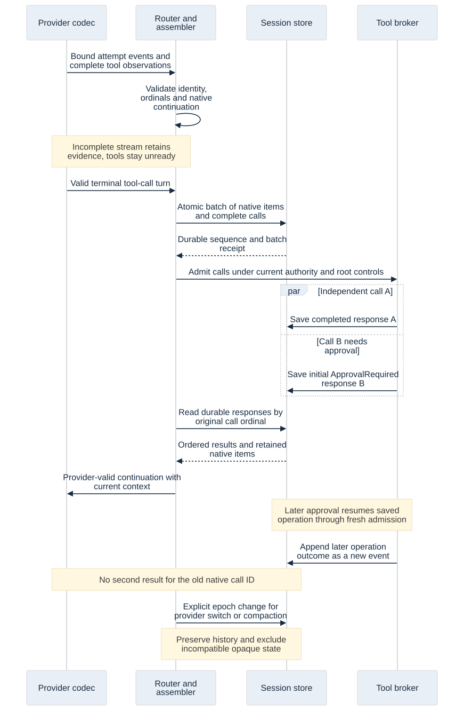
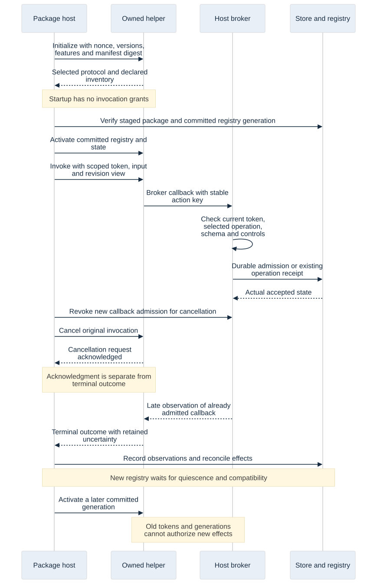

Current baseline update, 2 November 2026: [architecture feasibility review](architecture-feasibility-review.html) closes the design gates. All 347 operation input/result candidates now exist, including SystemOne. Anthropic API and opt-in direct Claude subscription are distinct profiles; no CLI adapter is adopted. The original probe results below retain their scope.

Current baseline 1.1 adds [incoming MCP server contracts](mcp-server-contracts.html) and four typed internal administration operations. The current register has 352 operations in 48 families; historical counts below describe their original checkpoints. New MCP transport/authentication/client behavior remains DW-063/064 implementation acceptance.

# Provider, session and package boundary contracts

Current coverage update, 2 November 2026: the [domain schema pass](domain-operation-contracts.html) now provides all 347 input/result candidates in 44 schemas, with zero unbound inputs. Counts and next-step statements below describe this reader's earlier checkpoint. Actual service/authority/SDK/provider/platform acceptance remains unqualified.

Adopted architecture candidate `1.0-draft.1`, 1 November 2026 · AD 52–55. Confidence: high in the boundary semantics; actual provider transports, production session store, SDK services, native authority and platform qualification remain pending. No inference or real provider request was executed.

Success for this pass is a concrete, reusable message model for inference/continuation/history and all package contribution categories, plus native DTO and owned-process protocol experiments. This extends the [shared operation contracts](shared-operation-contracts.html); it does not replace their authority, receipt, root-control or recovery rules. The [schema manifest](contracts/manifest.json) records generated files and exact digests. Schema identifiers name local contracts, not network endpoints.

## Data ownership and message direction

| Boundary | Concrete candidate | Trusted producer and acceptance rule |
| --- | --- | --- |
| Caller/package to router | `InferenceSpec` | Requested content/session and constraints are untrusted. Resolve artifacts, registered tool schemas, session ownership and permissions before admission. No caller-supplied purpose, budget owner or grant is accepted here. |
| Router to transport | `InferenceRequest` | Host creates logical request ID, purpose and attribution after admission. Generation and embeddings are distinct variants; service embeddings require no fabricated conversation or conversational pin. |
| Provider codec to host | `ProviderCodecEvent` | Untrusted decoded observations with request/attempt and call identity. Validate against the current transport/invocation. A codec cannot declare usage free, choose its billing owner or dispatch a host tool. |
| Router/transport normalization to engine | `ProviderEvent` | Host binds selected connection/account/profile/model/context, event sequence and current request/attempt. The host classifies reported/estimated/free/untracked/unknown cost and records its provenance. |
| Session writer to repository | `TranscriptBatch` | Host-owned append with batch identity, current context epoch and expected next sequence. Commit calls/results/native references/checkpoint together; never accept a package-supplied transcript as authoritative history. |
| User message / history query | `SessionCommandRequest`, `SessionQueryRequest`, `TranscriptPage` | Public message input contains content, target and expected revision, with no actor/role/host-notice fields. History is bounded and stamped under current visibility. |
| Host to package | `HostRequest` | Initialize/activate/invoke/cancel/shutdown. Process/session/registry/state/control/authority metadata comes from the host and is descriptive; callbacks still require current host lookup. |
| Package to host | `PackageRequest`, `PackageNotification` | Broker call/state requests and progress/event/credit notifications are untrusted. Match process session, invocation token, current registry/state and permitted operation on every callback. |
| Either request direction | `RpcResponse` | Exactly one terminal response to an outstanding request ID, with a method-appropriate result or error. Progress, cancel acknowledgment and a contribution's claimed success are not proof of completed work. |
| UI/agent to package lifecycle service | `AddonCommandRequest` / reply | Typed install/update/enable/disable/rollback/uninstall intent, expected registry/state revisions and immutable source references. Current trust, exact-version approval, permissions and state compatibility determine staging/activation. |

`CommandReply<D>` and `Receipt<D>` share receipt headers while each domain supplies its own closed decision type. Root-control responses stay root-specific; saving a message returns its session/entry identity, and package staging returns its actual activation/wait state. Avoid a generic success object that makes a saved message, started coordinator and installed executable look equivalent.

## Inference identity, pricing and capabilities

Generation input references the context snapshot, session/epoch, stable tool alias table and schema digests, required images/parallel calls and response headroom. Embedding input references a nonempty bounded artifact batch and exact embedding space/dimensions. Schema validity does not certify capability support. The router resolves the actual endpoint/access mode and rejects unsupported required semantics before dispatch.

Host-owned attribution distinguishes workspace, feature, issue, job and service work. Feature requests retain project/root/assignment and optional originating job-run links. A scheduled agent's own scan is job usage; work it dispatches into a feature is feature-owned and remains budgeted there. A caller cannot relabel it by placing attribution inside an `InferenceSpec` or broker artifact. Purpose lanes, pricing and conversational pin effects follow the existing router policy.

Codecs report raw nullable token/cache counts and an optional provider-reported decimal cost/currency. The host preserves unknown versus zero, applies local-free/custom-untracked/subscription-estimate policy, selects the recorded rate snapshot and charges each attempt once. Cache accounting is endpoint-specific; do not assume one provider's input count includes or excludes cache writes exactly like another's. This schema does not authorize a currency conversion or manufacture a price. Late cost observations append ledger evidence; they do not rewrite an old terminal response.

The request also carries explicit selection/effort/structured-output options and bounded deadline, with host instruction/control/authority/cancellation revisions. `RouteDecision`, `AttemptEnvelope` and `CapabilitySnapshot` bind access mode, account/model/profile, catalog/capability/credential/policy/pin revisions, capacity grant, pricing basis and cache epoch. Unknown capability support remains explicit and cannot satisfy a required modality/tool contract. Native request artifacts exclude credentials; the host injects authentication only at send time.

A normalized stream binding includes connection identity, account revision, exact endpoint profile, actual model identity and context epoch. Subscription Responses/Messages profiles are distinct from public API profiles. The codec cannot change that binding in the middle of an attempt. A replacement attempt has new identity and separately attributed partial output/usage; UI/history never concatenate it into the old partial answer.

## Stream completion, tool admission and native continuation

A complete tool-call observation contains the provider call identity, recorded ordinal, host capability ID, registered input schema and immutable argument/native-item references. The provider ID is bounded provider text, not a host-generated work ID or a capability. Resolve the wire alias through the frozen schema table; reject duplicate native IDs or ordinals and foreign attempts. Validate actual argument content against the registered schema; an artifact reference alone is not argument validation.

The default path waits for a valid terminal tool-call turn. A `ToolCallComplete` observation is neither dispatch permission nor evidence that the envelope is already durable. Persist the call/native material, then pass ordinary broker admission with current root controls, ownership, instruction/plan/policy revisions, approval, budget and resource checks. Earlier per-call dispatch remains an explicit per-profile capability requiring stable complete arguments/native continuation and durable admission; this probe does not qualify it.

Use the official wire semantics at the transport adapter:

- [Official OpenAI documentation: Responses streaming events](https://developers.openai.com/api/reference/resources/responses/streaming-events) distinguishes finalized function arguments from the terminal response status. The adapter must validate the terminal response and preserve required native output items.
- [Claude streaming](https://platform.claude.com/docs/en/build-with-claude/streaming) distinguishes block-level input/signature deltas, stop reason and message completion. A stopped block alone is not a completed message.
- [OpenRouter streaming](https://openrouter.ai/docs/api_reference/streaming) includes SSE comments and stream errors. Its supported endpoint profiles are explicit; a provider brand or a bare terminal marker cannot establish successful complete output.

These references guide API adapters. They do not qualify subscription authentication, endpoint parity, request options, real cache behavior or live compatibility. The source audit at simple-router revision `a556b3531b577173195bbc3876b556196447721d` remains the retained-behavior reference; source/reference drift must be reconciled before a transport is frozen.

`Completed`, `ToolCallsReady`, `Incomplete`, `Cancelled`, `Failed` and `OutcomeUnknown` remain distinct. A completed tool-call observation followed by EOF/incomplete/error is retained without becoming default-dispatchable. A post-terminal content event or changed attempt/binding is invalid. Adapters absorb legitimate trailing usage before emitting the normalized terminal event; later asynchronous usage is a separate attributed observation. Heartbeats prove transport activity only.

Native continuation is an immutable artifact plus the exact binding, not plain assistant text. Preserve required opaque/signature/encrypted items in their provider-native structure. Never expose hidden reasoning as a promised audit transcript. A different connection/account/profile/model/context cannot reuse an opaque item merely because its display model name matches. Explicit provider-compatible exceptions would need a qualified capability, not a guessed conversion. Cross-provider reconstruction uses visible directions, approved work, call/result receipts and unresolved operations in a new context epoch, excluding foreign opaque state.

## Transcript transactions and one response per native call

Order session entries by committed per-session sequence; transport event sequence and global store history sequence are separate counters. `TranscriptBatch` binds session, batch ID, context epoch and expected next sequence, with contiguous unique entry identities. The write owner checks the batch receipt before sequence CAS. Equal replay returns the original append outcome; changed payload under that batch ID is a conflict. A failed tail cannot leave an accepted prefix.

The entry variants cover user messages, attributed assistant attempts, complete tool calls, initial tool responses, host notices, native items, context-epoch changes and later operation updates. A public message operation cannot request a host notice, change its actor/role, fabricate a tool result or adopt a new context epoch. Home and sidebar keep the same session identity and append boundary.

A call key is `(attemptId, nativeCallId)` with its recorded ordinal. An initial result must match a durable call and appear once. Out-of-order completion is valid; assemble provider results by the saved ordinal. `ApprovalRequired` closes that call's initial response truthfully while its operation waits. Later approval/outcome is an operation update and supported new context exchange, never a second result for the old native call ID. Preserve known completed results through sibling failure, pause or provider restart.

A context switch records previous/next epoch, reason and immutable context snapshot. Compaction, provider change and instruction adoption do not rewrite the original transcript or authorize changed work. The host owns that transition, checks current session/instruction revisions and preserves the 80% compaction rule and protected constraints. Late native observations may be retained as old-bound evidence in current history; only compatible current bindings may enter a new inference request.

Transcript pages expose revision/freshness and a visibility-bound cursor. Opaque native artifacts are restricted transport material; UI/agent access shows permitted metadata or visible content rather than dumping opaque internals. The native in-memory append model checks ordering, duplicate receipts/call results, failure atomicity and explicit epoch changes. Actual SQLite session repository, durable stream-tail bounds, upcasters, access filtering and crash recovery remain acceptance work.

## Package manifest and contribution coverage

A manifest declares package/publisher/version, protocol/host compatibility, target binaries, digest-bound files, dependencies and runtimes, schema assets, configuration/state schemas, Help, requested limits/permissions and all contributions. Validate semantic versions/ranges, namespaced uniqueness, exact file membership, case aliases, relative paths and schema digests. Actual archive/signature verification, platform path identity, dependency closure and runtime discovery remain host service checks before launch. The helper's digest reply is not cryptographic proof of installed bytes.

All eight retained contribution categories have closed descriptor variants: semantic indexer, tool, workflow/gate, event handler, context/compaction hook, declarative skill/role/prompt, provider codec and native UI. References to bulk content and dynamic arguments use immutable artifacts plus registered schema identity/digest. This keeps the control channel bounded without turning arbitrary JSON into a privileged escape hatch.

Tool effect classification is requested metadata. `ReadCandidate` does not add a tool to the verified-read reviewer set. Verification `passed=true` is a claim that must match registered evidence/source revisions. Event-processed notifications require a corresponding durable host processing receipt; they cannot advance required work over failed effects. Context proposals reference frozen inputs and pass host constraint validation before adoption. Agent-authored roles/skills keep their separate exact-content approval.

Native UI uses a closed tree of text/groups/fields/actions/tables/images, with bounded depth, node/child/text/column limits and registered action/data bindings. No package supplies an egui object, WebView, HTML/JavaScript execution or a protected confirmation dialog. An action may request an ordinary operation; only the host's dedicated human interaction can mint approval/Continue/destructive-operation authority. Registration checks referenced actions, schema assets and Help before publishing the complete candidate registry.

Requested memory/concurrency/queue limits are bounded admission inputs. Report which process/resource controls the target actually enforces; declarations and separate processes do not prove an OS sandbox or hard memory containment. Limits do not create a global subagent-count cap.

## Framing, handshake and callback authority

Keep the already adopted JSON-RPC 2.0 profile: four-byte unsigned **little-endian** length, then one UTF-8 JSON object, maximum 1 MiB control payload. Reject zero/oversized lengths before allocating a body, truncated/invalid input, duplicate members, batches and malformed envelopes. [JSON-RPC 2.0](https://www.jsonrpc.org/specification) supplies request/response/notification rules; DevWorks adds framing, negotiation, flow control and invocation authority. MCP newline stdio remains a separate transport.

The host owns the process session nonce and each direction's request namespace (`<session>:h:<id>` or `<session>:p:<id>`). Match one outstanding request, method and result variant; duplicate/unknown terminal responses fail the session. Standard parse/invalid-request errors can have a null response ID; successful responses cannot. Uncorrelatable malformed framing can close the session without inventing an invocation outcome.

Initialize negotiates protocol/features/frame limits and checks the preverified manifest/inventory. Startup alone has no grants. Activate exposes only an already committed registry/state/configuration generation. Invoke supplies the immutable input, operation identity, descriptive scope/allowed operation view and short-lived token. A package cannot make those views authoritative by echoing or editing them in a callback.

The host resolves every callback against current process/session/invocation, token lifetime/revocation, contribution role, registry/state/control/policy revisions and granted scope. Broker application arguments use registered schemas and normal application admission. Broker HTTP uses a host-owned connection handle/endpoint and validated relative target; absolute/protocol-relative URLs, endpoint escape or credential injection are rejected. Codec invocations cannot recursively invoke inference to encode their own pending request; other nested inference retains ancestry/cycle/depth admission.

State access is package-scoped read or CAS proposal against the pinned state generation/revision. No raw SQLite, unrestricted state path or arbitrary host callback is exported. State writes, invocation receipts and follow-up effects use the existing transaction/outbox boundary. A package response cannot declare its own state generation committed.

### Atomic event handler commit

**AR-07 engineering refinement:** an event invocation that changes state, admits effects or advances its checkpoint must submit one `broker.commit_event` request. Its `EventCommit` carries the current process/invocation/token, subscription/event identity, expected checkpoint, pinned state generation, expected state revision, optional immutable state proposal and at most 64 typed `EventIntent { actionKey, call: BrokerCall }` entries. Empty proposals/intents support a handler that only records processing. Intent keys must be unique; ordinary broker schemas, relative HTTP targeting and current permissions still apply. Neither an artifact nor a token supplied by the package creates authority.

The host resolves the actual package/version/subscription/partition from its invocation. Validate the delivered event, consumer ordering, generation, CAS revision, state schema and every intent before committing anything. State CAS and effectful `broker.call` are rejected for an event invocation outside this commit path; read callbacks remain available. A handler must not separately publish state or effects and then claim an atomic checkpoint through a notification.

One SQLite transaction commits the state change, durable operation/outbox intents, processing receipt and subscription checkpoint, with a unique `(package, subscription, event)` processing identity. Compare the expected checkpoint and state revision in that transaction. The host mints `EventCommitAccepted { processingReceipt, checkpoint, stateRevision, operationIds }` only after commit. Store a payload digest and the exact reply: identical replay returns the original receipt/operation IDs; changed replay is a conflict. A lost reply cannot establish rollback. Revoked/stale invocations cannot introduce a new commit; an authorized receipt lookup can still recover already committed results.

External effects execute after the local commit through ordinary operation admission; acceptance of their intents is not completion. Persist their outcomes independently and retain dependency gates for required failed/uncertain effects. The checkpoint records durable handling/admission, not successful remote completion. `EventProcessed` is an optional echo of a host receipt and has no state/checkpoint authority; verify its subscription/event binding. Crash before transaction commit leaves no state, receipt, intent or checkpoint; crash after commit reuses all four on replay. Unrelated state changes and later events cannot make an old processing receipt apply to another event. Native host, migration, authority and process-crash acceptance remain implementation work; DTO/schema checks alone do not establish this atomicity.

## Cancellation, credits and update boundaries

Cancel fences future broker effects and revokes the invocation token before signaling the helper. Its RPC acknowledgment reports receipt of the request. The original invocation still needs a terminal outcome or explicit uncertainty. Already admitted work may have completed; late results are evidence and must not erase committed effects or satisfy superseding work. After the existing cooperative deadline, terminate/reap the owned helper tree where qualified and reconcile every interrupted invocation separately.

Credit belongs to `(processSession, invocation, stream)` and monotonically numbered grants. Maintain a capped outstanding byte window (initial maximum 256 KiB per stream), decrement on actual accepted data and reject duplicate/out-of-order grants, overflow and revoked/foreign invocation use. Different invocations may use the same local stream name independently. Progress can coalesce with a dropped-count marker; terminal results and required events cannot disappear under backpressure. Full bulk transfer/credit consumption and overload qualification remain pending.

A complete candidate registry/state generation can replace the active one only at the adopted quiescent boundary. New invocations wait during the barrier; in-flight invocations retain their pinned registry/state. A failed candidate preserves the old generation. Late old-generation output cannot publish new contributions or advance current state. The native helper experiment refuses activation while a callback is in flight and fences old generations after activation; it does not implement durable atomic registry/state publication or production rollback.

Initial install/update/rollback requests return their real staged/wait/activated state. Applicable explicit publisher trust permits only compatible signed updates without expanded access/prerequisites; agent-authored changed contents still require exact-version approval. A major/prerelease/authority/state incompatibility is not approved merely by SemVer ordering. Rollback preserves authored state/effects and refuses incompatible downgrades. None of this changes explicit app installation/restart approval.

## Validation and handoff

[Evidence and reproduction](validation/provider-package-contracts/README.md) distinguish four layers: generated schemas/native DTOs; native in-memory stream/history models; actual owned-helper framing/RPC; and still-unexecuted production services/adapters/platform qualification. All use deterministic fixture data without inference or external effects.

The [family register](contracts/family-coverage.json) binds the new public session and package-lifecycle inputs and retains every remaining domain operation. Internal router/codec/process messages are labeled internal; they do not pretend to finish UI configuration, endpoint transports, all package service behavior or the public SDK. The next [data/delivery pass](data-retrieval-delivery-contracts.html) records graph/retrieval/artifact/delivery candidates and limited native feasibility. The complete domain contracts and 61-slice local breakdown now exist; actual service adoption remains implementation acceptance. Native auth/live provider compatibility, full SDK contribution execution, target sandbox/process behavior and performance remain explicit acceptance work.

## Router selection correction

Confirmed ROUTE-18–20 adds direct Max/High/Mid/Low pool intent, named models and independent effort. Pool IDs represent tiers directly; named-model intent is never translated to a tier. Open Router Auto is an explicit upstream route. Retain requested/effective effort and existing session pins. SystemOne (for example Jev) uses its separate structured decision profile and the subsequently completed native input/result candidates, plus model/capability discovery; it does not join chat tiers. See [the router contract](devworks-architecture.html#direct-tier-selection-effort-and-systemone). Prior schema/model success does not cover this newly explicit decision boundary.

## Anthropic connection profiles and risk admission

AD72 adopts `AnthropicMessages` with API-key access and independent `ClaudeSubscriptionMessages` with direct simple-router-compatible subscription access. The latter is unsupported third-party use and disabled until an authenticated human accepts the connection/account/profile-bound current notice. `router.configure` has a `SubscriptionRisk` action carrying connection revision, notice digest and acceptance intent; the body itself grants no human authority. `ConnectionRecord` exposes host-derived acceptance and notice digest. The host rejects stale/forged acceptance and disables it after account/profile/notice changes, revocation or restore. Normal same-account token refresh does not revoke it.

Never import subscription beta/identity rewriting into the API-key profile, share secrets across profiles, silently change billing or reuse opaque continuation across these distinct bindings. Explicit route policy may include either or both and must expose access mode and pricing classification. Key replacement/removal uses SecretStore and advances credential revisions; subscription retains PKCE/exchange/serialized rotation. API usage is reported or estimated metered usage; subscription accounting remains an API-equivalent estimate. SDK provider codecs use host-owned connection handles and cannot accept this risk or resolve arbitrary credentials themselves.
